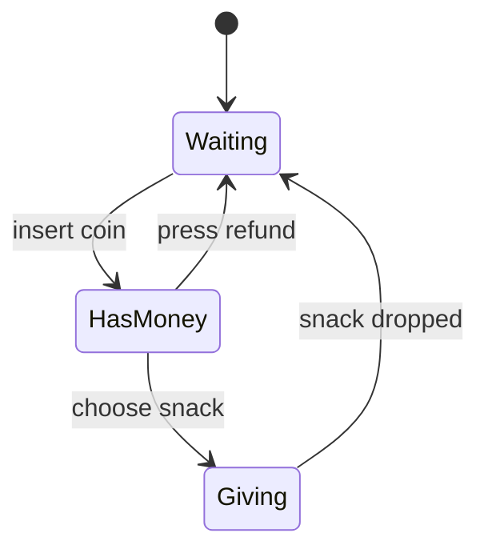

# Computational Thinking

[[Phase 1 - Start Here|Home]] · **Next:** [[02 Variables, Types and Expressions]] → · [[Software Engineering Roadmap#Computational Thinking|Roadmap card]]

> [!abstract] After this note, you can
> Take a problem that looks big and turn it into small, clear steps that a computer could follow.

## The Big Idea

A computer is extremely fast and extremely literal. It does **exactly** what you say, and nothing more. It has no common sense.

Imagine telling a robot to "make tea". The robot does nothing, because it doesn't know what tea is. You would need to say: fill the kettle, turn it on, wait until the water boils, put a tea bag in a cup, pour the water.

If you forget "put a cup on the table", the robot pours boiling water onto the table. It will not stop and ask why.

**Computational thinking** means thinking about a problem so clearly that even this robot could solve it. You do this before you write any code.

It has four main skills:

| Skill | Simple meaning | Tea example |
|---|---|---|
| [[#1. Decomposition]] | Break it into small parts | Boil water, prepare cup, pour |
| [[#2. Pattern Recognition]] | Notice what repeats | Coffee is nearly the same steps |
| [[#3. Abstraction]] | Keep what matters, ignore the rest | The cup's color doesn't matter |
| [[#4. Algorithms]] | Write exact steps in order | Step 1, step 2, step 3 |

## 1. Decomposition

**Decomposition** means breaking a big problem into smaller problems. Then you solve each small one.

> [!example] Example: build a school quiz app
> "Build a quiz app" feels impossible. But look what happens when you break it down:
> 1. Store the questions and answers.
> 2. Show one question.
> 3. Read what the user types.
> 4. Check if the answer is correct.
> 5. Keep a score.
> 6. Repeat for all questions.
> 7. Show the final score.
>
> Each of these steps is small enough to solve. Step 3 is a single line of code!

If a step still feels too hard, break that step down again. Keep going until each piece feels easy.

## 2. Pattern Recognition

**Pattern recognition** means noticing that things are similar, so you can solve them in the same way.

> [!example] Example: repeating work
> Suppose you must add a 10% discount to 500 products. You don't need 500 different solutions. Each product follows the same pattern:
>
> `new price = old price - (old price × 0.10)`
>
> Solve it once, then repeat it 500 times.

When you notice yourself doing the same thing again and again, a pattern is waiting to be found. In code, you handle patterns with [[03 Conditions and Loops|loops]] and [[04 Functions and Scope|functions]].

## 3. Abstraction

**Abstraction** means keeping only the details that matter for your problem, and ignoring the rest.

> [!example] Example: a metro map
> A metro map doesn't show every building, tree or road. It shows only stations and lines, because that is all you need to plan a trip. The map is a useful **model** of the real city.

In the same way, say you build a library system. What do you need to know about a book?

- **Needed:** title, author, is it borrowed?
- **Not needed:** the book's weight, or the smell of its pages

A **model** is this simplified version of the real thing. Choosing what to keep is one of the most important decisions in software.

## 4. Algorithms

An **algorithm** is a list of exact steps that solves a problem. A cooking recipe is an algorithm. So are the directions to a friend's house.

A good algorithm is:

- **Clear:** each step has only one meaning.
- **In order:** the order is correct.
- **Finite:** it finishes at some point.

> [!example] Example: find the largest number in a list
> Numbers: `4, 9, 2, 7`
>
> 1. Remember the first number as the "largest so far". (4)
> 2. Look at the next number.
> 3. If it is bigger than the largest so far, remember it instead.
> 4. Repeat steps 2 and 3 until there are no more numbers.
> 5. The answer is the largest so far.

Follow it by hand:

| Looking at | Largest so far |
|---|---|
| 4 (start) | 4 |
| 9 | 9, because 9 is bigger than 4 |
| 2 | 9, no change |
| 7 | 9, no change |

The answer is 9. Here is the same algorithm in Python. You don't need to understand the code yet. Just see how closely it follows the steps:

```python
numbers = [4, 9, 2, 7]

largest = numbers[0]
for number in numbers:
    if number > largest:
        largest = number

print(largest)
```

Output:

```text
9
```

Writing steps in plain words first, like the list above, is called **pseudocode**. Good programmers do this all the time. It lets you think about the problem without worrying about code rules.

## State - What Is True Right Now

**State** means the information that describes something at this moment. When an event happens, the state can change. That change is called a **transition**.

> [!example] Example: a vending machine
> A vending machine is always in one state. Each action moves it to another state.



Drawing the states shows you the questions you must answer. What if someone chooses a snack with no money? From `Waiting`, there is no "choose snack" arrow, so the machine ignores it. A lot of bugs happen because a programmer forgot a state or a transition.

Other things with state: a light switch (on, off), an online order (paid, shipped, delivered), and a game character (alive, dead).

## How Computers Store Everything

Computers store everything as **bits**. A bit is a tiny switch that is either 0 or 1. Eight bits make one **byte**. So how can 0s and 1s mean numbers, text and pictures? We agree on what they mean.

**Numbers in binary.** We normally count with ten digits. Computers count with two digits. Each position is worth double the one to its right.

| Worth | 8 | 4 | 2 | 1 | Total |
|---|---|---|---|---|---|
| Number 5 | 0 | 1 | 0 | 1 | 4 + 1 = 5 |
| Number 6 | 0 | 1 | 1 | 0 | 4 + 2 = 6 |
| Number 13 | 1 | 1 | 0 | 1 | 8 + 4 + 1 = 13 |

**Letters are numbers too.** We agree that one number means each letter. For example, `A` is 65.

```python
print(bin(13))
print(ord("A"))
print(chr(66))
```

Output:

```text
0b1101
65
B
```

(`0b` just means "this number is in binary".)

**Bigger things are made from smaller things.** A photo is a grid of colored dots, and each color is a set of numbers. A student record can be a name (text), an age (number) and marks (a list of numbers). You'll build these structures in [[05 Lists, Strings and Dictionaries]].

## Common Mistakes

> [!warning] Watch out for these
> - **Starting to code right away.** Five minutes of planning can save you hours.
> - **Steps that are not exact.** "Check the numbers" is not clear. "Check if the number is above 100" is clear.
> - **Forgetting unusual cases.** What if the list is empty? What if the user types a letter instead of a number?

## Practice

**1. Decompose.** Break "plan a birthday party" into at least 5 smaller steps.

**2. Write an algorithm.** Write exact steps to find the **smallest** number in a list.

> [!example]- Answer to question 2
> 1. Remember the first number as the "smallest so far".
> 2. Look at each of the other numbers, one at a time.
> 3. If a number is less than the smallest so far, remember it instead.
> 4. When no numbers are left, the answer is the smallest so far.
>
> Notice the pattern: this is nearly the same as finding the largest. Only "bigger" changed to "less".

**3. Abstract.** You are building a parking lot app. Which of these details do you need: car plate number, entry time, car color, driver's favorite song, parking spot number?

> [!example]- Answer to question 3
> You need the plate number, entry time and spot number. Car color could be useful, but it isn't required. The song doesn't matter.

**4. State.** Draw the states of a parking lot spot. What events move it from one state to another?

> [!example]- Answer to question 4
> One good answer has two states, **Free** and **Taken**.
> - A car arrives: Free → Taken
> - The car leaves: Taken → Free
>
> You could also add a **Reserved** state or a **Broken** state. There's often more than one good model.

**5. Binary.** What number is `1010` in binary?

> [!example]- Answer to question 5
> The positions are worth 8, 4, 2, 1. Here 8 + 2 = **10**.

## Can You Do This?

- [ ] Explain the four skills with your own examples
- [ ] Break a new problem into small steps
- [ ] Decide which details matter when you model something
- [ ] Write an algorithm in plain words that another person could follow
- [ ] Draw a simple state diagram
- [ ] Explain how a computer can store numbers and letters as bits

## Summary

> [!success] Remember
> - **Decomposition:** break it down.
> - **Pattern recognition:** find what repeats.
> - **Abstraction:** keep only what matters.
> - **Algorithm:** write exact steps in order.
> - **State:** know what is true right now, and what changes it.

**Next:** [[02 Variables, Types and Expressions]] →
