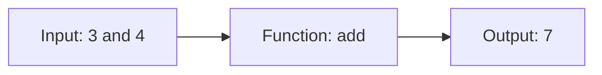

# Functions and Scope

← [[03 Conditions and Loops]] · [[Phase 1 - Start Here|Home]] · **Next:** [[05 Lists, Strings and Dictionaries]] → · [[Software Engineering Roadmap#Programming Fundamentals|Roadmap card]]

> [!abstract] After this note, you can
> Package code into named, reusable pieces, which is how all real programs are built.

## The Big Idea

A **function** is a named block of code that does one job. Think of a juice machine. You put fruit **in**, the machine does its work, and juice comes **out**. You don't need to know what happens inside. You just use it.



You've already used functions: `print()`, `len()` and `int()` were all written by someone else. Now you will write your own.

## Writing a Function

```python
def greet():
    print("Hello!")
    print("Welcome to the class.")

greet()
greet()
```

Output:

```text
Hello!
Welcome to the class.
Hello!
Welcome to the class.
```

There are two separate steps here:

1. `def` **defines** the function. This teaches Python the recipe. Nothing runs yet.
2. `greet()` **calls** the function. This is when the code actually runs.

## Parameters - Giving a Function Input

**Parameters** are the names a function uses for its inputs. The real values you pass in are called **arguments**.

```python
def greet(name):
    print(f"Hello, {name}!")

greet("Sam")
greet("Priya")
```

Output:

```text
Hello, Sam!
Hello, Priya!
```

Here `name` is the parameter. `"Sam"` is the argument. A function can have several parameters, and they can have **default values**:

```python
def make_tea(cups, sugar=1):
    print(f"Making {cups} cups with {sugar} sugar each")

make_tea(2)
make_tea(2, 3)
make_tea(cups=1, sugar=0)
```

Output:

```text
Making 2 cups with 1 sugar each
Making 2 cups with 3 sugar each
Making 1 cups with 0 sugar each
```

## Return - Getting a Result Back

`return` sends a value back to the code that called the function. It also ends the function at once.

```python
def add(a, b):
    return a + b

result = add(3, 4)
print(result)
print(add(10, 20) * 2)
```

Output:

```text
7
60
```

> [!important] `print` and `return` are very different
> - `print` shows text on the screen, for a human to read.
> - `return` gives a value back, for the program to use.

```python
def add_and_print(a, b):
    print(a + b)

def add_and_return(a, b):
    return a + b

x = add_and_print(1, 2)
y = add_and_return(1, 2)

print(x)
print(y)
```

Output:

```text
3
None
3
```

`add_and_print` showed 3 on the screen, but gave nothing back. That is why `x` is `None`. If you want to use the result later, you need `return`. Most functions should `return` their result and leave printing to other code.

> [!example] Worked example: a function that makes a decision
> A function can return early. Once a `return` runs, the function is finished.

```python
def get_grade(mark):
    if mark >= 75:
        return "A"
    if mark >= 50:
        return "C"
    return "F"

print(get_grade(90))
print(get_grade(60))
print(get_grade(10))
```

Output:

```text
A
C
F
```

## Why Functions Are So Useful

- **Reuse:** write it once, and use it many times.
- **Names:** `get_grade(mark)` explains itself.
- **Small pieces:** this is [[01 Computational Thinking#1. Decomposition|decomposition]] in code. Each function solves one small problem.
- **One place to fix:** if the tax rule changes, you change one function.
- **Easy to test:** you can check each function alone. See [[11 Unit Testing Basics]].

> [!example] Before and after

Before, the same logic appears twice. Mistakes in one copy are easy to miss:

```python
price_a = 100
price_b = 250

total_a = price_a + price_a * 0.18
total_b = price_b + price_b * 0.18

print(total_a, total_b)
```

After, the rule has one home and one clear name:

```python
def add_tax(price):
    return price + price * 0.18

print(add_tax(100), add_tax(250))
```

Output:

```text
118.0 295.0
```

> [!tip] Rules for good functions
> - A function does **one** job. If you need "and" to describe it, think about splitting it.
> - Use a verb for the name, such as `get_grade` or `save_file`.
> - Keep it short enough to read without scrolling.

## Scope - Where a Name Exists

**Scope** means the part of the program where a variable can be seen. A variable made inside a function is **local**. It exists only inside that function, and it disappears when the function ends.

Think of a house. What you put in your bedroom stays in your bedroom. People outside can't see it.

```python
def calculate():
    secret = 42
    return secret + 1

print(calculate())
print(secret)
```

Output:

```text
Traceback (most recent call last):
  File "main.py", line 6, in <module>
    print(secret)
NameError: name 'secret' is not defined
```

Before the crash, you'd see `43` printed. Then `print(secret)` fails, because `secret` doesn't exist outside the function.

Variables outside all functions are **global**. A function can read them, but assigning to the same name inside the function makes a new, separate local variable:

```python
score = 10

def change_score():
    score = 99
    print(f"Inside: {score}")

change_score()
print(f"Outside: {score}")
```

Output:

```text
Inside: 99
Outside: 10
```

> [!tip] The clean way
> Pass values **in** through parameters. Send results **out** with `return`. Then a function depends only on what you give it, so it's much easier to understand and test.

```python
def add_bonus(score, bonus):
    return score + bonus

score = 10
score = add_bonus(score, 5)
print(score)
```

Output:

```text
15
```

## Recursion

**Recursion** is when a function calls itself. Each call solves a slightly smaller version of the same problem.

Imagine you're in a long line and want to know your position. You ask the person in front: "What's your position?" They ask the person in front of them, and so on. The first person says "I'm number 1". Then the answer comes back: 2, 3, 4...

Every recursive function needs two parts:

- **Base case:** the simple case with no more calls. This stops the recursion.
- **Recursive case:** the function calls itself with a smaller problem.

```python
def countdown(number):
    if number == 0:
        print("Go!")
        return
    print(number)
    countdown(number - 1)

countdown(3)
```

Output:

```text
3
2
1
Go!
```

> [!example] Worked example: factorial
> The factorial of 4 is written `4!`. It means 4 × 3 × 2 × 1 = 24. Notice that `4! = 4 × 3!`. The problem contains a smaller version of itself.

```python
def factorial(n):
    if n <= 1:
        return 1
    return n * factorial(n - 1)

print(factorial(4))
```

Output:

```text
24
```

Here is what happens, step by step:

```text
factorial(4)
= 4 * factorial(3)
= 4 * 3 * factorial(2)
= 4 * 3 * 2 * factorial(1)
= 4 * 3 * 2 * 1
= 24
```

> [!warning] Don't forget the base case
> Without a base case, the function calls itself until Python stops it with a `RecursionError`. Recursion can be confusing at first, so don't worry if it takes time. You will use it heavily in Phase 2 with trees and graphs.

## Common Mistakes

> [!warning] Watch out for these
> - Writing `greet` instead of `greet()`. Without the brackets, the function doesn't run.
> - Using `print` when you need `return`.
> - Calling a function before its `def` line has run.
> - Using a local variable outside its function.
> - Writing huge functions that do many jobs.

## Practice

**1. Largest of three.** Write `largest(a, b, c)`, which returns the largest of three numbers. Don't use Python's `max`.

> [!example]- Answer to question 1
> ```python
> def largest(a, b, c):
>     biggest = a
>     if b > biggest:
>         biggest = b
>     if c > biggest:
>         biggest = c
>     return biggest
>
> print(largest(3, 9, 5))
> ```
>
> Output:
>
> ```text
> 9
> ```

**2. Is it a prime number?** Write `is_prime(n)`, which returns `True` if `n` can only be divided by 1 and itself. Hint: try dividing `n` by every number from 2 up to `n - 1`.

> [!example]- Answer to question 2
> ```python
> def is_prime(n):
>     if n < 2:
>         return False
>     for divisor in range(2, n):
>         if n % divisor == 0:
>             return False
>     return True
>
> print(is_prime(7))
> print(is_prime(9))
> ```
>
> Output:
>
> ```text
> True
> False
> ```

**3. Predict.** What does this print, and why?

```python
def double(x):
    x = x * 2

number = 5
double(number)
print(number)
```

> [!example]- Answer to question 3
> It prints `5`. `double` changes its own local `x`, and it doesn't return anything. To fix it, write `return x * 2` and `number = double(number)`.

**4. Recursion.** Write a recursive function `sum_to(n)` that adds up all the numbers from 1 to `n`.

> [!example]- Answer to question 4
> ```python
> def sum_to(n):
>     if n == 0:
>         return 0
>     return n + sum_to(n - 1)
>
> print(sum_to(4))
> ```
>
> Output:
>
> ```text
> 10
> ```

## Can You Do This?

- [ ] Define and call a function with parameters
- [ ] Use a default parameter value
- [ ] Explain the difference between `print` and `return`
- [ ] Explain what local scope means
- [ ] Split a long program into small functions
- [ ] Write a recursive function with a base case

## Summary

> [!success] Remember
> - A **function** takes input, does one job, and returns output.
> - `def` defines it. Brackets `()` call it.
> - `return` gives a value back. `print` only shows text.
> - Variables made inside a function stay inside.
> - **Recursion** needs a base case, or it never stops.

**Next:** [[05 Lists, Strings and Dictionaries]] →
