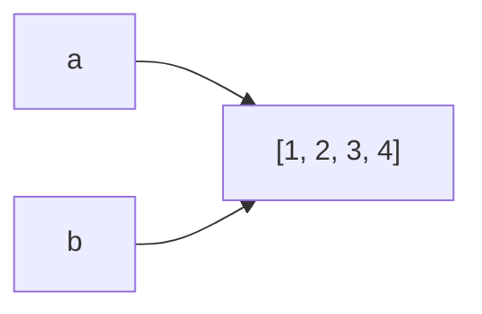

# Lists, Strings and Dictionaries

← [[04 Functions and Scope]] · [[Phase 1 - Start Here|Home]] · **Next:** [[06 Files, Errors and Modules]] → · [[Software Engineering Roadmap#Programming Fundamentals|Roadmap card]]

> [!abstract] After this note, you can
> Store and work with whole groups of data, not just single values. You'll also understand a surprise that confuses many beginners: references.

## Choosing the Right Container

So far, each variable has held one value. Real programs handle many values: all the students in a class, or all the words in a book.

| Container | Think of it as | Use it when | Example |
|---|---|---|---|
| **List** | A numbered shopping list | Order matters, or items repeat | `["milk", "eggs"]` |
| **String** | A list of letters | You have text | `"hello"` |
| **Dictionary** | A real dictionary: word and meaning | You look things up by a name | `{"age": 20}` |
| **Tuple** | A list that can't change | A fixed group of values | `(6.9, 79.8)` |
| **Set** | A bag with no duplicates | You care only about "is it in there?" | `{"red", "blue"}` |

## Lists

A **list** holds items in order. Other languages call a similar thing an **array**.

```python
fruits = ["apple", "mango", "banana"]

print(fruits[0])
print(fruits[2])
print(fruits[-1])
print(len(fruits))
```

Output:

```text
apple
banana
banana
3
```

> [!important] Counting starts at 0
> The first item is at **index** 0, not 1. In a list of 3 items, the last index is 2. An index of `-1` means "the last item". Try `fruits[3]` and you'll get an `IndexError`.

| Index | 0 | 1 | 2 |
|---|---|---|---|
| Item | apple | mango | banana |

### Changing a List

```python
tasks = ["wash", "cook"]

tasks.append("sleep")
print(tasks)

tasks[0] = "clean"
print(tasks)

tasks.remove("cook")
print(tasks)

last = tasks.pop()
print(last)
print(tasks)

print("clean" in tasks)
```

Output:

```text
['wash', 'cook', 'sleep']
['clean', 'cook', 'sleep']
['clean', 'sleep']
sleep
['clean']
True
```

### Slices - Taking a Part of a List

`items[start:stop]` gives you the items from `start` up to, but not including, `stop`. It works the same way as `range`.

```python
letters = ["a", "b", "c", "d", "e"]

print(letters[1:3])
print(letters[:2])
print(letters[3:])
print(letters[::-1])
```

Output:

```text
['b', 'c']
['a', 'b']
['d', 'e']
['e', 'd', 'c', 'b', 'a']
```

### Looping over a List

```python
marks = [70, 85, 60]

total = 0
for mark in marks:
    total = total + mark

average = total / len(marks)
print(f"Average: {average:.1f}")

print(sum(marks), max(marks), min(marks))
print(sorted(marks))
```

Output:

```text
Average: 71.7
215 85 60
[60, 70, 85]
```

If you also need the position, use `enumerate`:

```python
for position, name in enumerate(["Sam", "Priya"], start=1):
    print(f"{position}. {name}")
```

Output:

```text
1. Sam
2. Priya
```

> [!example] Worked example: keep only the passing marks
> The pattern is: make an empty list, loop, and add the items you want.

```python
marks = [40, 75, 52, 30, 90]

passed = []
for mark in marks:
    if mark >= 50:
        passed.append(mark)

print(passed)
```

Output:

```text
[75, 52, 90]
```

Python has a short way to write this, called a **list comprehension**. Learn the long way first.

```python
marks = [40, 75, 52, 30, 90]
passed = [mark for mark in marks if mark >= 50]
print(passed)
```

Output:

```text
[75, 52, 90]
```

## Strings

A **string** is text. It behaves much like a list of letters, so indexing and slicing work too.

```python
word = "Python"

print(word[0])
print(word[-1])
print(word[0:3])
print(len(word))
```

Output:

```text
P
n
Pyt
6
```

Strings have many helpful tools built in:

```python
text = "  Hello, World!  "

print(text.strip())
print(text.lower())
print(text.upper())
print(text.replace("World", "Sam"))
print("World" in text)

line = "apple,mango,banana"
parts = line.split(",")
print(parts)
print(" and ".join(parts))
```

Output:

```text
Hello, World!
  hello, world!  
  HELLO, WORLD!  
  Hello, Sam!  
True
['apple', 'mango', 'banana']
apple and mango and banana
```

> [!important] Strings can't be changed
> Strings are **immutable**, which means they can't be changed once made. `text.upper()` doesn't change `text`. It gives you a **new** string. To keep the result, save it: `text = text.upper()`.

> [!example] Worked example: count the vowels in a word

```python
def count_vowels(word):
    total = 0
    for letter in word.lower():
        if letter in "aeiou":
            total = total + 1
    return total

print(count_vowels("Programming"))
```

Output:

```text
3
```

## Dictionaries

A **dictionary** stores **key and value** pairs. You look up a value using its key, just as you look up a word to find its meaning. Other languages call this a **map** or **hash map**.

```python
student = {
    "name": "Sam",
    "age": 20,
    "city": "Colombo",
}

print(student["name"])

student["age"] = 21
student["email"] = "sam@example.com"

print(student)
print("city" in student)
print(student.get("phone", "not given"))
```

Output:

```text
Sam
{'name': 'Sam', 'age': 21, 'city': 'Colombo', 'email': 'sam@example.com'}
True
not given
```

Asking for a key that doesn't exist with `student["phone"]` gives a `KeyError`. Use `.get()` when a key might be missing.

**Looping over a dictionary:**

```python
prices = {"tea": 50, "cake": 120}

for item, price in prices.items():
    print(f"{item} costs {price}")
```

Output:

```text
tea costs 50
cake costs 120
```

> [!example] Worked example: count how many times each word appears
> This is one of the most common jobs in all of programming.

```python
text = "the cat and the dog and the bird"

counts = {}
for word in text.split():
    counts[word] = counts.get(word, 0) + 1

print(counts)
```

Output:

```text
{'the': 3, 'cat': 1, 'and': 2, 'dog': 1, 'bird': 1}
```

Read the middle line slowly: find the word's count so far (or 0 if it's new), add 1, then store it back.

### Combining Containers

Real data is usually a list of dictionaries:

```python
students = [
    {"name": "Sam", "mark": 72},
    {"name": "Priya", "mark": 88},
]

for student in students:
    print(f"{student['name']}: {student['mark']}")

best = max(students, key=lambda student: student["mark"])
print(f"Top student: {best['name']}")
```

Output:

```text
Sam: 72
Priya: 88
Top student: Priya
```

(`lambda` makes a tiny function with no name. Here, it tells `max` what to compare.)

## Tuples and Sets

A **tuple** is like a list, but it can't change. A **set** keeps only one copy of each value.

```python
location = (6.9, 79.8)
print(location[0])

colors = ["red", "blue", "red", "red"]
unique = set(colors)
print(len(unique))
print("blue" in unique)
```

Output:

```text
6.9
2
True
```

## Values and References - The Big Surprise

Run this and think about the result:

```python
a = [1, 2, 3]
b = a
b.append(4)

print(a)
```

Output:

```text
[1, 2, 3, 4]
```

We changed `b`, but `a` changed as well! Why?

A variable doesn't really hold a list. It holds a **reference**, which is a pointer to where the list lives in memory. Think of a house and its address. `b = a` copied the **address**, not the house. Both names point to the same house. Paint it through either name, and it's painted for both.



To get a separate list, make a copy:

```python
a = [1, 2, 3]
b = a.copy()
b.append(4)

print(a)
print(b)
```

Output:

```text
[1, 2, 3]
[1, 2, 3, 4]
```

**Mutable and immutable.** Lists and dictionaries are **mutable**, so they can be changed. Numbers, strings and tuples are **immutable**. That is why this surprise didn't happen in [[02 Variables, Types and Expressions#Practice|the practice question with numbers]].

The same rule applies to functions. A function that changes a list you pass in changes **your** list:

```python
def add_item(items):
    items.append("new")

my_list = ["old"]
add_item(my_list)
print(my_list)
```

Output:

```text
['old', 'new']
```

> [!note] Why this matters later
> Other languages make this more visible with **pointers**, especially C. Understanding this idea now will help with [[Software Engineering Roadmap#Memory Management|memory management]] in Phase 3.

## Common Mistakes

> [!warning] Watch out for these
> - Forgetting that indexes start at 0
> - Changing a list while looping over it. Build a new list instead.
> - Expecting `text.upper()` to change `text`
> - `new_list = old_list` doesn't copy. Use `.copy()`
> - Using a list to find things by name, when a dictionary would be simpler

## Practice

**1. Reverse a string.** Write `reverse(text)` using a loop, without `[::-1]`.

> [!example]- Answer to question 1
> ```python
> def reverse(text):
>     result = ""
>     for letter in text:
>         result = letter + result
>     return result
>
> print(reverse("hello"))
> ```
>
> Output:
>
> ```text
> olleh
> ```

**2. Remove duplicates, keep the order.** Given `[3, 1, 3, 2, 1]`, produce `[3, 1, 2]`.

> [!example]- Answer to question 2
> ```python
> numbers = [3, 1, 3, 2, 1]
>
> seen = []
> for number in numbers:
>     if number not in seen:
>         seen.append(number)
>
> print(seen)
> ```
>
> Output:
>
> ```text
> [3, 1, 2]
> ```

**3. Phone book.** Make a dictionary of three names and phone numbers. Ask the user for a name, and print the number, or print "not found".

> [!example]- Answer to question 3
> ```python
> phone_book = {"Sam": "0771", "Priya": "0772", "Ali": "0773"}
>
> name = input("Name: ")
> print(phone_book.get(name, "not found"))
> ```

**4. Predict.** What does this print?

```python
x = [1, 2]
y = x
y = [9, 9]
print(x)
```

> [!example]- Answer to question 4
> It prints `[1, 2]`. The line `y = [9, 9]` makes `y` point to a **new** list. It doesn't change the list that `x` points to. Compare it with `y.append(9)`, which would change that shared list.

**5. Most common letter.** Write a function that returns the most common letter in a word.

> [!example]- Answer to question 5
> ```python
> def most_common(word):
>     counts = {}
>     for letter in word:
>         counts[letter] = counts.get(letter, 0) + 1
>
>     best = word[0]
>     for letter in counts:
>         if counts[letter] > counts[best]:
>             best = letter
>     return best
>
> print(most_common("banana"))
> ```
>
> Output:
>
> ```text
> a
> ```

## Can You Do This?

- [ ] Choose between a list, dictionary, tuple and set
- [ ] Get, change, add and remove list items
- [ ] Use slices on lists and strings
- [ ] Use `split`, `join`, `strip` and `replace`
- [ ] Count things using a dictionary
- [ ] Loop over a list of dictionaries
- [ ] Explain why `b = a` doesn't copy a list

## Summary

> [!success] Remember
> - **List:** ordered, starts at index 0, can change.
> - **String:** text, can't change.
> - **Dictionary:** look up values by key.
> - **Set:** no duplicates. **Tuple:** can't change.
> - Variables hold **references** to lists and dictionaries. Copy them if you need a separate one.

**Next:** [[06 Files, Errors and Modules]] →
