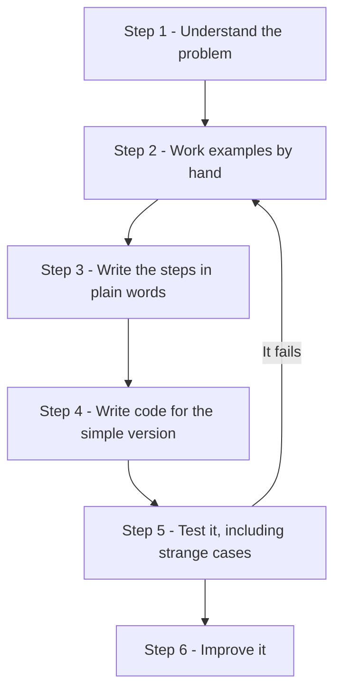

# Problem-Solving Techniques

← [[06 Files, Errors and Modules]] · [[Phase 1 - Start Here|Home]] · **Next:** [[08 Linux Basics]] → · [[Software Engineering Roadmap#Problem-Solving Techniques|Roadmap card]]

> [!abstract] After this note, you can
> Follow a clear method when you face a problem you've never seen, instead of staring at an empty screen.

## The Big Idea

Many beginners think good programmers just "see" the answer. They don't. Good programmers have a **method**. They know what to try when they don't know the answer, and that can be learned.

## A Method for Any Problem



Let's use this method on one problem.

> [!example] Problem: is a word a palindrome?
> A **palindrome** reads the same forward and backward, like "level" or "Noon".

**Step 1: Understand.** Say the problem in your own words, and ask questions:

- What's the input? A word.
- What's the output? `True` or `False`.
- Do capital letters matter? "Noon" should count, so we should ignore them.
- What about an empty word? We'll say it counts.

**Step 2: Work examples by hand.**

| Input | Expected | Why |
|---|---|---|
| `level` | True | Same both ways |
| `hello` | False | Backward it's "olleh" |
| `Noon` | True | Ignore capitals |
| `a` | True | One letter |
| empty | True | Our decision |

**Step 3: Write the steps in plain words.**

1. Make the word lowercase.
2. Compare the first letter with the last letter.
3. Then compare the second with the second-to-last, and so on.
4. If any pair differs, answer False.
5. If all pairs match, answer True.

**Step 4: Write the code.**

```python
def is_palindrome(word):
    word = word.lower()
    left = 0
    right = len(word) - 1

    while left < right:
        if word[left] != word[right]:
            return False
        left = left + 1
        right = right - 1

    return True
```

**Step 5: Test it.** Use the table from step 2.

```python
def is_palindrome(word):
    word = word.lower()
    return word == word[::-1]

print(is_palindrome("level"))
print(is_palindrome("hello"))
print(is_palindrome("Noon"))
print(is_palindrome("a"))
print(is_palindrome(""))
```

Output:

```text
True
False
True
True
True
```

**Step 6: Improve.** That test code uses a simpler version: compare the word with its reverse. It's shorter and easier to read. You often find a better idea only after solving the problem once.

## Techniques for When You're Stuck

### Restate the Problem

Write it in your own words. Many problems become easier just by asking what the input is, what the output is, and what the rules are. If you can't explain the problem, you can't solve it yet.

### Work Small Examples by Hand

Take a small case and solve it with pen and paper. Watch what your brain does. Those actions become your algorithm. Don't forget the **edge cases**, the strange cases at the limits:

- An empty list, or a list with one item
- Zero and negative numbers
- Very large inputs
- Duplicates

### Brute Force First, Then Improve

**Brute force** means the obvious approach: try everything. It may be slow, but it gives you a working answer. You can improve it later.

> [!example] Example: find two numbers that add up to a target
> In `[2, 7, 4, 9]`, which two numbers add up to 13?

Brute force checks every pair:

```python
def find_pair(numbers, target):
    for i in range(len(numbers)):
        for j in range(i + 1, len(numbers)):
            if numbers[i] + numbers[j] == target:
                return numbers[i], numbers[j]
    return None

print(find_pair([2, 7, 4, 9], 13))
```

Output:

```text
(4, 9)
```

It works, but a list of 1,000 numbers needs about 500,000 checks. Here's a smarter idea. For each number, we know exactly what partner it needs. We can remember the numbers we've seen in a set.

```python
def find_pair(numbers, target):
    seen = set()
    for number in numbers:
        needed = target - number
        if needed in seen:
            return needed, number
        seen.add(number)
    return None

print(find_pair([2, 7, 4, 9], 13))
```

Output:

```text
(4, 9)
```

This needs only one pass through the list. You will learn why it's faster in Phase 2, with [[Software Engineering Roadmap#Complexity Analysis|complexity analysis]].

### Divide and Conquer

Split the problem in half, and solve the half that matters.

> [!example] Example: guess a number from 1 to 100
> Always guess the middle. If the answer is "too high", you can forget the top half. Each guess removes half of what's left: 100 → 50 → 25 → 12 → 6 → 3 → 1. You need 7 guesses at most!

```python
def guess_number(secret, low, high):
    guesses = 0
    while True:
        guesses = guesses + 1
        middle = (low + high) // 2
        if middle == secret:
            return guesses
        if middle > secret:
            high = middle - 1
        else:
            low = middle + 1

print(guess_number(73, 1, 100))
```

Output:

```text
6
```

This idea is called **binary search**.

### Reduce It to a Problem You Know

Change your problem into one you've already solved.

> [!example] Example: are two words anagrams?
> "listen" and "silent" use exactly the same letters. How can we check this? Sort the letters of both words. Now it's the easy problem of checking if two strings are equal!

```python
def is_anagram(a, b):
    return sorted(a) == sorted(b)

print(is_anagram("listen", "silent"))
print(is_anagram("hello", "world"))
```

Output:

```text
True
False
```

### Work Backward

Start from the goal, and ask what must be true just before it.

> [!example] Example: planning your morning
> You must be at class by 9:00. The bus takes 40 minutes, so you must leave by 8:20. Getting ready takes 30 minutes, so you must wake by 7:50. You found the answer by starting from the end.

### Keep Something True - Invariants

An **invariant** is a fact that stays true every time your loop goes around. If you can name it, you can trust your loop.

In the "find the largest" code from [[01 Computational Thinking#4. Algorithms|Computational Thinking]], the invariant is: **`largest` is always the biggest number seen so far**. It's true at the start, each step keeps it true, and so it's true at the end. More on this in [[12 Mathematical Logic#Loop Invariants]].

### Talk to a Rubber Duck

Explain your code out loud, line by line, to anyone. It can even be a rubber duck on your desk. This sounds silly, but it works. When you must explain each step, you often hear your own mistake. Programmers really do call this **rubber duck debugging**.

### Test Your Guesses

Treat a problem like a science experiment:

1. **Guess** what's wrong or what could work.
2. **Test** it with one small experiment.
3. **Learn** from the result, then guess again.

You'll use this constantly in [[10 Debugging]].

### Estimate

Before you build something, do a rough calculation. You only need the right size of answer, not the exact number.

> [!example] Example: is my program fast enough?
> Python does roughly 10 million simple steps each second. This is only a rough figure, and machines differ. If your code needs 1,000 × 1,000 = 1 million steps, that takes about 0.1 seconds. That's fine. If it needs 1 million × 1 million steps, that's about 28 hours. You need a better idea!

## How to Ask for Help

> [!tip] Try for 20 to 30 minutes, then ask
> Struggling helps you learn, but being stuck for hours just wastes time. When you ask, include:
> 1. What you're trying to do
> 2. What you expected to happen
> 3. What really happened, with the exact error message
> 4. What you've already tried
>
> Writing all this out often solves the problem by itself.

> [!warning] Using AI assistants while learning
> AI tools are useful, but if they solve your practice problems, your brain doesn't get the exercise. It's like sending a friend to the gym for you. Try on your own first. Then use AI to explain ideas or give hints, not full answers.

## Common Mistakes

> [!warning] Watch out for these
> - Coding before you understand the problem
> - Trying to write the perfect answer on the first try
> - Testing only the happy case, and never the edge cases
> - Staying stuck for hours without trying a new approach
> - Looking at the answer too early

## Practice

For each problem, follow the full method. Write your examples **before** you code.

**1. Second largest.** Find the second largest number in a list.

> [!example]- Answer to question 1
> Edge cases to think about: what if the largest number appears twice? In `[5, 5, 3]`, let's decide the answer is 3. What if there aren't two different numbers? Then return `None`.
>
> ```python
> def second_largest(numbers):
>     unique = sorted(set(numbers))
>     if len(unique) < 2:
>         return None
>     return unique[-2]
>
> print(second_largest([4, 9, 2, 7]))
> print(second_largest([5, 5, 3]))
> print(second_largest([1]))
> ```
>
> Output:
>
> ```text
> 7
> 3
> None
> ```

**2. Balanced brackets.** Check if the brackets in a string like `(()())` are balanced. Each `(` must have a matching `)` after it.

> [!example]- Answer to question 2
> **Key idea:** keep a count of open brackets. Add 1 for `(`, and subtract 1 for `)`. If the count ever goes below 0, there's a `)` with no partner. The count must finish at 0.
>
> ```python
> def is_balanced(text):
>     count = 0
>     for character in text:
>         if character == "(":
>             count = count + 1
>         elif character == ")":
>             count = count - 1
>         if count < 0:
>             return False
>     return count == 0
>
> print(is_balanced("(()())"))
> print(is_balanced("(()"))
> print(is_balanced(")("))
> ```
>
> Output:
>
> ```text
> True
> False
> False
> ```
>
> Here, the invariant is that `count` is always the number of brackets still open.

**3. Estimate.** About how many seconds are there in one year?

> [!example]- Answer to question 3
> 60 × 60 × 24 × 365 = 31,536,000. So it's roughly **30 million**. This is a helpful number to remember.

**4. More practice.** Solve 30 problems on [Exercism](https://exercism.org/tracks/python). Write down your approach before coding each one.

## Can You Do This?

- [ ] Restate a problem and name its input and output
- [ ] List edge cases before you write code
- [ ] Solve a problem by brute force, and then improve it
- [ ] Explain how binary search removes half of the options each time
- [ ] Turn a new problem into one that you already know
- [ ] Ask for help with a clear, complete question
- [ ] Explain your approach to a new problem in under 10 minutes

## Summary

> [!success] Remember
> **Understand → examples → plain words → code → test → improve.** When you're stuck, try a smaller example, try brute force, explain it out loud, or take a break. Being stuck is part of the job, and now you have tools for it.

**Next:** [[08 Linux Basics]] →
