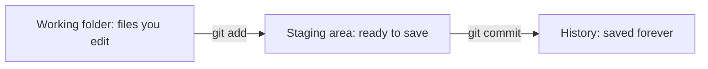
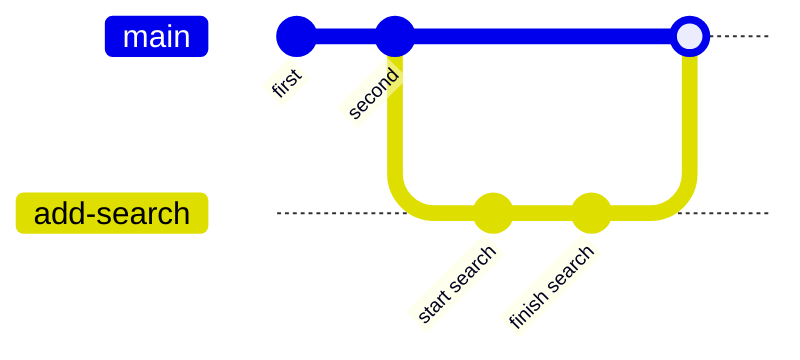

# Git Basics

← [[08 Linux Basics]] · [[Phase 1 - Start Here|Home]] · **Next:** [[10 Debugging]] → · [[Software Engineering Roadmap#Version Control with Git|Roadmap card]]

> [!abstract] After this note, you can
> Save versions of your work, undo mistakes, work on ideas safely in branches, and share code with others through GitHub.

## The Big Idea

Have you ever had files like these?

```text
project_final.py
project_final_v2.py
project_final_v2_REAL.py
```

**Git** solves this. It's a **version control** tool. It works like save points in a video game: you can save at any time, and go back to any save point. It also lets many people work on the same code without overwriting each other.

- **Git** is the tool on your computer.
- **GitHub** is a website that stores your Git projects online and helps people work together.

## First-Time Setup

Tell Git who you are. Do this once.

```bash
git config --global user.name "Your Name"
git config --global user.email "you@example.com"
git config --global init.defaultBranch main
```

## The Three Places

This is the key idea in Git. Your changes move through three places:



Think of taking a group photo:

1. **Working folder:** everyone's standing around.
2. **Staging area:** you choose who's in the photo.
3. **Commit:** you take the picture. It's saved.

## Your First Repository

A **repository**, or **repo**, is a project that Git is tracking. Try this:

```bash
mkdir git-practice
cd git-practice
git init
echo "print('hello')" > app.py
git status
```

`git status` shows:

```text
On branch main

No commits yet

Untracked files:
  (use "git add <file>..." to include in what will be committed)
	app.py

nothing added to commit but untracked files present (use "git add" to track)
```

> [!note] A harmless warning on Windows
> You may see `warning: LF will be replaced by CRLF`. Windows and Linux end lines of text in slightly different ways, and Git is telling you it will handle this. You can ignore it.

Now save it:

```bash
git add app.py
git commit -m "Add first version of app"
```

> [!tip] `git status` is your best friend
> Run it often. It tells you what's going on, and often what to do next.

## The Daily Loop

You'll do this hundreds of times:

```bash
git status
git add app.py
git commit -m "Explain what this change does"
```

`git add .` adds all changed files in this folder. Run `git status` first, so that you don't add something by accident.

**To look at your history and changes:**

| Command | What it shows |
|---|---|
| `git log --oneline` | A short list of commits |
| `git diff` | Changes you haven't staged yet |
| `git diff --staged` | Changes in the staging area |
| `git show` | The most recent commit in detail |

```text
3f2a1bc Add input validation
9d8e7f6 Add first version of app
```

The strange code at the start is the commit's **hash**, its unique ID. Yours will be different.

### Good Commit Messages

A commit message explains the change for your future self.

| Bad | Good |
|---|---|
| `fix` | `Fix crash when the task list is empty` |
| `stuff` | `Add login page` |
| `changes` | `Rename total to total_price for clarity` |

> [!tip] Rules for commits
> - Start with a verb, written as a command: "Add", "Fix", "Remove".
> - Make small commits. Each one should do one thing.
> - Commit working code as often as you can.

### Ignoring Files

Some files shouldn't be saved in Git: passwords, temporary files, and installed packages. List them in a file named `.gitignore`:

```text
.venv/
__pycache__/
*.log
.env
```

> [!danger] Never commit passwords or secret keys
> Git remembers everything. Even if you delete a secret in a later commit, it remains in the history. If you ever push a secret, treat it as stolen, and replace it right away.

## Branches - Safe Places to Try Things

A **branch** is a separate line of work. You can build a feature on a branch, while `main` stays safe and working. Think of a parallel universe for your code.



```bash
git switch -c add-search
echo "# search code" >> app.py
git add app.py
git commit -m "Add search placeholder"
git switch main
git merge add-search
git branch -d add-search
```

Step by step:

1. `git switch -c add-search` creates a branch and moves to it.
2. You commit your work there.
3. `git switch main` goes back to `main`.
4. `git merge add-search` brings the work into `main`.
5. `git branch -d` removes the finished branch name.

## Merge Conflicts

A **conflict** happens when two branches change the same line, and Git can't decide which one to keep. **It's normal, and it isn't dangerous.** Git just asks you to choose.

Your file will look like this:

```text
<<<<<<< HEAD
print("Hello from main")
=======
print("Hello from the branch")
>>>>>>> greeting
```

- Between `<<<<<<<` and `=======` is the version on your current branch.
- Between `=======` and `>>>>>>>` is the incoming version.

**To fix it:**

1. Edit the file so it says what you really want. Delete the marker lines.
2. Save the file, then finish the merge:

```bash
git add app.py
git commit -m "Merge greeting branch"
```

Stuck? `git merge --abort` cancels the merge and takes you back to how things were.

> [!example] Practice: create a conflict on purpose
> Create one yourself so that it won't scare you later.
> ```bash
> echo 'print("Hello")' > hello.py
> git add hello.py
> git commit -m "Add greeting"
>
> git switch -c greeting
> echo 'print("Hello from the branch")' > hello.py
> git commit -am "Change greeting on branch"
>
> git switch main
> echo 'print("Hello from main")' > hello.py
> git commit -am "Change greeting on main"
>
> git merge greeting
> ```

## Remotes and GitHub

A **remote** is a copy of your repo on another computer, usually GitHub.

1. Create a free account on [GitHub](https://github.com/).
2. Create a new empty repository there.
3. Connect your repo and upload it, using the URL GitHub gives you:

```bash
git remote add origin https://github.com/your-name/git-practice.git
git push -u origin main
```

| Command | Meaning |
|---|---|
| `git clone URL` | Download a repo to your computer |
| `git push` | Send your commits to the remote |
| `git pull` | Get new commits from the remote |
| `git fetch` | Check for new commits, without changing your files |

GitHub will ask you to sign in. Follow its [Set up Git guide](https://docs.github.com/en/get-started/git-basics/set-up-git).

### Pull Requests

A **pull request (PR)** asks others to review your branch before it joins `main`. This is how nearly all professional teams work.

1. Create a branch and make your commits.
2. Push it: `git push -u origin my-feature`
3. Open a pull request on GitHub.
4. Teammates review it and leave comments.
5. Fix anything they find, and push again.
6. The branch gets merged into `main`.

## Undoing Things

Everyone makes mistakes. Git is your safety net.

| Situation | Command | Is it safe? |
|---|---|---|
| Undo edits in a file, not yet staged | `git restore app.py` | ⚠️ These edits are lost |
| Unstage a file | `git restore --staged app.py` | ✅ Yes |
| Change the last commit's message | `git commit --amend -m "New message"` | ✅ If it isn't pushed yet |
| Undo a commit by making a new opposite one | `git revert HEAD` | ✅ Yes, even after pushing |
| Remove the last commit, keep the changes | `git reset --soft HEAD~1` | ✅ If it isn't pushed yet |
| Remove the last commit **and** its changes | `git reset --hard HEAD~1` | ⚠️ Dangerous |
| Put work aside for a moment | `git stash`, later `git stash pop` | ✅ Yes |

> [!important] `revert` and `reset`
> - `revert` adds a new commit that undoes an old one. History stays honest. **Use this for anything you've already pushed.**
> - `reset` moves your branch backward, as if the commits never happened. Use it only for local commits.

### The Secret Rescue Tool - reflog

`git reflog` lists everywhere your branch has been, even after a bad `reset`. If you think you've lost work, look here first.

```bash
git reflog
git reset --hard abc1234
```

(Use the hash you find in your own reflog in place of `abc1234`.)

## Going Further

These commands are useful, but you can learn them when you need them.

**Rebase** replays your commits on top of another branch, to make a straight history. Never rebase commits that others are already using.

```bash
git switch my-feature
git rebase main
```

**Cherry-pick** copies one commit onto your current branch.

```bash
git cherry-pick abc1234
```

**Bisect** finds which commit introduced a bug, by using [[07 Problem-Solving Techniques#Divide and Conquer|divide and conquer]]. You tell Git one bad commit and one good commit. It then tests the commits in between with you, halving the options each time.

```bash
git bisect start
git bisect bad
git bisect good abc1234
```

## Common Mistakes

> [!warning] Watch out for these
> - Working directly on `main` instead of using a branch
> - Huge commits with vague messages like "update"
> - Committing secrets or big generated folders
> - Panicking over a conflict. Read it, fix it, or abort.
> - Using `git push --force` on a shared branch. It can erase other people's work.
> - Running `git init` inside a folder that's already a repo

## Practice

**1. Complete the roadmap exercise.** Play the "Main" levels of [Learn Git Branching](https://learngitbranching.js.org/). It shows you visually what each command does.

**2. Rescue mission.** In a practice repo, make three commits. Run `git reset --hard HEAD~2`. Your commits seem gone! Get them back.

> [!example]- Answer to question 2
> ```bash
> git reflog
> ```
> Find the line for your latest commit, and copy its hash. Then:
> ```bash
> git reset --hard <that-hash>
> ```
> Your commits are back. They were never really deleted.

**3. Revert or reset?** You pushed a bad commit, and your teammates have already pulled it. Which should you use?

> [!example]- Answer to question 3
> Use `git revert`. It adds a new commit, so your teammates' history stays valid. `reset` would rewrite history that they already have.

**4. Publish your work.** Put your [[05 Lists, Strings and Dictionaries|practice code]] into a GitHub repo, with a good README and at least 5 clear commits.

## Can You Do This?

- [ ] Explain the working folder, staging area and history
- [ ] Commit small changes with clear messages
- [ ] Create, switch and merge branches
- [ ] Solve a merge conflict without fear
- [ ] Push to GitHub and open a pull request
- [ ] Choose between `revert` and `reset`
- [ ] Rescue "lost" work with `git reflog`

## Summary

> [!success] Remember
> - `git add` chooses changes. `git commit` saves them. `git push` shares them.
> - Use a branch for each new piece of work.
> - Conflicts are normal: choose the right text, and commit.
> - Use `revert` for shared commits. It's very hard to truly lose committed work.

**Next:** [[10 Debugging]] →
