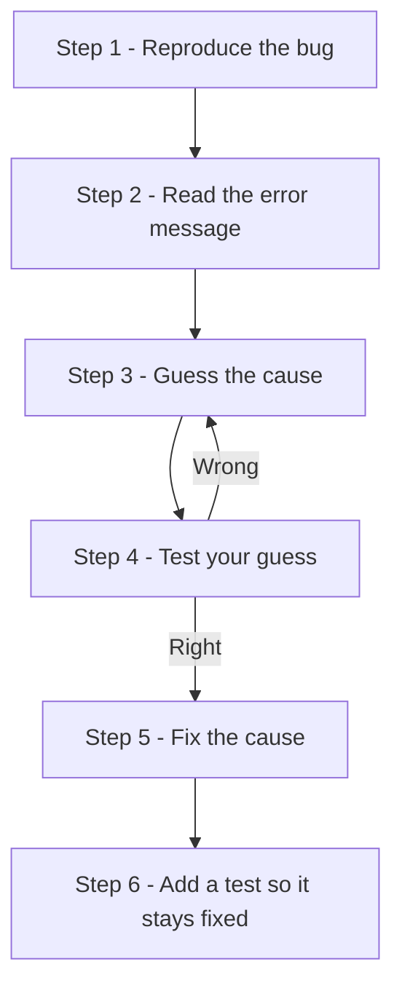

# Debugging

← [[09 Git Basics]] · [[Phase 1 - Start Here|Home]] · **Next:** [[11 Unit Testing Basics]] → · [[Software Engineering Roadmap#Debugging|Roadmap card]]

> [!abstract] After this note, you can
> Find the true cause of a bug using a calm, step-by-step method instead of guessing.

## The Big Idea

A **bug** is when a program does something you didn't expect. **Debugging** is finding out why, and fixing it.

Good debugging is detective work. A detective doesn't arrest the first person they see. They collect clues, form a theory, and test it. Beginners often change random lines and hope. Professionals follow the evidence.

> [!note] Bugs are normal
> Every programmer writes bugs, every day. The difference is how quickly they find them. Debugging is a skill that grows with practice, and it's one of the clearest signs of a strong engineer.

## The Debugging Method



### Step 1 - Reproduce the Bug

Make the bug happen again, on purpose, using the same steps each time. If you can't make it happen, you can't prove you've fixed it.

Then make the example as **small** as possible. If a list of 1,000 items crashes, does a list of 2 crash as well?

### Step 2 - Read the Error Message

When Python crashes, it prints a **traceback**, also called a **stack trace**. It's a map to the problem, not an insult.

```python
def average(numbers):
    return sum(numbers) / len(numbers)

def report(marks):
    print(average(marks))

report([])
```

Output:

```text
Traceback (most recent call last):
  File "main.py", line 7, in <module>
    report([])
  File "main.py", line 5, in report
    print(average(marks))
  File "main.py", line 2, in average
    return sum(numbers) / len(numbers)
ZeroDivisionError: division by zero
```

> [!tip] How to read a traceback
> **Start at the bottom.**
> 1. **Last line:** the type of error, and what went wrong. Division by zero.
> 2. **The line above it:** where it happened. Line 2, inside `average`.
> 3. **Going upward:** how the program got there. `report([])` called `report`, which called `average`.

Now we know the cause. The list was empty, so `len(numbers)` was 0.

### Common Python Errors

| Error | Meaning | Common cause |
|---|---|---|
| `SyntaxError` | Python can't read your code | Missing `:`, bracket or quote mark |
| `IndentationError` | Spaces at the line start are wrong | Mixed or missing indentation |
| `NameError` | This name doesn't exist | A typo, or using a variable before creating it |
| `TypeError` | Wrong type for this action | Adding a string and a number |
| `ValueError` | Right type, bad value | `int("hello")` |
| `IndexError` | No item at this position | `items[5]` in a list of 3 |
| `KeyError` | No such key in the dictionary | `person["phone"]` when there isn't one |
| `AttributeError` | This thing doesn't have that tool | `(5).upper()` |
| `FileNotFoundError` | The file isn't there | Wrong name or wrong folder |
| `ZeroDivisionError` | Dividing by zero | An empty list's length |

> [!tip] Searching for errors
> Copy the last line of the error into a search engine, but leave out your own variable names and file paths.

### Step 3 and 4 - Guess, Then Test

The hardest bugs give no error at all. The program runs, but the answer is wrong. Here's one:

```python
def count_passing(marks):
    count = 0
    for i in range(1, len(marks)):
        if marks[i] >= 50:
            count = count + 1
    return count

print(count_passing([80, 40, 60]))
```

Output:

```text
1
```

We expected 2, since 80 and 60 both pass. Let's investigate.

**Guess 1:** "Maybe 80 isn't being counted." **Test:** print each mark the loop looks at.

```python
def count_passing(marks):
    count = 0
    for i in range(1, len(marks)):
        print(f"checking index {i}, mark {marks[i]}")
        if marks[i] >= 50:
            count = count + 1
    return count

print(count_passing([80, 40, 60]))
```

Output:

```text
checking index 1, mark 40
checking index 2, mark 60
1
```

There's the clue: the loop never looks at index 0! `range(1, ...)` starts at 1. This is an **off-by-one error**, one of the most common bugs of all.

### Step 5 - Fix the Cause

Fix the real cause, not just the symptom. Adding 1 to the answer might give the right number for this input, but it would be wrong for others.

```python
def count_passing(marks):
    count = 0
    for mark in marks:
        if mark >= 50:
            count = count + 1
    return count

print(count_passing([80, 40, 60]))
print(count_passing([]))
print(count_passing([10]))
```

Output:

```text
2
0
0
```

### Step 6 - Stop It from Coming Back

Add a test that fails if this bug ever returns. See [[11 Unit Testing Basics]]. Then remove your debugging `print` lines.

## Tools for Finding Bugs

### Print Debugging

Printing values is simple and effective, and experts use it too. Make your output easy to read:

```python
price = 100
discount = "10"
print(f"price={price!r}, discount={discount!r}")
```

Output:

```text
price=100, discount='10'
```

`!r` shows the exact form of a value. You can see the quote marks, which tell you `discount` is a string. That is often the whole bug.

### Using a Debugger

A **debugger** pauses your program so that you can look around inside it, like pausing a film to study one scene. It's often faster than adding many `print` lines.

**In VS Code:**

1. Install the Python extension.
2. Click in the left margin next to a line number. A red dot appears. This is a **breakpoint**, which is where the program will pause.
3. Press **F5**, and choose **Python File**.
4. When it pauses, look at the **Variables** panel on the left.
5. Use these controls to move through your code:

| Button | Key | What it does |
|---|---|---|
| Continue | F5 | Run until the next breakpoint |
| Step Over | F10 | Run this line, then pause on the next |
| Step Into | F11 | Go inside the function on this line |
| Step Out | Shift + F11 | Finish this function, and pause after it |

**In the terminal:** add `breakpoint()` to your code to pause there.

```python
def add_tax(price):
    tax = price * 0.18
    breakpoint()
    return price + tax

print(add_tax(100))
```

Example run (you type the commands after `(Pdb)`):

```text
> main.py(4)add_tax()
-> return price + tax
(Pdb) p tax
18.0
(Pdb) c
118.0
```

Useful commands: `p name` prints a value, `n` runs the next line, `s` steps into a function, `c` continues, and `q` quits.

### Logging

**Logging** is like a program's diary. It's similar to `print`, but you can leave it in real programs. Each message has a level of importance, and you can turn levels on or off.

```python
import logging

logging.basicConfig(level=logging.INFO)

logging.info("Starting import")
logging.warning("Row 7 has no email")
logging.debug("This is hidden, because the level is INFO")
```

Example output:

```text
INFO:root:Starting import
WARNING:root:Row 7 has no email
```

Levels from low to high: `DEBUG`, `INFO`, `WARNING`, `ERROR`, `CRITICAL`.

### Binary Search for Bugs

When you don't know where a bug is, cut the search area in half, just like [[07 Problem-Solving Techniques#Divide and Conquer|guessing a number]]. Check that the data is correct halfway through the program. If it's right there, the bug is in the second half. If not, it's in the first. Repeat.

You can do the same across your history. `git bisect` finds the commit that added a bug. See [[09 Git Basics#Going Further]].

## Mental Tips

> [!tip] When you're really stuck
> - **Question your assumptions.** "This part can't be the problem" is often where the problem is. Check it anyway.
> - **Change one thing at a time.** Otherwise, you won't know what worked.
> - **Check the simple things.** Did you save the file? Are you running the right one?
> - **Look at what changed.** If it worked yesterday, `git diff` shows what's different.
> - **Explain it** to a [[07 Problem-Solving Techniques#Talk to a Rubber Duck|rubber duck]].
> - **Take a walk.** Your brain keeps working. Many bugs get solved away from the keyboard.

## Your Bug Journal

The roadmap's exercise is to keep a journal for one month. Copy this template for each bug:

```text
Date:
Symptom: what did I see?
Guesses: what did I think it was?
Cause: what was it really?
Fix: what did I change?
Prevention: how can I avoid this next time?
```

You'll soon see your own patterns, like "I often forget that `input` returns a string".

## Common Mistakes

> [!warning] Watch out for these
> - Changing code randomly without a theory
> - Not reading the full error message
> - Fixing the symptom rather than the cause
> - Changing many things at once
> - Leaving debugging `print` lines in your final code
> - Assuming a library or Python itself is broken. It's almost always your code.

## Practice

Find and fix the bug in each program. Use the method, not random changes!

**1. The missing total.**

```python
def total_price(prices):
    total = 0
    for price in prices:
        total = price
    return total

print(total_price([10, 20, 30]))
```

> [!example]- Answer to question 1
> It prints 30, not 60. `total = price` replaces the total each time. It should be `total = total + price`.

**2. The stubborn counter.**

```python
def countdown(start):
    while start > 0:
        print(start)
        start = start - 1
    print("Done")

countdown(2)
```

This one works correctly. What would happen if you removed `start = start - 1`?

> [!example]- Answer to question 2
> It would become an infinite loop, printing `2` forever, since the condition never changes. You'd stop it with Ctrl + C.

**3. The shared list.** The output isn't what the programmer wanted. Why?

```python
original = [1, 2, 3]
doubled = original
for i in range(len(doubled)):
    doubled[i] = doubled[i] * 2
print(original)
```

> [!example]- Answer to question 3
> It prints `[2, 4, 6]`. `doubled = original` doesn't make a copy, so both names point to one list. See [[05 Lists, Strings and Dictionaries#Values and References - The Big Surprise]]. Use `doubled = original.copy()`.

**4. Read this traceback.** What's wrong, and on which line?

```python
person = {"name": "Sam"}
print(person["name"])
print(person["age"])
```

> [!example]- Answer to question 4
> The third line fails with `KeyError: 'age'`, because the dictionary has no `age` key. Fix it by adding the key, or by using `person.get("age")`.

**5. Use the debugger.** Take the broken `count_passing` above and run it in the VS Code debugger. Set a breakpoint inside the loop, and watch `i` and `count` change.

## Can You Do This?

- [ ] Reproduce a bug with a small example
- [ ] Read a traceback from the bottom up
- [ ] Name at least 6 common error types
- [ ] Find a logic bug by testing a guess
- [ ] Use breakpoints and stepping in a debugger
- [ ] Use `logging` instead of `print` when suitable
- [ ] Fix a bug and write a test that catches it

## Summary

> [!success] Remember
> **Reproduce → read → guess → test → fix → prevent.** Read errors from the bottom up. Change one thing at a time. Never guess when you can check.

**Next:** [[11 Unit Testing Basics]] →
