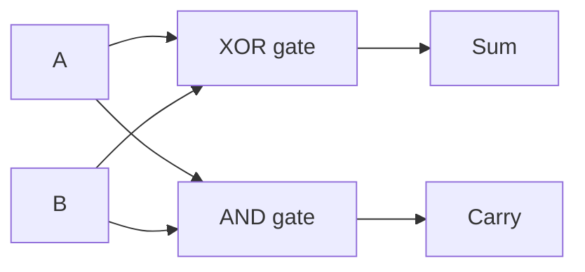

# Boolean Algebra

← [[12 Mathematical Logic]] · [[Phase 1 - Start Here|Home]] · **Next:** [[14 Phase 1 Final Project]] → · [[Software Engineering Roadmap#Boolean Algebra|Roadmap card]]

> [!abstract] After this note, you can
> Simplify messy conditions, work with individual bits, and explain how a computer adds numbers using only simple switches.

## The Big Idea

**Boolean algebra** is math with only two values: **true** and **false**, or **1** and **0**. It's named after George Boole.

It's amazing how far this goes. Every photo, game and website comes down to a huge number of tiny switches following these simple rules. By the end of this note, you'll see how those switches can do addition.

## The Basic Operations

You met these in [[12 Mathematical Logic#AND, OR, NOT]]. Here they are again with 1 and 0.

| A | B | A AND B | A OR B | A XOR B | NOT A |
|---|---|---|---|---|---|
| 0 | 0 | 0 | 0 | 0 | 1 |
| 0 | 1 | 0 | 1 | 1 | 1 |
| 1 | 0 | 0 | 1 | 1 | 0 |
| 1 | 1 | 1 | 1 | 0 | 0 |

### XOR - One or the Other, Not Both

**XOR** means "exclusive or". It's true when the two values are **different**.

Think of a light with two switches at either end of a staircase. Flipping either one changes the light. The light is on when the two switches are in different positions.

In Python, you can write XOR for true and false values as `!=`:

```python
is_light_on = True != False
print(is_light_on)
print(True != True)
```

Output:

```text
True
False
```

## Laws That Simplify Conditions

Just like normal algebra, Boolean algebra has rules. You can use them to rewrite conditions.

| Law | Rule | In plain words |
|---|---|---|
| Identity | `A and True` = `A` | "and True" changes nothing |
| | `A or False` = `A` | "or False" changes nothing |
| Domination | `A and False` = `False` | One false makes "and" false |
| | `A or True` = `True` | One true makes "or" true |
| Double negative | `not (not A)` = `A` | Two "nots" cancel out |
| Complement | `A and (not A)` = `False` | It can't be both |
| | `A or (not A)` = `True` | It must be one of them |

### De Morgan's Laws

These are the most useful laws of all. **To flip a whole condition, flip each part, and swap AND with OR.**

- `not (A and B)` = `(not A) or (not B)`
- `not (A or B)` = `(not A) and (not B)`

> [!example] In real life
> "It's **not** true that I have **both** a pen **and** paper" means "I don't have a pen, **or** I don't have paper".
>
> "I want **neither** tea **nor** coffee" means `not (tea or coffee)`. That's "no tea **and** no coffee".

Let's prove them by checking all the cases:

```python
for a in [True, False]:
    for b in [True, False]:
        first = (not (a and b)) == ((not a) or (not b))
        second = (not (a or b)) == ((not a) and (not b))
        print(first, second)
```

Output:

```text
True True
True True
True True
True True
```

They hold in all four cases. For true and false values, checking every case **is** a proof.

### Simplifying Real Code

**Example 1: Use De Morgan to remove the "not".**

Hard to read:

```python
age = 25
has_ticket = True

if not (age < 18 or not has_ticket):
    print("Welcome")
```

Easier, and it does the same thing:

```python
age = 25
has_ticket = True

if age >= 18 and has_ticket:
    print("Welcome")
```

Output:

```text
Welcome
```

**Example 2: Don't compare with `True`.**

```python
is_member = True

if is_member == True:
    print("Long way")

if is_member:
    print("Better")
```

Output:

```text
Long way
Better
```

**Example 3: Return the condition itself.**

The long way:

```python
def is_adult(age):
    if age >= 18:
        return True
    else:
        return False
```

The clean way:

```python
def is_adult(age):
    return age >= 18

print(is_adult(20))
```

Output:

```text
True
```

### Short-Circuit Evaluation

Python stops checking as soon as it knows the answer. In `A and B`, if `A` is false, the answer must be false, so `B` never runs. This is useful for avoiding errors:

```python
numbers = []

if len(numbers) > 0 and numbers[0] == 5:
    print("Starts with 5")
else:
    print("No")
```

Output:

```text
No
```

`numbers[0]` would crash on an empty list, but it never runs. If you swapped the two sides, the program would crash. So order matters.

## Bits and Bitwise Operations

As you saw in [[01 Computational Thinking#How Computers Store Everything]], numbers are stored as bits. **Bitwise operators** apply AND, OR and XOR to each pair of bits.

| Operator | Name | Meaning |
|---|---|---|
| `&` | AND | 1 only if both bits are 1 |
| `\|` | OR | 1 if either bit is 1 |
| `^` | XOR | 1 if the bits differ |
| `~` | NOT | Flip all the bits |
| `<<` | Left shift | Move bits left. Each step doubles the number |
| `>>` | Right shift | Move bits right. Each step halves the number |

Let's do `12 & 10` by hand. Line up the bits, and apply AND to each column.

```text
  1100   (12)
& 1010   (10)
------
  1000   (8)
```

```python
a = 12
b = 10

print(a & b)
print(a | b)
print(a ^ b)
print(3 << 2)
print(12 >> 1)
print(format(a & b, "04b"))
```

Output:

```text
8
14
6
12
6
1000
```

> [!warning] Don't confuse `and` with `&`
> `and` works on true and false values, in conditions. `&` works on the bits of numbers. Use `and`, `or` and `not` in normal `if` statements.

### Masks - Using Bits as Switches

A **mask** is a number used to set or check certain bits. One number can then hold many yes-or-no values. You've already seen this idea in [[08 Linux Basics#Permissions - Who Can Do What|Linux permissions]], where 4, 2 and 1 mean read, write and run!

```python
READ = 4     # 100
WRITE = 2    # 010
RUN = 1      # 001

# Turn on READ and WRITE using OR
permissions = READ | WRITE
print(permissions)

# Check a bit using AND
print(permissions & WRITE != 0)
print(permissions & RUN != 0)

# Turn a bit on
permissions = permissions | RUN
print(permissions)

# Flip a bit using XOR
permissions = permissions ^ WRITE
print(permissions)
```

Output:

```text
6
True
False
7
5
```

Another quick trick: the last bit tells you if a number is odd.

```python
print(7 & 1)
print(8 & 1)
```

Output:

```text
1
0
```

## Logic Gates - Boolean Algebra in Hardware

A **logic gate** is a tiny electronic part that does one Boolean operation. Your processor contains billions of them.

| Gate | Output is 1 when... |
|---|---|
| **AND** | Both inputs are 1 |
| **OR** | At least one input is 1 |
| **NOT** | The input is 0 |
| **XOR** | The inputs differ |
| **NAND** | NOT AND: anything except both 1 |

> [!note] NAND can build everything
> Surprisingly, you can build every other gate using only NAND gates. The [Nand2Tetris](https://www.nand2tetris.org/) course starts there, and builds a whole working computer. It's a great project for Phase 3.

### How Do Switches Add Numbers?

Now for the exciting part. Let's add two bits by hand:

| A | B | Sum bit | Carry bit |
|---|---|---|---|
| 0 | 0 | 0 | 0 |
| 0 | 1 | 1 | 0 |
| 1 | 0 | 1 | 0 |
| 1 | 1 | 0 | 1 |

(1 + 1 = 2, and 2 in binary is `10`. So write down 0 and carry 1, just as you'd carry a ten in normal addition.)

Look closely at the columns:

- The **sum** column is exactly **XOR**.
- The **carry** column is exactly **AND**.

So two gates can add two bits! This is called a **half adder**.



To add bigger numbers, each column must also take the carry from the previous column. A **full adder** handles this with two half adders. Then you chain several full adders together. Here's a 4-bit adder, built only from these operations:

```python
def half_adder(a, b):
    return a ^ b, a & b

def full_adder(a, b, carry_in):
    sum1, carry1 = half_adder(a, b)
    sum2, carry2 = half_adder(sum1, carry_in)
    return sum2, carry1 | carry2

def add_4_bits(a_bits, b_bits):
    # Bits are listed from the right-most bit to the left-most bit
    result = []
    carry = 0
    for a, b in zip(a_bits, b_bits):
        total, carry = full_adder(a, b, carry)
        result.append(total)
    return result, carry

# 5 is 0101, and 3 is 0011. Written right to left:
five = [1, 0, 1, 0]
three = [1, 1, 0, 0]

answer, carry = add_4_bits(five, three)
print(answer[::-1])
print(carry)
```

Output:

```text
[1, 0, 0, 0]
0
```

`1000` in binary is 8, and 5 + 3 = 8. ✓

You've just seen how a computer does arithmetic: nothing but simple switches and Boolean rules. This is the bottom of the whole tower of computing.

## Common Mistakes

> [!warning] Watch out for these
> - `if x == 1 or 2:` doesn't do what it looks like. It's always true! Write `if x == 1 or x == 2:`, or `if x in (1, 2):`
> - Forgetting to swap AND with OR when you remove a `not`
> - Confusing `&` with `and`, or `^` with "to the power of". In Python, the power operator is `**`.
> - Writing complex conditions in one line, when you could give the parts good names

> [!tip] Give conditions a name
> ```python
> age = 20
> has_id = True
> is_banned = False
>
> can_enter = age >= 18 and has_id and not is_banned
>
> if can_enter:
>     print("Welcome")
> ```
>
> Output:
>
> ```text
> Welcome
> ```

## Practice

**1. De Morgan.** Rewrite `not (is_raining or is_cold)` without brackets around the `or`.

> [!example]- Answer to question 1
> `(not is_raining) and (not is_cold)`

**2. Simplify.** Rewrite this so it's as simple as you can make it:

```python
def check(a, b):
    if a == True and b == True:
        return True
    return False
```

> [!example]- Answer to question 2
> ```python
> def check(a, b):
>     return a and b
>
> print(check(True, False))
> ```
>
> Output:
>
> ```text
> False
> ```

**3. By hand.** What's `6 & 3`, `6 | 3` and `6 ^ 3`? Work them out on paper first, then check with Python.

> [!example]- Answer to question 3
> 6 is `110`, and 3 is `011`.
> - AND: `010` = 2
> - OR: `111` = 7
> - XOR: `101` = 5
>
> ```python
> print(6 & 3, 6 | 3, 6 ^ 3)
> ```
>
> Output:
>
> ```text
> 2 7 5
> ```

**4. Find the bug.** Why is this message always printed?

```python
color = "green"
if color == "red" or "blue":
    print("Primary color")
```

> [!example]- Answer to question 4
> Python reads this as `(color == "red") or ("blue")`. A non-empty string counts as true, so the whole condition is true. Write `if color in ("red", "blue"):` instead.

**5. Build it.** Use the adder code to calculate 7 + 6 in binary. What happens to the carry for 15 + 1?

> [!example]- Answer to question 5
> ```python
> def half_adder(a, b):
>     return a ^ b, a & b
>
> def full_adder(a, b, carry_in):
>     sum1, carry1 = half_adder(a, b)
>     sum2, carry2 = half_adder(sum1, carry_in)
>     return sum2, carry1 | carry2
>
> def add_4_bits(a_bits, b_bits):
>     result = []
>     carry = 0
>     for a, b in zip(a_bits, b_bits):
>         total, carry = full_adder(a, b, carry)
>         result.append(total)
>     return result, carry
>
> print(add_4_bits([1, 1, 1, 0], [0, 1, 1, 0]))
> print(add_4_bits([1, 1, 1, 1], [1, 0, 0, 0]))
> ```
>
> Output:
>
> ```text
> ([1, 0, 1, 1], 0)
> ([0, 0, 0, 0], 1)
> ```
>
> Read right to left: 7 + 6 gives `1101`, which is 13. For 15 + 1, the 4 bits are all 0 with a carry of 1. The real answer, 16, doesn't fit in 4 bits. This is called **overflow**, and it's a real source of bugs in software.

## Can You Do This?

- [ ] Write truth tables for AND, OR, XOR and NOT
- [ ] Use De Morgan's laws to rewrite a condition
- [ ] Simplify messy `if` statements
- [ ] Explain short-circuit evaluation
- [ ] Work out `&`, `|` and `^` on paper
- [ ] Use a mask to set and check a flag
- [ ] Explain how XOR and AND can add two bits

## Summary

> [!success] Remember
> - Everything reduces to 1s and 0s, and a few rules.
> - **De Morgan:** flip each part, and swap AND with OR.
> - `and` is for conditions. `&` is for bits.
> - **Sum = XOR, carry = AND.** That's how computers add.

**Next:** [[14 Phase 1 Final Project]] →
