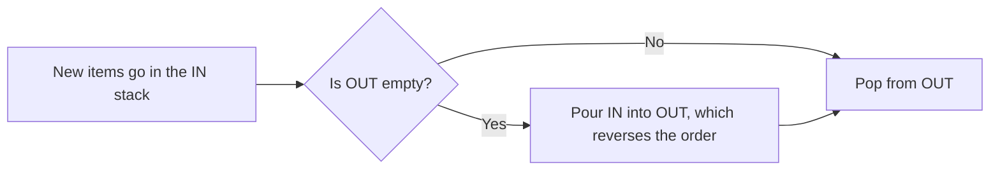
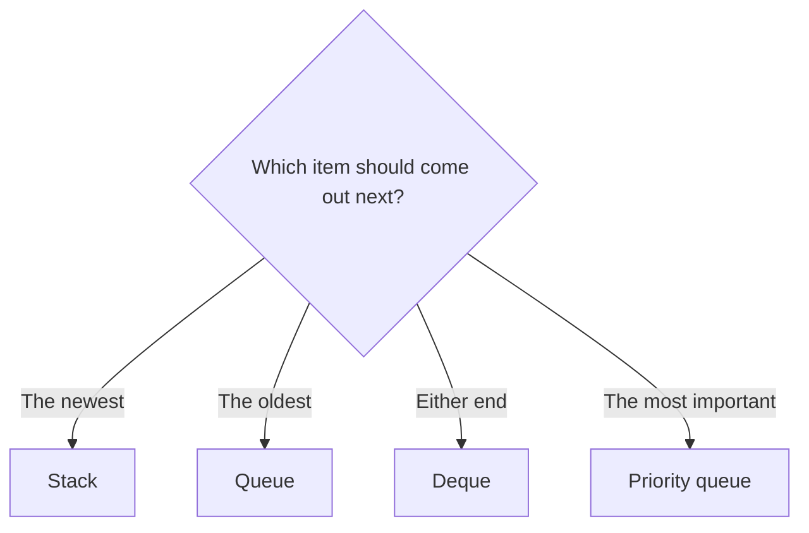

# Stacks, Queues and Deques

← [[17 Arrays and Linked Lists]] · [[Phase 2 - Start Here|Home]] · **Next:** [[19 Hash Tables]] → · [[Software Engineering Roadmap#Data Structures|Roadmap card]]

> [!abstract] After this note, you can
> Control the order that items come out in, and recognise which problems need a stack and which need a queue.

## The Big Idea

Stacks and queues limit what you can do on purpose. By giving you fewer options, they make your code simpler and harder to get wrong. They answer one question: **who goes next?**

| Structure | Rule | Real life |
|---|---|---|
| **Stack** | Last in, first out | A pile of plates |
| **Queue** | First in, first out | A line at a shop |
| **Deque** | Both ends are open | A line where people can join or leave at either end |

## Stacks

![[stack.svg]]

A **stack** works like a pile of plates. You add to the top, and you take from the top. The last plate you put on is the first one you take off. This is called **LIFO**.

| Action | Meaning | Python | Cost |
|---|---|---|---|
| **push** | Add to the top | `stack.append(x)` | O(1) |
| **pop** | Remove from the top | `stack.pop()` | O(1) |
| **peek** | Look at the top | `stack[-1]` | O(1) |

```python
stack = []
stack.append("A")
stack.append("B")
stack.append("C")

print(stack)
print(stack.pop())
print(stack)
print(stack[-1])
```

Output:

```text
['A', 'B', 'C']
C
['A', 'B']
B
```

**Stacks are everywhere:**

- The **undo** button: your last action is undone first.
- The browser **back** button.
- Your text editor matching brackets.
- Your program's function calls, as you'll see next.

### The Call Stack

Each time you call a function, Python adds a **frame** to the **call stack**, to remember where to return to. When the function returns, its frame is removed.

![[call-stack.svg]]

```python
def factorial(n):
    if n <= 1:
        return 1
    return n * factorial(n - 1)

print(factorial(3))
```

Output:

```text
6
```

This is what a **stack trace** from [[10 Debugging#Step 2 - Read the Error Message|Phase 1]] really shows you: the call stack at the moment of a crash. It's also why very deep recursion fails with a `RecursionError`, sometimes called a **stack overflow**. The stack ran out of space.

### Worked Example - Balanced Brackets

> [!example] Are the brackets in `{[()]}` balanced?
> Each closing bracket must match the **most recent** open one. "Most recent" means you need a stack.

```python
def is_balanced(text):
    pairs = {")": "(", "]": "[", "}": "{"}
    stack = []
    for character in text:
        if character in "([{":
            stack.append(character)
        elif character in pairs:
            if not stack or stack.pop() != pairs[character]:
                return False
    return not stack

print(is_balanced("{[()]}"))
print(is_balanced("{[(])}"))
print(is_balanced("(("))
```

Output:

```text
True
False
False
```

**Watch it run** on `{[()]}`:

| Character | Action | Stack after |
|---|---|---|
| `{` | Push | `{` |
| `[` | Push | `{ [` |
| `(` | Push | `{ [ (` |
| `)` | Pop `(`, it matches | `{ [` |
| `]` | Pop `[`, it matches | `{` |
| `}` | Pop `{`, it matches | empty, so it's balanced |

## Queues

![[queue.svg]]

A **queue** works like a line at a shop. People join at the back, and leave from the front. Whoever came first is served first. This is called **FIFO**.

| Action | Meaning | Python | Cost |
|---|---|---|---|
| **enqueue** | Join the back | `queue.append(x)` | O(1) |
| **dequeue** | Leave the front | `queue.popleft()` | O(1) |

### Queue Code

> [!warning] Don't use a plain list as a queue
> `my_list.pop(0)` shifts every item, so it's O(n). Use `deque` from Python's `collections` module, which is O(1) at both ends.

```python
from collections import deque

queue = deque()
queue.append("Sam")
queue.append("Priya")
queue.append("Ali")

print(queue.popleft())
print(queue.popleft())
print(list(queue))
```

Output:

```text
Sam
Priya
['Ali']
```

**Queues are everywhere too:**

- Printer jobs, and customer support tickets
- [[Software Engineering Roadmap#Message Queues|Message queues]] between services in big systems
- Web servers handling incoming requests
- [[25 Graph Algorithms#Breadth-First Search|Breadth-first search]] in graphs

> [!example] Worked example: a printer simulator

```python
from collections import deque

jobs = deque(["report.pdf", "photo.png"])
jobs.append("essay.docx")

while jobs:
    job = jobs.popleft()
    print(f"Printing {job}, {len(jobs)} left")
```

Output:

```text
Printing report.pdf, 2 left
Printing photo.png, 1 left
Printing essay.docx, 0 left
```

## Deques

A **deque** ("deck") is a **double-ended queue**. You can add and remove at both ends in O(1).

```text
        appendleft →  [ A | B | C ]  ← append
           popleft ←  [ A | B | C ]  → pop
```

```python
from collections import deque

items = deque([2, 3])
items.appendleft(1)
items.append(4)
print(list(items))

items.pop()
items.popleft()
print(list(items))
```

Output:

```text
[1, 2, 3, 4]
[2, 3]
```

> [!example] Worked example: keep only the last 3 messages
> `maxlen` automatically removes the oldest item.

```python
from collections import deque

recent = deque(maxlen=3)
for message in ["a", "b", "c", "d", "e"]:
    recent.append(message)

print(list(recent))
```

Output:

```text
['c', 'd', 'e']
```

## Build a Queue from Two Stacks

Here's a classic puzzle that shows how these ideas fit together. Pouring a stack into another stack reverses the order, and that reversed order is exactly a queue.



```python
class Queue:
    def __init__(self):
        self.incoming = []
        self.outgoing = []

    def enqueue(self, item):
        self.incoming.append(item)

    def dequeue(self):
        if not self.outgoing:
            while self.incoming:
                self.outgoing.append(self.incoming.pop())
        return self.outgoing.pop()

queue = Queue()
queue.enqueue(1)
queue.enqueue(2)
queue.enqueue(3)
print(queue.dequeue())
print(queue.dequeue())
```

Output:

```text
1
2
```

## Which One Do I Need?



A **priority queue** is covered in [[20 Trees and Heaps#Priority Queues]].

## Common Mistakes

> [!warning] Watch out for these
> - Using `list.pop(0)` for a queue
> - Popping from an empty stack, which raises `IndexError`. Check first with `if stack:`
> - Confusing the two: **plates are a stack. Lines are a queue.**

## Practice

**1. Predict.** What does this print?

```python
stack = []
stack.append(1)
stack.append(2)
stack.pop()
stack.append(3)
print(stack)
```

> [!example]- Answer to question 1
> `[1, 3]`. The 2 was on top when `pop` ran.

**2. Reverse a string with a stack.**

> [!example]- Answer to question 2
> Letters come out in the opposite order they went in.
> ```python
> def reverse(text):
>     stack = list(text)
>     result = ""
>     while stack:
>         result = result + stack.pop()
>     return result
>
> print(reverse("hello"))
> ```
>
> Output:
>
> ```text
> olleh
> ```

**3. Undo.** Build a small text editor with `type(word)` and `undo()`.

> [!example]- Answer to question 3
> ```python
> class Editor:
>     def __init__(self):
>         self.words = []
>
>     def type(self, word):
>         self.words.append(word)
>
>     def undo(self):
>         if self.words:
>             self.words.pop()
>
>     def text(self):
>         return " ".join(self.words)
>
> editor = Editor()
> editor.type("Hello")
> editor.type("wrold")
> editor.undo()
> editor.type("world")
> print(editor.text())
> ```
>
> Output:
>
> ```text
> Hello world
> ```

**4. Choose.** Which would you use for each one: a stack or a queue?
- Handling support tickets fairly
- Going back through web pages
- Sending messages in the order they were written

> [!example]- Answer to question 4
> Queue, stack, queue.

## Can You Do This?

- [ ] Draw a stack and a queue, and explain LIFO and FIFO
- [ ] Use `deque` for a real queue
- [ ] Explain the call stack and a stack overflow
- [ ] Solve balanced brackets without looking
- [ ] Build a queue using two stacks
- [ ] Recognise when a problem needs each one

## Summary

> [!success] Remember
> - **Stack:** last in, first out. Think plates and undo.
> - **Queue:** first in, first out. Think lines. Use `deque`.
> - **Deque:** both ends.
> - All main actions are O(1).

**Next:** [[19 Hash Tables]] →
