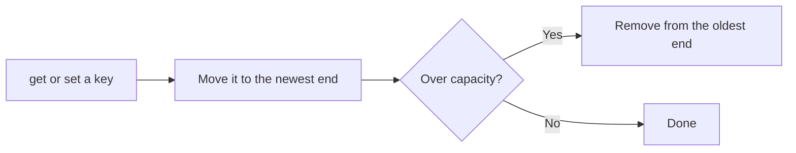

# Hash Tables

← [[18 Stacks, Queues and Deques]] · [[Phase 2 - Start Here|Home]] · **Next:** [[20 Trees and Heaps]] → · [[Software Engineering Roadmap#Data Structures|Roadmap card]]

> [!abstract] After this note, you can
> Explain why a dictionary lookup is almost instant, handle collisions, and build your own hash map and LRU cache.

## The Big Idea

Imagine a library with a million books and no system. Finding one book means checking every shelf. Now imagine a magic rule: **the title itself tells you the shelf number**. You walk straight there.

A **hash table** is that magic rule. Python's `dict` and `set` are both hash tables. It's probably the most useful data structure in all of programming.

![[hash-table.svg]]

## Step by Step

### 1. The Hash Function

A **hash function** turns a key into a number. The same key must always give the same number.

Here is a simple one: add up the character codes.

```python
def simple_hash(key):
    total = 0
    for character in key:
        total = total + ord(character)
    return total

print(simple_hash("cat"))
print(simple_hash("cat"))
print(simple_hash("act"))
```

Output:

```text
312
312
312
```

The same key gives the same number each time. But `cat` and `act` both give 312, since they have the same letters. Real hash functions mix the bits far more thoroughly to spread keys evenly.

### 2. Turn It into a Box Number

The number can be huge, but we only have a few boxes, or **buckets**. Use [[15 Discrete Mathematics#Clock Math - Modular Arithmetic|clock math]] to wrap it.

`box = hash(key) % number_of_boxes`

**Watch it run** with 5 boxes:

| Key | simple_hash | % 5 | Goes to box |
|---|---|---|---|
| `cat` | 312 | 312 % 5 | 2 |
| `dog` | 314 | 314 % 5 | 4 |
| `ant` | 327 | 327 % 5 | 2 |

### 3. Handle Collisions

`cat` and `ant` both landed in box 2. That's a **collision**. The [[15 Discrete Mathematics#The Pigeonhole Principle|pigeonhole principle]] proves these can't be avoided, so we need a plan.

| Method | How it works | Picture |
|---|---|---|
| **Chaining** | Each box holds a small list | `box 2: [cat, ant]` |
| **Open addressing** | If the box is taken, try the next one | `box 2: cat, box 3: ant` |

Python's `dict` uses open addressing. Below, we build the chaining version, because it's easier to see.

## Build Your Own Hash Map

The roadmap asks you to build this from scratch. It's only a short program.

```python
class HashMap:
    def __init__(self, size=8):
        self.boxes = [[] for _ in range(size)]
        self.count = 0

    def _box(self, key):
        return self.boxes[hash(key) % len(self.boxes)]

    def set(self, key, value):
        box = self._box(key)
        for pair in box:
            if pair[0] == key:
                pair[1] = value        # Key exists: update it
                return
        box.append([key, value])       # New key: add it
        self.count = self.count + 1
        if self.count / len(self.boxes) > 0.75:
            self._grow()

    def get(self, key, default=None):
        for pair in self._box(key):
            if pair[0] == key:
                return pair[1]
        return default

    def _grow(self):
        old_boxes = self.boxes
        self.boxes = [[] for _ in range(len(old_boxes) * 2)]
        self.count = 0
        for box in old_boxes:
            for key, value in box:
                self.set(key, value)

ages = HashMap()
ages.set("Sam", 20)
ages.set("Priya", 25)
ages.set("Sam", 21)

print(ages.get("Sam"))
print(ages.get("Ali", "unknown"))

for i in range(100):
    ages.set(f"person{i}", i)

print(ages.count, len(ages.boxes))
print(ages.get("person50"))
```

Output:

```text
21
unknown
102 256
50
```

## Why Is It So Fast?

### The Load Factor

The **load factor** is how full the table is:

`load factor = number of items ÷ number of boxes`

```text
Load factor 0.25 (roomy):    [a][ ][ ][ ]            Most chains are short. Fast.
Load factor 3.0 (crowded):   [a,b,c][d,e][f,g,h][i]  Long chains. Slower.
```

If the chains stay short, finding a key takes only a few checks, whatever the table's size. To keep them short, the table **grows** when it passes a limit such as 0.75, and moves all the items to a bigger table. Growing is costly, but it's rare, so it's [[16 Complexity Analysis#Amortized Cost|amortized O(1)]].

### The Costs

| Action | Average | Worst case (everything collides) |
|---|---|---|
| Get | **O(1)** | O(n) |
| Set | **O(1)** | O(n) |
| Delete | **O(1)** | O(n) |

Good hash functions make the worst case extremely rare.

### Rules for Keys

```python
good = {"name": 1, 42: 2, (1, 2): 3}
print(len(good))

try:
    bad = {[1, 2]: "list as a key"}
except TypeError as error:
    print(error)
```

Output:

```text
3
cannot use 'list' as a dict key (unhashable type: 'list')
```

Keys must be **hashable**, which in practice means they can't change. If a list could change after being stored, its hash would change too, and you could never find it again.

## What Hash Tables Can't Do

| You want to... | Hash table? | Use instead |
|---|---|---|
| Find by exact key | ✅ Great | |
| Find keys in sorted order | ❌ | [[20 Trees and Heaps#Binary Search Trees]], or sort first |
| Find a range, like ages 20 to 30 | ❌ | Balanced tree |
| Find the smallest item quickly | ❌ | [[20 Trees and Heaps#Heaps]] |

## Three Famous Patterns

### Counting Things

```python
from collections import Counter

words = ["apple", "kiwi", "apple", "plum", "apple", "kiwi"]
print(Counter(words).most_common(2))
```

Output:

```text
[('apple', 3), ('kiwi', 2)]
```

### Grouping Things

> [!example] Group words that are anagrams of each other
> Sorted letters make the perfect key, since anagrams share them.

```python
from collections import defaultdict

groups = defaultdict(list)
for word in ["eat", "tea", "tan", "ate", "nat"]:
    key = "".join(sorted(word))
    groups[key].append(word)

print(dict(groups))
```

Output:

```text
{'aet': ['eat', 'tea', 'ate'], 'ant': ['tan', 'nat']}
```

### Remembering What You've Seen

> [!example] Two Sum, the most famous interview question
> Find two numbers that add up to a target, and return their positions.

```python
def two_sum(numbers, target):
    seen = {}
    for index, number in enumerate(numbers):
        needed = target - number
        if needed in seen:
            return seen[needed], index
        seen[number] = index
    return None

print(two_sum([2, 7, 11, 15], 9))
```

Output:

```text
(0, 1)
```

**Watch it run** with target 9:

| index | number | needed | In `seen`? | `seen` after |
|---|---|---|---|---|
| 0 | 2 | 7 | No | `{2: 0}` |
| 1 | 7 | 2 | **Yes, at index 0** | Return (0, 1) |

This takes one pass, O(n), instead of checking all pairs at O(n²).

## Build an LRU Cache

A **cache** keeps recent answers nearby, so you don't have to work them out again. When it's full, an **LRU** (Least Recently Used) cache throws away whatever hasn't been touched for the longest time.



Python's `OrderedDict` is a hash table combined with a [[17 Arrays and Linked Lists#Other Kinds of Linked List|doubly linked list]], so both jobs are O(1).

```python
from collections import OrderedDict

class LRUCache:
    def __init__(self, capacity):
        self.capacity = capacity
        self.items = OrderedDict()

    def get(self, key):
        if key not in self.items:
            return None
        self.items.move_to_end(key)
        return self.items[key]

    def set(self, key, value):
        self.items[key] = value
        self.items.move_to_end(key)
        if len(self.items) > self.capacity:
            self.items.popitem(last=False)

cache = LRUCache(2)
cache.set("a", 1)
cache.set("b", 2)
cache.get("a")
cache.set("c", 3)

print(list(cache.items))
```

Output:

```text
['a', 'c']
```

**Watch it run:**

| Action | Oldest → newest | Why |
|---|---|---|
| set a | a | |
| set b | a, b | |
| get a | b, a | a is now the newest |
| set c | b, a, c | Over capacity! |
| remove oldest | a, c | b was the least recently used |

## Common Mistakes

> [!warning] Watch out for these
> - Looking through a list when a dict would be O(1)
> - Using a list as a key
> - Expecting a hash table to give sorted order. Python's dict keeps insertion order, which isn't the same thing.
> - Using `dict[key]` when the key may be missing. Use `.get()`.

## Practice

**1. By hand.** Using 7 boxes, where do keys with hashes 10, 17 and 22 go? Is there a collision?

> [!example]- Answer to question 1
> 10 % 7 = 3, 17 % 7 = 3, 22 % 7 = 1. **Yes:** 10 and 17 collide in box 3.

**2. First unique letter.** Find the first letter in a word that appears only once.

> [!example]- Answer to question 2
> ```python
> from collections import Counter
>
> def first_unique(word):
>     counts = Counter(word)
>     for letter in word:
>         if counts[letter] == 1:
>             return letter
>     return None
>
> print(first_unique("swiss"))
> ```
>
> Output:
>
> ```text
> w
> ```

**3. Is it a subset?** Check if every item in `a` is also in `b`, in O(n + m).

> [!example]- Answer to question 3
> ```python
> def is_subset(a, b):
>     b_set = set(b)
>     return all(item in b_set for item in a)
>
> print(is_subset([1, 2], [2, 1, 3]))
> print(is_subset([1, 9], [2, 1, 3]))
> ```
>
> Output:
>
> ```text
> True
> False
> ```

**4. Add delete.** Add a `delete(key)` method to your `HashMap`. Return `True` if it was found.

> [!example]- Answer to question 4
> ```python
> def delete(self, key):
>     box = self._box(key)
>     for i, pair in enumerate(box):
>         if pair[0] == key:
>             box.pop(i)
>             self.count = self.count - 1
>             return True
>     return False
> ```

## Can You Do This?

- [ ] Draw how a key reaches a box
- [ ] Explain collisions, and two ways to handle them
- [ ] Explain the load factor, and why tables grow
- [ ] Build a hash map from scratch
- [ ] Use counting, grouping and "seen" patterns
- [ ] Build an LRU cache
- [ ] Say what hash tables can't do well

## Summary

> [!success] Remember
> - A **hash function** turns a key into a box number.
> - **Collisions** are unavoidable, and are handled with chains or probing.
> - Keep the table roomy, and everything is **O(1) on average**.
> - When you think "I need to find this quickly", think `dict` or `set`.

**Next:** [[20 Trees and Heaps]] →
