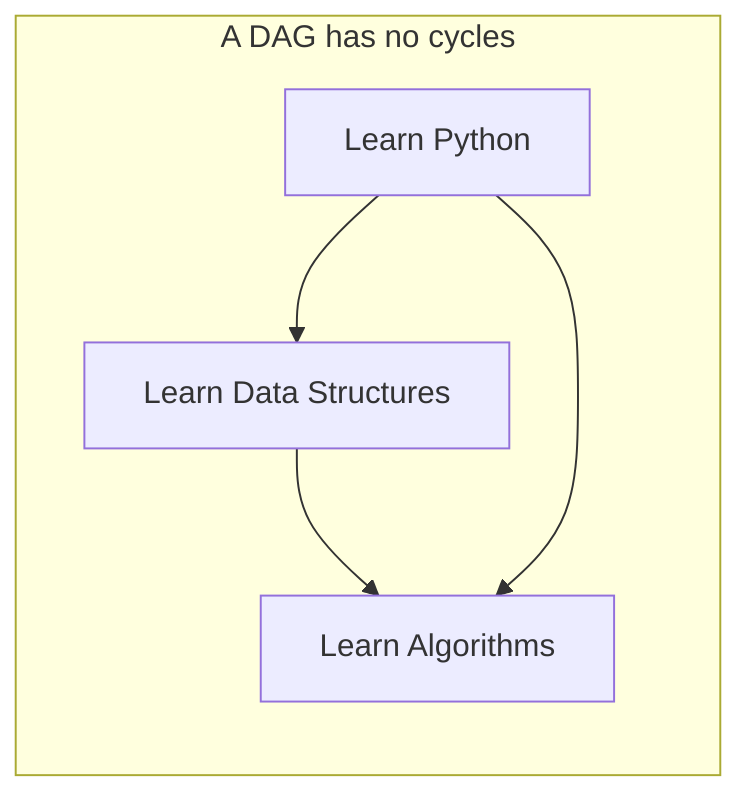

# Graphs

← [[20 Trees and Heaps]] · [[Phase 2 - Start Here|Home]] · **Next:** [[22 Searching and Sorting]] → · [[Software Engineering Roadmap#Graph Theory|Roadmap card]]

> [!abstract] After this note, you can
> Recognise when a problem is secretly a graph, and store any graph in code.

## The Big Idea

A **graph** is a set of things and the connections between them. That's all. The things are **nodes** (or vertices), and the connections are **edges**.

Once you learn to see graphs, you find them everywhere:

| Real thing | Nodes | Edges |
|---|---|---|
| Social network | People | Friendships |
| Maps | Places | Roads |
| The web | Pages | Links |
| Package manager | Packages | "Depends on" |
| Course plan | Courses | "Must come before" |

## Three Kinds of Graph

![[graph-types.svg]]

| Kind | Edges | Example |
|---|---|---|
| **Undirected** | Work both ways | Facebook friends |
| **Directed** | Go one way | Following on Instagram |
| **Weighted** | Have a number, or cost | Road distances |

### More Words You Need

```text
Path:      A → B → C          A route along edges
Cycle:     A → B → C → A      A path that returns to its start
Connected: You can reach every node from every other node
Degree:    The number of edges touching a node
DAG:       Directed Acyclic Graph: directed, with no cycles
```



> [!note] Trees are graphs too
> A tree is a connected graph with no cycles. So everything from [[20 Trees and Heaps]] was also graph theory.

## Storing a Graph

![[graph-representations.svg]]

### Adjacency List

For each node, store a list of its neighbours. A dictionary of lists does this nicely. **This is your usual choice.**

```python
graph = {
    "A": ["B", "C"],
    "B": ["A", "D"],
    "C": ["A", "D"],
    "D": ["B", "C"],
}

print(graph["A"])
print("D" in graph["A"])
print(len(graph["B"]))
```

Output:

```text
['B', 'C']
False
2
```

### Adjacency Matrix

Use a grid, where row `i`, column `j` is 1 if there's an edge from `i` to `j`.

```python
names = ["A", "B", "C", "D"]
matrix = [
    [0, 1, 1, 0],
    [1, 0, 0, 1],
    [1, 0, 0, 1],
    [0, 1, 1, 0],
]

a, d = names.index("A"), names.index("D")
print(matrix[a][d] == 1)
```

Output:

```text
False
```

### Which Should You Choose?

`V` is the number of nodes, and `E` is the number of edges.

| Question | Adjacency list | Adjacency matrix |
|---|---|---|
| Memory | **O(V + E)**, small | O(V²), large |
| Are A and B connected? | O(number of A's neighbours) | **O(1)** |
| List all of A's neighbours | **O(number of neighbours)** | O(V) |
| Best for | Most real graphs | Dense graphs with lots of edges |

**Most real graphs are sparse.** You may have thousands of friends, but not a billion. With a billion users, a matrix would need 10¹⁸ cells, which is far too many. A list only stores the edges that exist.

### Building a Graph from Edges

Data often arrives as a list of pairs.

```python
from collections import defaultdict

def build_graph(edges, directed=False):
    graph = defaultdict(list)
    for a, b in edges:
        graph[a].append(b)
        if not directed:
            graph[b].append(a)
    return dict(graph)

print(build_graph([("A", "B"), ("A", "C")]))
print(build_graph([("A", "B"), ("A", "C")], directed=True))
```

Output:

```text
{'A': ['B', 'C'], 'B': ['A'], 'C': ['A']}
{'A': ['B', 'C']}
```

**Weighted graphs** store a cost with each neighbour:

```python
roads = {
    "A": [("B", 5), ("C", 7)],
    "B": [("A", 5), ("C", 2)],
    "C": [("A", 7), ("B", 2)],
}

for neighbour, distance in roads["A"]:
    print(f"A to {neighbour}: {distance} km")
```

Output:

```text
A to B: 5 km
A to C: 7 km
```

## Seeing Hidden Graphs

The most valuable graph skill is recognising one when nobody calls it a graph.

> [!example] A grid is a graph
> Each cell is a node, and it connects to its neighbours. Mazes, games and maps all work like this.

```text
Grid:         As a graph, cell (0,0) connects to:
S . #
. . .         (0,1) on its right
# . E         (1,0) below it
```

```python
def neighbours(row, col, rows, cols):
    result = []
    for dr, dc in [(0, 1), (1, 0), (0, -1), (-1, 0)]:
        r, c = row + dr, col + dc
        if 0 <= r < rows and 0 <= c < cols:
            result.append((r, c))
    return result

print(neighbours(0, 0, 3, 3))
print(len(neighbours(1, 1, 3, 3)))
```

Output:

```text
[(0, 1), (1, 0)]
4
```

> [!example] Word ladders are a graph
> Change `cold` to `warm`, one letter at a time: cold → cord → card → ward → warm. Each word is a node. Words that differ by one letter are connected. The shortest ladder is the shortest path.

> [!example] A package manager is a graph
> If `app` needs `web`, and `web` needs `http`, you must install them in the order `http`, `web`, `app`. Finding that order is a [[25 Graph Algorithms#Topological Sort|topological sort]]. If two packages need each other, that's a cycle.

## Common Graph Questions

| Question | Algorithm | In |
|---|---|---|
| Can I reach B from A? | BFS or DFS | [[25 Graph Algorithms]] |
| What's the fewest hops from A to B? | BFS | [[25 Graph Algorithms#Breadth-First Search]] |
| What's the cheapest route? | Dijkstra | [[25 Graph Algorithms#Shortest Paths with Dijkstra]] |
| What order respects these rules? | Topological sort | [[25 Graph Algorithms#Topological Sort]] |
| Which items are in the same group? | Union-find | [[25 Graph Algorithms#Union-Find]] |
| Cheapest way to connect everything? | Minimum spanning tree | [[25 Graph Algorithms#Minimum Spanning Trees]] |

## Common Mistakes

> [!warning] Watch out for these
> - Forgetting to add both directions in an undirected graph
> - Choosing a matrix for a huge sparse graph
> - Forgetting that nodes with no edges may not appear in your dictionary
> - Not noticing that a problem is a graph, and writing complicated code instead

## Practice

**1. Draw it.** Draw this graph. Is it directed? Does it have a cycle?

```text
A: [B]
B: [C]
C: [A]
```

> [!example]- Answer to question 1
> It's directed, with one-way arrows. Yes, it has a cycle: A → B → C → A.

**2. Degree.** Write a function that finds the node with the most neighbours.

> [!example]- Answer to question 2
> ```python
> def most_connected(graph):
>     return max(graph, key=lambda node: len(graph[node]))
>
> print(most_connected({"A": ["B", "C"], "B": ["A"], "C": ["A"]}))
> ```
>
> Output:
>
> ```text
> A
> ```

**3. Convert.** Turn this matrix into an adjacency list. The nodes are 0, 1 and 2.

```text
0 1 0
0 0 1
1 0 0
```

> [!example]- Answer to question 3
> ```python
> matrix = [[0, 1, 0], [0, 0, 1], [1, 0, 0]]
>
> graph = {}
> for i, row in enumerate(matrix):
>     graph[i] = [j for j, value in enumerate(row) if value == 1]
>
> print(graph)
> ```
>
> Output:
>
> ```text
> {0: [1], 1: [2], 2: [0]}
> ```

**4. Spot the graph.** Which of these are graph problems?
- Finding if two people are linked through friends
- Adding up a list of prices
- Working out which courses to take first

> [!example]- Answer to question 4
> The first and third. Adding prices has no connections, so it's just a loop.

## Can You Do This?

- [ ] Define node, edge, path, cycle and DAG
- [ ] Draw directed, undirected and weighted graphs
- [ ] Store a graph as an adjacency list and a matrix
- [ ] Explain when to use each one
- [ ] Build a graph from a list of edges
- [ ] Turn a grid or maze into a graph

## Summary

> [!success] Remember
> - **Graph:** things plus connections.
> - **Adjacency list:** the normal way to store one.
> - If a problem talks about links, routes, dependencies or neighbours, it's probably a graph.

**Next:** [[22 Searching and Sorting]] →
