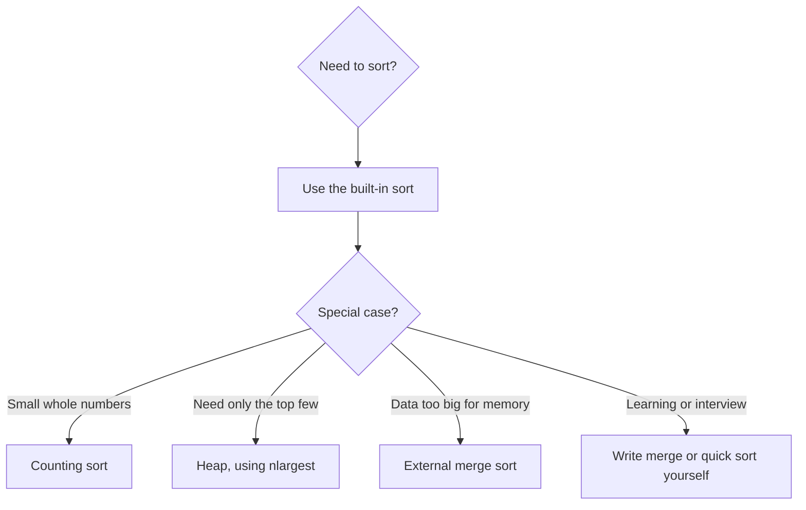

# Searching and Sorting

← [[21 Graphs]] · [[Phase 2 - Start Here|Home]] · **Next:** [[23 Algorithm Patterns]] → · [[Software Engineering Roadmap#Algorithms|Roadmap card]]

> [!abstract] After this note, you can
> Search sorted data in O(log n), explain how the main sorting algorithms work, and choose the right one.

## The Big Idea

Why do dictionaries list words in alphabetical order? Because **sorted data is enormously easier to search**. These two jobs go together.

## Searching

### Linear Search

Check each item, one by one. It works on any list, but it's **O(n)**.

```python
def linear_search(items, target):
    for index, item in enumerate(items):
        if item == target:
            return index
    return -1

print(linear_search([7, 3, 9], 9))
```

Output:

```text
2
```

### Binary Search

If the list is **sorted**, look at the middle, and throw away the half that can't contain your target.

![[binary-search.svg]]

```python
def binary_search(items, target):
    low = 0
    high = len(items) - 1

    while low <= high:
        middle = (low + high) // 2
        if items[middle] == target:
            return middle
        if items[middle] < target:
            low = middle + 1
        else:
            high = middle - 1

    return -1

numbers = [2, 5, 8, 12, 16, 23, 38, 56, 72, 91]
print(binary_search(numbers, 23))
print(binary_search(numbers, 7))
```

Output:

```text
5
-1
```

**Watch it run** for 23:

| Round | low | high | middle | items[middle] | Decision |
|---|---|---|---|---|---|
| 1 | 0 | 9 | 4 | 16 | 16 < 23, so low = 5 |
| 2 | 5 | 9 | 7 | 56 | 56 > 23, so high = 6 |
| 3 | 5 | 6 | 5 | 23 | Found at index 5 |

> [!warning] Binary search is easy to get slightly wrong
> Most bugs come from the boundaries. Remember these:
> - The loop is `low <= high`, so a single remaining item still gets checked.
> - Use `middle + 1` and `middle - 1`. Otherwise, the loop may never end.

### Binary Search Variants

What if the value appears several times, and you need the **first** one? Don't stop when you find it. Save the position, and keep looking on the left.

```python
def first_position(items, target):
    low, high = 0, len(items) - 1
    answer = -1
    while low <= high:
        middle = (low + high) // 2
        if items[middle] == target:
            answer = middle
            high = middle - 1
        elif items[middle] < target:
            low = middle + 1
        else:
            high = middle - 1
    return answer

print(first_position([1, 2, 2, 2, 3], 2))
```

Output:

```text
1
```

In real code, use Python's `bisect` module:

```python
import bisect

numbers = [1, 2, 2, 2, 3]
print(bisect.bisect_left(numbers, 2))
print(bisect.bisect_right(numbers, 2))
```

Output:

```text
1
4
```

> [!tip] Binary search on answers
> Binary search works for more than lists. It works wherever you can ask a yes-or-no question, and the answers flip only once. For example: "What's the smallest speed that finishes the job in time?" Try the middle speed, then halve the range.

## Sorting

### Sorting Algorithms at a Glance

| Algorithm | Idea | Time (average) | Time (worst) | Extra space | Stable? |
|---|---|---|---|---|---|
| **Bubble** | Swap neighbours | O(n²) | O(n²) | O(1) | Yes |
| **Selection** | Pick the smallest each time | O(n²) | O(n²) | O(1) | No |
| **Insertion** | Insert into the sorted part | O(n²) | O(n²) | O(1) | Yes |
| **Merge** | Split, then merge | O(n log n) | O(n log n) | O(n) | Yes |
| **Quick** | Split around a pivot | O(n log n) | O(n²) | O(log n) | No |
| **Heap** | Pop from a heap | O(n log n) | O(n log n) | O(1) | No |
| **Counting** | Count each value | O(n + k) | O(n + k) | O(k) | Yes |

(`k` is the range of values.)

**Stable** means items that tie keep their original order. This matters when you sort by one field after another.

### Bubble Sort

![[bubble-sort.svg]]

Compare neighbours, and swap them if they're in the wrong order. After each pass, the largest remaining item has "bubbled" to the end. It's simple, but slow. It's only for learning.

```python
def bubble_sort(items):
    n = len(items)
    for end in range(n - 1, 0, -1):
        for i in range(end):
            if items[i] > items[i + 1]:
                items[i], items[i + 1] = items[i + 1], items[i]
    return items

print(bubble_sort([5, 1, 4, 2]))
```

Output:

```text
[1, 2, 4, 5]
```

### Insertion Sort

Think of sorting playing cards in your hand. You take one card at a time, and slide it into the right place among those you're holding.

```text
[5] 1 4 2       Sorted part is in brackets
[1 5] 4 2       1 slides before 5
[1 4 5] 2       4 slides before 5
[1 2 4 5]       2 slides before 4
```

```python
def insertion_sort(items):
    for i in range(1, len(items)):
        current = items[i]
        j = i - 1
        while j >= 0 and items[j] > current:
            items[j + 1] = items[j]
            j = j - 1
        items[j + 1] = current
    return items

print(insertion_sort([5, 1, 4, 2]))
```

Output:

```text
[1, 2, 4, 5]
```

It's very fast on nearly sorted lists, and it's used inside real sorting tools for small pieces.

### Merge Sort

**Divide and conquer:** split the list until each piece is trivially sorted, then merge those pieces back together.

![[merge-sort.svg]]

Merging two sorted lists is simple. Compare the front of each, and take the smaller.

| Left | Right | Take | Result so far |
|---|---|---|---|
| **2** 5 | **1** 8 | 1 | 1 |
| **2** 5 | **8** | 2 | 1 2 |
| **5** | **8** | 5 | 1 2 5 |
| | **8** | 8 | 1 2 5 8 |

```python
def merge(left, right):
    result = []
    i = j = 0
    while i < len(left) and j < len(right):
        if left[i] <= right[j]:
            result.append(left[i])
            i = i + 1
        else:
            result.append(right[j])
            j = j + 1
    return result + left[i:] + right[j:]

def merge_sort(items):
    if len(items) <= 1:
        return items
    middle = len(items) // 2
    return merge(merge_sort(items[:middle]), merge_sort(items[middle:]))

print(merge_sort([5, 2, 8, 1, 9, 3, 7, 4]))
```

Output:

```text
[1, 2, 3, 4, 5, 7, 8, 9]
```

**Why O(n log n)?** The picture has about **log n** levels, because the list halves each time. Each level handles **n** items in total. So it's n × log n.

### Quick Sort

Choose a **pivot**. Put smaller items on its left and bigger ones on its right. The pivot is now in its final place. Then repeat for each side.

![[quick-sort.svg]]

```python
def quick_sort(items):
    if len(items) <= 1:
        return items
    pivot = items[-1]
    smaller = [x for x in items[:-1] if x <= pivot]
    bigger = [x for x in items[:-1] if x > pivot]
    return quick_sort(smaller) + [pivot] + quick_sort(bigger)

print(quick_sort([5, 2, 8, 1, 9, 3, 6]))
```

Output:

```text
[1, 2, 3, 5, 6, 8, 9]
```

> [!warning] Quick sort's bad day
> If the pivot is always the smallest or largest item, one side stays empty, and it becomes O(n²). In the code above, a list that's already sorted causes exactly this. Real versions choose the pivot more carefully, often at random.

### Heap Sort

Put everything into a [[20 Trees and Heaps#Heaps|heap]], then pop items one at a time. They come out sorted.

```python
import heapq

def heap_sort(items):
    heap = list(items)
    heapq.heapify(heap)
    return [heapq.heappop(heap) for _ in range(len(heap))]

print(heap_sort([5, 1, 4, 2]))
```

Output:

```text
[1, 2, 4, 5]
```

### Counting Sort

If the values are small whole numbers, you don't need to compare at all. Just count them.

```text
Input:   3 1 2 1 3 1

Value:   1  2  3
Count:   3  1  2

Output:  1 1 1 2 3 3
```

```python
def counting_sort(items, max_value):
    counts = [0] * (max_value + 1)
    for item in items:
        counts[item] = counts[item] + 1

    result = []
    for value, count in enumerate(counts):
        result = result + [value] * count
    return result

print(counting_sort([3, 1, 2, 1, 3, 1], 3))
```

Output:

```text
[1, 1, 1, 2, 3, 3]
```

This takes **O(n + k)**, which beats O(n log n) when the range `k` is small, such as exam marks from 0 to 100.

## Sorting in Real Life

**Use your language's built-in sort.** It's carefully built and tested. Python uses **Timsort**, a blend of merge sort and insertion sort.

```python
names = ["Priya", "Sam", "Ali"]
print(sorted(names))
print(sorted(names, key=len))
print(sorted(names, reverse=True))

students = [("Sam", 72), ("Priya", 88), ("Ali", 72)]
print(sorted(students, key=lambda student: student[1], reverse=True))
```

Output:

```text
['Ali', 'Priya', 'Sam']
['Sam', 'Ali', 'Priya']
['Sam', 'Priya', 'Ali']
[('Priya', 88), ('Sam', 72), ('Ali', 72)]
```

In the last line, Sam and Ali tie at 72 and stay in their original order. That's stability at work.

`sorted()` gives you a new list. `items.sort()` changes the list in place.

### Which Should You Use?



## Common Mistakes

> [!warning] Watch out for these
> - Running binary search on unsorted data
> - Getting `low` and `high` wrong, causing an endless loop
> - Sorting when you only need the smallest item
> - Writing your own sort in production code
> - Forgetting that `.sort()` returns `None`

## Practice

**1. By hand.** Use binary search to find 72 in the list from the picture. Which middle values do you check?

> [!example]- Answer to question 1
> 16, then 56, then 72. (Indexes 4, 7, then 8.)

**2. Square root.** Use binary search to find the whole-number square root of 50.

> [!example]- Answer to question 2
> ```python
> def int_sqrt(n):
>     low, high = 0, n
>     answer = 0
>     while low <= high:
>         middle = (low + high) // 2
>         if middle * middle <= n:
>             answer = middle
>             low = middle + 1
>         else:
>             high = middle - 1
>     return answer
>
> print(int_sqrt(50))
> ```
>
> Output:
>
> ```text
> 7
> ```

**3. Trace.** Write each step of insertion sort on `[3, 1, 2]`.

> [!example]- Answer to question 3
> ```text
> [3] 1 2
> [1 3] 2
> [1 2 3]
> ```

**4. Merge.** Merge `[1, 4, 6]` and `[2, 3, 7]` by hand, then write the code from memory.

> [!example]- Answer to question 4
> The result is `[1, 2, 3, 4, 6, 7]`.

**5. Choose.** Which sort would you use for each?
- Sorting a million ages from 0 to 120
- Sorting your app's list of users by name
- Finding the 10 highest scores among a billion

> [!example]- Answer to question 5
> - Counting sort, since the range is small.
> - The built-in sort.
> - A heap (`nlargest`), since you don't need the rest in order.

## Can You Do This?

- [ ] Write binary search without looking, and test its edges
- [ ] Find the first position of a repeated value
- [ ] Draw merge sort's split and merge picture
- [ ] Explain why merge sort is O(n log n)
- [ ] Explain quick sort, and its worst case
- [ ] Explain what stable means
- [ ] Sort records using a `key` function

## Summary

> [!success] Remember
> - **Binary search:** halve a sorted list. O(log n).
> - **Merge sort:** always O(n log n), but uses extra memory.
> - **Quick sort:** fast on average, with a poor worst case.
> - **Counting sort:** fast for small ranges.
> - In real code, **use the built-in sort**.

**Next:** [[23 Algorithm Patterns]] →
