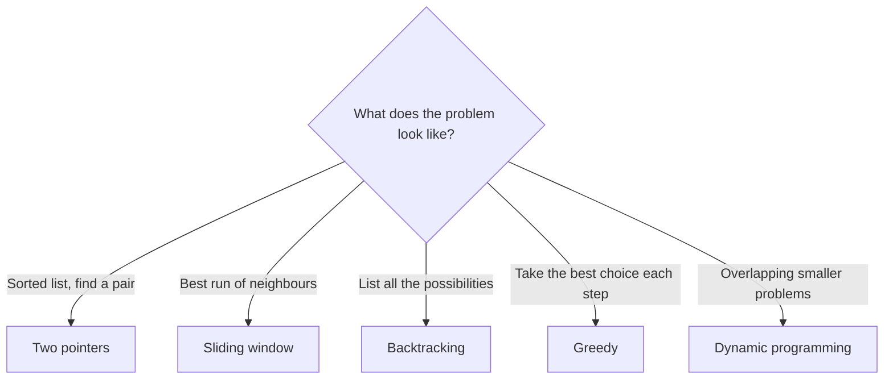

# Algorithm Patterns

← [[22 Searching and Sorting]] · [[Phase 2 - Start Here|Home]] · **Next:** [[24 Dynamic Programming]] → · [[Software Engineering Roadmap#Algorithms|Roadmap card]]

> [!abstract] After this note, you can
> Recognise four common patterns, so that a new problem starts to look like one you've seen.

## The Big Idea

There are thousands of coding problems, but only a small number of patterns behind them. Learning the patterns is much more useful than memorizing answers.



## Two Pointers

**What it is:** two positions that move through a list, usually from both ends. They replace a nested loop.

![[two-pointers.svg]]

Because the list is sorted, each comparison tells you which pointer to move:

- Sum too big? Move the right pointer left, to get a smaller number.
- Sum too small? Move the left pointer right, to get a bigger number.

```python
def pair_with_sum(numbers, target):
    left = 0
    right = len(numbers) - 1
    while left < right:
        total = numbers[left] + numbers[right]
        if total == target:
            return numbers[left], numbers[right]
        if total > target:
            right = right - 1
        else:
            left = left + 1
    return None

print(pair_with_sum([1, 2, 4, 6, 8, 11], 10))
```

Output:

```text
(2, 8)
```

Each step moves one pointer inward, so it needs at most n steps: **O(n)** instead of O(n²).

> [!example] Another one: remove duplicates from a sorted list, in place
> One pointer reads every item. The other marks where to write the next unique item.

```python
def remove_duplicates(items):
    if not items:
        return 0
    write = 1
    for read in range(1, len(items)):
        if items[read] != items[read - 1]:
            items[write] = items[read]
            write = write + 1
    return write

numbers = [1, 1, 2, 3, 3]
count = remove_duplicates(numbers)
print(numbers[:count])
```

Output:

```text
[1, 2, 3]
```

**Use it when:** the data is sorted, you need pairs, or you need to compare from both ends.

## Sliding Window

**What it is:** a section of a list that moves along. Instead of recalculating the whole section each time, you update it by adding the new item and removing the old one.

![[sliding-window.svg]]

### Fixed-Size Window

Without this pattern, you add up 3 numbers at each position. With it, you do one add and one subtract per step.

```python
def biggest_sum(numbers, size):
    window = sum(numbers[:size])
    best = window
    for i in range(size, len(numbers)):
        window = window + numbers[i] - numbers[i - size]
        best = max(best, window)
    return best

print(biggest_sum([2, 1, 5, 1, 3, 2], 3))
```

Output:

```text
9
```

**Watch it run:**

| New item | Item leaving | Window sum | Best |
|---|---|---|---|
| start | | 2 + 1 + 5 = 8 | 8 |
| 1 | 2 | 8 + 1 − 2 = 7 | 8 |
| 3 | 1 | 7 + 3 − 1 = 9 | 9 |
| 2 | 5 | 9 + 2 − 5 = 6 | 9 |

### Variable-Size Window

Sometimes the window grows and shrinks. Move the right edge to grow it. If a rule breaks, move the left edge until it's fine again.

> [!example] Longest part of a word with no repeated letters

```python
def longest_unique(text):
    seen = set()
    left = 0
    best = 0
    for right, letter in enumerate(text):
        while letter in seen:
            seen.remove(text[left])
            left = left + 1
        seen.add(letter)
        best = max(best, right - left + 1)
    return best

print(longest_unique("abcabcbb"))
print(longest_unique("bbbb"))
```

Output:

```text
3
1
```

```text
a b c a b c b b
[a b c]            size 3, no repeats
  [b c a]          second a arrives, so drop the first a
    [c a b]        and so on...
```

**Use it when:** you need the best **continuous** run of items, such as a subarray or substring.

## Recursion and Backtracking

**Backtracking** is how you explore every possibility: try a choice, explore what follows, then **undo the choice**, and try the next. It's like walking through a maze: at a dead end, you step back to the last junction.

![[backtracking-tree.svg]]

All backtracking follows one template:

```text
function explore(state):
    if state is complete: save it, and return
    for each choice:
        make the choice
        explore(next state)
        undo the choice
```

> [!example] All subsets of a list
> For each number, there are two options: leave it out, or include it. That's the picture above.

```python
def subsets(numbers):
    results = []
    chosen = []

    def explore(index):
        if index == len(numbers):
            results.append(chosen.copy())
            return
        explore(index + 1)              # Leave it out
        chosen.append(numbers[index])   # Make the choice
        explore(index + 1)              # Include it
        chosen.pop()                    # Undo the choice

    explore(0)
    return results

print(subsets([1, 2, 3]))
```

Output:

```text
[[], [3], [2], [2, 3], [1], [1, 3], [1, 2], [1, 2, 3]]
```

> [!example] All arrangements of a list

```python
def arrangements(items):
    results = []
    current = []

    def explore():
        if len(current) == len(items):
            results.append(current.copy())
            return
        for item in items:
            if item not in current:
                current.append(item)
                explore()
                current.pop()

    explore()
    return results

print(arrangements([1, 2, 3]))
```

Output:

```text
[[1, 2, 3], [1, 3, 2], [2, 1, 3], [2, 3, 1], [3, 1, 2], [3, 2, 1]]
```

### Pruning - Cutting Off Bad Paths

Backtracking can be O(2ⁿ) or worse. **Pruning** means giving up on a path once you can tell that it can't work. In a Sudoku, you don't keep filling in after a clash appears.

> [!example] Subsets that add up to a target
> If the sum is already too big, stop exploring that branch. This needs positive numbers.

```python
def subsets_with_sum(numbers, target):
    results = []
    chosen = []

    def explore(index, total):
        if total == target:
            results.append(chosen.copy())
            return
        if total > target or index == len(numbers):
            return                      # Prune this branch
        chosen.append(numbers[index])
        explore(index + 1, total + numbers[index])
        chosen.pop()
        explore(index + 1, total)

    explore(0, 0)
    return results

print(subsets_with_sum([1, 2, 3, 4], 5))
```

Output:

```text
[[1, 4], [2, 3]]
```

**Use it when:** the problem says "all", "every possible", or it's a puzzle such as Sudoku or a maze.

## Greedy Algorithms

**What it is:** at each step, take whatever looks best right now, and never look back.

![[greedy-coins.svg]]

```python
def make_change(amount, coins):
    used = []
    for coin in sorted(coins, reverse=True):
        while amount >= coin:
            amount = amount - coin
            used.append(coin)
    return used

print(make_change(63, [50, 20, 10, 5, 1]))
```

Output:

```text
[50, 10, 1, 1, 1]
```

### Greedy Can Be Wrong

Greedy is fast and simple, but it doesn't always find the best answer.

> [!danger] A case where greedy fails
> The coins are 1, 3 and 4, and you need to make 6.
> - **Greedy:** 4 + 1 + 1, which is 3 coins.
> - **Best:** 3 + 3, which is 2 coins.

```python
def make_change(amount, coins):
    used = []
    for coin in sorted(coins, reverse=True):
        while amount >= coin:
            amount = amount - coin
            used.append(coin)
    return used

print(make_change(6, [1, 3, 4]))
```

Output:

```text
[4, 1, 1]
```

To get the correct answer, you need [[24 Dynamic Programming]].

### When Greedy Works

> [!example] Fit as many meetings as possible into one room
> Always choose the meeting that **ends first**. That leaves the most time for the others. This one is provably the best.

```text
Time:    9    10    11    12    13    14
A        [=====]                            chosen: ends first
B        [===========]                      clashes with A
C              [===========]                chosen: ends next
D                    [===========]          clashes with C
E                          [===========]    chosen
```

```python
def most_meetings(meetings):
    chosen = []
    last_end = 0
    for start, end in sorted(meetings, key=lambda m: m[1]):
        if start >= last_end:
            chosen.append((start, end))
            last_end = end
    return chosen

print(most_meetings([(9, 10), (9, 11), (10, 12), (11, 13), (12, 14)]))
```

Output:

```text
[(9, 10), (10, 12), (12, 14)]
```

**Use it when:** you can argue that the best choice now will never hurt you later. Always test it with examples, and try to break it.

## Recognising a Pattern

| Clue in the problem | Try |
|---|---|
| "Sorted list", "pair", "reverse" | Two pointers |
| "Longest or shortest substring", "subarray", "in a row" | Sliding window |
| "All combinations", "every arrangement", "puzzle" | Backtracking |
| "Most", "fewest", and there's an obvious best choice | Greedy |
| "Number of ways", "minimum cost", with repeating subproblems | [[24 Dynamic Programming]] |
| "Find quickly", "seen before" | [[19 Hash Tables]] |
| "Smallest or largest so far", "top k" | [[20 Trees and Heaps#Heaps]] |
| "Connected", "route", "dependencies" | [[25 Graph Algorithms]] |

## Common Mistakes

> [!warning] Watch out for these
> - Forgetting to undo the choice in backtracking
> - Saving `chosen` instead of `chosen.copy()`. All your results would point to one list!
> - Using a sliding window on items that aren't next to each other
> - Trusting a greedy idea without trying to break it

## Practice

**1. Reverse in place.** Reverse a list using two pointers, without a new list.

> [!example]- Answer to question 1
> ```python
> def reverse(items):
>     left, right = 0, len(items) - 1
>     while left < right:
>         items[left], items[right] = items[right], items[left]
>         left = left + 1
>         right = right - 1
>     return items
>
> print(reverse([1, 2, 3, 4]))
> ```
>
> Output:
>
> ```text
> [4, 3, 2, 1]
> ```

**2. Window.** Find the smallest sum of 2 neighbours in `[4, 2, 1, 7, 8]`.

> [!example]- Answer to question 2
> ```python
> def smallest_sum(numbers, size):
>     window = sum(numbers[:size])
>     best = window
>     for i in range(size, len(numbers)):
>         window = window + numbers[i] - numbers[i - size]
>         best = min(best, window)
>     return best
>
> print(smallest_sum([4, 2, 1, 7, 8], 2))
> ```
>
> Output:
>
> ```text
> 3
> ```

**3. Letter combos.** Print all the 2-letter strings using `a` and `b`, with backtracking.

> [!example]- Answer to question 3
> ```python
> results = []
> current = []
>
> def explore():
>     if len(current) == 2:
>         results.append("".join(current))
>         return
>     for letter in "ab":
>         current.append(letter)
>         explore()
>         current.pop()
>
> explore()
> print(results)
> ```
>
> Output:
>
> ```text
> ['aa', 'ab', 'ba', 'bb']
> ```

**4. Name the pattern.** Which pattern fits each one?
- Solve a maze
- Longest stretch of days with rising prices
- Is a word a palindrome?

> [!example]- Answer to question 4
> Backtracking (or BFS), sliding window, two pointers.

**5. Keep going.** Use the [NeetCode Roadmap](https://neetcode.io/roadmap), which groups practice problems by pattern.

## Can You Do This?

- [ ] Solve "pair with sum" using two pointers
- [ ] Explain how a sliding window avoids repeat work
- [ ] Write the backtracking template from memory
- [ ] Use pruning to cut off a bad branch
- [ ] Show one case where greedy fails
- [ ] Look at a new problem, and name a likely pattern

## Summary

> [!success] Remember
> - **Two pointers:** move inward through sorted data.
> - **Sliding window:** add the new, remove the old.
> - **Backtracking:** choose, explore, undo.
> - **Greedy:** take the best now, but prove it's safe.

**Next:** [[24 Dynamic Programming]] →
