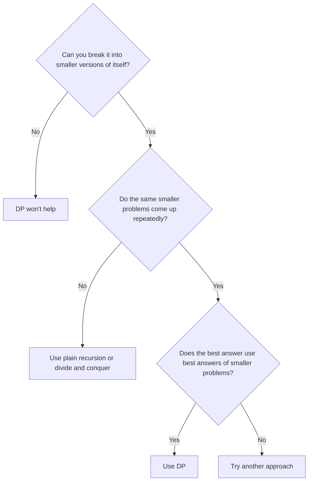
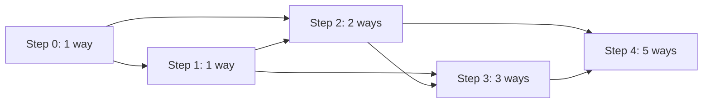

# Dynamic Programming

← [[23 Algorithm Patterns]] · [[Phase 2 - Start Here|Home]] · **Next:** [[25 Graph Algorithms]] → · [[Software Engineering Roadmap#Algorithms|Roadmap card]]

> [!abstract] After this note, you can
> Spot when a slow recursive solution is repeating itself, and make it dramatically faster by remembering answers.

## The Big Idea

**What's 1 + 1 + 1 + 1 + 1?** You count, and say 5.

**Now add another + 1.** You say 6 instantly, because you **remembered** the 5.

That's all **dynamic programming (DP)** is: **remember answers, so that you never work out the same thing twice.** The name sounds scary, but the idea is simple.

## See the Problem

The Fibonacci numbers go 0, 1, 1, 2, 3, 5, 8, 13... Each one is the sum of the two before it.

```python
def fib(n):
    if n <= 1:
        return n
    return fib(n - 1) + fib(n - 2)

print(fib(10))
```

Output:

```text
55
```

It looks fine. But look at what it does:

![[fib-tree.svg]]

`f3` gets worked out twice, and `f2` three times. For `fib(40)`, this code makes over 300 million calls. Each level roughly doubles the work: **O(2ⁿ)**.

```python
calls = 0

def fib(n):
    global calls
    calls = calls + 1
    if n <= 1:
        return n
    return fib(n - 1) + fib(n - 2)

fib(20)
print(calls)
```

Output:

```text
21891
```

## Fix 1 - Memoization (Top-Down)

**Memoization** means keeping a note of each answer. Before working something out, check your notes.

```python
calls = 0
memo = {}

def fib(n):
    global calls
    calls = calls + 1
    if n <= 1:
        return n
    if n in memo:
        return memo[n]
    memo[n] = fib(n - 1) + fib(n - 2)
    return memo[n]

print(fib(20))
print(calls)
```

Output:

```text
6765
39
```

Down from 21,891 calls to 39! Now it's **O(n)**. Python can even do this for you:

```python
from functools import cache

@cache
def fib(n):
    if n <= 1:
        return n
    return fib(n - 1) + fib(n - 2)

print(fib(80))
```

Output:

```text
23416728348467685
```

## Fix 2 - Tabulation (Bottom-Up)

**Tabulation** means filling in a table from the smallest answers upward, with no recursion.

![[dp-table.svg]]

```python
def fib(n):
    if n <= 1:
        return n
    table = [0] * (n + 1)
    table[1] = 1
    for i in range(2, n + 1):
        table[i] = table[i - 1] + table[i - 2]
    return table[n]

print(fib(7))
```

Output:

```text
13
```

### Saving Memory

Look closely: each box only uses the previous two. So you can throw away the rest.

```python
def fib(n):
    a, b = 0, 1
    for _ in range(n):
        a, b = b, a + b
    return a

print(fib(7))
```

Output:

```text
13
```

### Which Should You Use?

| | Memoization (top-down) | Tabulation (bottom-up) |
|---|---|---|
| **Style** | Recursion plus a dictionary | Loop plus a table |
| **Easy to write?** | Usually easier to start | Takes more thought |
| **Solves** | Only what's needed | Everything up to n |
| **Risk** | Deep recursion can overflow | None |

Start with memoization. Move to tabulation if you need speed or less memory.

## When Can You Use DP?



**Clues in the wording:** "number of ways", "minimum cost", "maximum value", "longest", "can you reach".

## A Recipe for Any DP Problem

1. **Define the state.** Say in words what one box means. For example: "`dp[i]` is the number of ways to reach step `i`."
2. **Find the rule.** How does a box use smaller boxes?
3. **Set the base cases.** What are the smallest answers?
4. **Decide the order.** Fill boxes so that what you need is ready.
5. **Find the answer.** Which box holds it?

> [!tip] Step 1 is the hard part
> Nearly all DP difficulty lies in defining the state. Once you have it, the rest usually follows.

## Worked Example 1 - Climbing Stairs

> [!example] You can climb 1 or 2 steps at a time. How many ways can you climb 4 steps?

**Step 1. State:** `ways[i]` is the number of ways to reach step `i`.

**Step 2. Rule:** to reach step `i`, your last move was from `i − 1` or from `i − 2`. So:

`ways[i] = ways[i - 1] + ways[i - 2]`

**Step 3. Base:** `ways[0] = 1`, since there's one way to stay put. `ways[1] = 1`.



```python
def climb(n):
    ways = [0] * (n + 1)
    ways[0] = 1
    ways[1] = 1
    for i in range(2, n + 1):
        ways[i] = ways[i - 1] + ways[i - 2]
    return ways[n]

print(climb(4))
```

Output:

```text
5
```

(It's Fibonacci in disguise!)

## Worked Example 2 - Fewest Coins

Remember [[23 Algorithm Patterns#Greedy Can Be Wrong|where greedy failed]]: making 6 from coins 1, 3 and 4.

**State:** `best[a]` is the fewest coins to make amount `a`.

**Rule:** try each coin as the last one: `best[a] = 1 + min(best[a - coin])`

```python
def fewest_coins(amount, coins):
    best = [float("inf")] * (amount + 1)
    best[0] = 0
    for a in range(1, amount + 1):
        for coin in coins:
            if coin <= a:
                best[a] = min(best[a], best[a - coin] + 1)
    return best[amount]

print(fewest_coins(6, [1, 3, 4]))
```

Output:

```text
2
```

**Watch the table fill:**

| Amount | 0 | 1 | 2 | 3 | 4 | 5 | 6 |
|---|---|---|---|---|---|---|---|
| Fewest coins | 0 | 1 | 2 | **1** | **1** | 2 | **2** |
| Best last coin | | 1 | 1 | 3 | 4 | 1 or 4 | 3 |

For amount 6: use a 3, and `best[3]` is 1, so the total is 2. Correct, where greedy failed.

## Worked Example 3 - A Table with Two Dimensions

Some problems need two numbers to describe a state, so the table becomes a grid.

### Knapsack

> [!example] You have a bag that holds weight 5. Which items do you take for the most value?
> A: weight 2, value $3. B: weight 3, value $4. C: weight 4, value $5.

**State:** `dp[i][c]` is the best value using the first `i` items, with capacity `c`.

**Rule:** for each item, you have two options, and you keep the better one:
- **Skip it:** `dp[i-1][c]`
- **Take it:** `value + dp[i-1][c - weight]`

![[knapsack-table.svg]]

```python
def knapsack(items, capacity):
    dp = [[0] * (capacity + 1) for _ in range(len(items) + 1)]

    for i, (weight, value) in enumerate(items, start=1):
        for c in range(capacity + 1):
            dp[i][c] = dp[i - 1][c]
            if weight <= c:
                dp[i][c] = max(dp[i][c], value + dp[i - 1][c - weight])

    return dp[len(items)][capacity]

print(knapsack([(2, 3), (3, 4), (4, 5)], 5))
```

Output:

```text
7
```

Taking A and B gives weight 5 and value $7.

### Longest Common Subsequence

> [!example] What's the longest sequence of letters appearing in the same order in both words?
> For `ABCBD` and `BCD`, it's `BCD`. Tools like `git diff` use this kind of idea to compare files.

**Rule:**
- Letters match: `1 + dp[i-1][j-1]`
- Letters differ: `max(dp[i-1][j], dp[i][j-1])`

```python
def lcs(a, b):
    dp = [[0] * (len(b) + 1) for _ in range(len(a) + 1)]
    for i in range(1, len(a) + 1):
        for j in range(1, len(b) + 1):
            if a[i - 1] == b[j - 1]:
                dp[i][j] = 1 + dp[i - 1][j - 1]
            else:
                dp[i][j] = max(dp[i - 1][j], dp[i][j - 1])
    return dp[len(a)][len(b)]

print(lcs("ABCBD", "BCD"))
```

Output:

```text
3
```

```text
        ""  B  C  D
    ""   0  0  0  0
    A    0  0  0  0
    B    0  1  1  1
    C    0  1  2  2
    B    0  1  2  2
    D    0  1  2  3   ← the answer
```

## Common Mistakes

> [!warning] Watch out for these
> - Starting to code before saying in words what a box means
> - Wrong base cases, which are the most common source of bugs
> - Off-by-one errors, especially `a[i - 1]` when the table is one bigger than the word
> - Using DP when simple greedy or a loop is enough

## Practice

**1. Grid paths.** You move only right or down on a 3 × 3 grid. How many paths go from top-left to bottom-right?

> [!example]- Answer to question 1
> **State:** `paths[r][c]` is the number of ways to reach that cell. **Rule:** the cell above plus the cell to the left.
> ```python
> def grid_paths(rows, cols):
>     paths = [[1] * cols for _ in range(rows)]
>     for r in range(1, rows):
>         for c in range(1, cols):
>             paths[r][c] = paths[r - 1][c] + paths[r][c - 1]
>     return paths[rows - 1][cols - 1]
>
> print(grid_paths(3, 3))
> ```
>
> Output:
>
> ```text
> 6
> ```

**2. Number of coin combinations.** How many ways can you make 5 from coins 1, 2 and 5?

> [!example]- Answer to question 2
> ```python
> def coin_ways(amount, coins):
>     ways = [0] * (amount + 1)
>     ways[0] = 1
>     for coin in coins:
>         for a in range(coin, amount + 1):
>             ways[a] = ways[a] + ways[a - coin]
>     return ways[amount]
>
> print(coin_ways(5, [1, 2, 5]))
> ```
>
> Output:
>
> ```text
> 4
> ```

**3. House robber.** You can't rob two neighbouring houses. What's the most you can take from `[2, 7, 9, 3, 1]`?

> [!example]- Answer to question 3
> **Rule:** at each house, either skip it, or take it plus the best from two houses back.
> ```python
> def rob(houses):
>     previous, current = 0, 0
>     for money in houses:
>         previous, current = current, max(current, previous + money)
>     return current
>
> print(rob([2, 7, 9, 3, 1]))
> ```
>
> Output:
>
> ```text
> 12
> ```

**4. Convert.** Add memoization to this function, and count the calls before and after.

```python
def climb(n):
    if n <= 1:
        return 1
    return climb(n - 1) + climb(n - 2)

print(climb(10))
```

> [!example]- Answer to question 4
> Put `@cache` from `functools` above it. See [[#Fix 1 - Memoization (Top-Down)]].

## Can You Do This?

- [ ] Draw the Fibonacci tree, and show the repeated work
- [ ] Explain memoization and tabulation
- [ ] Turn a slow recursive solution into a fast one
- [ ] Follow the 5-step recipe
- [ ] Solve fewest coins from memory
- [ ] Fill in a 2D table by hand for knapsack

## Summary

> [!success] Remember
> - **DP = recursion + memory.**
> - You need **repeating subproblems** and a **best answer built from smaller best answers**.
> - **Define the state first**, then the rule, then the base cases.
> - **O(2ⁿ) becomes O(n)** or O(n × m), which is a huge gain.

**Next:** [[25 Graph Algorithms]] →
