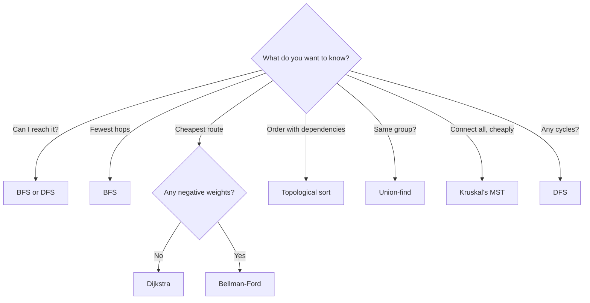

# Graph Algorithms

← [[24 Dynamic Programming]] · [[Phase 2 - Start Here|Home]] · **Next:** [[26 Object-Oriented Programming]] → · [[Software Engineering Roadmap#Algorithms|Roadmap card]]

> [!abstract] After this note, you can
> Explore any graph, find the shortest route, order tasks with dependencies, and group connected items.

## The Big Idea

Once you've [[21 Graphs|stored a graph]], you need ways to move through it. Nearly every graph algorithm is one of two walks, with some small additions.

![[bfs-vs-dfs.svg]]

| | Breadth-First Search (BFS) | Depth-First Search (DFS) |
|---|---|---|
| **Like** | A ripple in a pond | Exploring a maze, one path at a time |
| **Uses** | A [[18 Stacks, Queues and Deques#Queues\|queue]] | A [[18 Stacks, Queues and Deques#Stacks\|stack]], or recursion |
| **Good for** | Fewest hops | Exploring everything, detecting cycles |
| **Cost** | O(V + E) | O(V + E) |

The most important part of both: **remember which nodes you've visited**, or you'll go around in circles forever.

Both examples below use this graph, which is the one in the picture.

```python
graph = {
    "A": ["B", "C"],
    "B": ["D", "E"],
    "C": ["F"],
    "D": [],
    "E": [],
    "F": [],
}
print(len(graph))
```

Output:

```text
6
```

## Breadth-First Search

BFS visits everything 1 hop away, then everything 2 hops away, and so on.

```python
from collections import deque

graph = {"A": ["B", "C"], "B": ["D", "E"], "C": ["F"], "D": [], "E": [], "F": []}

def bfs(start):
    visited = {start}
    queue = deque([start])
    order = []

    while queue:
        node = queue.popleft()
        order.append(node)
        for neighbour in graph[node]:
            if neighbour not in visited:
                visited.add(neighbour)
                queue.append(neighbour)

    return order

print(bfs("A"))
```

Output:

```text
['A', 'B', 'C', 'D', 'E', 'F']
```

**Watch it run:**

| Step | Take from queue | Add neighbours | Queue after |
|---|---|---|---|
| 1 | A | B, C | B, C |
| 2 | B | D, E | C, D, E |
| 3 | C | F | D, E, F |
| 4 | D | none | E, F |
| 5 | E | none | F |
| 6 | F | none | empty |

### Fewest Hops

BFS reaches each node by the shortest route in hops, as long as every edge counts the same.

```python
from collections import deque

graph = {"A": ["B", "C"], "B": ["D"], "C": ["D"], "D": ["E"], "E": []}

def shortest_path(start, goal):
    came_from = {start: None}
    queue = deque([start])

    while queue:
        node = queue.popleft()
        if node == goal:
            path = []
            while node is not None:
                path.append(node)
                node = came_from[node]
            return path[::-1]
        for neighbour in graph[node]:
            if neighbour not in came_from:
                came_from[neighbour] = node
                queue.append(neighbour)
    return None

print(shortest_path("A", "E"))
```

Output:

```text
['A', 'B', 'D', 'E']
```

> [!example] Worked example: shortest way through a maze
> Remember, [[21 Graphs#Seeing Hidden Graphs|a grid is a graph]]. `#` is a wall.

```python
from collections import deque

maze = [
    "S.#",
    "..#",
    "#.E",
]

def steps_to_exit(maze):
    rows, cols = len(maze), len(maze[0])
    queue = deque([(0, 0, 0)])
    visited = {(0, 0)}
    while queue:
        r, c, steps = queue.popleft()
        if maze[r][c] == "E":
            return steps
        for dr, dc in [(0, 1), (1, 0), (0, -1), (-1, 0)]:
            nr, nc = r + dr, c + dc
            if 0 <= nr < rows and 0 <= nc < cols:
                if maze[nr][nc] != "#" and (nr, nc) not in visited:
                    visited.add((nr, nc))
                    queue.append((nr, nc, steps + 1))
    return -1

print(steps_to_exit(maze))
```

Output:

```text
4
```

## Depth-First Search

DFS goes as deep as it can, and backs up only when it's stuck. This is recursion, so it's short to write.

```python
graph = {"A": ["B", "C"], "B": ["D", "E"], "C": ["F"], "D": [], "E": [], "F": []}

def dfs(node, visited, order):
    visited.add(node)
    order.append(node)
    for neighbour in graph[node]:
        if neighbour not in visited:
            dfs(neighbour, visited, order)
    return order

print(dfs("A", set(), []))
```

Output:

```text
['A', 'B', 'D', 'E', 'C', 'F']
```

> [!example] Worked example: count the islands
> `1` is land, and `0` is water. Each time you find new land, that's an island. Use DFS to mark all of it as visited.

```python
grid = [
    [1, 1, 0, 0],
    [0, 1, 0, 1],
    [0, 0, 0, 1],
    [1, 0, 0, 0],
]

def sink(r, c):
    if r < 0 or c < 0 or r >= len(grid) or c >= len(grid[0]) or grid[r][c] == 0:
        return
    grid[r][c] = 0
    sink(r + 1, c)
    sink(r - 1, c)
    sink(r, c + 1)
    sink(r, c - 1)

islands = 0
for r in range(len(grid)):
    for c in range(len(grid[0])):
        if grid[r][c] == 1:
            islands = islands + 1
            sink(r, c)

print(islands)
```

Output:

```text
3
```

### Detecting Cycles

In a directed graph, there's a cycle if DFS finds a node **that's still on its current path**.

```python
def has_cycle(graph):
    done = set()
    on_path = set()

    def visit(node):
        if node in on_path:
            return True
        if node in done:
            return False
        on_path.add(node)
        for neighbour in graph[node]:
            if visit(neighbour):
                return True
        on_path.remove(node)
        done.add(node)
        return False

    return any(visit(node) for node in graph)

print(has_cycle({"A": ["B"], "B": ["C"], "C": ["A"]}))
print(has_cycle({"A": ["B"], "B": ["C"], "C": []}))
```

Output:

```text
True
False
```

## Topological Sort

**Topological sort** lists tasks so that each one comes after whatever it depends on. It only works on a [[21 Graphs#More Words You Need|DAG]].

![[topological-sort.svg]]

**Kahn's algorithm:** keep doing whatever has no remaining requirements.

```python
from collections import deque

def topological_sort(graph):
    needs = {node: 0 for node in graph}
    for node in graph:
        for after in graph[node]:
            needs[after] = needs[after] + 1

    ready = deque(node for node in graph if needs[node] == 0)
    order = []

    while ready:
        node = ready.popleft()
        order.append(node)
        for after in graph[node]:
            needs[after] = needs[after] - 1
            if needs[after] == 0:
                ready.append(after)

    if len(order) != len(graph):
        return None
    return order

tasks = {"Shirt": ["Tie"], "Tie": ["Jacket"], "Socks": ["Shoes"], "Shoes": [], "Jacket": []}
print(topological_sort(tasks))
```

Output:

```text
['Shirt', 'Socks', 'Tie', 'Shoes', 'Jacket']
```

If some tasks never become ready, the graph has a cycle, so the function returns `None`.

**Used in:** build systems, package managers, spreadsheets, and course planning.

## Shortest Paths with Dijkstra

BFS finds the fewest **hops**. When edges have different costs, you need the cheapest **total**. Use **Dijkstra's algorithm**.

![[dijkstra.svg]]

**The idea:** always finish whichever unfinished node is closest to the start. A [[20 Trees and Heaps#Priority Queues|priority queue]] gives you that node quickly.

```python
import heapq

graph = {
    "A": [("B", 4), ("C", 1)],
    "B": [("A", 4), ("C", 2), ("D", 5)],
    "C": [("A", 1), ("B", 2), ("E", 8)],
    "D": [("B", 5), ("E", 1)],
    "E": [("C", 8), ("D", 1)],
}

def dijkstra(start):
    distance = {node: float("inf") for node in graph}
    distance[start] = 0
    heap = [(0, start)]

    while heap:
        current, node = heapq.heappop(heap)
        if current > distance[node]:
            continue
        for neighbour, weight in graph[node]:
            new_distance = current + weight
            if new_distance < distance[neighbour]:
                distance[neighbour] = new_distance
                heapq.heappush(heap, (new_distance, neighbour))

    return distance

print(dijkstra("A"))
```

Output:

```text
{'A': 0, 'B': 3, 'C': 1, 'D': 8, 'E': 9}
```

**Watch it run:**

| Finish | Why | Updates |
|---|---|---|
| A (0) | The start | B = 4, C = 1 |
| C (1) | Closest | B improves to 3, E = 9 |
| B (3) | Closest | D = 8 |
| D (8) | Closest | E stays at 9 (8 + 1 = 9) |
| E (9) | Last | |

Its cost is **O(E log V)**.

> [!warning] Negative weights break Dijkstra
> Dijkstra assumes a finished node can't get cheaper later. Negative edges break this. For those, use **Bellman-Ford**, which is slower at O(V × E), but handles them.

## Union-Find

**Union-find** (or disjoint set) tracks groups. It answers "are these two in the same group?" and "merge these two groups", both almost instantly.

![[union-find.svg]]

Each item points to a parent. The top of the chain, the **root**, names the group.

```python
class UnionFind:
    def __init__(self, items):
        self.parent = {item: item for item in items}

    def find(self, item):
        while self.parent[item] != item:
            self.parent[item] = self.parent[self.parent[item]]
            item = self.parent[item]
        return item

    def union(self, a, b):
        root_a, root_b = self.find(a), self.find(b)
        if root_a == root_b:
            return False
        self.parent[root_b] = root_a
        return True

groups = UnionFind("ABCD")
groups.union("A", "B")
groups.union("C", "D")

print(groups.find("A") == groups.find("B"))
print(groups.find("A") == groups.find("C"))

groups.union("B", "C")
print(groups.find("A") == groups.find("D"))
```

Output:

```text
True
False
True
```

## Minimum Spanning Trees

A **minimum spanning tree (MST)** connects all the nodes for the lowest total cost, with no cycles. Think of laying the least cable to connect all the offices.

![[mst.svg]]

**Kruskal's algorithm** is greedy, and it's correct here. Take the cheapest edges first, skipping any that would form a cycle. Union-find detects the cycles.

```python
class UnionFind:
    def __init__(self, items):
        self.parent = {item: item for item in items}

    def find(self, item):
        while self.parent[item] != item:
            item = self.parent[item]
        return item

    def union(self, a, b):
        root_a, root_b = self.find(a), self.find(b)
        if root_a == root_b:
            return False
        self.parent[root_b] = root_a
        return True

def kruskal(nodes, edges):
    groups = UnionFind(nodes)
    chosen = []
    for weight, a, b in sorted(edges):
        if groups.union(a, b):
            chosen.append((a, b, weight))
    return chosen

edges = [(1, "A", "B"), (4, "A", "C"), (2, "B", "D"), (3, "C", "D"), (5, "A", "D")]
result = kruskal("ABCD", edges)
print(result)
print(sum(weight for _, _, weight in result))
```

Output:

```text
[('A', 'B', 1), ('B', 'D', 2), ('C', 'D', 3)]
6
```

## Which Algorithm Do I Need?



## Common Mistakes

> [!warning] Watch out for these
> - Forgetting `visited`, so the program never ends on a cycle
> - Marking a node as visited too late in BFS, adding it to the queue many times
> - Using BFS when edges have different weights
> - Using Dijkstra with negative weights
> - Very deep recursion in DFS, which can cause a `RecursionError`

## Practice

**1. By hand.** Write the BFS and DFS order for this graph, starting from 1.

```text
1: [2, 3]
2: [4]
3: [4]
4: []
```

> [!example]- Answer to question 1
> BFS: 1, 2, 3, 4. DFS: 1, 2, 4, 3.

**2. Connected?** Using BFS, write `is_connected(graph)`, which checks that every node can be reached.

> [!example]- Answer to question 2
> ```python
> from collections import deque
>
> def is_connected(graph):
>     start = next(iter(graph))
>     visited = {start}
>     queue = deque([start])
>     while queue:
>         for neighbour in graph[queue.popleft()]:
>             if neighbour not in visited:
>                 visited.add(neighbour)
>                 queue.append(neighbour)
>     return len(visited) == len(graph)
>
> print(is_connected({"A": ["B"], "B": ["A"], "C": []}))
> print(is_connected({"A": ["B"], "B": ["A"]}))
> ```
>
> Output:
>
> ```text
> False
> True
> ```

**3. Course plan.** You must take Math before Physics, and Physics before Robotics. Art needs nothing. Use `topological_sort` to list a valid order.

> [!example]- Answer to question 3
> The graph is `{"Math": ["Physics"], "Physics": ["Robotics"], "Robotics": [], "Art": []}`. One valid order is Math, Art, Physics, Robotics.

**4. Trace Dijkstra.** On the picture's graph, what would change if the edge from C to E cost 2?

> [!example]- Answer to question 4
> E becomes 1 + 2 = 3. It finishes early, and D can now be reached through E for 3 + 1 = 4, which beats 8.

## Can You Do This?

- [ ] Write BFS and DFS from memory
- [ ] Explain why each uses a queue or a stack
- [ ] Find the shortest path through a maze
- [ ] Detect a cycle
- [ ] Do a topological sort
- [ ] Trace Dijkstra by hand
- [ ] Use union-find to track groups
- [ ] Build a dependency resolver, as the roadmap's Graph Theory card asks

## Summary

> [!success] Remember
> - **BFS** uses a queue, for fewest hops.
> - **DFS** uses a stack, for exploring and cycles.
> - **Dijkstra** uses a heap, for the cheapest route.
> - **Topological sort** orders dependencies.
> - **Always track what you've visited.**

**Next:** [[26 Object-Oriented Programming]] →
