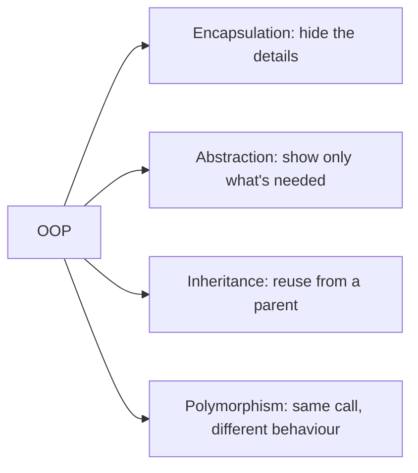
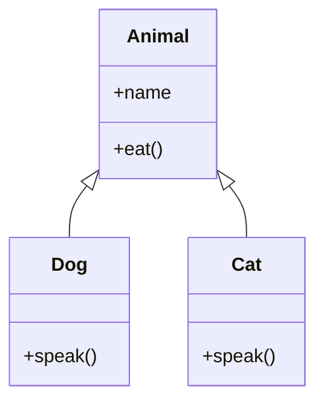
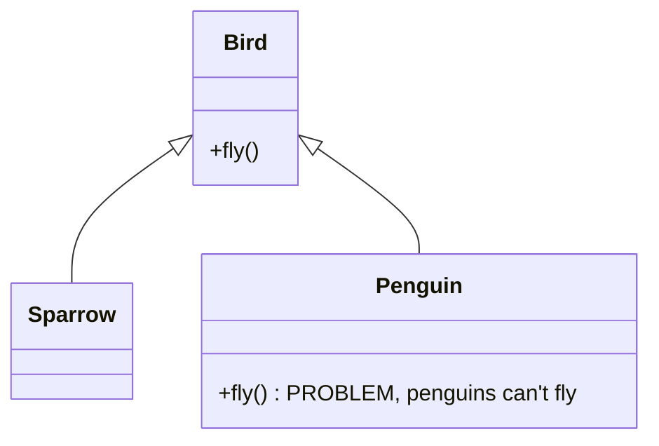
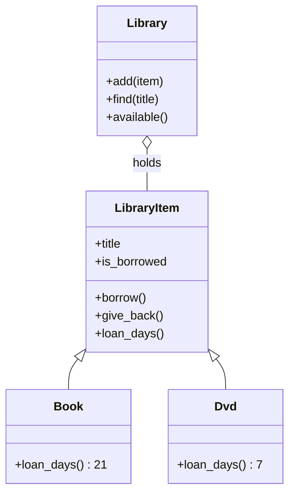

# Object-Oriented Programming

← [[25 Graph Algorithms]] · [[Phase 2 - Start Here|Home]] · **Next:** [[27 Programming Paradigms]] → · [[Software Engineering Roadmap#Object-Oriented Programming|Roadmap card]]

> [!abstract] After this note, you can
> Model things from the real world as objects, keep their data safe, and choose between inheritance and composition.

## The Big Idea

Until now, your data and functions lived apart. **Object-oriented programming (OOP)** puts them together. An **object** knows things (its **data**) and can do things (its **methods**).

Think of a dog. It has a name and an age (data). It can bark (method). You don't reach inside the dog to make it bark. You just ask it to.

## Classes and Objects

![[class-vs-object.svg]]

A **class** is a blueprint. An **object** (or **instance**) is one real thing built from it. One house plan can build many houses, each with a different family inside.

```python
class Dog:
    def __init__(self, name, age):
        self.name = name
        self.age = age

    def bark(self):
        return f"{self.name} says woof!"

    def birthday(self):
        self.age = self.age + 1

rex = Dog("Rex", 3)
bella = Dog("Bella", 5)

print(rex.bark())
print(bella.bark())

rex.birthday()
print(rex.age, bella.age)
```

Output:

```text
Rex says woof!
Bella says woof!
4 5
```

### Understanding Each Part

| Part | Meaning |
|---|---|
| `class Dog:` | Defines the blueprint |
| `__init__` | The **constructor**. It runs automatically when you create an object |
| `self` | "This particular object". Each one has its own data |
| `self.name` | An **attribute**: data stored on the object |
| `def bark(self)` | A **method**: a function belonging to the object |
| `Dog("Rex", 3)` | Creates a new object |

> [!important] What is `self`?
> When you write `rex.bark()`, Python really runs `Dog.bark(rex)`. So `self` is simply `rex`. That's how one method can work for every dog.

## The Four Pillars



## Encapsulation

**Encapsulation** means keeping an object's data safe inside it, and allowing changes only through its methods.

![[encapsulation.svg]]

Think of an ATM. You press buttons. You can't reach in and change your balance.

```python
class BankAccount:
    def __init__(self, balance):
        self._balance = balance

    def deposit(self, amount):
        if amount <= 0:
            raise ValueError("Deposit must be positive")
        self._balance = self._balance + amount

    def withdraw(self, amount):
        if amount > self._balance:
            raise ValueError("Not enough money")
        self._balance = self._balance - amount

    @property
    def balance(self):
        return self._balance

account = BankAccount(100)
account.deposit(50)
print(account.balance)

try:
    account.withdraw(500)
except ValueError as error:
    print(error)
```

Output:

```text
150
Not enough money
```

**Why it matters:** the rule "balance can't go below zero" lives in one place. No other code can break it by accident.

> [!note] Python's naming habit
> A leading underscore, as in `_balance`, means "private: please don't touch this from outside". Python doesn't enforce it, but other programmers will respect it. Languages like Java and C# have a real `private` keyword.

`@property` lets you read `account.balance` like normal data, while there's no way to set it directly.

## Abstraction

**Abstraction** means showing what something does, and hiding how it does it. You use a TV remote without knowing anything about infrared signals.

```python
from abc import ABC, abstractmethod

class Notifier(ABC):
    @abstractmethod
    def send(self, message):
        pass

class EmailNotifier(Notifier):
    def send(self, message):
        return f"Email: {message}"

class SmsNotifier(Notifier):
    def send(self, message):
        return f"SMS: {message}"

def alert_user(notifier, message):
    print(notifier.send(message))

alert_user(EmailNotifier(), "Your order shipped")
alert_user(SmsNotifier(), "Your order shipped")
```

Output:

```text
Email: Your order shipped
SMS: Your order shipped
```

An **abstract class** can't be used directly. It's a contract that says "anything of this type must have a `send` method". In other languages, a pure contract like this is called an **interface**. `alert_user` only needs to know the contract, so you can add a new notifier without changing it.

## Inheritance

**Inheritance** means a class reuses the data and methods of a parent class.



```python
class Animal:
    def __init__(self, name):
        self.name = name

    def eat(self):
        return f"{self.name} is eating"

    def speak(self):
        return "..."

class Dog(Animal):
    def speak(self):
        return "Woof"

class Cat(Animal):
    def speak(self):
        return "Meow"

rex = Dog("Rex")
print(rex.eat())
print(rex.speak())
print(isinstance(rex, Animal))
```

Output:

```text
Rex is eating
Woof
True
```

`Dog` got `eat` from `Animal` for free. Writing a new `speak` is called **overriding**.

To add data, use `super()` to call the parent's constructor:

```python
class Animal:
    def __init__(self, name):
        self.name = name

class Dog(Animal):
    def __init__(self, name, breed):
        super().__init__(name)
        self.breed = breed

rex = Dog("Rex", "Beagle")
print(rex.name, rex.breed)
```

Output:

```text
Rex Beagle
```

## Polymorphism

**Polymorphism** means "many forms". The same call does different things, depending on the object.

![[polymorphism.svg]]

```python
import math

class Circle:
    def __init__(self, radius):
        self.radius = radius

    def area(self):
        return round(math.pi * self.radius ** 2, 2)

class Square:
    def __init__(self, side):
        self.side = side

    def area(self):
        return self.side ** 2

shapes = [Circle(2), Square(3)]
for shape in shapes:
    print(type(shape).__name__, shape.area())
```

Output:

```text
Circle 12.57
Square 9
```

The loop doesn't care what each shape is. To add a triangle, you only add a class. **No `if` statements need to change.** That's the real power.

```python
# Without polymorphism: every new shape means editing this function
def area(shape_type, size):
    if shape_type == "circle":
        return 3.14 * size ** 2
    elif shape_type == "square":
        return size ** 2

print(area("square", 3))
```

Output:

```text
9
```

## Composition over Inheritance

![[is-a-has-a.svg]]

**Composition** means building an object out of other objects.

> [!tip] A simple test
> - A dog **is an** animal. Inheritance can fit.
> - A car **has an** engine. A car isn't an engine, so use composition.

```python
class Engine:
    def start(self):
        return "Engine running"

class ElectricEngine:
    def start(self):
        return "Silent motor running"

class Car:
    def __init__(self, engine):
        self.engine = engine

    def drive(self):
        return f"{self.engine.start()}, driving away"

print(Car(Engine()).drive())
print(Car(ElectricEngine()).drive())
```

Output:

```text
Engine running, driving away
Silent motor running, driving away
```

Changing a car's behaviour is as simple as handing it a different engine.

### Why Be Careful with Inheritance?



| Problem | What happens |
|---|---|
| **Wrong model** | `Penguin` inherits `fly()`, but it can't fly |
| **Tight link** | Change the parent, and you may break all its children |
| **Deep trees** | With 5 levels of parents, it's hard to tell what a method does |

**Rule of thumb:** prefer composition. Use inheritance only for a true "is-a" relationship, and keep it shallow.

## Coupling and Cohesion

These two words describe good design, in any language.

![[coupling-cohesion.svg]]

| Word | Meaning | You want | Think of |
|---|---|---|---|
| **Cohesion** | How much a class's parts belong together | **High** | A toolbox with only tools |
| **Coupling** | How much classes depend on each other | **Low** | Replacing one light bulb without rewiring the house |

> [!example] Low cohesion
> A class named `UserManager` that saves users, sends emails, and creates PDF reports does three unrelated jobs. Split it up.

> [!example] High coupling
> A class that reaches inside another: `order.customer.address.city.name`. If any step changes, this line breaks.

## Handy Python Features

**`__str__`** decides what `print` shows. **Dataclasses** write the boring parts for you.

```python
from dataclasses import dataclass

class Point:
    def __init__(self, x, y):
        self.x = x
        self.y = y

    def __str__(self):
        return f"({self.x}, {self.y})"

print(Point(1, 2))

@dataclass
class Book:
    title: str
    pages: int

print(Book("SQL Fun", 200))
print(Book("A", 1) == Book("A", 1))
```

Output:

```text
(1, 2)
Book(title='SQL Fun', pages=200)
True
```

## Worked Example - A Library System

The roadmap's exercise asks you to build this, then add a new item type without modifying the existing classes.



```python
class LibraryItem:
    def __init__(self, title):
        self.title = title
        self.is_borrowed = False

    def borrow(self):
        if self.is_borrowed:
            raise ValueError(f"{self.title} is already borrowed")
        self.is_borrowed = True
        return self.loan_days()

    def give_back(self):
        self.is_borrowed = False

    def loan_days(self):
        return 14

class Book(LibraryItem):
    def loan_days(self):
        return 21

class Dvd(LibraryItem):
    def loan_days(self):
        return 7

class Library:
    def __init__(self):
        self.items = {}

    def add(self, item):
        self.items[item.title] = item

    def find(self, title):
        return self.items.get(title)

    def available(self):
        return [item.title for item in self.items.values() if not item.is_borrowed]

library = Library()
library.add(Book("SQL Fun"))
library.add(Dvd("Space"))

print(library.find("SQL Fun").borrow())
print(library.find("Space").borrow())
print(library.available())

library.find("Space").give_back()
print(library.available())

# A new item type: no existing class had to change
class Magazine(LibraryItem):
    def loan_days(self):
        return 3

library.add(Magazine("Code Weekly"))
print(library.find("Code Weekly").borrow())
```

Output:

```text
21
7
[]
['Space']
3
```

## Common Mistakes

> [!warning] Watch out for these
> - Forgetting `self` in a method's parameters
> - Writing `Dog` when you mean `Dog()`
> - Using inheritance just to reuse a few lines
> - Making "god classes" that do everything
> - Writing classes where a simple function would do
> - Changing another object's data directly, instead of through a method

## Practice

**1. Rectangle.** Create a `Rectangle` class with `area()` and `is_square()`.

> [!example]- Answer to question 1
> ```python
> class Rectangle:
>     def __init__(self, width, height):
>         self.width = width
>         self.height = height
>
>     def area(self):
>         return self.width * self.height
>
>     def is_square(self):
>         return self.width == self.height
>
> box = Rectangle(2, 3)
> print(box.area(), box.is_square())
> ```
>
> Output:
>
> ```text
> 6 False
> ```

**2. Is-a or has-a?** Choose inheritance or composition for each pair.
- Student and Person
- School and Students
- Laptop and Battery
- Manager and Employee

> [!example]- Answer to question 2
> Inheritance, composition, composition, inheritance. (Even a Manager might be better as a role, using composition, if people change jobs.)

**3. Shopping cart.** Build `Product` and `Cart` classes. `Cart` has `add(product)` and `total()`.

> [!example]- Answer to question 3
> ```python
> class Product:
>     def __init__(self, name, price):
>         self.name = name
>         self.price = price
>
> class Cart:
>     def __init__(self):
>         self.products = []
>
>     def add(self, product):
>         self.products.append(product)
>
>     def total(self):
>         return sum(product.price for product in self.products)
>
> cart = Cart()
> cart.add(Product("Tea", 50))
> cart.add(Product("Cake", 120))
> print(cart.total())
> ```
>
> Output:
>
> ```text
> 170
> ```

**4. Spot the problem.** What's wrong with this design?

```python
class Report:
    def build(self): pass
    def save_to_database(self): pass
    def send_email(self): pass
    def print_page(self): pass
```

> [!example]- Answer to question 4
> It has low cohesion, with four unrelated jobs in one class. A change to email could break printing. Split it into `Report`, `ReportStore`, `ReportMailer` and `ReportPrinter`.

## Can You Do This?

- [ ] Explain class, object, attribute and method with a picture
- [ ] Write a class with a constructor and methods
- [ ] Explain the four pillars with your own examples
- [ ] Protect an object's data using methods
- [ ] Use polymorphism to remove a chain of `if` statements
- [ ] Choose between inheritance and composition
- [ ] Spot low cohesion and high coupling
- [ ] Add a new library item type without changing existing classes

## Summary

> [!success] Remember
> - **Class:** blueprint. **Object:** a thing built from it.
> - **Encapsulation:** data is protected behind methods.
> - **Polymorphism:** one call, many behaviours.
> - **Prefer composition** over deep inheritance.
> - **High cohesion, low coupling.**

Later, you'll build on this with [[Software Engineering Roadmap#SOLID Principles|SOLID principles]] and [[Software Engineering Roadmap#Design Patterns|design patterns]] in Phase 3.

**Next:** [[27 Programming Paradigms]] →
