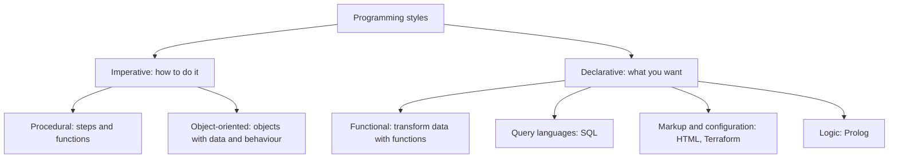
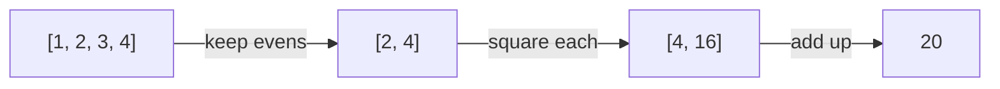
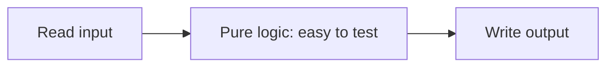

# Programming Paradigms

← [[26 Object-Oriented Programming]] · [[Phase 2 - Start Here|Home]] · **Next:** [[28 Clean Code]] → · [[Software Engineering Roadmap#Programming Paradigms|Roadmap card]]

> [!abstract] After this note, you can
> Recognise the main styles of programming, and choose the one that suits a problem.

## The Big Idea

A **paradigm** is a style of thinking about code. It's like giving directions to a taxi:

- **Imperative:** "Turn left. Go 2 km. Turn right." You describe each step.
- **Declarative:** "Take me to the airport." You describe the result.

Neither is always best. Modern languages such as Python let you mix styles.

![[paradigms.svg]]

## The Family Tree



## One Task, Many Styles

**The task:** add up the squares of the even numbers in a list.

### Procedural

List the steps, in order. You've done this since [[03 Conditions and Loops|Phase 1]].

```python
numbers = [1, 2, 3, 4]

total = 0
for number in numbers:
    if number % 2 == 0:
        total = total + number ** 2

print(total)
```

Output:

```text
20
```

**Good for:** scripts and simple tasks. **Watch out:** things get tangled as they grow.

### Object-Oriented

Group data and behaviour into objects. See [[26 Object-Oriented Programming]].

```python
class NumberList:
    def __init__(self, numbers):
        self.numbers = numbers

    def even_numbers(self):
        return [n for n in self.numbers if n % 2 == 0]

    def sum_of_even_squares(self):
        return sum(n ** 2 for n in self.even_numbers())

print(NumberList([1, 2, 3, 4]).sum_of_even_squares())
```

Output:

```text
20
```

**Good for:** large systems modelling real things. **Watch out:** too many classes for simple problems.

### Functional

Pass data through a chain of small functions, without changing anything.

```python
numbers = [1, 2, 3, 4]

evens = filter(lambda n: n % 2 == 0, numbers)
squares = map(lambda n: n ** 2, evens)
print(sum(squares))
```

Output:

```text
20
```



**Good for:** data processing and code that's easy to test. **Watch out:** it can be hard to read if chains get long.

### Declarative

Describe the result, and let the system work out how. SQL is the classic example, as you'll see in [[30 SQL]].

```python
import sqlite3

db = sqlite3.connect(":memory:")
db.execute("CREATE TABLE numbers (n INTEGER)")
db.executemany("INSERT INTO numbers VALUES (?)", [(1,), (2,), (3,), (4,)])

result = db.execute("SELECT SUM(n * n) FROM numbers WHERE n % 2 = 0").fetchone()
print(result[0])
```

Output:

```text
20
```

You never said how to loop. The database decides.

**Good for:** queries, web page structure and infrastructure.

## Key Functional Ideas

These ideas will improve your code in any style. See also the [[Software Engineering Roadmap#Functional Programming|Functional Programming card]] for later.

### Pure Functions

A **pure function** gives the same output for the same input, and it changes nothing else. Think of a calculator: 2 + 2 is always 4.

```python
# Pure: easy to test and trust
def add_tax(price):
    return price * 1.18

# Impure: depends on and changes the outside world
total = 0
def add_to_total(price):
    global total
    total = total + price
    return total

print(add_tax(100))
print(add_to_total(5), add_to_total(5))
```

Output:

```text
118.0
5 10
```

Calling `add_to_total(5)` twice gave different answers. That's what makes impure code hard to test.

### Immutability

**Immutable** data never changes. Instead, you make a new copy. Then no other part of the program can surprise you by changing it, which avoids the [[05 Lists, Strings and Dictionaries#Values and References - The Big Surprise|reference surprise]] from Phase 1.

```python
original = [1, 2, 3]
updated = original + [4]

print(original)
print(updated)
```

Output:

```text
[1, 2, 3]
[1, 2, 3, 4]
```

### Functions as Values

A function can be stored, passed in or returned, just like a number. A function that accepts or returns another function is called a **higher-order function**.

```python
def twice(action, value):
    return action(action(value))

def add_three(x):
    return x + 3

print(twice(add_three, 10))
print(sorted(["bb", "a", "ccc"], key=len))
```

Output:

```text
16
['a', 'bb', 'ccc']
```

### Closures

A **closure** is a function that remembers variables from where it was created.

```python
def make_multiplier(factor):
    def multiply(x):
        return x * factor
    return multiply

double = make_multiplier(2)
triple = make_multiplier(3)
print(double(5), triple(5))
```

Output:

```text
10 15
```

### Pure Core, Thin Shell

Here's a helpful way to mix styles. Keep your logic pure in the middle, and keep messy input and output at the edges. You learned this golden rule in [[11 Unit Testing Basics#Write Code That's Easy to Test]].



## Event-Driven Programming

So far, your programs have run from top to bottom. **Event-driven** programs wait for things to happen, then react. Think of a receptionist who responds when the phone rings.

```python
handlers = {}

def on(event, handler):
    handlers.setdefault(event, []).append(handler)

def emit(event, data):
    for handler in handlers.get(event, []):
        handler(data)

on("order_placed", lambda order: print(f"Email sent for {order}"))
on("order_placed", lambda order: print(f"Stock updated for {order}"))

emit("order_placed", "order 42")
```

Output:

```text
Email sent for order 42
Stock updated for order 42
```

**Used in:** web pages (clicks), mobile apps (taps), servers (requests), games and [[Software Engineering Roadmap#Event-Driven Architecture|big systems]]. **Reactive** programming builds on this, treating events as streams of data.

## Concurrent Styles

**Concurrency** means handling many things at once. You'll study it deeply in [[Software Engineering Roadmap#Concurrency and Parallelism|Phase 3]], but here's a preview of the main models.

| Model | Idea | Like | Example |
|---|---|---|---|
| **Threads** | Many workers share one memory | Cooks sharing a kitchen | Java, C++ |
| **Async** | One worker switches during waits | One waiter serving many tables | JavaScript, Python `asyncio` |
| **Actors** | Workers send each other messages | Offices sending mail | Erlang, Akka |
| **CSP** | Workers talk over channels | Workers using a conveyor belt | Go |

```python
import asyncio

async def make_tea(name):
    print(f"{name}: boiling")
    await asyncio.sleep(0.01)
    print(f"{name}: done")

async def main():
    await asyncio.gather(make_tea("A"), make_tea("B"))

asyncio.run(main())
```

Output:

```text
A: boiling
B: boiling
A: done
B: done
```

Both started before either finished, even with just one worker. `await` means "I'm waiting, so do something else in the meantime."

## Metaprogramming and Logic

Two more styles you may meet later:

- **Metaprogramming** is code that writes or changes code. Python's `@cache` **decorator** from [[24 Dynamic Programming#Fix 1 - Memoization (Top-Down)|Dynamic Programming]] is an example.
- **Logic programming** lets you state facts and rules, and then ask questions. Prolog is the classic language.

## Which Should I Use?

| Situation | Good fit |
|---|---|
| Short script | Procedural |
| Business app with many concepts | Object-oriented, with functional parts |
| Transforming data | Functional |
| Asking a database a question | Declarative (SQL) |
| User interface | Event-driven |
| Waiting on many network calls | Async |

## Common Mistakes

> [!warning] Watch out for these
> - Treating one paradigm as a religion
> - Writing a class where a simple function would be clearer
> - Writing clever one-liners that nobody can read
> - Using shared global variables, which functional thinking helps you avoid

## Practice

**1. Rewrite.** Rewrite this using a list comprehension, then with `filter`.

```python
result = []
for word in ["hi", "hello", "yo"]:
    if len(word) > 2:
        result.append(word)
print(result)
```

> [!example]- Answer to question 1
> ```python
> words = ["hi", "hello", "yo"]
> print([word for word in words if len(word) > 2])
> print(list(filter(lambda word: len(word) > 2, words)))
> ```
>
> Output:
>
> ```text
> ['hello']
> ['hello']
> ```

**2. Pure or not?** Which of these are pure functions?

```python
import random

def a(x):
    return x * 2

def b(items):
    items.append(1)
    return items

def c():
    return random.random()

print(a(2))
```

> [!example]- Answer to question 2
> Only `a` is pure. `b` changes its input, and `c` gives a different answer each time.

**3. Three ways.** Find the longest word in a list using procedural code, then using a built-in function with `key`.

> [!example]- Answer to question 3
> ```python
> words = ["hi", "hello", "yo"]
>
> longest = words[0]
> for word in words:
>     if len(word) > len(longest):
>         longest = word
> print(longest)
>
> print(max(words, key=len))
> ```
>
> Output:
>
> ```text
> hello
> hello
> ```

**4. Roadmap exercise.** Build a tool that counts word frequency in a text. Write it in procedural, object-oriented and functional styles. Which one reads best?

## Can You Do This?

- [ ] Explain imperative and declarative with your own example
- [ ] Solve one problem in three styles
- [ ] Say what makes a function pure
- [ ] Use `map`, `filter` and a closure
- [ ] Explain event-driven code
- [ ] Name four concurrency models
- [ ] Choose a suitable style for a problem

## Summary

> [!success] Remember
> - **Imperative:** how. **Declarative:** what.
> - **Procedural:** steps. **OOP:** objects. **Functional:** data flowing through functions.
> - **Pure functions** are the easiest to test.
> - Use the style that makes the problem simplest.

**Next:** [[28 Clean Code]] →
