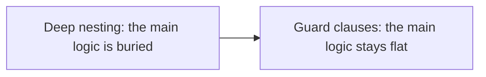
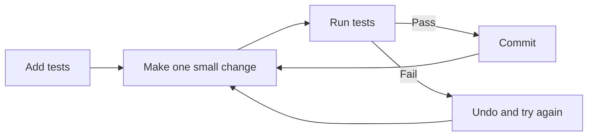

# Clean Code

← [[27 Programming Paradigms]] · [[Phase 2 - Start Here|Home]] · **Next:** [[29 Relational Databases]] → · [[Software Engineering Roadmap#Clean Code|Roadmap card]]

> [!abstract] After this note, you can
> Write code that a teammate can understand without asking you, and improve messy code step by step.

## The Big Idea

> [!quote]
> Code is read far more often than it's written.

You write a line once. Then you and your team read it for years. **Clean code** is code that clearly says what it does. It's like good handwriting: the reader can focus on the message.

The computer doesn't care about any of this. Humans do. And "future you" is one of those humans. Six months from now, you won't remember why you wrote it.

**One example says it all:**

```python
def calc(l):
    t = 0
    for i in l:
        if i[1] > 0:
            t += i[0] * i[1]
    return t

print(calc([(10, 2), (5, 0)]))
```

What does this do? Now read this version:

```python
def order_total(items):
    total = 0
    for price, quantity in items:
        if quantity > 0:
            total += price * quantity
    return total

print(order_total([(10, 2), (5, 0)]))
```

Output:

```text
20
```

It's the same logic, and it runs exactly the same. But only one explains itself.

## Rule 1 - Use Meaningful Names

Names are the most powerful tool you have. A good name removes the need for a comment.

| Bad | Better | Why |
|---|---|---|
| `d` | `days_until_expiry` | Says what it means |
| `data` | `customer_orders` | Says what kind of data |
| `flag` | `is_active` | Reads like a question |
| `process()` | `send_welcome_email()` | Says what it does |
| `temp2` | `previous_balance` | Numbered names hide meaning |
| `n = 86400` | `SECONDS_PER_DAY = 86400` | Explains a magic number |

**Tips:**

- Variables are **nouns**: `total_price`
- Functions are **verbs**: `calculate_total`
- True or false values read like **questions**: `is_valid`, `has_access`
- Longer names for bigger scopes. `i` is fine in a three-line loop.

## Rule 2 - Small, Focused Functions

![[function-split.svg]]

A function should do **one thing**. If you need "and" to describe it, it probably does too much.

**Before:** one function handles every step.

```python
def process_order(order):
    if not order["items"]:
        raise ValueError("Empty order")
    total = 0
    for item in order["items"]:
        total += item["price"]
    if order["member"]:
        total = total * 0.9
    print(f"Charged {total}")
    print(f"Receipt sent to {order['email']}")

process_order({"items": [{"price": 100}], "member": True, "email": "a@example.com"})
```

**After:** the top function reads like a table of contents.

```python
def validate(order):
    if not order["items"]:
        raise ValueError("Empty order")

def calculate_total(order):
    total = sum(item["price"] for item in order["items"])
    if order["member"]:
        total = total * 0.9
    return total

def charge(total):
    print(f"Charged {total}")

def send_receipt(email):
    print(f"Receipt sent to {email}")

def process_order(order):
    validate(order)
    total = calculate_total(order)
    charge(total)
    send_receipt(order["email"])

process_order({"items": [{"price": 100}], "member": True, "email": "a@example.com"})
```

Output:

```text
Charged 90.0
Receipt sent to a@example.com
```

Now you can [[11 Unit Testing Basics|test]] `calculate_total` alone, without charging anyone.

## Rule 3 - Use Guard Clauses

Deep nesting makes code hard to follow. Handle problems first, and **return early**.



**Before:**

```python
def can_rent(user):
    if user is not None:
        if user["age"] >= 18:
            if user["has_license"]:
                return True
            else:
                return False
        else:
            return False
    else:
        return False

print(can_rent({"age": 20, "has_license": True}))
```

**After:**

```python
def can_rent(user):
    if user is None:
        return False
    if user["age"] < 18:
        return False
    return user["has_license"]

print(can_rent({"age": 20, "has_license": True}))
```

Output:

```text
True
```

## Rule 4 - Avoid Duplication, But Not Too Early

**DRY** stands for **Don't Repeat Yourself**. If a rule exists in five places, you'll eventually change four and forget one.

```python
TAX_RATE = 0.18

def with_tax(price):
    return price * (1 + TAX_RATE)

print(with_tax(100))
print(with_tax(50))
```

Output:

```text
118.0
59.0
```

> [!warning] Too much DRY is also harmful
> Two pieces of code can look the same today, but change for different reasons tomorrow. Forcing them together creates a confusing function with many options. A common guide is the **rule of three**: wait until you've seen something three times before you abstract it.
>
> **A little duplication is cheaper than the wrong abstraction.**

## Rule 5 - Handle Errors Clearly

Fail loudly and early, with a message that helps. Don't hide errors.

```python
def bad_divide(a, b):
    try:
        return a / b
    except Exception:
        return None          # What went wrong? Nobody will ever know.

def good_average(numbers):
    if not numbers:
        raise ValueError("Cannot average an empty list")
    return sum(numbers) / len(numbers)

print(bad_divide(1, 0))

try:
    good_average([])
except ValueError as error:
    print(f"Error: {error}")
```

Output:

```text
None
Error: Cannot average an empty list
```

## Rule 6 - Comment the Why, Not the What

Good code shows **what** it's doing. Comments should explain **why**.

```python
total = 10

# Bad: repeats the code
# Add 1 to total
total = total + 1

# Good: explains a reason the code can't show
# The payment provider rejects amounts under 50, so round up to its minimum.
amount = max(total, 50)

print(amount)
```

Output:

```text
50
```

**Good reasons to comment:** an unusual business rule, a workaround for a bug, a surprising performance choice, or a warning.

**Bad reasons:** explaining unclear code. Rename and simplify it instead. Don't leave old code commented out, either. Git remembers it for you.

## Rule 7 - Keep It Simple

| Principle | Meaning |
|---|---|
| **KISS** (Keep It Simple) | Choose the simplest thing that works |
| **YAGNI** (You Aren't Gonna Need It) | Don't build for a future that may never come |

> [!example] Over-engineered
> You need to read one settings file. So you build a `ConfigurationProviderFactory` that supports five file formats, for "someday". Most of that code will never run, but you'll still have to maintain it.

```python
import json

with open("settings.json", "w") as file:
    file.write('{"debug": true}')

with open("settings.json") as file:
    settings = json.load(file)

print(settings["debug"])
```

Output:

```text
True
```

Clever code isn't good code. If a short trick needs a paragraph of explanation, write three clear lines instead.

## Let Tools Do the Boring Parts

Don't argue about formatting. Let tools handle it.

| Tool type | What it does | Python example |
|---|---|---|
| **Formatter** | Fixes spacing and layout automatically | `ruff format` or `black` |
| **Linter** | Finds likely bugs and bad style | `ruff check` |
| **Type checker** | Finds type mistakes before running | `mypy` |

```bash
python -m pip install ruff
ruff format .
ruff check .
```

Follow your language's style guide. For Python, that's [PEP 8](https://peps.python.org/pep-0008/). Set these tools to run on every commit, as you'll see in [[Software Engineering Roadmap#Continuous Integration and Delivery|CI/CD]].

**Type hints** also serve as documentation:

```python
def discount(price: float, percent: float) -> float:
    return price - price * percent / 100

print(discount(200, 10))
```

Output:

```text
180.0
```

## How to Clean Code Safely



Changing the structure of code without changing what it does is called [[Software Engineering Roadmap#Refactoring|refactoring]]. **The Boy Scout Rule:** leave the code a little cleaner than you found it.

> [!warning] These rules are guides, not laws
> Don't treat them as a religion. A 30-line function that reads top to bottom can be clearer than ten tiny ones you must jump between. The real test is always this: **can the next person understand and safely change it?**

## Common Mistakes

> [!warning] Watch out for these
> - Very short names like `x` and `tmp` outside of tiny scopes
> - Comments that have gone out of date
> - Huge functions, and deep nesting
> - Abstracting too early
> - Clever one-liners
> - Rewriting a working codebase just to match a preferred style

## Practice

**1. Rename.** Improve the names here.

```python
def f(a, b):
    return a * b / 100

print(f(200, 10))
```

> [!example]- Answer to question 1
> ```python
> def percent_of(amount, percent):
>     return amount * percent / 100
>
> print(percent_of(200, 10))
> ```
>
> Output:
>
> ```text
> 20.0
> ```

**2. Flatten.** Rewrite with guard clauses.

```python
def shipping_cost(order):
    if order["country"] == "LK":
        if order["total"] > 5000:
            return 0
        else:
            return 300
    else:
        return 1500

print(shipping_cost({"country": "LK", "total": 6000}))
```

> [!example]- Answer to question 2
> ```python
> def shipping_cost(order):
>     if order["country"] != "LK":
>         return 1500
>     if order["total"] > 5000:
>         return 0
>     return 300
>
> print(shipping_cost({"country": "LK", "total": 6000}))
> ```
>
> Output:
>
> ```text
> 0
> ```

**3. Magic numbers.** What's wrong with this?

```python
def is_expired(age_in_seconds):
    return age_in_seconds > 2592000

print(is_expired(10))
```

> [!example]- Answer to question 3
> Nobody knows what 2592000 means. Write `THIRTY_DAYS_IN_SECONDS = 30 * 24 * 60 * 60`, and use that name.

**4. Roadmap exercise.** Find your code from a few months ago, perhaps from [[14 Phase 1 Final Project]]. Rewrite its worst function using these rules. Run your tests before and after.

## Can You Do This?

- [ ] Rename unclear variables and functions
- [ ] Split a long function into small named steps
- [ ] Replace deep nesting with guard clauses
- [ ] Explain DRY, and when not to apply it
- [ ] Write comments that explain why
- [ ] Explain KISS and YAGNI
- [ ] Set up a formatter and a linter

## Summary

> [!success] Remember
> - **Names first.** A good name beats a comment.
> - **Small functions** that do one thing.
> - **Return early** to avoid nesting.
> - **Comment why,** not what.
> - **Simple beats clever.**

**Next:** [[29 Relational Databases]] →
