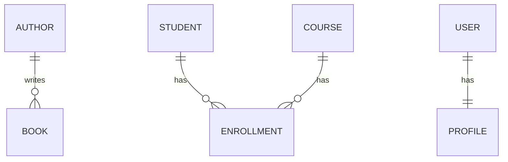
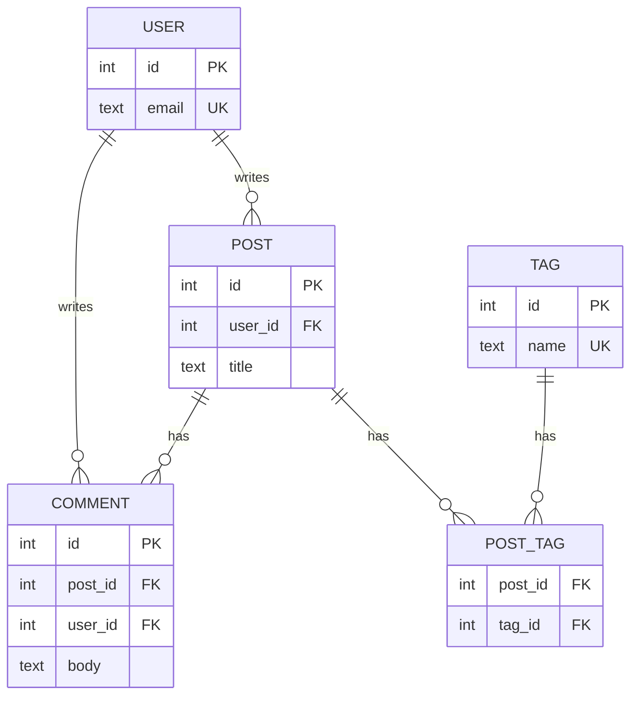

# Relational Databases

← [[28 Clean Code]] · [[Phase 2 - Start Here|Home]] · **Next:** [[30 SQL]] → · [[Software Engineering Roadmap#Relational Databases|Roadmap card]]

> [!abstract] After this note, you can
> Design tables, connect them with keys, and explain how databases keep data correct and fast.

## The Big Idea

In Phase 1, you saved tasks in a [[06 Files, Errors and Modules#Files - Memory That Lasts|JSON file]]. That works for one user. Now imagine a million users, all changing data at the same time. What if the power goes out halfway through saving? How do you find one order among billions?

A **database** solves these problems. A **relational database** stores data in tables that connect to each other. It's the right starting choice for most software.

| | Spreadsheet or file | Database |
|---|---|---|
| Many users at once | Breaks | Built for this |
| A crash halfway through | Data can be lost | Safe |
| Finding one row in a billion | Reads everything | A few steps |
| Stops bad data | No | Yes |

Popular ones include **PostgreSQL**, **MySQL** and **SQLite**. Their differences matter less than their shared ideas. We'll use **SQLite**, because it's built into Python, so there's nothing to install. For real servers, [PostgreSQL](https://www.postgresql.org/docs/current/) is a great default.

## The Parts of a Table

![[table-anatomy.svg]]

| Word | Meaning | In the picture |
|---|---|---|
| **Table** | One kind of thing | `students` |
| **Row** | One item | Priya's record |
| **Column** | One kind of fact, with a set type | `city` |
| **Primary key** | A value that uniquely identifies a row | `id` |

Let's make one. **SQL** is the language you use to talk to the database. It's covered fully in the [[30 SQL|next note]].

```python
import sqlite3

db = sqlite3.connect(":memory:")

db.execute("""
    CREATE TABLE students (
        id   INTEGER PRIMARY KEY,
        name TEXT NOT NULL,
        city TEXT
    )
""")

db.execute("INSERT INTO students (name, city) VALUES (?, ?)", ("Sam", "Colombo"))
db.execute("INSERT INTO students (name, city) VALUES (?, ?)", ("Priya", "Kandy"))

for row in db.execute("SELECT id, name, city FROM students"):
    print(row)
```

Output:

```text
(1, 'Sam', 'Colombo')
(2, 'Priya', 'Kandy')
```

(`:memory:` keeps the database in memory for practice. To save it to a file, use a file name instead, such as `"school.db"`.)

> [!danger] Always use `?` placeholders
> Never build SQL by joining strings with user input. That allows [[Software Engineering Roadmap#SQL Injection|SQL injection]], one of the most damaging security bugs. The `?` keeps your data safely separate from your commands.

## Keys - How Tables Connect

### Primary Keys

A **primary key** uniquely identifies each row. Why not use a name? Because two students can share a name, and people can change their names. An `id` number never changes.

### Foreign Keys and One-to-Many

Say each author writes many books. How do you store that? You **don't** repeat the author's details in every book. Each book stores the author's id. This is a **foreign key**.

![[one-to-many.svg]]

### Many-to-Many

A student takes many courses. A course has many students. Neither table can hold a single foreign key for this, so you add a **join table** in the middle.

![[many-to-many.svg]]

### Relationship Types



| Type | Example | How to store it |
|---|---|---|
| **One-to-one** | User and profile | Foreign key with `UNIQUE` |
| **One-to-many** | Author and books | Foreign key on the "many" side |
| **Many-to-many** | Students and courses | A join table |

> [!tip] Reading the diagram
> In these **ER diagrams**, `||` means exactly one, and `o{` means zero or more.

## Constraints - Rules the Database Enforces

**Constraints** make the database reject bad data, even if your code has a bug. Think of them as a last line of defense.

| Constraint | Rule |
|---|---|
| `PRIMARY KEY` | Unique, and never empty |
| `NOT NULL` | Must have a value |
| `UNIQUE` | No two rows can have the same value |
| `FOREIGN KEY` | Must point to a row that exists |
| `CHECK` | Must pass a test you write |
| `DEFAULT` | Used when no value is given |

```python
import sqlite3

db = sqlite3.connect(":memory:")
db.execute("PRAGMA foreign_keys = ON")

db.execute("""
    CREATE TABLE authors (
        id   INTEGER PRIMARY KEY,
        name TEXT NOT NULL
    )
""")
db.execute("""
    CREATE TABLE books (
        id        INTEGER PRIMARY KEY,
        title     TEXT NOT NULL,
        price     REAL CHECK (price >= 0),
        author_id INTEGER NOT NULL REFERENCES authors(id)
    )
""")

db.execute("INSERT INTO authors (name) VALUES ('Asha')")
db.execute("INSERT INTO books (title, price, author_id) VALUES ('SQL Fun', 10, 1)")
print("Good row saved")

bad_rows = [
    ("No such author", 10, 99),
    ("Negative price", -5, 1),
    (None, 10, 1),
]
for title, price, author in bad_rows:
    try:
        db.execute("INSERT INTO books (title, price, author_id) VALUES (?, ?, ?)", (title, price, author))
    except sqlite3.IntegrityError as error:
        print(f"Rejected: {error}")
```

Output:

```text
Good row saved
Rejected: FOREIGN KEY constraint failed
Rejected: CHECK constraint failed: price >= 0
Rejected: NOT NULL constraint failed: books.title
```

> [!note] SQLite's foreign keys
> SQLite only checks foreign keys if you turn it on with `PRAGMA foreign_keys = ON`. Other databases, such as PostgreSQL, always check.

### What Is NULL?

`NULL` means **unknown or missing**. It's not 0, and it's not an empty string. Because it's unknown, `NULL = NULL` isn't true. You must write `IS NULL`.

## Normalization - Store Each Fact Once

![[normalization.svg]]

**Normalization** means organizing tables so that each fact lives in exactly one place. Without it, you get problems:

| Problem | Example |
|---|---|
| **Update** | Asha moves, but you only change one of her two rows. Now the data disagrees with itself. |
| **Insert** | You can't add a new author until they have a book. |
| **Delete** | Remove Ben's only book, and you lose Ben's city too. |

### The Normal Forms in Simple Words

**1NF: One value per cell.**

```text
Bad:   | Sam | "Math, Art, Music" |

Good:  | Sam | Math  |
       | Sam | Art   |
       | Sam | Music |
```

**2NF: Every column depends on the whole key.** If the key is `(student_id, course_id)`, then `course_title` depends only on the course, so it belongs in a `courses` table.

**3NF: Columns depend only on the key, not on other columns.** In a books table, `author_city` depends on the author rather than the book. So move it to the `authors` table.

> [!tip] A simple test
> Ask of each column: "Is this a fact about the thing this table represents?" If it's not, it probably belongs in another table.

**Denormalization** means repeating some data on purpose, usually for speed. Learn the rules first, and break them only with a measured reason. See [[Software Engineering Roadmap#Normalization|the roadmap card]].

## Indexes in One Picture

![[index-book.svg]]

Without an **index**, the database reads every row to find a match. With one, it jumps almost straight there, using a [[20 Trees and Heaps#Why Databases Love Trees|B-tree]].

```python
import sqlite3

db = sqlite3.connect(":memory:")
db.execute("CREATE TABLE users (id INTEGER PRIMARY KEY, email TEXT)")

def plan():
    query = "EXPLAIN QUERY PLAN SELECT * FROM users WHERE email = 'a@example.com'"
    return db.execute(query).fetchone()[3]

print(plan())
db.execute("CREATE INDEX idx_users_email ON users(email)")
print(plan())
```

Output:

```text
SCAN users
SEARCH users USING COVERING INDEX idx_users_email (email=?)
```

The plan changed from `SCAN` (read everything) to `SEARCH` (jump there).

**The cost:** each index takes up space, and it slows down writes, because the index must also be updated. Don't index everything. Add indexes for the columns you often search or sort by.

## Transactions

![[transaction.svg]]

A **transaction** groups changes together, so that they **all happen or none of them do**. The classic example is moving money.

```python
import sqlite3

db = sqlite3.connect(":memory:")
db.execute("CREATE TABLE accounts (name TEXT PRIMARY KEY, balance INTEGER CHECK (balance >= 0))")
db.execute("INSERT INTO accounts VALUES ('Sam', 100), ('Priya', 50)")
db.commit()

def transfer(sender, receiver, amount):
    try:
        with db:
            db.execute("UPDATE accounts SET balance = balance + ? WHERE name = ?", (amount, receiver))
            db.execute("UPDATE accounts SET balance = balance - ? WHERE name = ?", (amount, sender))
        print("Transfer done")
    except sqlite3.IntegrityError:
        print("Transfer failed, nothing changed")

transfer("Sam", "Priya", 30)
transfer("Sam", "Priya", 500)

print(db.execute("SELECT * FROM accounts").fetchall())
```

Output:

```text
Transfer done
Transfer failed, nothing changed
[('Sam', 70), ('Priya', 80)]
```

In the failed transfer, Priya's balance was updated first. Then Sam's check failed, and the database **rolled back** Priya's change too. No money appeared from nowhere.

These guarantees have a name, **ACID**:

| Letter | Means | In plain words |
|---|---|---|
| **A** | Atomicity | All or nothing |
| **C** | Consistency | Rules are never broken |
| **I** | Isolation | Transactions don't interfere with each other |
| **D** | Durability | Once saved, it survives a crash |

## Under the Hood

You'll go deeper later, but it's good to know these ideas.

- **Connection pools:** opening a database connection is slow. Apps keep a group of open connections ready to reuse.
- **Pages:** databases store data on disk in fixed-size blocks called pages.
- **Write-ahead log:** before changing data, the database first writes down what it plans to do. After a crash, it uses this log to recover. That's how durability works.

## Worked Example - Design a Blog

**Step 1. Find the nouns:** users, posts, comments and tags.

**Step 2. Find the relationships:**

- A user writes many posts.
- A post has many comments.
- A post has many tags, and a tag has many posts.

**Step 3. Draw it:**



## Common Mistakes

> [!warning] Watch out for these
> - Using a person's name or email as a primary key
> - Storing a list in one cell
> - Repeating the same data across tables
> - Storing money as a floating-point number. Use whole cents, or a decimal type.
> - Building SQL strings from user input
> - Having no constraints, and trusting the app to get it all right

## Practice

**1. Relationships.** Which type is each?
- A country and its capital city
- A customer and their orders
- Actors and films

> [!example]- Answer to question 1
> One-to-one, one-to-many, many-to-many.

**2. Normalize.** Fix this table.

```text
orders: | id | customer_name | customer_phone | product_names         |
        | 1  | Sam           | 0771           | "Tea, Cake"           |
        | 2  | Sam           | 0771           | "Milk"                |
```

> [!example]- Answer to question 2
> ```text
> customers:   id, name, phone
> orders:      id, customer_id
> products:    id, name
> order_items: order_id, product_id
> ```
> Now Sam's phone is stored once, and each product has its own row.

**3. Design.** Draw a design for a school: teachers, classes and students. Each class has one teacher, and many students.

> [!example]- Answer to question 3
> ```mermaid
> erDiagram
>     TEACHER ||--o{ CLASS : teaches
>     CLASS ||--o{ ENROLLMENT : has
>     STUDENT ||--o{ ENROLLMENT : has
> ```

**4. Try it.** Create the `authors` and `books` tables, and try to break each constraint on purpose.

## Can You Do This?

- [ ] Name the parts of a table on a drawing
- [ ] Explain primary and foreign keys
- [ ] Store one-to-many and many-to-many relationships
- [ ] Add constraints, and see them reject bad data
- [ ] Normalize a messy table to 3NF
- [ ] Explain the benefits and costs of an index
- [ ] Explain ACID, and write a safe transfer
- [ ] Use `?` placeholders every time

## Summary

> [!success] Remember
> - **Tables** hold rows and columns. **Keys** connect them.
> - **Constraints** stop bad data at the door.
> - **Normalize:** store each fact once.
> - **Indexes** speed up reads, but slow down writes.
> - **Transactions:** all or nothing.

**Next:** [[30 SQL]] →
