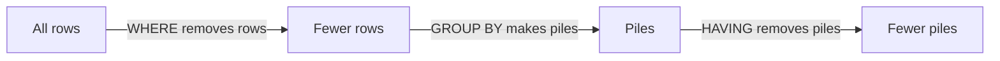
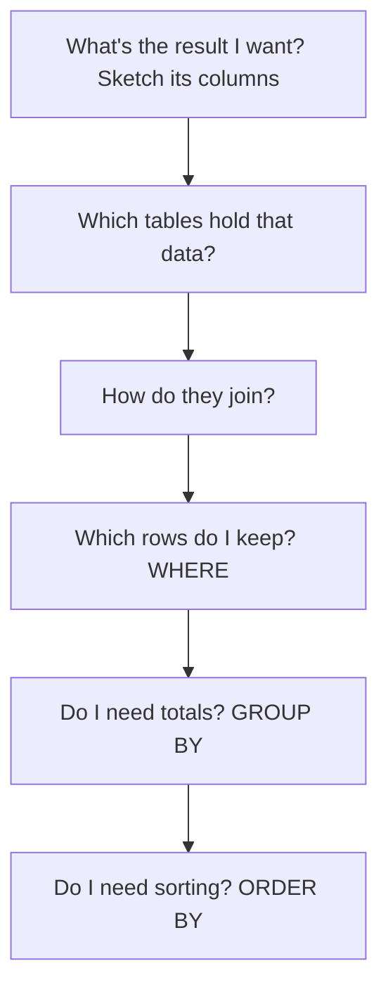

# SQL

← [[29 Relational Databases]] · [[Phase 2 - Start Here|Home]] · **Next:** [[31 Networking Fundamentals]] → · [[Software Engineering Roadmap#SQL|Roadmap card]]

> [!abstract] After this note, you can
> Ask a database almost any question, including ones that combine several tables and calculate totals.

## The Big Idea

**SQL** (Structured Query Language) is how you talk to a relational database. It's over 50 years old, and it's still everywhere, because it's [[27 Programming Paradigms#Declarative|declarative]]: you say **what** you want, and the database works out **how**.

## Set Up Your Practice Database

Create this file once. Every example below uses it, so you can focus on the queries.

```python
# file: shop.py
import sqlite3

def connect():
    db = sqlite3.connect(":memory:")
    db.executescript("""
        CREATE TABLE customers (
            id INTEGER PRIMARY KEY, name TEXT NOT NULL, city TEXT
        );
        CREATE TABLE products (
            id INTEGER PRIMARY KEY, name TEXT NOT NULL, price INTEGER NOT NULL, category TEXT
        );
        CREATE TABLE orders (
            id INTEGER PRIMARY KEY, customer_id INTEGER REFERENCES customers(id),
            product_id INTEGER REFERENCES products(id), quantity INTEGER, day TEXT
        );
        INSERT INTO customers VALUES
            (1, 'Sam', 'Colombo'), (2, 'Priya', 'Kandy'), (3, 'Ali', 'Galle'), (4, 'Mei', 'Kandy');
        INSERT INTO products VALUES
            (1, 'Tea', 50, 'Drink'), (2, 'Coffee', 80, 'Drink'),
            (3, 'Cake', 120, 'Food'), (4, 'Bread', 60, 'Food');
        INSERT INTO orders VALUES
            (10, 1, 1, 2, '2026-01-05'), (11, 1, 3, 1, '2026-01-06'),
            (12, 2, 2, 1, '2026-01-06'), (13, 2, 3, 2, '2026-01-07'),
            (14, 4, 1, 5, '2026-01-08');
    """)
    return db

def show(db, sql, *values):
    for row in db.execute(sql, values):
        print(row)
```

Here's the data as a picture. Keep it open while you practice.

```text
customers                products                       orders
id  name   city          id  name    price  category    id  customer  product  qty  day
1   Sam    Colombo       1   Tea     50     Drink       10  1         1        2    01-05
2   Priya  Kandy         2   Coffee  80     Drink       11  1         3        1    01-06
3   Ali    Galle         3   Cake    120    Food        12  2         2        1    01-06
4   Mei    Kandy         4   Bread   60     Food        13  2         3        2    01-07
                                                        14  4         1        5    01-08
```

> [!tip] Other ways to practice
> Try the free interactive lessons at [SQLBolt](https://sqlbolt.com/), or use [DB Browser for SQLite](https://sqlitebrowser.org/).

## SQL's Order of Work

![[sql-order.svg]]

This one picture explains many confusing errors. You **write** `SELECT` first, but the database **runs** it nearly last. Think of it as a pipeline, where each step works on what the last step produced.

## Reading Data

### SELECT and FROM

```python
from shop import connect, show
db = connect()

show(db, "SELECT name, city FROM customers")
```

Output:

```text
('Sam', 'Colombo')
('Priya', 'Kandy')
('Ali', 'Galle')
('Mei', 'Kandy')
```

`SELECT *` means all columns. It's handy for exploring, but in real code, name the columns you need.

### WHERE - Filter the Rows

```python
from shop import connect, show
db = connect()

show(db, "SELECT name, price FROM products WHERE price > 70")
print("---")
show(db, "SELECT name FROM products WHERE category = 'Drink' AND price < 60")
print("---")
show(db, "SELECT name FROM customers WHERE city IN ('Kandy', 'Galle')")
print("---")
show(db, "SELECT name FROM products WHERE name LIKE 'C%'")
print("---")
show(db, "SELECT name FROM products WHERE price BETWEEN 50 AND 60")
```

Output:

```text
('Coffee', 80)
('Cake', 120)
---
('Tea',)
---
('Priya',)
('Ali',)
('Mei',)
---
('Coffee',)
('Cake',)
---
('Tea',)
('Bread',)
```

In `LIKE`, `%` means "anything". So `'C%'` means "starts with C".

### ORDER BY and LIMIT

```python
from shop import connect, show
db = connect()

show(db, "SELECT name, price FROM products ORDER BY price DESC LIMIT 2")
```

Output:

```text
('Cake', 120)
('Coffee', 80)
```

`DESC` means highest first. `ASC`, the default, means lowest first.

### Calculations and Names

```python
from shop import connect, show
db = connect()

show(db, "SELECT name, price * 2 AS double_price FROM products LIMIT 2")
show(db, "SELECT DISTINCT city FROM customers")
```

Output:

```text
('Tea', 100)
('Coffee', 160)
('Colombo',)
('Kandy',)
('Galle',)
```

`AS` gives a result a name. `DISTINCT` removes duplicates. Notice Kandy appears only once.

## Joins in One Picture

Your data lives in separate tables. A **join** matches rows from them.

![[joins.svg]]

![[join-result.svg]]

### INNER JOIN

Keep only the rows that match on both sides.

```python
from shop import connect, show
db = connect()

show(db, """
    SELECT customers.name, orders.id
    FROM customers
    INNER JOIN orders ON orders.customer_id = customers.id
    ORDER BY orders.id
""")
```

Output:

```text
('Sam', 10)
('Sam', 11)
('Priya', 12)
('Priya', 13)
('Mei', 14)
```

Ali doesn't appear, because he has no orders.

### LEFT JOIN

Keep **all** rows from the left table. Where there's no match, you get `NULL`, which Python shows as `None`.

```python
from shop import connect, show
db = connect()

show(db, """
    SELECT c.name, o.id
    FROM customers AS c
    LEFT JOIN orders AS o ON o.customer_id = c.id
    ORDER BY c.id, o.id
""")
```

Output:

```text
('Sam', 10)
('Sam', 11)
('Priya', 12)
('Priya', 13)
('Ali', None)
('Mei', 14)
```

> [!example] A very common trick: find what's missing
> Which customers have **never** ordered? Do a left join, and keep the rows with no match.

```python
from shop import connect, show
db = connect()

show(db, """
    SELECT c.name
    FROM customers AS c
    LEFT JOIN orders AS o ON o.customer_id = c.id
    WHERE o.id IS NULL
""")
```

Output:

```text
('Ali',)
```

### Joining Three Tables

`orders` connects customers and products. Add one `JOIN` for each table.

```python
from shop import connect, show
db = connect()

show(db, """
    SELECT c.name, p.name, o.quantity, p.price * o.quantity AS total
    FROM orders AS o
    JOIN customers AS c ON c.id = o.customer_id
    JOIN products  AS p ON p.id = o.product_id
    ORDER BY o.id
""")
```

Output:

```text
('Sam', 'Tea', 2, 100)
('Sam', 'Cake', 1, 120)
('Priya', 'Coffee', 1, 80)
('Priya', 'Cake', 2, 240)
('Mei', 'Tea', 5, 250)
```

## Summarizing with GROUP BY

![[group-by.svg]]

**Aggregate functions** turn many rows into one number: `COUNT`, `SUM`, `AVG`, `MIN` and `MAX`.

```python
from shop import connect, show
db = connect()

show(db, "SELECT COUNT(*), MIN(price), MAX(price), AVG(price) FROM products")
```

Output:

```text
(4, 50, 120, 77.5)
```

`GROUP BY` makes one pile per value, and then summarizes each pile.

```python
from shop import connect, show
db = connect()

show(db, """
    SELECT category, COUNT(*), AVG(price)
    FROM products
    GROUP BY category
""")
print("---")
show(db, """
    SELECT city, COUNT(*) AS people
    FROM customers
    GROUP BY city
    ORDER BY people DESC, city
""")
```

Output:

```text
('Drink', 2, 65.0)
('Food', 2, 90.0)
---
('Kandy', 2)
('Colombo', 1)
('Galle', 1)
```

### WHERE and HAVING



- **WHERE** filters rows **before** grouping.
- **HAVING** filters groups **after** grouping.

> [!example] Which customers have spent over 240?

```python
from shop import connect, show
db = connect()

show(db, """
    SELECT c.name, SUM(p.price * o.quantity) AS spent
    FROM orders AS o
    JOIN customers AS c ON c.id = o.customer_id
    JOIN products  AS p ON p.id = o.product_id
    GROUP BY c.name
    HAVING spent > 240
    ORDER BY spent DESC
""")
```

Output:

```text
('Priya', 320)
('Mei', 250)
```

Sam spent 220, so `HAVING` removed that group.

## Queries Inside Queries

### Subqueries

A **subquery** is a query inside another query.

```python
from shop import connect, show
db = connect()

show(db, """
    SELECT name, price FROM products
    WHERE price > (SELECT AVG(price) FROM products)
""")
```

Output:

```text
('Coffee', 80)
('Cake', 120)
```

### CTEs - Giving a Query a Name

A **CTE** (Common Table Expression) names a step, so you can read a query from top to bottom. It's like using a variable. Start with `WITH`.

```python
from shop import connect, show
db = connect()

show(db, """
    WITH spending AS (
        SELECT o.customer_id, SUM(p.price * o.quantity) AS total
        FROM orders AS o
        JOIN products AS p ON p.id = o.product_id
        GROUP BY o.customer_id
    )
    SELECT c.name, s.total
    FROM spending AS s
    JOIN customers AS c ON c.id = s.customer_id
    ORDER BY s.total DESC
""")
```

Output:

```text
('Priya', 320)
('Mei', 250)
('Sam', 220)
```

## Window Functions

`GROUP BY` squashes rows into one per group. A **window function** calculates over a group of rows, but **keeps every row**.

```text
GROUP BY:   Drink → 65            Window:   Tea    50   average 65
            Food  → 90                      Coffee 80   average 65
                                            Cake  120   average 90
                                            Bread  60   average 90
```

```python
from shop import connect, show
db = connect()

show(db, """
    SELECT name, category, price,
           AVG(price) OVER (PARTITION BY category) AS category_average,
           RANK() OVER (ORDER BY price DESC) AS price_rank
    FROM products
    ORDER BY price_rank
""")
```

Output:

```text
('Cake', 'Food', 120, 90.0, 1)
('Coffee', 'Drink', 80, 65.0, 2)
('Bread', 'Food', 60, 90.0, 3)
('Tea', 'Drink', 50, 65.0, 4)
```

> [!example] Running total of sales by day

```python
from shop import connect, show
db = connect()

show(db, """
    SELECT o.day, p.price * o.quantity AS sale,
           SUM(p.price * o.quantity) OVER (ORDER BY o.id) AS running_total
    FROM orders AS o
    JOIN products AS p ON p.id = o.product_id
    ORDER BY o.id
""")
```

Output:

```text
('2026-01-05', 100, 100)
('2026-01-06', 120, 220)
('2026-01-06', 80, 300)
('2026-01-07', 240, 540)
('2026-01-08', 250, 790)
```

## Changing Data

```python
from shop import connect, show
db = connect()

db.execute("INSERT INTO products (name, price, category) VALUES (?, ?, ?)", ("Juice", 70, "Drink"))
show(db, "SELECT name, price FROM products WHERE name = 'Juice'")

db.execute("UPDATE products SET price = price + 10 WHERE name = 'Juice'")
show(db, "SELECT name, price FROM products WHERE name = 'Juice'")

db.execute("DELETE FROM products WHERE name = 'Juice'")
show(db, "SELECT COUNT(*) FROM products")
```

Output:

```text
('Juice', 70)
('Juice', 80)
(4,)
```

> [!danger] Never forget WHERE
> `UPDATE products SET price = 0` changes **every row**. `DELETE FROM customers` removes **every customer**.
>
> **Good habit:** first write it as a `SELECT` with your `WHERE`, and check which rows you get. Then change it to `UPDATE` or `DELETE`, inside a [[29 Relational Databases#Transactions|transaction]].

## Saving a Query - Views

A **view** is a saved query that you use like a table.

```python
from shop import connect, show
db = connect()

db.execute("""
    CREATE VIEW drinks AS
    SELECT name, price FROM products WHERE category = 'Drink'
""")
show(db, "SELECT * FROM drinks")
```

Output:

```text
('Tea', 50)
('Coffee', 80)
```

**Stored procedures** are named programs saved inside the database. SQLite doesn't have them, but PostgreSQL and MySQL do.

## How to Write Any Query



Build it **one step at a time**, and run it after each step.

## Common Mistakes

> [!warning] Watch out for these
> - `UPDATE` or `DELETE` with no `WHERE`
> - Writing `= NULL` instead of `IS NULL`
> - Using `WHERE` for aggregate conditions. Use `HAVING`.
> - Forgetting an `ON` condition, which matches every row with every row
> - Selecting a column that isn't in `GROUP BY`
> - Using an `INNER JOIN` when you need to keep rows with no match

## Practice

Use `shop.py` to answer these. Try them yourself before looking.

**1.** List products from cheapest to most expensive.

> [!example]- Answer to question 1
> ```python
> from shop import connect, show
> db = connect()
>
> show(db, "SELECT name, price FROM products ORDER BY price")
> ```
>
> Output:
>
> ```text
> ('Tea', 50)
> ('Bread', 60)
> ('Coffee', 80)
> ('Cake', 120)
> ```

**2.** How many orders did each customer place? Include customers with none.

> [!example]- Answer to question 2
> `COUNT(o.id)` skips `NULL`, so Ali correctly gets 0.
> ```python
> from shop import connect, show
> db = connect()
>
> show(db, """
>     SELECT c.name, COUNT(o.id)
>     FROM customers AS c
>     LEFT JOIN orders AS o ON o.customer_id = c.id
>     GROUP BY c.id
> """)
> ```
>
> Output:
>
> ```text
> ('Sam', 2)
> ('Priya', 2)
> ('Ali', 0)
> ('Mei', 1)
> ```

**3.** What's the total revenue per category?

> [!example]- Answer to question 3
> ```python
> from shop import connect, show
> db = connect()
>
> show(db, """
>     SELECT p.category, SUM(p.price * o.quantity) AS revenue
>     FROM orders AS o
>     JOIN products AS p ON p.id = o.product_id
>     GROUP BY p.category
>     ORDER BY revenue DESC
> """)
> ```
>
> Output:
>
> ```text
> ('Drink', 430)
> ('Food', 360)
> ```

**4.** Which products have never been ordered?

> [!example]- Answer to question 4
> ```python
> from shop import connect, show
> db = connect()
>
> show(db, """
>     SELECT p.name
>     FROM products AS p
>     LEFT JOIN orders AS o ON o.product_id = p.id
>     WHERE o.id IS NULL
> """)
> ```
>
> Output:
>
> ```text
> ('Bread',)
> ```

**5.** Why does this fail? `SELECT price * 2 AS doubled FROM products WHERE doubled > 100`

> [!example]- Answer to question 5
> Look at the [[#SQL's Order of Work|order of work]]. `WHERE` runs before `SELECT`, so `doubled` doesn't exist yet in standard SQL. Write `WHERE price * 2 > 100`.

**6. Roadmap exercise.** Download a real dataset, load it into a database, and answer 30 business questions with SQL only.

## Can You Do This?

- [ ] Filter, sort and limit rows
- [ ] Draw and explain INNER and LEFT JOIN
- [ ] Join three tables
- [ ] Use GROUP BY with SUM, COUNT and AVG
- [ ] Explain WHERE and HAVING
- [ ] Write a subquery and a CTE
- [ ] Use a window function
- [ ] Safely update and delete rows
- [ ] Find rows with no match

## Summary

> [!success] Remember
> - **The order:** FROM → WHERE → GROUP BY → HAVING → SELECT → ORDER BY → LIMIT.
> - **INNER JOIN:** only matches. **LEFT JOIN:** everything on the left.
> - **WHERE** is for rows. **HAVING** is for groups.
> - **Always check your WHERE** before you change data.

**Next:** [[31 Networking Fundamentals]] →
