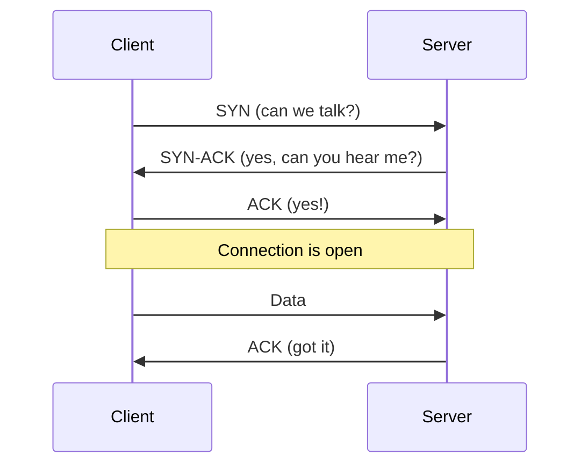
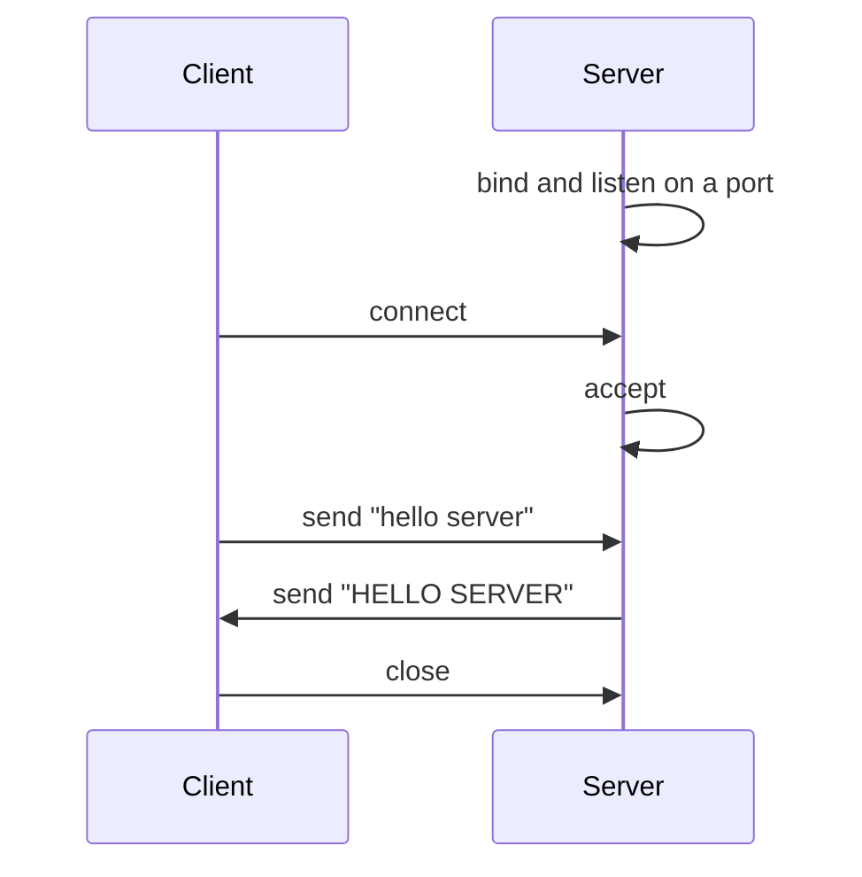
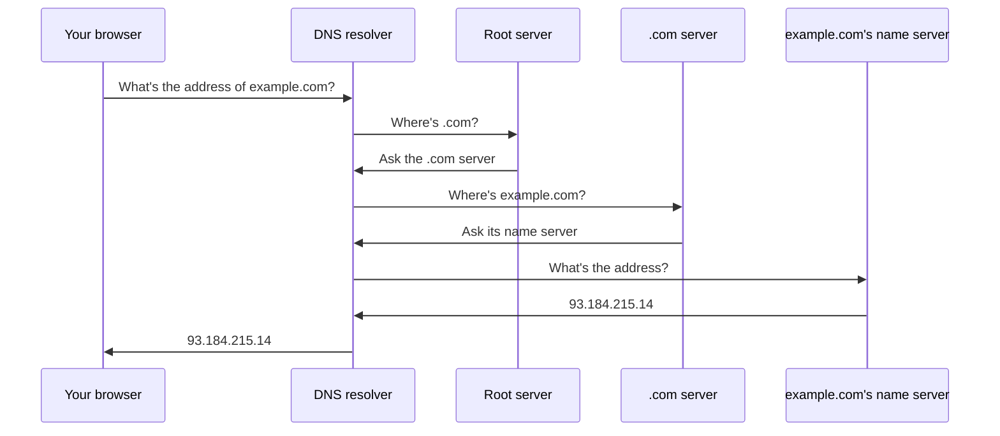
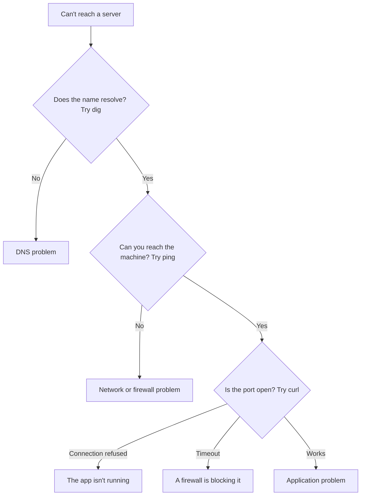

# Networking Fundamentals

← [[30 SQL]] · [[Phase 2 - Start Here|Home]] · **Next:** [[32 HTTP and HTTPS]] → · [[Software Engineering Roadmap#Networking Fundamentals|Roadmap card]]

> [!abstract] After this note, you can
> Explain how data travels between computers, what each network layer does, and use tools to investigate network problems.

## The Big Idea

Almost all software talks over a network. Networks are slow and unreliable compared with your computer's memory, so they cause many real bugs. To debug them, you need a clear picture of how they work.

Think about sending a letter. You write it, put it in an envelope, add an address, and the postal service moves it through several sorting centres. The internet works the same way.

## How Data Travels

![[network-journey.svg]]

Data isn't sent all at once. It's chopped into small pieces called **packets**. Each packet finds its way through a series of **routers**, which are like sorting centres. They pass it along, one hop at a time, until it arrives.

**Why packets?** If one piece gets lost, only that piece needs to be sent again. And many people can share the same wires.

### Two Words People Confuse

| Word | Meaning | Think of a water pipe |
|---|---|---|
| **Bandwidth** | How much data per second | How wide the pipe is |
| **Latency** | How long one piece takes to arrive | How long the pipe is |

> [!example] Why a fast connection can still feel slow
> You can have a very wide pipe, but if the server's on another continent, each request still takes 200 milliseconds to go there and back. Light in fibre can only go so fast. That's why big companies put servers near their users.

## Finding a Computer - IP Addresses and Ports

![[ip-port.svg]]

- An **IP address** identifies a computer on a network, like a building's address. For example, `203.0.113.10`.
- A **port** identifies a program on that computer, like a door or an apartment number.

| Common port | Used for |
|---|---|
| 22 | SSH |
| 53 | DNS |
| 80 | HTTP |
| 443 | HTTPS |
| 5432 | PostgreSQL |

> [!note] Two special addresses
> - `127.0.0.1`, also called `localhost`, means "this computer". You'll use this when testing your own programs.
> - `192.168.x.x` is a **private address**, used inside your home or office network. Your router shares one public address for all your devices. This is called **NAT**.

**Subnets** and **routing** are covered on the [[Software Engineering Roadmap#IP Addressing and Routing|IP Addressing card]] in Phase 3.

## Layers - The Key Idea

Networking is complicated, so it's split into **layers**. Each layer does one job, and relies on the layer below. Your web browser doesn't care if you're on Wi-Fi or a cable. That's the lower layer's business.

![[tcpip-layers.svg]]

| Layer | Job | Post office comparison | Examples |
|---|---|---|---|
| **Application** | What the programs say | The letter itself | HTTP, DNS, SSH |
| **Transport** | Between programs, maybe reliably | Tracked delivery, apartment number | TCP, UDP |
| **Internet** | Between computers, across networks | The city and street address | IP |
| **Link** | Across one physical link | The van between two post offices | Wi-Fi, Ethernet |

### Encapsulation - Parcels Inside Parcels

Each layer wraps the data with its own label, called a **header**. The receiver unwraps them in reverse order. This is called **encapsulation**.

### OSI and TCP-IP

You'll hear about two models. **TCP/IP** is what the internet actually uses. **OSI** has seven layers, and it's mainly used as a shared vocabulary. When someone says "that's a layer 7 problem", they mean the application layer.

![[osi-vs-tcpip.svg]]

> [!tip] Remember the OSI layers
> From bottom to top: **P**lease **D**o **N**ot **T**hrow **S**ausage **P**izza **A**way. Physical, Data link, Network, Transport, Session, Presentation, Application.

## TCP and UDP

The transport layer offers two main choices.

![[tcp-vs-udp.svg]]

| | TCP | UDP |
|---|---|---|
| **Connection** | Sets one up first | None |
| **Reliable?** | Yes, resends what's lost | No |
| **In order?** | Yes | Not guaranteed |
| **Speed** | Slower to start, more overhead | Fast, light |
| **Used for** | Web, email, files, databases | Video calls, games, DNS |

### The TCP Handshake

Before sending data, TCP sets up a connection with three messages. It's like a phone call: "Can you hear me?", "Yes, can you hear me?", "Yes!"



If a data packet gets lost, the sender notices the missing ACK and sends it again. This handshake costs one trip there and back before any real data moves, which is why reusing connections saves time.

### Sockets - Your Code on the Network

A **socket** is your program's connection to the network. Here's a tiny client and server talking to each other on your own computer.

```python
import socket
import threading

server = socket.socket()
server.bind(("127.0.0.1", 0))
server.listen()
port = server.getsockname()[1]

def serve_one():
    connection, address = server.accept()
    message = connection.recv(1024)
    connection.sendall(message.upper())
    connection.close()

threading.Thread(target=serve_one).start()

client = socket.socket()
client.connect(("127.0.0.1", port))
client.sendall(b"hello server")
print(client.recv(1024).decode())
client.close()
server.close()
```

Output:

```text
HELLO SERVER
```



**All** network programs, including web servers and databases, are built on this. For more, read [Beej's Guide to Network Programming](https://beej.us/guide/bgnet/).

## DNS - The Internet's Phone Book

People remember names, but computers need IP addresses. **DNS** (Domain Name System) turns `example.com` into an address.



The answer is saved, or **cached**, for a set time called the **TTL** (time to live), so most lookups are instant. This also explains why a DNS change can take a while to reach everyone.

| Record type | Purpose |
|---|---|
| `A` | Name to IPv4 address |
| `AAAA` | Name to IPv6 address |
| `CNAME` | One name is an alias for another |
| `MX` | Where to send email |
| `TXT` | Text notes, often used to prove you own a domain |

```python
import socket

print(socket.gethostbyname("localhost"))
```

Output:

```text
127.0.0.1
```

## What Can Go Wrong?

| Problem | What it means | What you'd see |
|---|---|---|
| **Packet loss** | Pieces go missing | TCP gets slow, video stutters |
| **High latency** | Long round trips | Everything feels sluggish |
| **DNS failure** | Name can't be found | "Name or service not known" |
| **Connection refused** | Nothing's listening on that port | Is the server running? |
| **Timeout** | No reply at all | Possibly a firewall or a dead server |
| **MTU problems** | Packet too big for a link | Small requests work, but large ones hang |



## Your Network Toolbox

| Tool | What it answers | Example |
|---|---|---|
| `ping` | Can I reach it, and how long does it take? | `ping example.com` |
| `traceroute` | Which route do my packets take? | `traceroute example.com` (`tracert` on Windows) |
| `dig` | What does DNS say? | `dig example.com` (`nslookup` on Windows) |
| `curl` | What does the server answer? | `curl -v https://example.com` |
| `ss` | Which ports are open on my machine? | `ss -tln` (`netstat -an` on Windows) |
| **Wireshark** | What's really on the wire? | A graphical tool |

> [!example] Roadmap exercise: see it for yourself
> Install [Wireshark](https://www.wireshark.org/). Start a capture, load one web page, then stop. Find the DNS lookup, the TCP handshake (SYN, SYN-ACK, ACK) and the TLS setup. Only capture on your own network.

## Common Mistakes

> [!warning] Watch out for these
> - Confusing bandwidth with latency
> - Assuming the network always works. Always handle timeouts and failures.
> - Blaming the network without checking. Use the flowchart above.
> - Forgetting that `localhost` in a container or on a server means **that** machine, not yours
> - Forgetting that DNS answers are cached

## Practice

**1. Layers.** Which layer does each belong to? HTTP, IP, Wi-Fi, TCP.

> [!example]- Answer to question 1
> Application, Internet, Link, Transport.

**2. Choose.** Would you use TCP or UDP for each?
- Downloading a file
- A live video call
- Loading a bank's website

> [!example]- Answer to question 2
> TCP, UDP, TCP. In a call, an old lost frame isn't worth waiting for. In a file or a bank page, every byte matters.

**3. Diagnose.** `curl` says "Connection refused". What does that tell you? What about a timeout?

> [!example]- Answer to question 3
> **Refused:** the machine answered, but nothing's listening on that port. So check that the app is running. **Timeout:** no answer at all, which often means a firewall, a wrong address, or a dead machine.

**4. Build.** Change the socket example so that the server handles three clients, one after another.

> [!example]- Answer to question 4
> ```python
> import socket
> import threading
>
> server = socket.socket()
> server.bind(("127.0.0.1", 0))
> server.listen()
> port = server.getsockname()[1]
>
> def serve_three():
>     for _ in range(3):
>         connection, address = server.accept()
>         message = connection.recv(1024)
>         connection.sendall(message.upper())
>         connection.close()
>
> worker = threading.Thread(target=serve_three)
> worker.start()
>
> for word in [b"a", b"b", b"c"]:
>     client = socket.socket()
>     client.connect(("127.0.0.1", port))
>     client.sendall(word)
>     print(client.recv(1024).decode())
>     client.close()
>
> worker.join()
> server.close()
> ```
>
> Output:
>
> ```text
> A
> B
> C
> ```

**5. Explore.** Run `traceroute` (or `tracert`) to a website in another country. How many hops does it take?

## Can You Do This?

- [ ] Draw the path from your laptop to a server
- [ ] Explain bandwidth and latency
- [ ] Explain IP addresses and ports
- [ ] Draw the four TCP/IP layers, and explain encapsulation
- [ ] Choose between TCP and UDP
- [ ] Draw the TCP handshake and a DNS lookup
- [ ] Write a simple socket client and server
- [ ] Use `ping`, `dig` and `curl` to narrow down a problem

## Summary

> [!success] Remember
> - Data travels as **packets**, hop by hop.
> - **IP** finds the machine. **Port** finds the program.
> - **Layers** each do one job, and wrap the layer above.
> - **TCP** is reliable. **UDP** is fast.
> - **DNS** turns names into addresses.

**Next:** [[32 HTTP and HTTPS]] →
