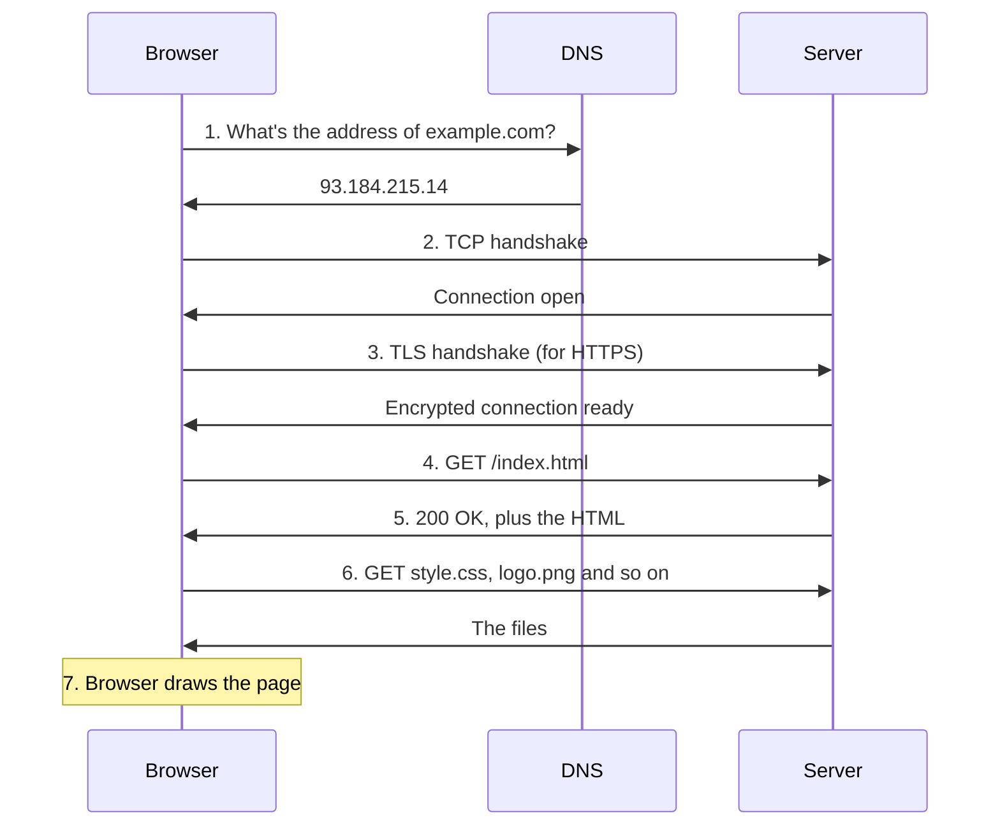
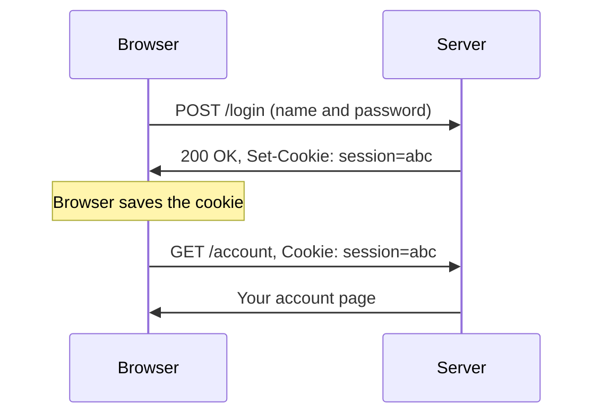
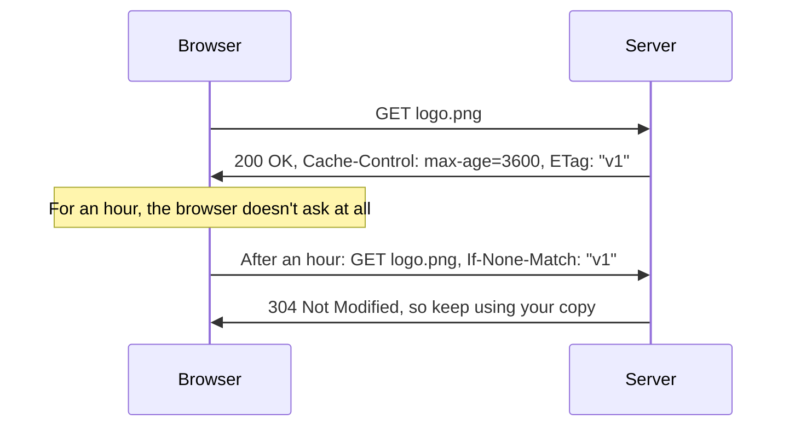
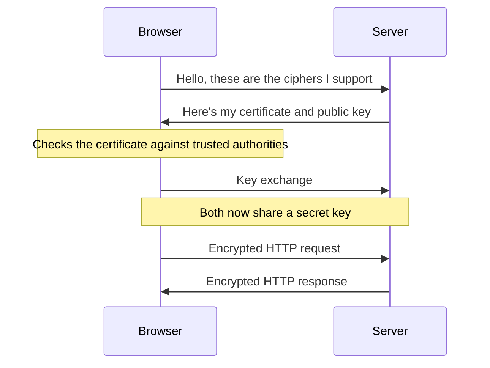
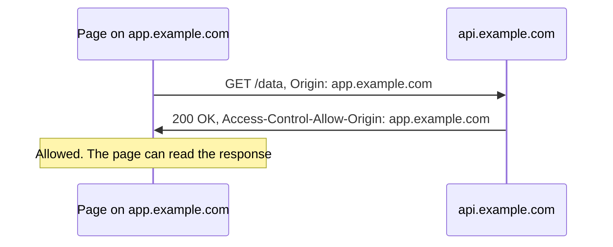
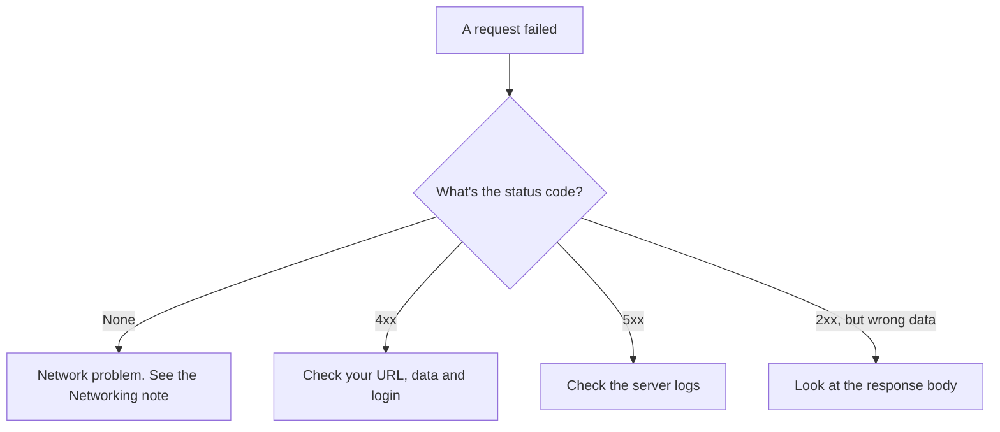

# HTTP and HTTPS

← [[31 Networking Fundamentals]] · [[Phase 2 - Start Here|Home]] · **Next:** [[33 Choose Your Delivery Area]] → · [[Software Engineering Roadmap#HTTP and HTTPS|Roadmap card]]

> [!abstract] After this note, you can
> Explain what happens when you visit a website, read any HTTP request and response, and write a small web server.

## The Big Idea

**HTTP** is the language of the web. It's a simple conversation, like ordering at a restaurant: you ask for something (a **request**), and you get something back (a **response**).

## What Happens When You Visit a Website?

This is one of the most famous interview questions. You now know enough to answer it.



## The Parts of a URL

![[url-anatomy.svg]]

```python
from urllib.parse import urlparse, parse_qs

url = urlparse("https://www.example.com:443/books/42?page=2#reviews")

print(url.scheme)
print(url.hostname)
print(url.port)
print(url.path)
print(parse_qs(url.query))
print(url.fragment)
```

Output:

```text
https
www.example.com
443
/books/42
{'page': ['2']}
reviews
```

## Requests and Responses

![[http-anatomy.svg]]

They're just text, in a set format. Here's a look at a real exchange:

```bash
curl -i https://example.com
```

`-i` shows the response headers. Add `-v` to see the request too.

### Methods - What Do You Want to Do?

| Method | Meaning | Like | Safe? | Idempotent? |
|---|---|---|---|---|
| **GET** | Read | Look at the menu | Yes | Yes |
| **POST** | Create | Place a new order | No | No |
| **PUT** | Replace | Replace your whole order | No | Yes |
| **PATCH** | Change part of something | Add extra cheese | No | Not always |
| **DELETE** | Remove | Cancel your order | No | Yes |

- **Safe** means it doesn't change anything.
- **Idempotent** means doing it twice has the same effect as doing it once.

> [!example] Why idempotent matters
> Your network drops just after you press "Pay". Did it go through? If you retry a POST, you might pay twice. A safe retry requires an idempotent design. You'll study [[Software Engineering Roadmap#API Design|idempotency keys]] later.

### Status Codes - What Happened?

![[status-codes.svg]]

| Code | Meaning | When you'd see it |
|---|---|---|
| **200** OK | It worked | A normal page |
| **201** Created | A new thing was created | After a successful POST |
| **204** No Content | It worked, nothing to send back | After a DELETE |
| **301** Moved Permanently | It's at a new address | A site changed its URL |
| **304** Not Modified | Use your saved copy | Browser caching |
| **400** Bad Request | Your request is malformed | Invalid data |
| **401** Unauthorized | Who are you? Log in | Missing login |
| **403** Forbidden | I know who you are, but no | Not allowed |
| **404** Not Found | It isn't here | Wrong URL |
| **429** Too Many Requests | Slow down | Rate limited |
| **500** Internal Server Error | The server's code crashed | A bug |
| **503** Service Unavailable | The server's overloaded or down | Maintenance |

> [!tip] The quick way to remember
> **4xx: your fault. 5xx: the server's fault.**

### Headers - Extra Information

| Header | Purpose | Example |
|---|---|---|
| `Host` | Which website | `Host: example.com` |
| `Content-Type` | What format the body is in | `Content-Type: application/json` |
| `Accept` | What format you'd like back | `Accept: application/json` |
| `Authorization` | Who you are | `Authorization: Bearer abc123` |
| `Cookie` | Data the site asked you to keep | `Cookie: session=xyz` |
| `Cache-Control` | How long to keep a copy | `Cache-Control: max-age=3600` |
| `Location` | Where to go for a redirect | `Location: /new-page` |

## Stateless and Cookies

HTTP is **stateless**: each request stands alone, and the server doesn't remember the last one. So how does a site keep you logged in?



A **cookie** is a small piece of data your browser saves and sends back automatically. It's like a cloakroom ticket: it doesn't contain your coat, but it proves which coat is yours.

## Caching

Why download the same logo every time? The server can say how long a copy stays good.



## HTTPS - The Secure Version

![[https-lock.svg]]

**HTTPS** is HTTP inside an encrypted **TLS** connection. It gives you three promises:

| Promise | Meaning |
|---|---|
| **Encryption** | Nobody along the way can read it |
| **Integrity** | Nobody can change it without detection |
| **Authentication** | You're really talking to that website |



A **certificate** is like a passport for a website. It's signed by a trusted organization, called a **certificate authority**. Your browser already trusts a list of these. [Let's Encrypt](https://letsencrypt.org/how-it-works/) gives certificates out for free. There's more on the [[Software Engineering Roadmap#TLS and Certificates|TLS card]].

> [!important] Always use HTTPS
> Over plain HTTP, your passwords travel as readable text. The padlock doesn't mean a site is honest, though. It only means that your connection to it is private.

## JSON APIs and REST

Websites send HTML for people. **APIs** send data for programs, usually in **JSON**.

**REST** is a common style for designing APIs. Treat everything as a **resource** with a URL, and use the HTTP methods as your verbs.

| Action | Method and URL | Success code |
|---|---|---|
| List books | `GET /books` | 200 |
| Read one book | `GET /books/42` | 200 |
| Create a book | `POST /books` | 201 |
| Replace a book | `PUT /books/42` | 200 |
| Delete a book | `DELETE /books/42` | 204 |

> [!warning] Use nouns in URLs
> `POST /createBook` isn't RESTful. The method is already the verb, so `POST /books` is enough.

## Build a Web Server

### Level 1 - From Raw Sockets

The roadmap asks you to write a minimal HTTP server from sockets. HTTP is just text, so it's surprisingly short.

```python
import socket
import threading

server = socket.socket()
server.bind(("127.0.0.1", 0))
server.listen()
port = server.getsockname()[1]

def serve_one():
    connection, address = server.accept()
    request = connection.recv(4096).decode()
    first_line = request.split("\r\n")[0]
    method, path, version = first_line.split(" ")

    body = f"You asked for {path}"
    response = (
        "HTTP/1.1 200 OK\r\n"
        "Content-Type: text/plain\r\n"
        f"Content-Length: {len(body)}\r\n"
        "\r\n"
        f"{body}"
    )
    connection.sendall(response.encode())
    connection.close()

threading.Thread(target=serve_one).start()

client = socket.socket()
client.connect(("127.0.0.1", port))
client.sendall(b"GET /hello HTTP/1.1\r\nHost: localhost\r\n\r\n")
print(client.recv(4096).decode().replace("\r\n", "\n"))
client.close()
server.close()
```

Output:

```text
HTTP/1.1 200 OK
Content-Type: text/plain
Content-Length: 20

You asked for /hello
```

That's real HTTP, with no framework. In a real response, each line ends with `\r\n`, and an empty line separates the headers from the body. The last `print` swaps `\r\n` for `\n` only to make the output tidy.

### Level 2 - Using a Library

Python's `http.server` handles the text parsing, so you can focus on the logic.

```python
import json
import threading
import urllib.request
from http.server import BaseHTTPRequestHandler, HTTPServer

class Handler(BaseHTTPRequestHandler):
    def do_GET(self):
        body = json.dumps({"path": self.path}).encode()
        self.send_response(200)
        self.send_header("Content-Type", "application/json")
        self.send_header("Content-Length", str(len(body)))
        self.end_headers()
        self.wfile.write(body)

    def log_message(self, *args):
        pass

server = HTTPServer(("127.0.0.1", 0), Handler)
threading.Thread(target=server.serve_forever, daemon=True).start()

url = f"http://127.0.0.1:{server.server_port}/books/42"
with urllib.request.urlopen(url) as response:
    print(response.status)
    print(response.read().decode())

server.shutdown()
```

Output:

```text
200
{"path": "/books/42"}
```

Real projects use frameworks such as FastAPI, Express or Spring. You'll build on this in the [[34 Phase 2 Final Project|final project]].

## HTTP Versions

| Version | Big idea | Picture |
|---|---|---|
| **HTTP/1.1** | One request at a time on each connection | One checkout lane |
| **HTTP/2** | Many requests at once on one connection | One lane, with items mixed and labeled |
| **HTTP/3** | Runs on QUIC over UDP, so one lost packet doesn't block the rest | Separate lanes |

Your code rarely notices the difference. Servers and browsers handle it for you.

## CORS

Browsers stop a page from one site reading responses from another, unless that other site allows it. This is the **same-origin policy**. **CORS** is how a server gives permission.



> [!tip] A common beginner error
> A "CORS error" appears in the browser, but it isn't a bug in your JavaScript. The **server** must send the right header. Requests from `curl` aren't affected, since only browsers enforce this.

## Debugging HTTP

**In the browser:** press **F12**, then open the **Network** tab. You can see every request, status, header and timing.

**In the terminal:**

```bash
curl -v https://example.com
curl -i https://example.com/missing
curl -X POST -H "Content-Type: application/json" -d '{"title":"SQL Fun"}' http://localhost:8000/books
```



## Common Mistakes

> [!warning] Watch out for these
> - Using GET for something that changes data
> - Returning 200 with an error message in the body
> - Mixing up 401 (who are you?) and 403 (you can't do this)
> - Sending passwords over plain HTTP
> - Putting secrets in URLs, because URLs end up in logs
> - Treating a CORS error as a frontend bug

## Practice

**1. Status codes.** Which code fits each one?
- A new user was created
- The password was wrong
- The page doesn't exist
- The server's code threw an exception

> [!example]- Answer to question 1
> 201, 401, 404, 500.

**2. Design.** Write the REST URLs for a to-do app: list, create, update, and delete tasks.

> [!example]- Answer to question 2
> - `GET /tasks`
> - `POST /tasks`
> - `PATCH /tasks/7`
> - `DELETE /tasks/7`

**3. Content-Length.** The socket server works out `Content-Length` with `len(body)`, rather than typing a number. Why? What would happen if the number were wrong?

> [!example]- Answer to question 3
> The body changes with each request, so its length does too. The header tells the client how many bytes to read. If the number is too small, the client cuts off the body. If it's too big, the client may keep waiting for bytes that never come.
>
> `len(body)` counts characters, and this only equals bytes for plain English text. The fully correct way is `len(body.encode())`.

**4. Explain.** In your own words, write down what happens when you type a URL and press Enter. Include DNS, TCP, TLS, HTTP and rendering.

**5. Use it.** Use `curl -v` on a website. Find the status code, the `Content-Type`, and the TLS version.

## Can You Do This?

- [ ] Name the parts of a URL
- [ ] Read a raw HTTP request and response
- [ ] Choose the right method and status code
- [ ] Explain safe and idempotent
- [ ] Explain how cookies keep you logged in
- [ ] Explain what HTTPS protects, and what it doesn't
- [ ] Design simple REST URLs
- [ ] Write a small server from raw sockets
- [ ] Debug with DevTools and `curl`

## Summary

> [!success] Remember
> - **Request:** method, path, headers, body. **Response:** status, headers, body.
> - **2xx** good, **3xx** elsewhere, **4xx** your fault, **5xx** server's fault.
> - HTTP is **stateless**. Cookies carry the memory.
> - **HTTPS** gives privacy, integrity and identity.

**Next:** [[33 Choose Your Delivery Area]] →
