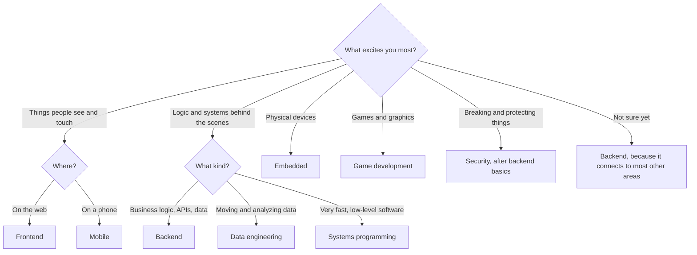

# Choose Your Delivery Area

← [[32 HTTP and HTTPS]] · [[Phase 2 - Start Here|Home]] · **Next:** [[34 Phase 2 Final Project]] → · [[Software Engineering Roadmap#Recommended Study Order|Roadmap study order]]

> [!abstract] After this note, you can
> Pick one area to go deep in, with a clear first project. You can change your mind later.

## The Big Idea

So far, you've learned what all engineers need. To get hired, you must also be able to **build something real** in one area. You can't learn all of them at once, and you don't need to.

![[delivery-areas.svg]]

> [!important] This isn't a life decision
> Your fundamentals transfer. Many engineers change direction several times. Pick what interests you most today, and start. You'll learn more from building than from choosing.

## Find Your Direction

## Compare the Areas

| Area | You build | First language | First tools | Roadmap |
|---|---|---|---|---|
| **Frontend** | Websites and web apps | JavaScript, TypeScript | HTML, CSS, React | [[Software Engineering Roadmap#Frontend Engineering\|Frontend]] |
| **Backend** | APIs, servers, business logic | Python, Java, C#, Go or Node | A framework, SQL, Docker | [[Software Engineering Roadmap#Backend Engineering\|Backend]] |
| **Mobile** | Phone apps | Kotlin or Swift | Android Studio or Xcode | [[Software Engineering Roadmap#Mobile Engineering Path\|Mobile]] |
| **Data** | Pipelines and warehouses | Python, SQL | Airflow, dbt | [[Software Engineering Roadmap#Data Engineering Path\|Data]] |
| **Embedded** | Software for devices | C | A microcontroller board | [[Software Engineering Roadmap#Embedded Systems Engineering Path\|Embedded]] |
| **Games** | Interactive games | C# or C++ | Godot, Unity or Unreal | [[Software Engineering Roadmap#Game Development Path\|Games]] |
| **Systems** | Databases, compilers, kernels | C, Rust | Linux | [[Software Engineering Roadmap#Systems Programming Path\|Systems]] |

## What's the Daily Work Like?

| Area | A typical day | You'll enjoy it if | It may frustrate you if |
|---|---|---|---|
| **Frontend** | Build screens, fix layout, improve speed | You like seeing results instantly and care about users | You dislike fast-changing tools |
| **Backend** | Design APIs, write queries, fix production issues | You like logic and reliability | You need to see visual results |
| **Mobile** | Build screens, test on devices, publish releases | You like polished apps people carry around | You dislike app store reviews |
| **Data** | Build pipelines, fix data quality problems | You like patterns and large-scale data | You dislike debugging data problems |
| **Embedded** | Read datasheets, write C, use an oscilloscope | You like hardware and tight limits | You dislike slow debugging |
| **Games** | Build gameplay, tune performance | You love games and creative work | You dislike crowded job markets |

> [!tip] Try before you decide
> Spend one weekend on a tiny project in your top two choices. Your interest during the boring parts tells you more than any chart.

## Your First Project in Each Area

| Area | First project | You'll learn |
|---|---|---|
| **Frontend** | A to-do app with [React](https://react.dev/learn) | Components, state, fetching data |
| **Backend** | [[34 Phase 2 Final Project\|The final project]], then rebuild it with FastAPI | APIs, databases, testing |
| **Mobile** | A notes app with local storage | Screens, lifecycle, storage |
| **Data** | Load a public dataset, clean it, and chart it | SQL, Python, pipelines |
| **Embedded** | Blink an LED, then read a sensor | C, registers, timing |
| **Games** | Pong or Breakout in Godot | Game loop, collisions |

**Free places to learn:**

- Web: [Full Stack Open](https://fullstackopen.com/en/), [The Odin Project](https://www.theodinproject.com/), [MDN](https://developer.mozilla.org/)
- Mobile: [Android courses](https://developer.android.com/courses), [SwiftUI tutorials](https://developer.apple.com/tutorials/swiftui)
- Data: [Data Engineering Zoomcamp](https://github.com/DataTalksClub/data-engineering-zoomcamp)
- Games: [Godot docs](https://docs.godotengine.org/en/stable/)

## Don't Forget the Basics

Whichever area you pick, keep practicing these, since they matter in all of them:

- [ ] A little coding practice each week, covering [[23 Algorithm Patterns]]
- [ ] Using Git for every project: [[09 Git Basics]]
- [ ] Writing tests: [[11 Unit Testing Basics]]
- [ ] Reading and fixing other people's code

## How to Decide in One Hour

1. Read the comparison table above.
2. Write down your top two choices.
3. Check local and remote job listings for each. What do they ask for?
4. Pick one, and write it here: **My first area is: \_\_\_\_\_\_\_\_\_\_**
5. Commit to it for at least 3 months before reconsidering.

## Common Mistakes

> [!warning] Watch out for these
> - Waiting for the perfect choice, instead of starting
> - Switching tools every few weeks, and never finishing a project
> - Following only what pays the most, then hating the work
> - Learning five frameworks instead of building one real project
> - Choosing ML or AI first with no programming or math base. It builds on what you're learning now.

## Summary

> [!success] Remember
> - **Pick one. Build something. Adjust later.**
> - Not sure? **Backend** is a safe start, as it teaches databases, APIs and systems that help everywhere.
> - Your fundamentals go with you wherever you go.

**Next:** [[34 Phase 2 Final Project]] →
