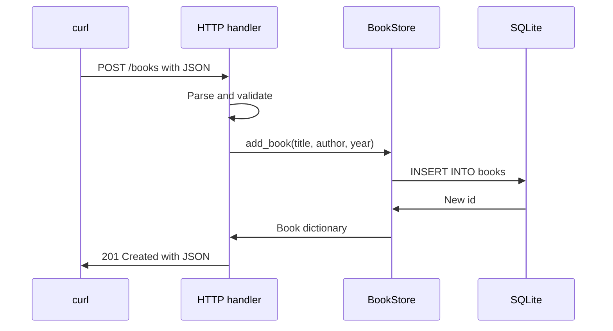
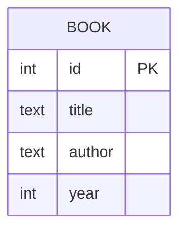

# Phase 2 Final Project - A Library Web API

← [[33 Choose Your Delivery Area]] · [[Phase 2 - Start Here|Home]]

> [!abstract] Your goal
> Build a real web API that stores books in a database, with tests and documentation. Other programs can talk to it over HTTP. This brings together nearly everything in Phase 2.

## What You'll Build

![[project-architecture.svg]]

```bash
curl -X POST -d '{"title":"SQL Fun","author":"Asha","year":2024}' http://localhost:8000/books
curl http://localhost:8000/books
curl http://localhost:8000/books/1
curl -X DELETE http://localhost:8000/books/1
```

| Method and URL | What it does | Success |
|---|---|---|
| `GET /books` | List all books | 200 |
| `GET /books?author=Asha` | List by author | 200 |
| `GET /books/1` | Get one book | 200, or 404 |
| `POST /books` | Add a book | 201, or 400 |
| `DELETE /books/1` | Remove a book | 204, or 404 |

> [!important] Try it yourself first
> Do the steps **without** opening the solution. Struggling is where the learning happens.

## How a Request Flows



Notice the two layers. **`BookStore`** only knows about the database. **The handler** only knows about HTTP. You can test `BookStore` without any network. That's [[26 Object-Oriented Programming#Coupling and Cohesion|low coupling]], and the [[11 Unit Testing Basics#Write Code That's Easy to Test|golden rule]] again.

## What You'll Use

| Skill | Where you learned it |
|---|---|
| Designing the table | [[29 Relational Databases]] |
| Writing queries with `?` | [[30 SQL]] |
| Status codes and methods | [[32 HTTP and HTTPS]] |
| Classes for structure | [[26 Object-Oriented Programming]] |
| Small, clear functions | [[28 Clean Code]] |
| Tests | [[11 Unit Testing Basics]] |
| Commits | [[09 Git Basics]] |

## Step by Step

### Step 1 - Set Up

- [ ] Create a folder called `library-api`, and run `git init`.
- [ ] Create `library_api.py`, `test_library_api.py`, `README.md` and `.gitignore`.
- [ ] Add `*.db`, `.venv/` and `__pycache__/` to `.gitignore`.
- [ ] Commit.

### Step 2 - Design the Data



- [ ] Write the `CREATE TABLE` with `NOT NULL` where needed.
- [ ] Add a `CHECK` that `year` is sensible.
- [ ] Add an index on `author`, as you'll search by it.

### Step 3 - Build the BookStore, with Tests

Write each method with a test, then commit.

- [ ] `add_book(title, author, year)` returns the new book
- [ ] `get_book(book_id)` returns the book, or `None`
- [ ] `list_books(author=None)` returns a list
- [ ] `delete_book(book_id)` returns `True` or `False`

> [!example]- Hint: testing without a real file
> Use `sqlite3.connect(":memory:")` in tests, so that each test begins with a fresh, empty database.

### Step 4 - Add the HTTP Layer

Start with the Level 2 server from [[32 HTTP and HTTPS#Level 2 - Using a Library]].

- [ ] Write a small `send_json(status, data)` helper, so you don't repeat yourself.
- [ ] Add `do_GET`, `do_POST` and `do_DELETE`.
- [ ] Read the POST body using the `Content-Length` header.

> [!example]- Hint: reading the URL
> `urlparse(self.path)` splits the path from the query, and `parse_qs` reads `?author=Asha`. To get the id, split the path: `"/books/1".split("/")` gives `['', 'books', '1']`.

### Step 5 - Handle Bad Input

The app must **never crash** on bad input. Test each of these:

- [ ] Invalid JSON returns 400
- [ ] A missing title returns 400
- [ ] A year that isn't a number returns 400
- [ ] `GET /books/abc` returns 404
- [ ] `GET /nothing` returns 404
- [ ] Trying to inject SQL, such as `?author=' OR 1=1 --`, returns nothing extra

### Step 6 - Test the Whole Thing

- [ ] Write tests that start the server, send real HTTP requests, and check the responses.

### Step 7 - Write the README and Share

- [ ] Say what it is, how to run it, and how to run the tests.
- [ ] Include a table of endpoints.
- [ ] Add one architecture diagram. You can draw your own.
- [ ] Push it to GitHub.

## Check Your Work

Your project is finished when you can tick all of these:

- [ ] All five endpoints work with `curl`
- [ ] Data is still there after restarting the server
- [ ] Status codes are correct, including 201, 204, 400 and 404
- [ ] No input can crash it
- [ ] All SQL uses `?` placeholders
- [ ] You have at least 10 passing tests
- [ ] You have at least 15 small commits with clear messages
- [ ] You can draw the request flow from memory
- [ ] You can explain every line

## One Possible Solution

> [!warning] Finish your own version first
> Compare only when you're done or truly stuck. Then close this, and write it again yourself.

> [!example]- Solution: library_api.py
> ```python
> # file: library_api.py
> """A small web API for a library, using only Python's standard library."""
> import json
> import sqlite3
> from http.server import BaseHTTPRequestHandler, ThreadingHTTPServer
> from urllib.parse import parse_qs, urlparse
>
> SCHEMA = """
> CREATE TABLE IF NOT EXISTS books (
>     id     INTEGER PRIMARY KEY,
>     title  TEXT NOT NULL,
>     author TEXT NOT NULL,
>     year   INTEGER NOT NULL CHECK (year BETWEEN 0 AND 3000)
> );
> CREATE INDEX IF NOT EXISTS idx_books_author ON books(author);
> """
>
>
> class BookStore:
>     def __init__(self, path):
>         self.db = sqlite3.connect(path, check_same_thread=False)
>         self.db.row_factory = sqlite3.Row
>         self.db.executescript(SCHEMA)
>
>     def add_book(self, title, author, year):
>         with self.db:
>             cursor = self.db.execute(
>                 "INSERT INTO books (title, author, year) VALUES (?, ?, ?)",
>                 (title, author, year),
>             )
>         return self.get_book(cursor.lastrowid)
>
>     def get_book(self, book_id):
>         row = self.db.execute("SELECT * FROM books WHERE id = ?", (book_id,)).fetchone()
>         return dict(row) if row else None
>
>     def list_books(self, author=None):
>         if author is None:
>             rows = self.db.execute("SELECT * FROM books ORDER BY id")
>         else:
>             rows = self.db.execute("SELECT * FROM books WHERE author = ? ORDER BY id", (author,))
>         return [dict(row) for row in rows]
>
>     def delete_book(self, book_id):
>         with self.db:
>             cursor = self.db.execute("DELETE FROM books WHERE id = ?", (book_id,))
>         return cursor.rowcount > 0
>
>
> def validate_book(data):
>     """Return a list of problems with the data. An empty list means it's valid."""
>     if not isinstance(data, dict):
>         return ["Body must be a JSON object"]
>     problems = []
>     for field in ("title", "author"):
>         value = data.get(field)
>         if not isinstance(value, str) or not value.strip():
>             problems.append(f"{field} must be a non-empty string")
>     year = data.get("year")
>     if not isinstance(year, int) or isinstance(year, bool) or not 0 <= year <= 3000:
>         problems.append("year must be a whole number from 0 to 3000")
>     return problems
>
>
> def book_id_from(path):
>     """Return the id from '/books/5', or None if the path doesn't match."""
>     parts = path.strip("/").split("/")
>     if len(parts) == 2 and parts[0] == "books" and parts[1].isdigit():
>         return int(parts[1])
>     return None
>
>
> def make_handler(store):
>     class Handler(BaseHTTPRequestHandler):
>         def send_json(self, status, data=None):
>             body = b"" if data is None else json.dumps(data).encode()
>             self.send_response(status)
>             self.send_header("Content-Type", "application/json")
>             self.send_header("Content-Length", str(len(body)))
>             self.end_headers()
>             self.wfile.write(body)
>
>         def send_not_found(self):
>             self.send_json(404, {"error": "Not found"})
>
>         def do_GET(self):
>             url = urlparse(self.path)
>             if url.path == "/books":
>                 author = parse_qs(url.query).get("author", [None])[0]
>                 self.send_json(200, store.list_books(author))
>                 return
>             book_id = book_id_from(url.path)
>             book = store.get_book(book_id) if book_id is not None else None
>             if book is None:
>                 self.send_not_found()
>             else:
>                 self.send_json(200, book)
>
>         def do_POST(self):
>             if urlparse(self.path).path != "/books":
>                 self.send_not_found()
>                 return
>             length = int(self.headers.get("Content-Length", 0))
>             try:
>                 data = json.loads(self.rfile.read(length))
>             except ValueError:
>                 self.send_json(400, {"error": "Body must be valid JSON"})
>                 return
>             problems = validate_book(data)
>             if problems:
>                 self.send_json(400, {"error": problems})
>                 return
>             book = store.add_book(data["title"].strip(), data["author"].strip(), data["year"])
>             self.send_json(201, book)
>
>         def do_DELETE(self):
>             book_id = book_id_from(urlparse(self.path).path)
>             if book_id is not None and store.delete_book(book_id):
>                 self.send_json(204)
>             else:
>                 self.send_not_found()
>
>         def log_message(self, *args):
>             pass
>
>     return Handler
>
>
> def main():
>     store = BookStore("library.db")
>     server = ThreadingHTTPServer(("127.0.0.1", 8000), make_handler(store))
>     print("Library API running on http://127.0.0.1:8000")
>     server.serve_forever()
>
>
> if __name__ == "__main__":
>     main()
> ```

> [!example]- Solution: test_library_api.py
> ```python
> # file: test_library_api.py
> import json
> import threading
> import urllib.error
> import urllib.parse
> import urllib.request
> from http.server import ThreadingHTTPServer
>
> import pytest
>
> from library_api import BookStore, book_id_from, make_handler, validate_book
>
> GOOD_BOOK = {"title": "SQL Fun", "author": "Asha", "year": 2024}
>
>
> @pytest.fixture
> def store():
>     return BookStore(":memory:")
>
>
> @pytest.fixture
> def api(store):
>     server = ThreadingHTTPServer(("127.0.0.1", 0), make_handler(store))
>     threading.Thread(target=server.serve_forever, daemon=True).start()
>     yield f"http://127.0.0.1:{server.server_port}"
>     server.shutdown()
>
>
> def call(method, url, data=None):
>     """Send a request. Return the status and the parsed body."""
>     body = data if isinstance(data, bytes) else None
>     if data is not None and body is None:
>         body = json.dumps(data).encode()
>     request = urllib.request.Request(url, data=body, method=method)
>     try:
>         with urllib.request.urlopen(request) as response:
>             status, text = response.status, response.read()
>     except urllib.error.HTTPError as error:
>         status, text = error.code, error.read()
>     return status, json.loads(text) if text else None
>
>
> # ---------- BookStore ----------
>
> def test_add_then_get(store):
>     book = store.add_book("A", "B", 2000)
>     assert store.get_book(book["id"])["title"] == "A"
>
>
> def test_get_missing_book_gives_none(store):
>     assert store.get_book(99) is None
>
>
> def test_list_filters_by_author(store):
>     store.add_book("A", "Asha", 2000)
>     store.add_book("B", "Ben", 2001)
>     assert [book["title"] for book in store.list_books("Asha")] == ["A"]
>
>
> def test_delete_reports_if_found(store):
>     book = store.add_book("A", "B", 2000)
>     assert store.delete_book(book["id"]) is True
>     assert store.delete_book(book["id"]) is False
>
>
> # ---------- Small helpers ----------
>
> @pytest.mark.parametrize("path, expected", [
>     ("/books/5", 5), ("/books/abc", None), ("/books", None), ("/nothing/5", None),
> ])
> def test_book_id_from(path, expected):
>     assert book_id_from(path) == expected
>
>
> @pytest.mark.parametrize("bad", [
>     [], {}, {"title": "", "author": "A", "year": 1}, {"title": "T", "author": "A", "year": "old"},
>     {"title": "T", "author": "A", "year": True},
> ])
> def test_validate_rejects_bad_data(bad):
>     assert validate_book(bad)
>
>
> def test_validate_accepts_good_data():
>     assert validate_book(GOOD_BOOK) == []
>
>
> # ---------- The real HTTP API ----------
>
> def test_create_returns_201_and_the_book(api):
>     status, book = call("POST", f"{api}/books", GOOD_BOOK)
>     assert status == 201
>     assert book["id"] == 1
>     assert book["title"] == "SQL Fun"
>
>
> def test_full_journey(api):
>     _, book = call("POST", f"{api}/books", GOOD_BOOK)
>     url = f"{api}/books/{book['id']}"
>     assert call("GET", url)[0] == 200
>     assert call("DELETE", url) == (204, None)
>     assert call("GET", url)[0] == 404
>
>
> def test_filter_by_author_over_http(api):
>     call("POST", f"{api}/books", GOOD_BOOK)
>     call("POST", f"{api}/books", {"title": "Bits", "author": "Ben", "year": 2020})
>     _, books = call("GET", f"{api}/books?author=Ben")
>     assert [book["title"] for book in books] == ["Bits"]
>
>
> @pytest.mark.parametrize("bad_body", [b"not json", b"[]", b'{"title":"T"}'])
> def test_bad_post_returns_400(api, bad_body):
>     assert call("POST", f"{api}/books", bad_body)[0] == 400
>
>
> @pytest.mark.parametrize("path", ["/books/abc", "/books/99", "/nothing"])
> def test_missing_things_return_404(api, path):
>     assert call("GET", f"{api}{path}")[0] == 404
>
>
> def test_delete_missing_book_returns_404(api):
>     assert call("DELETE", f"{api}/books/99")[0] == 404
>
>
> def test_sql_injection_finds_nothing(api):
>     call("POST", f"{api}/books", GOOD_BOOK)
>     attack = urllib.parse.quote("' OR 1=1 --")
>     status, books = call("GET", f"{api}/books?author={attack}")
>     assert status == 200
>     assert books == []
> ```

Run it, then try the `curl` commands above in a second terminal:

```bash
python library_api.py
python -m pytest
```

## Roadmap Projects to Add

The roadmap's portfolio stage for this phase also lists these. Each one reuses this phase's notes.

- [ ] **Data structures library:** a hash map, heap and tree from scratch, tested and benchmarked. Start from [[19 Hash Tables#Build Your Own Hash Map]] and [[20 Trees and Heaps#Build One Yourself]].
- [ ] **HTTP server from sockets:** extend [[32 HTTP and HTTPS#Level 1 - From Raw Sockets]] to handle many requests, then many clients at once.
- [ ] **First open-source contribution:** fix a small bug in a project you use. Look for the label "good first issue".
- [ ] **A project in your chosen area:** see [[33 Choose Your Delivery Area#Your First Project in Each Area]].

## Make It Your Own

Finished? Each of these teaches something new:

- [ ] **Pagination:** `GET /books?page=2&size=10`
- [ ] **Update:** add `PUT /books/1`
- [ ] **Authors table:** split authors out, with a foreign key
- [ ] **Search:** find books whose title contains a word
- [ ] **A front end:** a small HTML page that calls your API
- [ ] **A framework:** rebuild the API with [FastAPI](https://fastapi.tiangolo.com/), and compare

## Congratulations

> [!success] You've finished Phase 2
> You can organize data for speed, measure your code's cost, design classes and databases, and build software that talks over the internet. That's the core of computer science, and it will serve you for your whole career.

Now check the [[Software Engineering Roadmap#Ready for a Junior Role|Ready for a Junior Role]] list. Then continue to [[Phase 3 - Start Here|Phase 3]].

**Back to:** [[Phase 2 - Start Here]]
