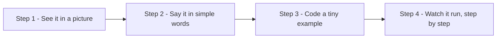
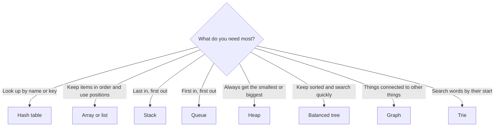

# Phase 2 - Build the Computer Science Core

> [!abstract] Your goal
> By the end of Phase 2, you can choose the right way to store data, work out if your code will be fast enough, write clean object-oriented code, use a database, and explain how the web works. That prepares you for a junior engineer role.

This is Phase 2 of the [[Software Engineering Roadmap#Recommended Study Order|Software Engineering Roadmap]]. You should finish [[Phase 1 - Start Here|Phase 1]] first.

![[p2-map.svg]]

## How These Notes Teach

Every idea follows the same four steps, so you always know what comes next.

> [!tip] Draw the pictures yourself
> When you study a diagram, close the note and draw it from memory on paper. If you can draw it, you understand it. Engineers draw boxes and arrows every day, even senior ones.

## The Notes, in Order

### Part 1 - Measure your code
- [ ] [[15 Discrete Mathematics]]: sets, counting and clock math
- [ ] [[16 Complexity Analysis]]: how to tell if code is fast or slow

### Part 2 - Organize your data
- [ ] [[17 Arrays and Linked Lists]]: two ways to keep things in order
- [ ] [[18 Stacks, Queues and Deques]]: control who goes next
- [ ] [[19 Hash Tables]]: find anything almost instantly
- [ ] [[20 Trees and Heaps]]: data that branches
- [ ] [[21 Graphs]]: data that connects

### Part 3 - Work on your data
- [ ] [[22 Searching and Sorting]]: the classic algorithms
- [ ] [[23 Algorithm Patterns]]: two pointers, sliding window, backtracking, greedy
- [ ] [[24 Dynamic Programming]]: stop repeating work
- [ ] [[25 Graph Algorithms]]: BFS, DFS, shortest paths

### Part 4 - Write code for humans
- [ ] [[26 Object-Oriented Programming]]: model the world with objects
- [ ] [[27 Programming Paradigms]]: different styles of thinking
- [ ] [[28 Clean Code]]: code others enjoy reading

### Part 5 - Store data and connect
- [ ] [[29 Relational Databases]]: tables, keys and relationships
- [ ] [[30 SQL]]: ask your data questions
- [ ] [[31 Networking Fundamentals]]: how computers talk
- [ ] [[32 HTTP and HTTPS]]: the language of the web

### Part 6 - Choose and build
- [ ] [[33 Choose Your Delivery Area]]: pick your direction
- [ ] [[34 Phase 2 Final Project]]: build a real web API with a database

**Need a word explained?** See the [[Phase 2 Glossary]].

> [!note] One small order change
> The roadmap lists SQL before relational databases. These notes teach tables first, because it's much easier to write SQL once you can picture the tables.

## Which Data Structure Should I Use?

Come back to this chart whenever you are unsure.

| Structure | Find by position | Search | Add | Remove | Learn it in |
|---|---|---|---|---|---|
| Array or list | O(1) | O(n) | O(1) at end, O(n) elsewhere | O(n) | [[17 Arrays and Linked Lists]] |
| Linked list | O(n) | O(n) | O(1) once you are there | O(1) once you are there | [[17 Arrays and Linked Lists]] |
| Stack or queue | Not used | Not used | O(1) | O(1) | [[18 Stacks, Queues and Deques]] |
| Hash table | Not used | O(1) on average | O(1) on average | O(1) on average | [[19 Hash Tables]] |
| Balanced tree | Not used | O(log n) | O(log n) | O(log n) | [[20 Trees and Heaps]] |
| Heap | Not used | O(n), top is O(1) | O(log n) | O(log n) for the top | [[20 Trees and Heaps]] |

Don't worry if O(1) means nothing to you yet. It will after [[16 Complexity Analysis]].

## A Simple Study Plan

This plan assumes about 8 to 10 hours each week. Phase 2 is bigger than Phase 1, so be patient with yourself.

| Weeks | Study |
|---|---|
| 1 to 2 | [[15 Discrete Mathematics]], [[16 Complexity Analysis]] |
| 3 to 4 | [[17 Arrays and Linked Lists]], [[18 Stacks, Queues and Deques]] |
| 5 to 6 | [[19 Hash Tables]], [[20 Trees and Heaps]] |
| 7 to 8 | [[21 Graphs]], [[22 Searching and Sorting]] |
| 9 to 12 | [[23 Algorithm Patterns]], [[24 Dynamic Programming]], [[25 Graph Algorithms]] |
| 13 to 15 | [[26 Object-Oriented Programming]], [[27 Programming Paradigms]], [[28 Clean Code]] |
| 16 to 19 | [[29 Relational Databases]], [[30 SQL]] |
| 20 to 22 | [[31 Networking Fundamentals]], [[32 HTTP and HTTPS]] |
| 23 to 26 | [[33 Choose Your Delivery Area]], [[34 Phase 2 Final Project]] |

Alongside the notes, solve 2 to 3 problems each week on [Exercism](https://exercism.org/) or [LeetCode](https://leetcode.com/). The roadmap's target is about 150 mixed problems by the end of this phase.

## When You Finish Phase 2

Check yourself with the roadmap's [[Software Engineering Roadmap#Ready for a Junior Role|Ready for a Junior Role]] list. Then continue to [[Phase 3 - Start Here|Phase 3]]. Then continue to [[Phase 3 - Start Here|Phase 3]]. Then continue to [[Phase 3 - Start Here|Phase 3]].

**Start here:** [[15 Discrete Mathematics]] →
