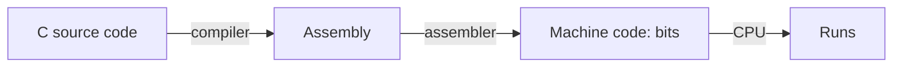
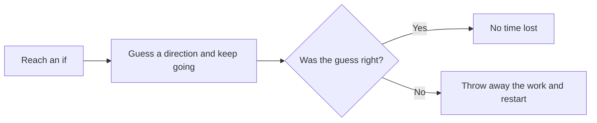

# Computer Organization and Architecture

[[Phase 3 - Start Here|Home]] · **Next:** [[36 Operating Systems]] → · [[Software Engineering Roadmap#Computer Organization and Architecture|Roadmap card]]

> [!abstract] After this note, you can
> Explain how a CPU runs your code, follow a small program through registers and memory, and see why some code is much faster than other code that looks the same.

## The Big Idea

Python, Java and every other language eventually become simple instructions for the CPU, such as "add these two numbers". Knowing what happens down there explains many mysteries, like why a sum can overflow or why one loop runs ten times faster than another.

![[computer-parts.svg]]

| Part | Job | Like |
|---|---|---|
| **CPU** | Runs instructions | A very fast worker |
| **RAM** | Holds running programs and their data | The worker's desk |
| **Disk or SSD** | Keeps data when power is off | A filing cabinet |

Inside the CPU:

- **ALU (Arithmetic Logic Unit):** does math and logic. It's built from the [[13 Boolean Algebra#How Do Switches Add Numbers?|adders you met in Phase 1]].
- **Registers:** a few tiny, extremely fast storage slots.
- **Control unit:** directs everything else.

## Numbers Inside the Machine

### Binary Refresher

You met binary in [[01 Computational Thinking#How Computers Store Everything|Phase 1]]. Computers usually work with fixed sizes: 8, 16, 32 or 64 bits. That limit causes real bugs.

### Negative Numbers - Two's Complement

![[twos-complement.svg]]

```python
def to_twos_complement(value, bits=4):
    return format(value & (2 ** bits - 1), f"0{bits}b")

print(to_twos_complement(5))
print(to_twos_complement(-5))
print(to_twos_complement(-1))
```

Output:

```text
0101
1011
1111
```

**Why this clever system?** The same adder circuit works for both positive and negative numbers. In 4 bits: 5 + (-5) is `0101 + 1011 = 10000`. The extra bit falls off, leaving `0000`.

### Integer Overflow

Python's whole numbers grow as needed, but most languages use fixed sizes. If you pass the limit, the value **wraps around**, like a car's odometer.

```python
def add_32_bit(a, b):
    result = (a + b) & 0xFFFFFFFF
    if result >= 2 ** 31:
        result = result - 2 ** 32
    return result

biggest = 2 ** 31 - 1
print(biggest)
print(add_32_bit(biggest, 1))
```

Output:

```text
2147483647
-2147483648
```

> [!example] Why this matters
> Add 1 to the biggest 32-bit number, and it becomes hugely negative. Real software has failed this way, including rockets and video games. A 32-bit counter of seconds since 1970 will overflow in the year 2038.

### Decimal Numbers - Floating Point

A **floating-point** number works like scientific notation, in binary. A 64-bit `float` splits its bits into three parts:

```text
| sign |  exponent  |            mantissa            |
| 1 bit|   11 bits  |            52 bits             |

Like:   -1.5 × 2^3
```

This gives a huge range, but limited precision. Many decimals, like 0.1, have no exact binary form, just as 1/3 has no exact decimal form.

```python
import struct

print(0.1 + 0.2)
print(0.1 + 0.2 == 0.3)
print(abs((0.1 + 0.2) - 0.3) < 1e-9)

bits = struct.unpack(">Q", struct.pack(">d", 1.5))[0]
print(format(bits, "064b")[:16])
```

Output:

```text
0.30000000000000004
False
True
0011111111111000
```

**Rules:** don't compare floats with `==`. Use a small tolerance. Don't store money in floats, as you'll see in [[50 Database Design#Money]].

## How the CPU Runs Code

![[fetch-decode-execute.svg]]

The CPU does one thing, forever: **fetch** an instruction, **decode** it, and **execute** it. A special register called the **instruction pointer** remembers where it's up to.

### Build a Tiny CPU

The best way to understand this is to build one. Here is a working CPU in 25 lines of Python.

```python
def run(program):
    registers = {"R1": 0, "R2": 0, "R3": 0}
    memory = {}
    pointer = 0

    while True:
        instruction = program[pointer]     # Fetch
        operation = instruction[0]         # Decode
        pointer = pointer + 1

        if operation == "LOAD":            # Execute
            registers[instruction[1]] = instruction[2]
        elif operation == "ADD":
            registers[instruction[1]] = registers[instruction[2]] + registers[instruction[3]]
        elif operation == "STORE":
            memory[instruction[2]] = registers[instruction[1]]
        elif operation == "JUMP_IF_LESS":
            if registers[instruction[1]] < registers[instruction[2]]:
                pointer = instruction[3]
        elif operation == "HALT":
            return registers, memory

registers, memory = run([
    ("LOAD", "R1", 7),
    ("LOAD", "R2", 5),
    ("ADD", "R3", "R1", "R2"),
    ("STORE", "R3", 200),
    ("HALT",),
])

print(registers)
print(memory)
```

Output:

```text
{'R1': 7, 'R2': 5, 'R3': 12}
{200: 12}
```

**Watch it run:**

| Pointer | Instruction | R1 | R2 | R3 | Memory 200 |
|---|---|---|---|---|---|
| 0 | `LOAD R1, 7` | **7** | 0 | 0 | |
| 1 | `LOAD R2, 5` | 7 | **5** | 0 | |
| 2 | `ADD R3, R1, R2` | 7 | 5 | **12** | |
| 3 | `STORE R3, 200` | 7 | 5 | 12 | **12** |
| 4 | `HALT` | | | | |

> [!example] How a loop works in hardware
> A loop is just a jump backward. There's no "for" in the CPU, only "go back to instruction N if this is true".

```python
def run(program):
    registers = {"R1": 0, "R2": 0, "R3": 0}
    pointer = 0
    steps = 0
    while True:
        instruction = program[pointer]
        operation = instruction[0]
        pointer = pointer + 1
        steps = steps + 1
        if operation == "LOAD":
            registers[instruction[1]] = instruction[2]
        elif operation == "ADD":
            registers[instruction[1]] = registers[instruction[2]] + registers[instruction[3]]
        elif operation == "JUMP_IF_LESS":
            if registers[instruction[1]] < registers[instruction[2]]:
                pointer = instruction[3]
        elif operation == "HALT":
            return registers, steps

# Count from 0 to 3, adding 1 each time
registers, steps = run([
    ("LOAD", "R1", 0),                  # 0: counter
    ("LOAD", "R2", 3),                  # 1: limit
    ("LOAD", "R3", 1),                  # 2: step
    ("ADD", "R1", "R1", "R3"),          # 3: counter = counter + 1
    ("JUMP_IF_LESS", "R1", "R2", 3),    # 4: back to 3 if counter < limit
    ("HALT",),                          # 5
])
print(registers["R1"], steps)
```

Output:

```text
3 10
```

## From Your Code to Machine Code



**Assembly** is a readable form of the CPU's instructions. You rarely write it, but it's useful to read. Here's a small C function:

```c
int add_ten(int x) {
    return x + 10;
}
```

And what a compiler makes of it on x86-64 and on ARM:

```text
x86-64:                       ARM64:
    lea  eax, [rdi + 10]          add  w0, w0, #10
    ret                           ret
```

Different CPUs understand different instructions. This is called the **instruction set architecture (ISA)**.

| ISA | Found in | Style |
|---|---|---|
| **x86-64** | Most laptops, desktops and servers | Many complex instructions |
| **ARM** | Phones, Apple Macs, many cloud servers | Fewer simple instructions, saves power |
| **RISC-V** | New chips, teaching, research | Open and free to use |

> [!tip] See it live
> Paste any code into [Compiler Explorer](https://godbolt.org/). It shows the assembly side by side with your code. Try changing the optimization level with `-O2`.

**Common instructions, in nearly every ISA:**

| Type | Example | Meaning |
|---|---|---|
| Move | `mov eax, 5` | Put 5 in a register |
| Math | `add eax, ebx` | Add two registers |
| Memory | `mov eax, [rbx]` | Read from an address |
| Compare | `cmp eax, 10` | Compare, and set flags |
| Jump | `jl label` | Jump if less |
| Call | `call func` | Run a function, then come back |

Function calls use the [[18 Stacks, Queues and Deques#The Call Stack|call stack]], and this is where it really lives. You'll see it in [[38 Memory Management]].

## Why Is the CPU So Fast?

### Pipelining

![[pipeline.svg]]

Doing laundry, you don't wait for one load to dry before washing the next. CPUs overlap instructions in the same way, so they finish far more per second.

### Branch Prediction

A pipeline has a problem. At an `if`, the CPU doesn't know which way to go until later. So it **guesses**, and keeps going. If it's wrong, it throws away that work and starts again, which costs time.

Modern CPUs guess correctly most of the time, as long as there's a pattern to learn.



> [!example] A famous surprise
> In C, summing the large values in an array can run several times faster if the array is **sorted first**, as the `if` becomes predictable. The Big-O is exactly the same. Only the hardware differs.

### Out-of-Order Execution and SIMD

- **Out-of-order execution:** the CPU reorders instructions behind the scenes, when it's safe, to keep busy.
- **SIMD (Single Instruction, Multiple Data):** one instruction works on several numbers at once. Video, games, and libraries like NumPy use this.

### Multiple Cores

A **core** is a separate worker inside a chip. A **GPU** takes this much further, with thousands of small cores. It's slower per core, but enormous in total, so it's ideal for graphics and machine learning.

| | CPU | GPU |
|---|---|---|
| **Cores** | A few to dozens, each powerful | Thousands, each simple |
| **Good at** | General logic, lots of branching | The same math on lots of data |

## The Memory Hierarchy

The CPU is much faster than RAM. To avoid waiting, it keeps recent data nearby in small, fast **caches**.

![[memory-hierarchy.svg]]

This is the same idea as the [[19 Hash Tables#Build an LRU Cache|caches you built]]: keep what you'll probably need close by.

### Locality

Caches work because programs tend to show **locality**:

- **Time:** data you just used will probably be used again.
- **Space:** data next to what you used will probably be used soon.

The CPU loads a whole block, called a **cache line**, usually 64 bytes. So reading through an array is fast, as the next items came along for free.

![[cache-locality.svg]]

This is why arrays beat linked lists in practice, even when the [[17 Arrays and Linked Lists#Side by Side|Big-O looks the same]]. Python's own overhead hides much of this, but you can still see it with NumPy, or in C.

```c
#include <stdio.h>
#define N 4

int main(void) {
    int grid[N][N];
    int total = 0;
    for (int row = 0; row < N; row++) {
        for (int col = 0; col < N; col++) {
            grid[row][col] = row + col;
        }
    }
    /* Going row by row reads memory in order, so it stays in the cache. */
    for (int row = 0; row < N; row++) {
        for (int col = 0; col < N; col++) {
            total += grid[row][col];
        }
    }
    printf("%d\n", total);
    return 0;
}
```

Output:

```text
48
```

With a very large grid, swapping the two loops gives the same answer, but it can run many times slower, because it keeps jumping around in memory.

## Common Mistakes

> [!warning] Watch out for these
> - Comparing floats with `==`
> - Forgetting that fixed-size integers can overflow
> - Trusting Big-O alone. Memory layout matters too.
> - Optimizing for hardware before measuring anything

## Practice

**1. Two's complement.** Write -3 in 4 bits, by hand.

> [!example]- Answer to question 1
> 3 is `0011`. Flip it: `1100`. Add 1: `1101`.

**2. Overflow.** An 8-bit signed value holds 127. What happens when you add 1?

> [!example]- Answer to question 2
> It wraps around to **-128**. 8 bits hold values from -128 to 127.

**3. Extend the CPU.** Add a `SUB` instruction to the tiny CPU, and use it to calculate 7 − 5.

> [!example]- Answer to question 3
> ```python
> def run(program):
>     registers = {"R1": 0, "R2": 0, "R3": 0}
>     pointer = 0
>     while True:
>         instruction = program[pointer]
>         pointer = pointer + 1
>         operation = instruction[0]
>         if operation == "LOAD":
>             registers[instruction[1]] = instruction[2]
>         elif operation == "SUB":
>             registers[instruction[1]] = registers[instruction[2]] - registers[instruction[3]]
>         elif operation == "HALT":
>             return registers
>
> print(run([("LOAD", "R1", 7), ("LOAD", "R2", 5), ("SUB", "R3", "R1", "R2"), ("HALT",)])["R3"])
> ```
>
> Output:
>
> ```text
> 2
> ```

**4. Latency.** A program reads 1 million values one after another. How long does that take, in rough terms, from RAM, and from a hard disk reading each value separately? Use the picture's numbers.

> [!example]- Answer to question 4
> RAM: 1,000,000 × 100 ns = **0.1 seconds**. Hard disk: 1,000,000 × 10 ms = **10,000 seconds**, or nearly 3 hours.

**5. Go deeper.** Try the first projects in [Nand2Tetris](https://www.nand2tetris.org/), or the bomb lab from [CMU 15-213](https://www.cs.cmu.edu/~213/).

## Can You Do This?

- [ ] Draw the main parts of a computer, and explain each
- [ ] Write negative numbers in two's complement
- [ ] Explain integer overflow and float errors
- [ ] Trace fetch, decode and execute through a small program
- [ ] Read simple assembly on Compiler Explorer
- [ ] Explain pipelining and branch prediction
- [ ] Draw the memory hierarchy, with rough speeds
- [ ] Explain why arrays are faster than linked lists in practice

## Summary

> [!success] Remember
> - The CPU repeats **fetch, decode, execute**.
> - Numbers have **limits**: integers overflow, and floats are approximate.
> - A loop is just a **jump back**.
> - **Close data is fast data.** Caches reward locality.

**Next:** [[36 Operating Systems]] →
