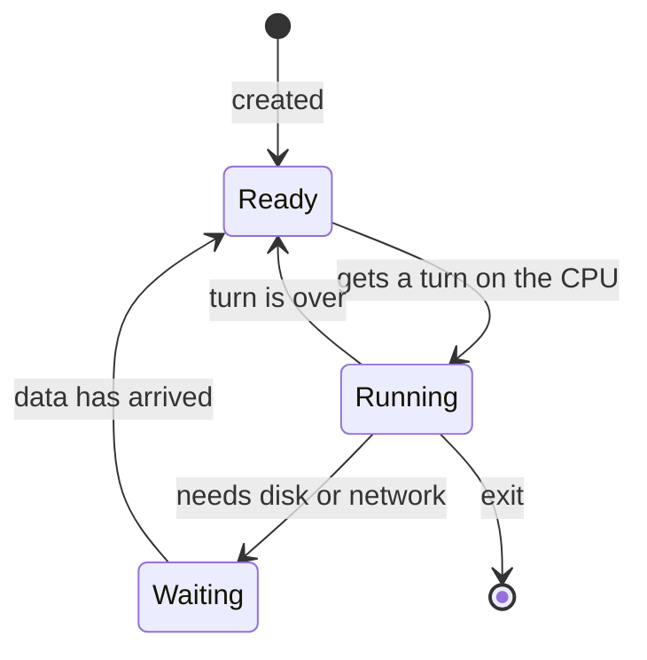
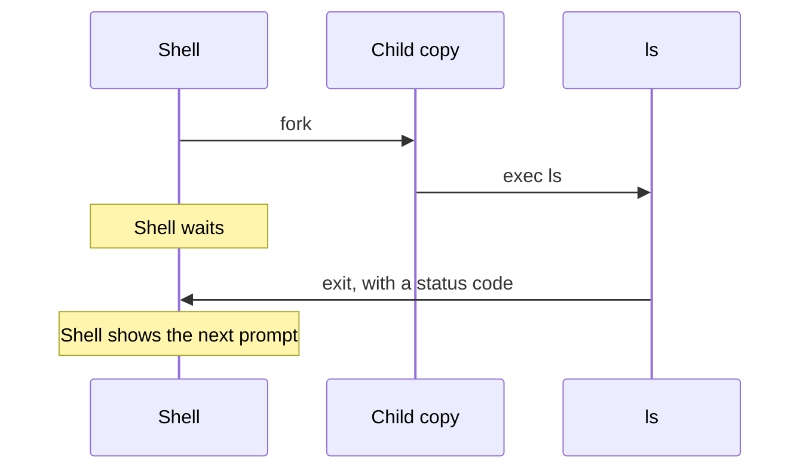
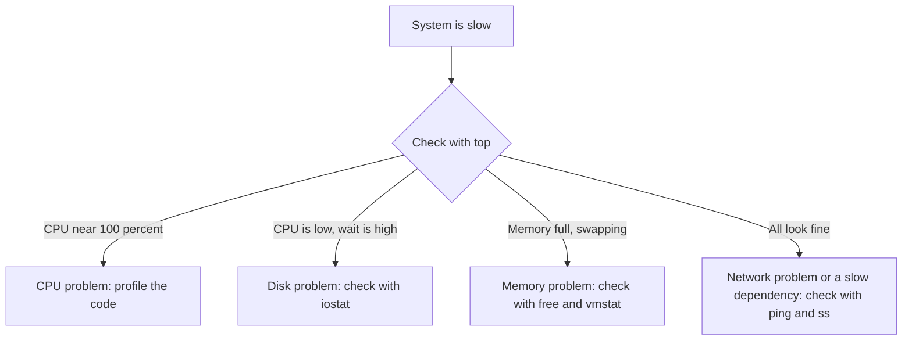

# Operating Systems

← [[35 Computer Organization and Architecture]] · [[Phase 3 - Start Here|Home]] · **Next:** [[37 Concurrency and Parallelism]] → · [[Software Engineering Roadmap#Operating Systems|Roadmap card]]

> [!abstract] After this note, you can
> Explain what the OS does for your program, how processes and threads differ, how virtual memory works, and work out why a system is slow.

## The Big Idea

Many programs share one computer. Who decides which one runs next? Who stops one program reading another's memory? That's the **operating system (OS)**. Think of it as the manager of a shared building: it hands out rooms, keeps people out of each other's offices, and runs the shared services.

The core part of the OS is called the **kernel**.

## Kernel and User Space

![[kernel-user.svg]]

Your program runs in **user space**, where it has limited powers. It can't touch the disk or network directly. To do so, it asks the kernel through a **system call**, or **syscall**.

Think of a bank. You can't walk into the vault yourself. You ask the teller, who checks your details and goes for you.

```python
import os

os.write(1, b"Hello directly from a system call\n")
print(os.getpid() > 0)
```

Output:

```text
Hello directly from a system call
True
```

`print` calls `write` underneath. `1` means "standard output".

| System call | What it asks for |
|---|---|
| `open`, `read`, `write`, `close` | Work with files and devices |
| `fork`, `exec`, `exit` | Create and end processes |
| `mmap` | Get memory |
| `socket`, `connect`, `send` | Use the network |

> [!tip] See them live
> On Linux, run `strace -c ls` to see a program's system calls. Each one crosses into the kernel, so it costs far more than a normal function call. That's why buffered I/O exists.

**Other jobs the kernel does:**

- **Interrupts:** hardware taps the CPU on the shoulder. "A key was pressed." "A network packet has arrived." The CPU pauses, and the kernel handles it. That's much better than checking constantly.
- **Device drivers:** code that knows how to talk to each kind of hardware.
- **Permissions:** checks that you may do what you're asking. See [[08 Linux Basics#Permissions - Who Can Do What]].

## Processes

A **process** is a running program, with its own memory. The program is the recipe. The process is the cooking.



### Creating Processes

On Linux, one process makes another in two steps:

1. **fork:** make a copy of myself.
2. **exec:** replace that copy with a different program.

This is exactly what your shell does whenever you type a command.



Python wraps all of this up in `subprocess`:

```python
import subprocess
import sys

result = subprocess.run(
    [sys.executable, "-c", "print('hello from a child process')"],
    capture_output=True,
    text=True,
)
print(result.stdout.strip())
print("exit code:", result.returncode)
```

Output:

```text
hello from a child process
exit code: 0
```

An **exit code** of 0 means success. Anything else means failure.

### Talking Between Processes

Processes can't see each other's memory, so they need **inter-process communication (IPC)**.

| Method | Like | Example |
|---|---|---|
| **Pipe** | A tube from one to another | `sort file \| uniq` |
| **Socket** | A phone line, even across a network | Web servers |
| **Shared memory** | A shared whiteboard | Very fast, but needs care |
| **Signals** | A tap on the shoulder | Ctrl + C |
| **Files** | Leaving a note | Simple batch jobs |

```python
import subprocess
import sys

child = subprocess.run(
    [sys.executable, "-c", "import sys; print(sys.stdin.read().upper())"],
    input="sent through a pipe",
    capture_output=True,
    text=True,
)
print(child.stdout.strip())
```

Output:

```text
SENT THROUGH A PIPE
```

**Signals** are simple messages sent by the kernel:

| Signal | Sent by | Default effect |
|---|---|---|
| `SIGINT` | Ctrl + C | Stop |
| `SIGTERM` | `kill 1234` | Please stop cleanly |
| `SIGKILL` | `kill -9 1234` | Stop now. It can't be ignored |

> [!tip] A real production rule
> When a server gets `SIGTERM`, it should finish its current requests and then exit. This is called a **graceful shutdown**. Using `kill -9` first can lose work.

## Threads

A **thread** is a path of execution inside a process. One process can have many threads, and they all share its memory.

![[process-vs-thread.svg]]

| | Process | Thread |
|---|---|---|
| **Memory** | Separate | Shared with its siblings |
| **Creating one** | Slower | Faster |
| **Talking** | Needs IPC | Just share variables |
| **If it crashes** | Others survive | Takes down the whole process |
| **Danger** | Low | [[37 Concurrency and Parallelism#Race Conditions\|Race conditions]] |

> [!example] Real examples
> - **Chrome** gives each site its own process, so a bad page can't easily reach or crash the others.
> - **A web server** may use many threads, to share one database connection pool.

**Green threads** are lightweight threads managed by your language, not the kernel. Go's goroutines are the famous example. You can run millions of them, because they're so cheap.

## The Scheduler

![[scheduler.svg]]

You might have hundreds of processes, but only a few CPU cores. The **scheduler** gives each one short turns, so fast that everything seems to run at once.

| Idea | Meaning |
|---|---|
| **Time slice** | How long one turn lasts, usually milliseconds |
| **Preemption** | The kernel can stop a process when its turn is up |
| **Priority** | Important work gets more turns |
| **Fairness** | Nobody should be left waiting forever |

Linux's scheduler, for example, tries to give each process a fair share of CPU time.

### Context Switches

Changing from one thread to another is called a **context switch**. The CPU saves one thread's registers, and loads the other's. It takes only microseconds, but the caches also go cold, so doing it too often wastes real time. That's one reason you can't simply use a million kernel threads.

## Virtual Memory

![[virtual-memory.svg]]

Each process believes it has a huge private memory, all to itself. That's an illusion managed by the kernel and CPU together, called **virtual memory**.

Memory is split into fixed-size blocks called **pages**, usually 4 KB. A **page table** maps each virtual page to a real place in RAM.

**This gives you four big benefits:**

| Benefit | How |
|---|---|
| **Isolation** | Process A simply has no way to name B's memory |
| **Simplicity** | Every program sees neat, continuous addresses |
| **More than RAM** | Rarely used pages can move to disk |
| **Sharing** | Two processes can map the same library once |

### Key Words

- **TLB:** a small cache of recent translations. Without it, every memory read would be much slower.
- **Page fault:** the page isn't in RAM. The kernel steps in, loads it, and the program continues without noticing.
- **Swapping:** moving pages to disk when RAM is full. Disk is thousands of times slower, so heavy swapping makes a machine crawl.
- **Copy-on-write:** after `fork`, parent and child share pages. A real copy happens only when one of them writes. That's why `fork` is fast.
- **OOM killer:** if memory really runs out, Linux's "out of memory" killer ends a process to save the system.

> [!example] A real production mystery
> Your container vanishes with exit code 137, and no error message. That's 128 + 9, meaning `SIGKILL`. If you didn't stop it yourself, the OOM killer probably ended it for going over its memory limit. To be sure, run `docker inspect NAME --format "{{.State.OOMKilled}}"`, or check `dmesg` and your memory graphs.

### Memory-Mapped Files

`mmap` makes a file look like memory. The kernel loads only the pages you touch, so you can work with files bigger than RAM.

```python
import mmap

with open("data.txt", "wb") as file:
    file.write(b"hello virtual memory")

with open("data.txt", "rb") as file:
    with mmap.mmap(file.fileno(), 0, access=mmap.ACCESS_READ) as memory:
        print(memory[:5])
        print(memory.find(b"memory"))
```

Output:

```text
b'hello'
14
```

## Files and Storage

A **file system** organizes data on disk. It's covered on the [[Software Engineering Roadmap#File Systems|File Systems card]], but one thing matters now:

> [!warning] Writing isn't the same as saved
> `write` usually only reaches a kernel buffer in RAM. If the power fails, it's gone. To be sure, call `fsync`. This is why [[52 Transactions and ACID#The Write-Ahead Log|databases]] are so careful.

```python
import os

with open("important.txt", "w") as file:
    file.write("saved")
    file.flush()
    os.fsync(file.fileno())

print(open("important.txt").read())
```

Output:

```text
saved
```

## Containers Are Just Processes

A preview of [[48 Docker]]: a container isn't a small virtual computer. It's a normal process with two kernel features:

- **Namespaces:** limit what it can **see** (its own process list, network, files).
- **cgroups:** limit what it can **use** (CPU, memory).

## Why Is It Slow?

The roadmap's mastery test asks you to diagnose slowness. Almost all of it comes from one of four resources.

![[slow-diagnosis.svg]]



| Tool | Shows |
|---|---|
| `top`, `htop` | CPU and memory per process |
| `vmstat 1` | Run queue, memory and swap activity |
| `iostat -x 1` | Disk load and waiting |
| `ss -s`, `ping` | Connections and network delay |
| `strace -c`, `perf` | What a program spends its time on |

The tools are for Linux. On Windows, use **Task Manager** or **Resource Monitor**.

> [!tip] A useful method
> For each resource, check three things: **Utilization** (how busy?), **Saturation** (is work queuing?) and **Errors**. Brendan Gregg calls this the [USE Method](https://www.brendangregg.com/usemethod.html).

## Worked Project - Your Own Shell

A shell is a surprisingly small program: read a command, start a process, wait, repeat. This is the roadmap's exercise, and it makes the ideas real.

```python
import shlex
import subprocess

def run_command(line):
    parts = shlex.split(line)
    if not parts:
        return ""
    result = subprocess.run(parts, capture_output=True, text=True)
    return result.stdout

def shell():
    while True:
        line = input("mysh> ")
        if line in ("exit", "quit"):
            break
        try:
            print(run_command(line), end="")
        except FileNotFoundError:
            print(f"Command not found: {line}")

print(run_command("") == "")
```

Output:

```text
True
```

Call `shell()` to try it. Then add `cd`, which must be built in, because a child process can't change its parent's folder. After that, try pipes.

## Common Mistakes

> [!warning] Watch out for these
> - Using `kill -9` as your first choice
> - Thinking `write` means the data is safe on disk
> - Blaming the CPU without checking disk, memory and network
> - Sharing data between threads without any protection
> - Assuming more threads always means more speed

## Practice

**1. Which is it?** Process or thread?
- Isolate untrusted code
- Share a big in-memory cache
- Keep running if another part crashes

> [!example]- Answer to question 1
> Process, thread, process.

**2. Exit codes.** Your container's exit code is 137. What happened?

> [!example]- Answer to question 2
> 137 = 128 + 9, which is `SIGKILL`. If nobody stopped it, it was most likely killed by the OOM killer for going over its memory limit. `docker inspect` can confirm this.

**3. Diagnose.** A server is slow. CPU is 5% and memory is fine, but `iostat` shows the disk is 100% busy. What's the problem, and what might you check next?

> [!example]- Answer to question 3
> A disk bottleneck. Check for slow database queries with no index, or heavy logging. See [[51 Indexing]].

**4. Build.** Add `cd` and `exit` commands to the small shell above.

> [!example]- Answer to question 4
> ```python
> import os
> import shlex
> import subprocess
>
> def handle(line):
>     parts = shlex.split(line)
>     if parts and parts[0] == "cd":
>         os.chdir(parts[1])
>         return f"now in {os.path.basename(os.getcwd())}"
>     return subprocess.run(parts, capture_output=True, text=True).stdout
>
> os.makedirs("demo_folder", exist_ok=True)
> print(handle("cd demo_folder"))
> ```
>
> Output:
>
> ```text
> now in demo_folder
> ```

**5. Go deeper.** Read [OSTEP](https://pages.cs.wisc.edu/~remzi/OSTEP/), a free and friendly book, then try the labs in [MIT 6.1810](https://pdos.csail.mit.edu/6.828/).

## Can You Do This?

- [ ] Draw user space, kernel and hardware
- [ ] Explain what a system call is
- [ ] Explain fork and exec
- [ ] Compare processes and threads
- [ ] Explain what a context switch costs
- [ ] Explain pages, page faults and swapping
- [ ] Explain exit code 137
- [ ] Find whether slowness comes from CPU, memory, disk or network
- [ ] Build a small shell

## Summary

> [!success] Remember
> - The **kernel** manages everything. You ask it through **system calls**.
> - **Process:** separate memory. **Thread:** shared memory.
> - **Virtual memory** gives each process a private world.
> - Slowness almost always comes from **CPU, memory, disk or network**.

**Next:** [[37 Concurrency and Parallelism]] →
