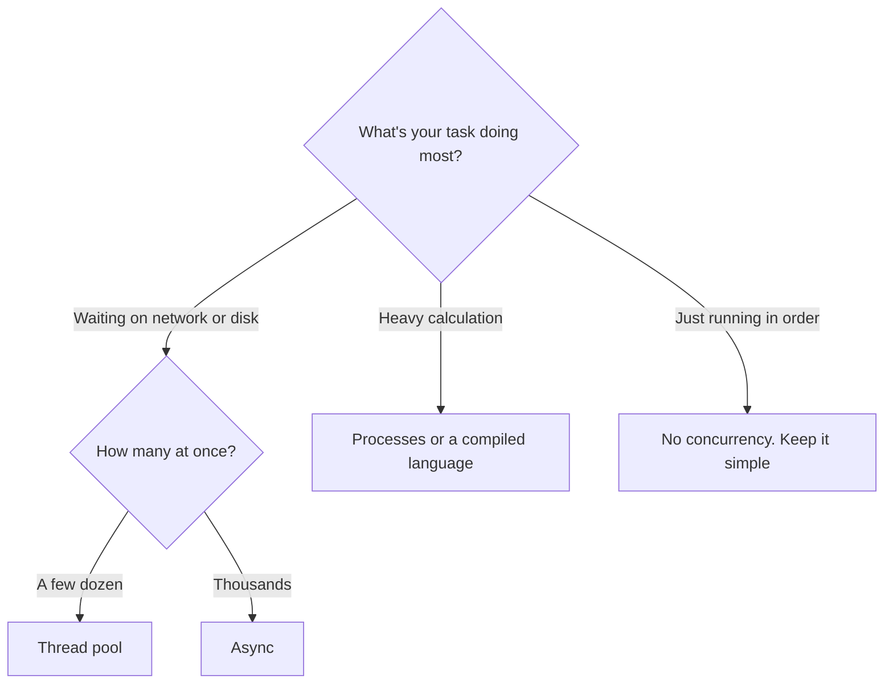

# Concurrency and Parallelism

← [[36 Operating Systems]] · [[Phase 3 - Start Here|Home]] · **Next:** [[38 Memory Management]] → · [[Software Engineering Roadmap#Concurrency and Parallelism|Roadmap card]]

> [!abstract] After this note, you can
> Spot race conditions, protect shared data correctly, avoid deadlocks, and choose between threads, processes and async.

## The Big Idea

Modern software does many things at once. A web server may handle thousands of requests at the same moment. That's powerful, but it creates the hardest bugs in programming: ones that happen only sometimes, and vanish when you look for them.

![[concurrent-vs-parallel.svg]]

| | Concurrency | Parallelism |
|---|---|---|
| **Meaning** | Managing many tasks at once | Running many tasks at the same instant |
| **Needs many cores?** | No | Yes |
| **Helps with** | Waiting (network, disk) | Heavy calculation |

## Threads in Python

```python
import threading

results = []

def work(name):
    results.append(f"{name} finished")

threads = [threading.Thread(target=work, args=(f"worker{i}",)) for i in range(3)]

for thread in threads:
    thread.start()
for thread in threads:
    thread.join()

print(sorted(results))
```

Output:

```text
['worker0 finished', 'worker1 finished', 'worker2 finished']
```

- `start()` begins the thread.
- `join()` waits for it to finish.

> [!note] Python's GIL
> In standard Python builds, the **Global Interpreter Lock (GIL)** lets only one thread run Python code at a time. So threads help with **waiting**, but not with heavy calculation. For that, use processes. Newer Python versions offer an optional build without the GIL, but threads still need the protection you'll learn here. Other languages, such as Java, C++, Go and Rust, run threads truly in parallel.

## Race Conditions

A **race condition** is when the result depends on the timing of threads. The classic example is two threads adding to a counter.

![[race-condition.svg]]

`counter = counter + 1` looks like one step, but it's really three: **read, add, write**. If two threads mix those steps, an update gets lost.

Let's force the problem. The `sleep` gives the other thread a chance to sneak in between read and write.

```python
import threading
import time

counter = 0

def add_many():
    global counter
    for _ in range(20):
        value = counter          # Read
        time.sleep(0.001)        # Another thread can run here
        counter = value + 1      # Write

threads = [threading.Thread(target=add_many) for _ in range(2)]
for thread in threads:
    thread.start()
for thread in threads:
    thread.join()

print(f"Expected 40. Lost some updates: {counter < 40}")
```

Output:

```text
Expected 40. Lost some updates: True
```

> [!danger] Why races are so nasty
> Without that `sleep`, this bug might appear only once in a million runs: in production, on a busy day, and never on your laptop. **You can't test your way out of races. You must design them out.**

The part of code that touches shared data is called the **critical section**. Only one thread should be inside at a time.

## Locks

![[mutex.svg]]

A **lock**, or **mutex** (mutual exclusion), is like the single key to a bathroom. Whoever holds it goes in. Everyone else waits.

```python
import threading
import time

counter = 0
lock = threading.Lock()

def add_many():
    global counter
    for _ in range(20):
        with lock:
            value = counter
            time.sleep(0.001)
            counter = value + 1

threads = [threading.Thread(target=add_many) for _ in range(2)]
for thread in threads:
    thread.start()
for thread in threads:
    thread.join()

print(counter)
```

Output:

```text
40
```

`with lock:` always releases the lock, even if an error occurs. Use it every time.

> [!tip] Rules for locks
> - Hold a lock for as **short** a time as you can. Don't do slow network calls inside one.
> - Protect **all** the code that touches the data, including reads.
> - Too many locks slow you down, because everything waits.

### The Best Lock Is No Lock

The safest shared data is data that isn't shared.

| Technique | Idea |
|---|---|
| **No sharing** | Each thread has its own data, combined at the end |
| **Immutable data** | If nothing can change it, it can't be raced |
| **Message passing** | Send data through a queue, instead of sharing it |

### Other Tools

| Tool | What it does | Like |
|---|---|---|
| **Semaphore** | Allows up to N holders | A car park with N spaces |
| **Condition variable** | Waits until something's true | Wait until a table is free |
| **Event** | A one-time signal | A starting gun |
| **Barrier** | Waits until N threads arrive | Friends meeting before leaving |

> [!example] A semaphore limits how many run at once
> Only 2 of the 5 tasks can run at the same time. It's useful for limiting database connections, or calls to an API.

```python
import threading
import time

limit = threading.Semaphore(2)
lock = threading.Lock()
running = 0
highest = 0

def task():
    global running, highest
    with limit:
        with lock:
            running = running + 1
            highest = max(highest, running)
        time.sleep(0.01)
        with lock:
            running = running - 1

threads = [threading.Thread(target=task) for _ in range(5)]
for thread in threads:
    thread.start()
for thread in threads:
    thread.join()

print("Most running at once:", highest)
```

Output:

```text
Most running at once: 2
```

### Worked Example - A Thread-Safe Bounded Queue

The roadmap asks you to build this. It's the **producer-consumer** pattern: some threads add work, others remove it. If it's full, producers wait. If it's empty, consumers wait.

```python
import threading

class BoundedQueue:
    def __init__(self, capacity):
        self.items = []
        self.capacity = capacity
        self.condition = threading.Condition()

    def put(self, item):
        with self.condition:
            while len(self.items) >= self.capacity:
                self.condition.wait()
            self.items.append(item)
            self.condition.notify_all()

    def get(self):
        with self.condition:
            while not self.items:
                self.condition.wait()
            item = self.items.pop(0)
            self.condition.notify_all()
            return item

queue = BoundedQueue(2)
output = []

def producer():
    for i in range(5):
        queue.put(i)

def consumer():
    for _ in range(5):
        output.append(queue.get())

threads = [threading.Thread(target=producer), threading.Thread(target=consumer)]
for thread in threads:
    thread.start()
for thread in threads:
    thread.join()

print(output)
```

Output:

```text
[0, 1, 2, 3, 4]
```

> [!warning] Why `while`, and not `if`?
> A waiting thread can wake up to find that the condition is false again, because another thread got there first. Always check again in a `while` loop.

In real Python code, use the built-in `queue.Queue`, which already does all of this.

## Deadlocks

![[deadlock.svg]]

A **deadlock** happens when threads wait for each other forever. Thread A holds Lock 1 and wants Lock 2. Thread B holds Lock 2 and wants Lock 1. Nobody can move.

Here, timeouts stop the demo from freezing forever:

```python
import threading

lock1 = threading.Lock()
lock2 = threading.Lock()
both_hold_one = threading.Barrier(2)
results = {}

def worker(name, first, second):
    with first:
        both_hold_one.wait()
        got_it = second.acquire(timeout=0.2)
        results[name] = got_it
        both_hold_one.wait()
        if got_it:
            second.release()

a = threading.Thread(target=worker, args=("A", lock1, lock2))
b = threading.Thread(target=worker, args=("B", lock2, lock1))
a.start()
b.start()
a.join()
b.join()

print(results["A"], results["B"])
```

Output:

```text
False False
```

Neither thread could get its second lock.

### How to Prevent Deadlocks

| Fix | How it helps |
|---|---|
| **Same lock order everywhere** | No circle can form. This is the main fix |
| **Timeouts** | Give up and retry, rather than waiting forever |
| **Hold fewer locks** | With one lock at a time, no deadlock is possible |

```python
import threading

lock1 = threading.Lock()
lock2 = threading.Lock()
done = []

def worker(name):
    with lock1:          # Everyone takes lock1 first
        with lock2:      # Then lock2
            done.append(name)

threads = [threading.Thread(target=worker, args=(n,)) for n in "AB"]
for thread in threads:
    thread.start()
for thread in threads:
    thread.join()

print(sorted(done))
```

Output:

```text
['A', 'B']
```

**A close relative:** in a **livelock**, threads stay busy reacting to each other but make no progress, like two people in a corridor who keep stepping the same way. Random delays break the cycle.

## Thread Pools and Futures

![[thread-pool.svg]]

Creating a thread for each job is wasteful, and can overload your system. A **thread pool** keeps a fixed team of workers. A **future** is a receipt for a result that isn't ready yet.

```python
from concurrent.futures import ThreadPoolExecutor
import time

def fetch(page):
    time.sleep(0.01)        # Pretend this is a slow network call
    return f"page {page}"

with ThreadPoolExecutor(max_workers=3) as pool:
    results = list(pool.map(fetch, [1, 2, 3, 4]))

print(results)
```

Output:

```text
['page 1', 'page 2', 'page 3', 'page 4']
```

```python
from concurrent.futures import ThreadPoolExecutor

def double(x):
    return x * 2

with ThreadPoolExecutor(max_workers=2) as pool:
    future = pool.submit(double, 21)
    print(future.result())
```

Output:

```text
42
```

**For heavy calculation in Python,** swap in `ProcessPoolExecutor`. It uses separate processes, so the GIL doesn't limit it.

## Async and Event Loops

![[event-loop.svg]]

When most of the time is spent waiting, you don't need many threads. An **event loop** runs on one thread. Whenever a task must wait, it pauses, and the loop runs something else.

Think of a single waiter serving 20 tables. They don't stand at your table while the kitchen cooks.

```python
import asyncio
import time

async def fetch(name):
    await asyncio.sleep(0.1)     # Waiting, so others can run
    return f"{name} done"

async def main():
    start = time.perf_counter()
    results = await asyncio.gather(fetch("A"), fetch("B"), fetch("C"))
    elapsed = time.perf_counter() - start
    print(results)
    print(f"Under 0.2s, not 0.3s: {elapsed < 0.2}")

asyncio.run(main())
```

Output:

```text
['A done', 'B done', 'C done']
Under 0.2s, not 0.3s: True
```

> [!danger] Never block the event loop
> Slow work, such as `time.sleep(5)` or a heavy calculation, freezes **every** task, as there's only one worker. Use `await asyncio.sleep`, or move that work to a thread. This is a very common bug in Node.js and async Python.

Node.js, nginx and much of modern Python web code work this way.

## Which One Should I Use?



| Model | Best for | Watch out for |
|---|---|---|
| **Threads** | Moderate waiting | Races, deadlocks |
| **Processes** | CPU-heavy work, isolation | Memory use, slow to share data |
| **Async** | Thousands of waits | Blocking the loop |

## Other Models

- **Channels (Go):** threads don't share memory, they send each other messages. "Don't communicate by sharing memory. Share memory by communicating."
- **Actors (Erlang, Akka):** each actor has private state, and handles one message at a time.
- **Atomics:** the CPU can do some small operations, like add-1, as one step with no lock. A **memory model** defines when one thread sees another's writes.
- **Lock-free programming:** building data structures from atomics. It's very hard to get right, so leave it to experts until you really need it.

> [!example] Message passing in Python
> Only the owner touches the total. Everyone else sends it messages.

```python
import queue
import threading

messages = queue.Queue()

def owner():
    total = 0
    while True:
        value = messages.get()
        if value is None:
            print(total)
            return
        total = total + value

thread = threading.Thread(target=owner)
thread.start()

for i in range(5):
    messages.put(i)
messages.put(None)
thread.join()
```

Output:

```text
10
```

## Debugging Concurrency

- **Make timing worse on purpose:** add small sleeps, like the earlier example, to expose races.
- **Use tools:** the **Thread Sanitizer** in C, C++ and Go, and Go's `-race` flag, find races automatically.
- **Look at stacks:** when a program hangs, dump all thread stacks to see who's waiting for what. Python's `faulthandler` can do this.
- **Review carefully:** ask "What if another thread runs between these two lines?"

## Common Mistakes

> [!warning] Watch out for these
> - Check-then-act: `if x not in cache: cache[x] = ...` is a race, even if each step is safe
> - Forgetting to protect reads
> - Holding a lock during a slow network call
> - Using threads when nothing needs them
> - Blocking the event loop in async code
> - Testing once, and believing that it's correct

## Practice

**1. Spot the race.** What's wrong here?

```python
balance = 100

def withdraw(amount):
    global balance
    if balance >= amount:
        balance = balance - amount
        return True
    return False

print(withdraw(30), balance)
```

> [!example]- Answer to question 1
> It's check-then-act. Two threads can both pass the `if` when the balance is 100, then both withdraw, overdrawing the account. Wrap the check and the change in **one** lock.

**2. Fix it.** Make `withdraw` safe.

> [!example]- Answer to question 2
> ```python
> import threading
>
> balance = 100
> lock = threading.Lock()
>
> def withdraw(amount):
>     global balance
>     with lock:
>         if balance >= amount:
>             balance = balance - amount
>             return True
>         return False
>
> print(withdraw(30), balance)
> ```
>
> Output:
>
> ```text
> True 70
> ```

**3. Choose.** Which model would you use?
- Downloading 10,000 web pages
- Resizing 500 images
- A chat server with 50,000 connections

> [!example]- Answer to question 3
> Async, or a thread pool. Processes, as resizing is CPU-heavy. Async.

**4. Deadlock.** Thread 1 locks A, then B. Thread 2 locks B, then A. How would you fix it?

> [!example]- Answer to question 4
> Make both threads lock A first, then B. A common trick is to always lock in a sorted order, such as by account id.

**5. Build.** Use `ThreadPoolExecutor` and `urllib.request` to build a small web crawler that fetches 10 pages from a site you own, with at most 3 at once.

## Can You Do This?

- [ ] Explain concurrency and parallelism with a picture
- [ ] Draw how a race loses an update
- [ ] Protect shared data with a lock
- [ ] Build a bounded queue
- [ ] Explain a deadlock, and prevent it with lock ordering
- [ ] Use a thread pool and a future
- [ ] Write simple async code, and avoid blocking the loop
- [ ] Choose between threads, processes and async
- [ ] Spot a race during code review

## Summary

> [!success] Remember
> - `x = x + 1` is **three steps**, not one.
> - **Protect shared data**, or better, don't share it.
> - **Same lock order everywhere** prevents deadlocks.
> - **Waiting?** Use threads or async. **Calculating?** Use processes.

**Next:** [[38 Memory Management]] →
