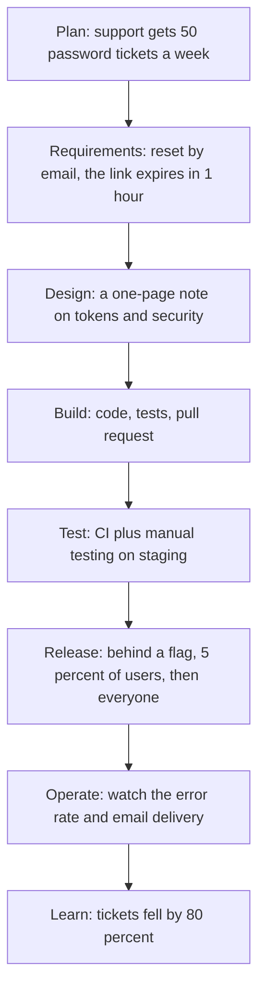

# Software Development Lifecycle

← [[38 Memory Management]] · [[Phase 3 - Start Here|Home]] · **Next:** [[40 Code Reviews]] → · [[Software Engineering Roadmap#Software Development Lifecycle|Roadmap card]]

> [!abstract] After this note, you can
> Follow a change from idea to production and beyond, explain why teams work in stages, and measure how well a team delivers.

## The Big Idea

Writing code is only a small part of building software. Someone had to decide what to build. Afterwards, someone must test it, release it, keep it running, fix it and eventually retire it. Together, these stages are called the **Software Development Lifecycle (SDLC)**.

Think about building a house. Pouring the concrete is important, but so are the plans before it and the repairs for decades after it.

![[sdlc-loop.svg]]

## The Stages

| Stage | Question it answers | What you produce |
|---|---|---|
| **Plan** | Why build this? Is it worth it? | A goal and a rough priority |
| **Requirements** | What must it do? | User stories, acceptance criteria |
| **Design** | How will it work? | A design note, diagrams |
| **Build** | Write it | Code and tests |
| **Test** | Does it work? | Passing tests, bug reports |
| **Release** | How does it reach users safely? | A deployed version |
| **Operate** | Is it healthy? | Monitoring, incident fixes |
| **Learn** | Did it help? What's next? | Metrics, a new plan |

> [!important] Most of the cost comes later
> A system may be built in months, and then maintained for ten years. Over its life, far more effort goes into changing and running it than into writing it the first time. So **write code for the person who has to change it.**

### A Real Example - Adding Password Reset



## Why Stages Matter

![[defect-cost.svg]]

A mistake gets more costly the later you find it.

| Found while | Fixing it means |
|---|---|
| Designing | Changing a sentence |
| Coding | Changing a few lines |
| Testing | Debugging, changing, re-testing |
| In production | All of that, plus upset users, an urgent fix, maybe lost data |

> [!tip] This isn't an argument for a long design phase
> Exact ratios vary, and old claims of "100 times the cost" are disputed. The practical lesson is simple: **get fast feedback at every stage**, using small changes, automated tests and early conversations.

## Environments

![[environments.svg]]

| Environment | Purpose | Data |
|---|---|---|
| **Local** | Write and try code | Fake |
| **CI** | Automated checks on each change | Fake |
| **Staging** | Final check, as close to production as possible | Fake, or properly anonymized |
| **Production** | Real users | Real |

> [!danger] Rules for production
> - Never test with real customer data outside production without properly anonymizing it.
> - Keep configuration, such as passwords, separate from code, so the same build runs everywhere.
> - Make environments as similar as you can, to avoid "it worked on staging". [[48 Docker]] helps here.

## Working Methods

The stages don't have to run in one long line.

| Method | How it works | Good when |
|---|---|---|
| **Waterfall** | Finish each stage fully before the next | Requirements are fixed and mistakes are very costly, such as in some medical or aerospace work |
| **Iterative, Agile** | Go through all the stages in small cycles | Requirements change, and you can release often |
| **Continuous delivery** | Each small change can flow to production | Mature teams with strong automation |

```text
Waterfall:   Requirements → Design → Build → Test → Release (one big release)

Iterative:   [Plan Build Test Release] → [Plan Build Test Release] → ...
```

There's more on the [[Software Engineering Roadmap#Development Methodologies|Development Methodologies]] and [[Software Engineering Roadmap#Agile and Scrum|Agile and Scrum]] cards.

## Releasing

**Deploying** puts code on servers. **Releasing** makes a feature available to users. Separating them is a superpower, as you'll see with [[49 Continuous Integration and Delivery#Feature Flags|feature flags]].

### Version Numbers

**Semantic versioning** tells users what to expect from an update.

```text
     2 . 4 . 1
     │   │   └── PATCH: bug fixes only
     │   └────── MINOR: new features, nothing broken
     └────────── MAJOR: breaking changes
```

```python
def bump(version, part):
    major, minor, patch = map(int, version.split("."))
    if part == "major":
        return f"{major + 1}.0.0"
    if part == "minor":
        return f"{major}.{minor + 1}.0"
    return f"{major}.{minor}.{patch + 1}"

print(bump("2.4.1", "patch"))
print(bump("2.4.1", "minor"))
print(bump("2.4.1", "major"))
```

Output:

```text
2.4.2
2.5.0
3.0.0
```

### A Good Release Checklist

- [ ] All tests pass
- [ ] Database changes are [[50 Database Design#Safe Schema Changes|backward compatible]]
- [ ] You know how to roll back
- [ ] Dashboards are ready to watch
- [ ] Release notes are written

## Maintenance and Retirement

Software needs upkeep, even if no features are added.

| Kind of maintenance | Example |
|---|---|
| **Corrective** | Fixing bugs |
| **Adaptive** | Upgrading to a new operating system or library |
| **Perfective** | Improving speed or usability |
| **Preventive** | [[41 Refactoring]], paying down [[Software Engineering Roadmap#Technical Debt\|technical debt]] |

**Deprecation** means announcing that something will go away, while it still works. Do it kindly: announce a date, offer a replacement, warn in the logs, and watch usage until it's near zero.

## Incidents and Postmortems

Things will break in production. A healthy team asks **"what made this possible?"**, and not "who did this?". That's a **blameless postmortem**.

```text
Incident:   Checkout down for 25 minutes
Timeline:   14:02 deploy, 14:05 errors rise, 14:11 alert, 14:27 rollback
Impact:     About 300 failed orders
Root cause: A migration locked the orders table
What went well:  Rollback was quick
What went badly: The alert took 6 minutes
Actions:
  1. Add a check for locking migrations in CI  (owner: Sam, due: Friday)
  2. Tighten the alert to 2 minutes            (owner: Priya, due: Friday)
```

## Measuring Delivery - DORA

![[dora.svg]]

Years of research from the [DORA](https://dora.dev/) program found that four numbers predict how well a team delivers.

| Metric | Elite teams, roughly | Struggling teams, roughly |
|---|---|---|
| **Deployment frequency** | Many times a day | Monthly or less |
| **Lead time for changes** | Under a day | Months |
| **Change failure rate** | Low | High |
| **Time to restore** | Under an hour | Days or weeks |

**The surprise:** fast teams are also the most stable. Small, frequent releases are less risky than big, rare ones, because less changes at once.

```python
from statistics import median

deploys = [
    {"lead_hours": 4, "failed": False},
    {"lead_hours": 30, "failed": True},
    {"lead_hours": 6, "failed": False},
    {"lead_hours": 8, "failed": False},
]

print("Deploys:", len(deploys))
print("Median lead time:", median(d["lead_hours"] for d in deploys), "hours")
print("Change failure rate:", sum(d["failed"] for d in deploys) / len(deploys))
```

Output:

```text
Deploys: 4
Median lead time: 7.0 hours
Change failure rate: 0.25
```

> [!warning] Metrics can be gamed
> Use these to help the team improve, not to rank people. Once a number becomes a target, people find ways to move it without improving anything.

### Finding Your Bottleneck

The roadmap's mastery test asks you to name what most limits delivery, with evidence. Measure where a change spends its time.

```text
Write code      ████ 1 day
Wait for review ████████████ 3 days     ← the bottleneck
Review          ██ half a day
Wait for test   ████████ 2 days         ← next
Deploy          █ an hour
```

Writing code faster wouldn't help this team at all. Quicker reviews would.

## Common Mistakes

> [!warning] Watch out for these
> - Thinking the job ends when the code merges
> - Testing with real customer data
> - Releasing big batches every few months
> - Skipping the "learn" stage, so nobody knows if the feature helped
> - Blaming people for incidents, so that problems get hidden

## Practice

**1. Which stage?** A user reports that a page is slow. You check dashboards and open a ticket. Which stage is this, and which stage does it feed?

> [!example]- Answer to question 1
> It's **Operate**. It feeds **Learn** and **Plan**, which is why the lifecycle is a loop.

**2. Version numbers.** Your library is at 1.3.2. Which version comes next after each change?
- You fix a small bug
- You add a new optional function
- You remove an old function

> [!example]- Answer to question 2
> 1.3.3, 1.4.0, 2.0.0.

**3. Find the bottleneck.** Coding takes 1 day, waiting for QA takes 5 days, and deploying takes 10 minutes. What would you improve first?

> [!example]- Answer to question 3
> The wait for QA. For example, automate more of the tests so that changes don't queue up.

**4. Write a postmortem.** Think of a time your program lost your work, or a bug caught you out. Write a short blameless postmortem with at least two actions.

**5. Roadmap exercise.** Take a small app through every stage, and write a sentence or two on each stage, including one real fix after release.

## Can You Do This?

- [ ] Draw the lifecycle as a loop
- [ ] Explain why late bugs cost more
- [ ] Explain each environment
- [ ] Explain semantic versioning
- [ ] Write a blameless postmortem
- [ ] Name the four DORA metrics
- [ ] Find the bottleneck in a team's delivery

## Summary

> [!success] Remember
> - Software lives in a **loop**, and most of its cost comes after release.
> - **Fast feedback** at every stage beats long plans.
> - **Small, frequent releases** are safer.
> - Measure with **DORA**, and fix the biggest bottleneck first.

**Next:** [[40 Code Reviews]] →
