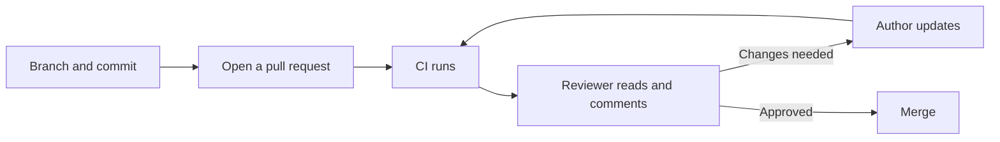

# Code Reviews

← [[39 Software Development Lifecycle]] · [[Phase 3 - Start Here|Home]] · **Next:** [[41 Refactoring]] → · [[Software Engineering Roadmap#Code Reviews|Roadmap card]]

> [!abstract] After this note, you can
> Write pull requests that are easy to review, find real problems in other people's code, and give feedback that helps instead of hurts.

## The Big Idea

A **code review** means another engineer reads your change before it joins the main code. It's like having a friend read your essay before you hand it in. They spot what you can no longer see.

**Why teams do it:**

| Benefit | Example |
|---|---|
| **Catches defects** | "This crashes on an empty list" |
| **Spreads knowledge** | Now two people understand the payment code |
| **Keeps things consistent** | "We have a helper for that" |
| **Teaches** | Juniors and seniors both learn |



You learned the mechanics in [[09 Git Basics#Pull Requests]]. Now let's do it well.

## Part 1 - Being a Good Author

### Keep It Small

![[pr-size.svg]]

Small changes get reviewed faster and better. As a rough guide, aim for **under about 300 lines**, with **one purpose**.

> [!tip] How to split up big work
> - Refactor in one pull request, and add the feature in the next.
> - Add the database change first, then the code that uses it.
> - Hide unfinished work behind a [[49 Continuous Integration and Delivery#Feature Flags|feature flag]], so you can merge in small pieces.

### Write a Helpful Description

Your description should answer: **what, why, and how do I check it?**

```markdown
## What
Add a password reset by email.

## Why
Support gets about 50 tickets a week from locked-out users.
Ticket: #482

## How
- Tokens are random, stored hashed, and expire after 1 hour.
- The endpoint always returns 200, so attackers can't check who has an account.

## Testing
- Unit tests for token expiry
- Manually tested on staging

## Notes for reviewers
Please look closely at `token_service.py`.
I wasn't sure about the 1-hour expiry. What do you think?
```

### Review Yourself First

Before asking anyone else, read your own diff on GitHub. You'll catch leftover `print` lines, debug code and typos. Then check that:

- [ ] Tests pass locally
- [ ] You've added tests for the new behaviour
- [ ] There are no unrelated changes
- [ ] Commit messages are clear
- [ ] The description explains why

### Receive Feedback Well

> [!important] A comment on your code isn't a comment on you
> Everybody's code gets comments, including the most senior engineers'. Assume good intent. If you disagree, explain why. If a comment thread goes back and forth more than twice, talk directly.

## Part 2 - Being a Good Reviewer

### What to Look For

![[review-pyramid.svg]]

Spend your energy at the bottom of this picture. Leave formatting to automated tools, like those in [[28 Clean Code#Let Tools Do the Boring Parts]].

### A Review Checklist

**Correctness**

- [ ] Does it do what the description says?
- [ ] What about empty input, zero, nulls, or very large values?
- [ ] What happens when a network or database call fails?
- [ ] Could two requests run this at once? See [[37 Concurrency and Parallelism#Race Conditions]].

**Security**

- [ ] Is input validated?
- [ ] Is every SQL query parameterized?
- [ ] Is access checked for **this** user and **this** item?
- [ ] Are any secrets, passwords or personal data in the code or logs?

**Design**

- [ ] Is this the right place for this code?
- [ ] Is it simpler than it could be, or is it over-built?
- [ ] Will it still work with 100 times the data? Watch for loops that run a query.

**Tests**

- [ ] Do the tests prove the behaviour, including failure cases?
- [ ] Would they fail if the code were wrong?

**Readability**

- [ ] Will someone new understand this in six months?

> [!example] Practice: review this code
> Try to find at least four problems before opening the answer.

```python
def get_user_orders(db, user_id, status):
    query = "SELECT * FROM orders WHERE user_id = " + str(user_id) + " AND status = '" + status + "'"
    orders = db.execute(query).fetchall()
    result = []
    for o in orders:
        items = db.execute("SELECT * FROM items WHERE order_id = " + str(o[0])).fetchall()
        result.append((o, items))
    return result
```

> [!example]- What a good reviewer would say
> 1. **Blocking, security:** `status` is added straight into the SQL, which allows [[46 OWASP Top 10#A05 Injection|SQL injection]]. Use `?` placeholders.
> 2. **Blocking, performance:** this runs one extra query per order, which is the **N+1 query problem**. Use a `JOIN`, or fetch all the items at once.
> 3. **Suggestion:** `SELECT *` fetches everything. Name the columns you need.
> 4. **Suggestion:** `o[0]` is unclear. Use a row with named columns.
> 5. **Question:** can a caller ask for another user's orders? Where's that checked?
> 6. **Question:** there's no limit. What if a user has 100,000 orders?

Here's the fixed version:

```python
import sqlite3

def get_user_orders(db, user_id, status, limit=100):
    return db.execute(
        """
        SELECT orders.id, orders.status, items.name
        FROM orders
        JOIN items ON items.order_id = orders.id
        WHERE orders.user_id = ? AND orders.status = ?
        LIMIT ?
        """,
        (user_id, status, limit),
    ).fetchall()

db = sqlite3.connect(":memory:")
db.executescript("""
    CREATE TABLE orders (id INTEGER PRIMARY KEY, user_id INTEGER, status TEXT);
    CREATE TABLE items (id INTEGER PRIMARY KEY, order_id INTEGER, name TEXT);
    INSERT INTO orders VALUES (1, 7, 'paid');
    INSERT INTO items VALUES (1, 1, 'Tea');
""")

print(get_user_orders(db, 7, "paid"))
print(get_user_orders(db, 7, "' OR '1'='1"))
```

Output:

```text
[(1, 'paid', 'Tea')]
[]
```

### How to Write Comments

Comment on the **code**, not the **person**. Explain **why**. Suggest a way forward.

| Unhelpful | Helpful |
|---|---|
| "This is wrong." | "This fails when `items` is empty, as `max()` raises an error. Could we return `None` in that case?" |
| "Why did you do it this way?" | "I'd expected a set here, for faster lookups. Is there a reason for the list?" |
| "Bad name." | "Could we name this `unpaid_orders`? `data` made me read the function twice." |
| "You forgot tests." | "Could we add a test for the expired-token case? That's the riskiest path." |

### Blockers and Nits

Say how serious each comment is, so that the author knows what really matters.

| Label | Meaning | Must it change? |
|---|---|---|
| **blocking:** | A bug, or a security or data problem | Yes |
| **suggestion:** | A real improvement | Author decides |
| **question:** | I want to understand | Answer it |
| **nit:** | Tiny and optional | No |
| **praise:** | This is great, and I learned from it | No, but do say it! |

```text
blocking: This query uses user input directly. Please use a placeholder.
nit: Could this be `is_active` for consistency?
praise: Great test coverage on the retry logic.
```

### When Is It Good Enough?

Google's guide says to approve when a change **definitely improves the overall health of the code**, even if it isn't perfect. Don't hold changes back over personal taste.

> [!tip] Respond quickly
> Slow reviews hurt more than most code problems, as we saw in [[39 Software Development Lifecycle#Finding Your Bottleneck]]. Try to respond within one working day. A quick "I'll look at this tomorrow" also helps.

## Reviewing Unfamiliar Code

Don't begin at line 1 of the first file.

1. **Read the description.** What's the goal?
2. **Read the tests.** They show what it's meant to do.
3. **Find the entry point**, and follow the flow.
4. **Run it locally** if it's complicated.
5. **Ask questions.** "I don't understand this" is useful feedback, because the next reader won't either.

## Reviewing AI-Written Code

Generated code needs **at least** the same care. It can look tidy and confident, while calling functions that don't exist, missing edge cases or using insecure defaults. Whoever merges it is responsible for it. See [[Software Engineering Roadmap#AI-Assisted Software Engineering|AI-Assisted Software Engineering]].

## Common Mistakes

> [!warning] Watch out for these
> - Huge pull requests with many purposes
> - Empty descriptions
> - Arguing about style that a tool could decide
> - Approving without really reading: "looks good to me"
> - Holding up work for personal preferences
> - Personal or sarcastic comments
> - Leaving a pull request waiting for days

## Practice

**1. Improve this comment.** "This is really inefficient. Did you even think about performance?"

> [!example]- Answer to question 1
> "suggestion: this loop checks `x in my_list` for each order, which is O(n²). With 100,000 orders, it could take minutes. Would a set work here, to make it O(n)?"

**2. Label them.** Which label fits each comment?
- A password appears in a log message
- You prefer a slightly different variable name
- You've never seen this library before, and you're curious

> [!example]- Answer to question 2
> blocking, nit, question.

**3. Review this.** Find the bug.

```python
def average_rating(reviews):
    total = 0
    for review in reviews:
        total += review["stars"]
    return total / len(reviews)

print(average_rating([{"stars": 4}, {"stars": 5}]))
```

> [!example]- Answer to question 3
> It crashes with `ZeroDivisionError` on a product with no reviews. A helpful comment would be: "What should we show for a product with no reviews? This raises an error at the moment."

**4. Write a description.** Pick a recent change from your [[34 Phase 2 Final Project|Phase 2 project]], and write a full description: what, why, how and testing.

**5. Real practice.** Read the [Google Code Review Guide](https://google.github.io/eng-practices/review/). Then read pull requests on an open-source project that you use, and try to understand why reviewers said what they did.

## Can You Do This?

- [ ] Split a big change into small pull requests
- [ ] Write a description that answers what, why and how to check it
- [ ] Review your own code first
- [ ] Use the checklist to find real bugs
- [ ] Write kind, specific comments
- [ ] Label blockers, suggestions and nits
- [ ] Review unfamiliar code in a sensible order

## Summary

> [!success] Remember
> - **Small pull requests** get better reviews.
> - Focus on **correctness, security and design**. Automate style.
> - **Comment on the code, not the person.**
> - **Label** how serious each comment is.
> - The goal is **better code health**, not perfection.

**Next:** [[41 Refactoring]] →
