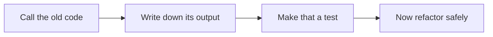

# Refactoring

← [[40 Code Reviews]] · [[Phase 3 - Start Here|Home]] · **Next:** [[42 SOLID Principles]] → · [[Software Engineering Roadmap#Refactoring|Roadmap card]]

> [!abstract] After this note, you can
> Spot code smells, improve messy code in tiny safe steps, and change old code that has no tests.

## The Big Idea

**Refactoring** means improving the structure of code **without changing what it does**. It's like tidying a kitchen. You still cook the same meals, but now you can find the knives.

Code tends to get messier with every quick change. Without regular tidying, each new feature takes longer than the last, until the team can barely move.

![[refactor-steps.svg]]

> [!important] The golden rule
> **Never change behaviour and structure at the same time.** Put on your refactoring hat, or your feature hat, but not both. Commit them separately.

## When to Refactor

| Good time | Example |
|---|---|
| **Before adding a feature** | "Make the change easy, then make the easy change" |
| **While understanding code** | Rename things as you figure them out |
| **When fixing a bug** | Make the bug easy to see, then fix it |
| **Following review comments** | "This function does too much" |

**When not to:** code you'll delete soon, or code that works and that nobody needs to touch.

## Code Smells

A **code smell** is a sign that something may be wrong. It isn't always a bug, but it's worth a look.

| Smell | What it looks like | Common fix |
|---|---|---|
| **Long function** | You have to scroll to read it | Extract Function |
| **Duplicated code** | The same logic in several places | Extract Function |
| **Long parameter list** | `f(a, b, c, d, e, f)` | Group into an object |
| **Large class** | Does many unrelated jobs | Extract Class |
| **Feature envy** | A function mostly uses another class's data | Move Function |
| **Primitive obsession** | Passing money as a bare number | Make a small class |
| **Shotgun surgery** | One small change touches many files | Move things together |
| **Magic numbers** | `if age > 18` everywhere | Name the constant |
| **Deep nesting** | Many levels of `if` | Guard clauses |
| **Comments explaining messy code** | Paragraphs to explain a line | Rename, simplify |

## The Basic Moves

These small moves come from Martin Fowler's [refactoring catalog](https://refactoring.com/catalog/). Most editors, including VS Code, can do some of them automatically: right-click, and choose **Refactor**, or press **F2** to rename.

### Rename

The simplest and often the most valuable one.

```python
# Before
def calc(d):
    return d * 0.18

# After
def tax_on(price):
    return price * 0.18

print(calc(100) == tax_on(100))
```

Output:

```text
True
```

### Extract Function

Give a block of code a name. If you feel the need for a comment, you probably have a function waiting to be born.

```python
# Before
def print_invoice(items):
    # work out the total
    total = 0
    for item in items:
        total += item["price"] * item["quantity"]
    print(f"Total: {total}")

# After
def calculate_total(items):
    return sum(item["price"] * item["quantity"] for item in items)

def print_invoice_clean(items):
    print(f"Total: {calculate_total(items)}")

items = [{"price": 10, "quantity": 2}]
print_invoice(items)
print_invoice_clean(items)
```

Output:

```text
Total: 20
Total: 20
```

### Inline

The opposite. If a function or variable adds nothing, remove it.

```python
# Before
def is_adult(age):
    return age_is_at_least_18(age)

def age_is_at_least_18(age):
    return age >= 18

# After
def is_adult_clean(age):
    return age >= 18

print(is_adult(20) == is_adult_clean(20))
```

Output:

```text
True
```

### Replace Magic Number

```python
# Before
def can_rent_before(age):
    return age >= 21

# After
MINIMUM_RENTAL_AGE = 21

def can_rent_after(age):
    return age >= MINIMUM_RENTAL_AGE

print(can_rent_before(21) == can_rent_after(21))
```

Output:

```text
True
```

### Replace Conditional with Polymorphism

You learned this idea in [[26 Object-Oriented Programming#Polymorphism]]. It's useful when the same `if` chain appears in many places.

```python
# Before
def shipping_cost(kind, weight):
    if kind == "standard":
        return weight * 2
    elif kind == "express":
        return weight * 5

# After
class Standard:
    def cost(self, weight):
        return weight * 2

class Express:
    def cost(self, weight):
        return weight * 5

print(shipping_cost("express", 2), Express().cost(2))
```

Output:

```text
10 10
```

> [!warning] Don't apply it automatically
> For two simple cases in one place, the `if` is clearer. Refactor toward simplicity, not toward more classes.

## A Full Example, Step by Step

Here's real-looking messy code. It works, but it's hard to change.

```python
# file: report_v1.py
def report(data):
    r = ""
    t = 0
    for d in data:
        if d["status"] == "paid":
            a = d["amount"]
            if d["country"] == "LK":
                a = a * 1.18
            else:
                a = a * 1.05
            t = t + a
            r = r + d["name"] + ": " + str(round(a, 2)) + "\n"
    r = r + "Total: " + str(round(t, 2))
    return r
```

**Step 1: Add tests first.** We need a safety net before changing anything.

```python
# file: test_report_v1.py
from report_v1 import report

DATA = [
    {"name": "Sam", "status": "paid", "amount": 100, "country": "LK"},
    {"name": "Mei", "status": "paid", "amount": 100, "country": "SG"},
    {"name": "Ali", "status": "unpaid", "amount": 999, "country": "LK"},
]

def test_report():
    assert report(DATA) == "Sam: 118.0\nMei: 105.0\nTotal: 223.0"

def test_empty_report():
    assert report([]) == "Total: 0"
```

**Step 2: Make one small change, and run the tests.** Then the next. After a series of commits, it looks like this:

```python
# file: report_v2.py
LOCAL_TAX = 1.18
FOREIGN_TAX = 1.05

def with_tax(amount, country):
    rate = LOCAL_TAX if country == "LK" else FOREIGN_TAX
    return amount * rate

def report(orders):
    paid = [order for order in orders if order["status"] == "paid"]
    lines = []
    total = 0
    for order in paid:
        amount = with_tax(order["amount"], order["country"])
        total += amount
        lines.append(f"{order['name']}: {round(amount, 2)}")
    lines.append(f"Total: {round(total, 2)}")
    return "\n".join(lines)
```

```python
# file: test_report_v2.py
from report_v2 import report

DATA = [
    {"name": "Sam", "status": "paid", "amount": 100, "country": "LK"},
    {"name": "Mei", "status": "paid", "amount": 100, "country": "SG"},
    {"name": "Ali", "status": "unpaid", "amount": 999, "country": "LK"},
]

def test_report():
    assert report(DATA) == "Sam: 118.0\nMei: 105.0\nTotal: 223.0"

def test_empty_report():
    assert report([]) == "Total: 0"
```

The same tests pass, so behaviour didn't change. And now changing a tax rate is a one-line edit.

**The commit history tells the story:**

```text
Add tests for report
Rename variables in report
Extract with_tax
Name the tax rates as constants
Replace string building with a list of lines
```

## Working with Legacy Code

**Legacy code** is code without tests. Adding tests needs changes, and safe changes need tests. Here's how to break out of that trap.

### Characterization Tests

You don't know if the old behaviour is **right**, but others may rely on it. So first, record what it **actually does**, even if it looks odd.



```python
# file: legacy.py
def mystery(n):
    x = 0
    while n > 0:
        x = x + n % 10
        n = n // 10
    return x if x < 10 else mystery(x)
```

```python
# file: test_legacy.py
from legacy import mystery

# These record what the code does today. We're not saying it's right.
def test_mystery_single_digit():
    assert mystery(5) == 5

def test_mystery_two_digits():
    assert mystery(38) == 2

def test_mystery_zero():
    assert mystery(0) == 0

def test_mystery_large():
    assert mystery(99999) == 9
```

Now you can restructure it, and the tests will tell you if anything changed. If you find a real bug, fix it **separately**, and mention it, since someone might depend on it.

### Seams - Making Old Code Testable

A **seam** is a place where you can change behaviour without editing the code around it. The common trick is to pass the hard dependency in.

```python
import datetime

# Before: impossible to test, because it uses the real clock
def greeting_before():
    hour = datetime.datetime.now().hour
    return "Good morning" if hour < 12 else "Good afternoon"

# After: the default keeps old callers working, and tests can pass a time
def greeting(now=None):
    now = now or datetime.datetime.now()
    return "Good morning" if now.hour < 12 else "Good afternoon"

print(greeting(datetime.datetime(2026, 1, 1, 9)))
print(greeting(datetime.datetime(2026, 1, 1, 15)))
```

Output:

```text
Good morning
Good afternoon
```

## Big Refactors

### Branch by Abstraction

To replace something that's used in many places:

1. Add a layer in front of the old thing.
2. Make all callers use the layer.
3. Build the new thing behind that layer.
4. Switch over, maybe with a [[49 Continuous Integration and Delivery#Feature Flags|flag]].
5. Remove the old thing and, if it isn't useful, the layer.

The code can ship at every step.

### The Strangler Fig

![[strangler-fig.svg]]

A strangler fig grows around a tree, until it eventually replaces it. Instead of a risky rewrite of the entire system, you put a router in front, and move one feature at a time to the new code.

> [!danger] Beware the big rewrite
> "Let's throw it away and start over" is tempting, and it often goes badly. The old code contains years of fixes that nobody remembers. Meanwhile, the old system keeps changing, and customers get nothing new for months. Prefer step-by-step replacement.

## Making Time for It

- **Include it in your work.** Tidying is part of the task, not a separate request. "Make the change easy" is simply how you add a feature.
- **Explain the value in business terms.** Not "this code is ugly", but "this module causes half of our bugs, and each change takes a week". See [[Software Engineering Roadmap#Technical Debt|Technical Debt]].
- **The Boy Scout Rule:** leave code a little better than you found it.

## Common Mistakes

> [!warning] Watch out for these
> - Refactoring with no tests
> - Mixing a refactor and a feature in a single pull request
> - Huge changes that nobody can review
> - Fixing "bugs" that other code relies on, without telling anyone
> - Chasing elegance in code that nobody needs to change
> - Trying a full rewrite when small steps would do

## Practice

**1. Name the smell.**

```python
def create_user(name, email, age, city, country, phone, is_admin, newsletter):
    return name

print(create_user("Sam", "a@example.com", 20, "Kandy", "LK", "077", False, True))
```

> [!example]- Answer to question 1
> **Long parameter list.** It's easy to swap two values by mistake. Group them in a dataclass, or use keyword arguments.

**2. Refactor.** Extract the duplication, and keep the results the same.

```python
def student_report(marks):
    best = marks[0]
    for mark in marks:
        if mark > best:
            best = mark
    return f"Best mark: {best}"

def sales_report(sales):
    best = sales[0]
    for sale in sales:
        if sale > best:
            best = sale
    return f"Best sale: {best}"

print(student_report([1, 3]), sales_report([5, 2]))
```

> [!example]- Answer to question 2
> Python already has this function, so you can simply use it.
> ```python
> def student_report(marks):
>     return f"Best mark: {max(marks)}"
>
> def sales_report(sales):
>     return f"Best sale: {max(sales)}"
>
> print(student_report([1, 3]), sales_report([5, 2]))
> ```
>
> Output:
>
> ```text
> Best mark: 3 Best sale: 5
> ```

**3. Characterize.** What does `mystery` from this note do? (Try some numbers before opening the answer.)

> [!example]- Answer to question 3
> It adds the digits repeatedly until one digit is left. It's called the **digital root**. 38 → 3 + 8 = 11 → 1 + 1 = 2. Now you could rename it `digital_root`, and the tests would still pass.

**4. Commit plan.** You need to add discount codes to a messy checkout function. List your pull requests in order.

> [!example]- Answer to question 4
> 1. Add characterization tests.
> 2. Refactor: extract `calculate_total`, with no behaviour change.
> 3. Add discount codes, with new tests.

**5. Roadmap exercise.** Take an untested module, such as old code of yours. Add characterization tests, then refactor it step by step with one commit per move.

## Can You Do This?

- [ ] Name at least six code smells
- [ ] Use Rename, Extract Function and Inline
- [ ] Refactor in tiny steps, with tests passing throughout
- [ ] Keep refactors and features in separate commits
- [ ] Write characterization tests for old code
- [ ] Create a seam to test hard-to-test code
- [ ] Explain the strangler fig, and the risks of a rewrite

## Summary

> [!success] Remember
> - Refactoring **changes structure, not behaviour**.
> - **Tests first**, then tiny steps.
> - **Characterize** legacy code before changing it.
> - **Replace gradually.** Avoid big rewrites.

**Next:** [[42 SOLID Principles]] →
