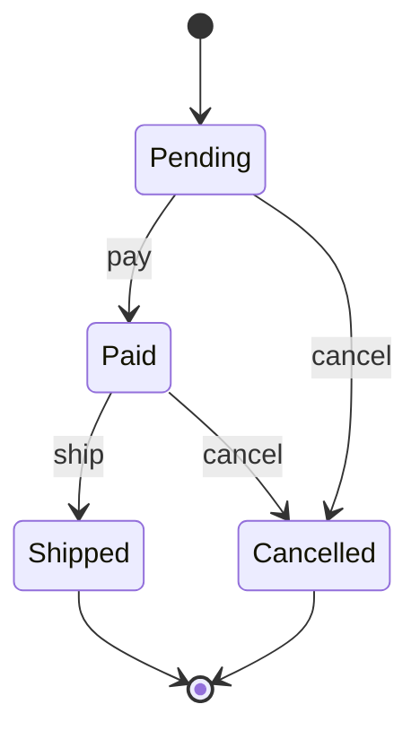
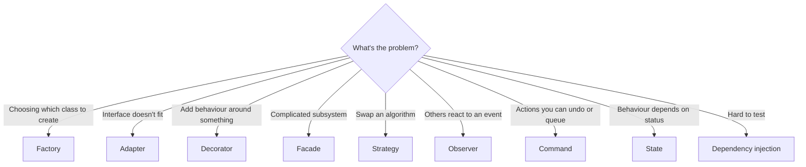

# Design Patterns

← [[42 SOLID Principles]] · [[Phase 3 - Start Here|Home]] · **Next:** [[44 API Design]] → · [[Software Engineering Roadmap#Design Patterns|Roadmap card]]

> [!abstract] After this note, you can
> Recognise common design patterns in real code, use them when they help, and remove them when they don't.

## The Big Idea

Builders don't invent an arch for each new bridge. They reuse a proven shape. A **design pattern** is a proven shape for a common software problem. It isn't code to copy. It's an idea you adapt.

Patterns also give teams a shared language. "Let's use an adapter here" says in three words what would otherwise take a paragraph.

![[pattern-families.svg]]

> [!warning] Solve the problem first
> Don't look for places to use patterns. Find a problem, then see if a pattern helps. Many famous patterns exist because of limits in older languages. In Python, a plain function often does the job.

## Creational Patterns - Making Objects

### Factory

**The problem:** creating an object involves a decision, and you don't want that decision scattered everywhere.

**Like:** ordering "a coffee" at a counter, without knowing how the machine works.

```python
class Email:
    def send(self, text):
        return f"Email: {text}"

class Sms:
    def send(self, text):
        return f"SMS: {text}"

def make_notifier(kind):
    notifiers = {"email": Email, "sms": Sms}
    if kind not in notifiers:
        raise ValueError(f"Unknown notifier: {kind}")
    return notifiers[kind]()

print(make_notifier("sms").send("hi"))
```

Output:

```text
SMS: hi
```

### Builder

**The problem:** an object has many optional parts, and one long constructor is hard to read.

**Like:** building a burger one layer at a time.

```python
class QueryBuilder:
    def __init__(self, table):
        self.table = table
        self.conditions = []
        self.max_rows = None

    def where(self, condition):
        self.conditions.append(condition)
        return self

    def limit(self, count):
        self.max_rows = count
        return self

    def build(self):
        sql = f"SELECT * FROM {self.table}"
        if self.conditions:
            sql = sql + " WHERE " + " AND ".join(self.conditions)
        if self.max_rows is not None:
            sql = sql + f" LIMIT {self.max_rows}"
        return sql

print(QueryBuilder("users").where("age > 18").where("active = 1").limit(10).build())
```

Output:

```text
SELECT * FROM users WHERE age > 18 AND active = 1 LIMIT 10
```

In Python, keyword arguments with defaults usually make this unnecessary. Use a builder when the construction has real steps.

### Singleton

**The idea:** only one instance of a class ever exists.

```python
class Config:
    _instance = None

    def __new__(cls):
        if cls._instance is None:
            cls._instance = super().__new__(cls)
        return cls._instance

print(Config() is Config())
```

Output:

```text
True
```

> [!danger] Singletons are often an anti-pattern
> It's a global variable in disguise. Hidden global state makes tests interfere with each other, and it hides what a class depends on. **Prefer creating one object at startup, and passing it in.** A Python module is already a natural single instance.

## Structural Patterns - Fitting Objects Together

### Adapter

**The problem:** you want to use something whose interface doesn't match yours.

![[adapter.svg]]

```python
class OldSmsLibrary:
    def transmit(self, number, body):
        return f"Sent '{body}' to {number}"

class SmsAdapter:
    def __init__(self, library, number):
        self.library = library
        self.number = number

    def send(self, text):
        return self.library.transmit(self.number, text)

notifier = SmsAdapter(OldSmsLibrary(), "0771234567")
print(notifier.send("hello"))
```

Output:

```text
Sent 'hello' to 0771234567
```

**This is very common** when wrapping third-party libraries. If you later switch providers, you change only the adapter.

### Decorator

**The problem:** you want to add behaviour without changing the original.

![[decorator.svg]]

**Like:** adding wrapping paper to a gift. It's still the same gift, with something extra around it.

Python has built-in syntax for wrapping functions, using `@`.

```python
import functools

def logged(function):
    @functools.wraps(function)
    def wrapper(*args):
        print(f"Calling {function.__name__}{args}")
        return function(*args)
    return wrapper

def retry(times):
    def decorate(function):
        @functools.wraps(function)
        def wrapper(*args):
            for attempt in range(times):
                try:
                    return function(*args)
                except ConnectionError:
                    print(f"Attempt {attempt + 1} failed")
            raise ConnectionError("All attempts failed")
        return wrapper
    return decorate

calls = 0

@logged
@retry(3)
def fetch(page):
    global calls
    calls = calls + 1
    if calls < 2:
        raise ConnectionError
    return f"page {page}"

print(fetch(7))
```

Output:

```text
Calling fetch(7,)
Attempt 1 failed
page 7
```

**Real uses:** logging, caching, retries, and checking logins. You've seen `@cache` in [[24 Dynamic Programming#Fix 1 - Memoization (Top-Down)]].

### Facade

**The problem:** a subsystem is complicated, but most callers need just one simple thing.

![[facade.svg]]

```python
class Decoder:
    def decode(self, file):
        return f"frames({file})"

class Encoder:
    def encode(self, frames):
        return f"mp4[{frames}]"

class VideoConverter:
    def convert(self, file):
        return Encoder().encode(Decoder().decode(file))

print(VideoConverter().convert("cat.mov"))
```

Output:

```text
mp4[frames(cat.mov)]
```

**Watch out:** a facade can grow into a "god class". Keep it thin.

### Proxy

**The problem:** you want to control access to an object: to check permissions, delay costly work, or cache results. A proxy has the same interface as the real thing.

**Like:** a bank card acting as a stand-in for the cash in your account.

```python
class RealImage:
    def __init__(self, path):
        print(f"Loading {path} from disk")
        self.path = path

    def show(self):
        return f"Showing {self.path}"

class LazyImage:
    def __init__(self, path):
        self.path = path
        self.real = None

    def show(self):
        if self.real is None:
            self.real = RealImage(self.path)
        return self.real.show()

image = LazyImage("cat.png")
print("Created, nothing loaded yet")
print(image.show())
print(image.show())
```

Output:

```text
Created, nothing loaded yet
Loading cat.png from disk
Showing cat.png
Showing cat.png
```

| Pattern | Same interface? | Purpose |
|---|---|---|
| **Adapter** | Changes it | Makes something fit |
| **Decorator** | Same | Adds behaviour |
| **Proxy** | Same | Controls access |
| **Facade** | New, simpler one | Hides complexity |

## Behavioural Patterns - How Objects Cooperate

### Strategy

**The problem:** you need to swap one algorithm for another.

![[strategy.svg]]

**Like:** choosing a route on a map: fastest, shortest or no tolls.

In Python, a strategy can simply be a function.

```python
def no_discount(price):
    return price

def member_discount(price):
    return price * 0.9

def sale_discount(price):
    return price * 0.5

def checkout(price, discount=no_discount):
    return discount(price)

print(checkout(100))
print(checkout(100, member_discount))
print(checkout(100, sale_discount))
```

Output:

```text
100
90.0
50.0
```

You've used this already: `sorted(items, key=len)` takes a strategy.

### Observer

**The problem:** many parts of your system need to react to something, but the source shouldn't know about them.

![[observer.svg]]

**Like:** subscribing to a channel. The creator posts once, and all subscribers get it.

```python
class EventBus:
    def __init__(self):
        self.listeners = {}

    def subscribe(self, event, listener):
        self.listeners.setdefault(event, []).append(listener)

    def publish(self, event, data):
        for listener in self.listeners.get(event, []):
            listener(data)

bus = EventBus()
bus.subscribe("order_placed", lambda order: print(f"Email for {order}"))
bus.subscribe("order_placed", lambda order: print(f"Stock update for {order}"))

bus.publish("order_placed", "order 42")
```

Output:

```text
Email for order 42
Stock update for order 42
```

**Watch out:** the flow becomes harder to follow, because no line says what happens next. And forgotten listeners can [[38 Memory Management#You Can Still Leak in Python|leak memory]].

### Command

**The problem:** you want to treat an action as an object, so you can queue, log or undo it.

**Like:** a waiter writing your order on a ticket. The ticket can wait in a queue, and it can be cancelled.

```python
class AddText:
    def __init__(self, document, text):
        self.document = document
        self.text = text

    def run(self):
        self.document.append(self.text)

    def undo(self):
        self.document.pop()

document = []
history = []

for word in ["Hello", "wrold"]:
    command = AddText(document, word)
    command.run()
    history.append(command)

print(document)
history.pop().undo()
print(document)
```

Output:

```text
['Hello', 'wrold']
['Hello']
```

### State

**The problem:** behaviour depends on the current state, and `if` chains are spreading. You met states in [[01 Computational Thinking#State - What Is True Right Now]].



A simple transition table is often all that you need:

```python
ALLOWED = {
    ("pending", "pay"): "paid",
    ("paid", "ship"): "shipped",
    ("pending", "cancel"): "cancelled",
    ("paid", "cancel"): "cancelled",
}

class Order:
    def __init__(self):
        self.state = "pending"

    def apply(self, action):
        key = (self.state, action)
        if key not in ALLOWED:
            raise ValueError(f"Can't {action} an order that is {self.state}")
        self.state = ALLOWED[key]

order = Order()
order.apply("pay")
order.apply("ship")
print(order.state)

try:
    order.apply("cancel")
except ValueError as error:
    print(error)
```

Output:

```text
shipped
Can't cancel an order that is shipped
```

Now invalid moves simply can't happen, and all the rules are in one place.

### Iterator

**The problem:** you want to go through a collection, without knowing how it's stored. Python builds this in: it's what makes `for` work. A **generator** is the easiest way to write one.

```python
def countdown(start):
    while start > 0:
        yield start
        start = start - 1

for number in countdown(3):
    print(number)
```

Output:

```text
3
2
1
```

`yield` pauses the function, and hands back one value. So you can process a huge file one line at a time, using very little memory.

## Dependency Injection

![[dependency-injection.svg]]

**Pass in what a class needs, rather than creating it inside.** It's the most useful idea on this page, and it's how you apply [[42 SOLID Principles#D - Dependency Inversion|dependency inversion]].

```python
class Clock:
    def hour(self):
        import datetime
        return datetime.datetime.now().hour

class FakeClock:
    def __init__(self, hour):
        self.fixed_hour = hour

    def hour(self):
        return self.fixed_hour

class Greeter:
    def __init__(self, clock):
        self.clock = clock

    def greet(self):
        return "Good morning" if self.clock.hour() < 12 else "Good afternoon"

print(Greeter(FakeClock(9)).greet())
print(Greeter(FakeClock(15)).greet())
```

Output:

```text
Good morning
Good afternoon
```

No special framework is needed. Many frameworks automate it, such as Spring in Java.

## Concurrency Patterns

Two patterns from [[37 Concurrency and Parallelism]]:

- **Producer-consumer:** some threads add work to a queue, and others take it. See [[37 Concurrency and Parallelism#Worked Example - A Thread-Safe Bounded Queue]].
- **Thread pool:** a fixed team of workers. See [[37 Concurrency and Parallelism#Thread Pools and Futures]].

## Anti-Patterns

An **anti-pattern** is a common "solution" that causes more trouble than it solves.

| Anti-pattern | What it is | Better |
|---|---|---|
| **God object** | One class knows and does everything | Split it |
| **Spaghetti code** | No structure, with jumps everywhere | Small functions, clear layers |
| **Golden hammer** | Using your favourite tool for everything | Fit the tool to the problem |
| **Premature optimization** | Tuning before measuring | Measure first |
| **Copy-paste programming** | Duplicating code instead of understanding it | Extract and reuse |
| **Patternitis** | Using patterns for their own sake | Use the simplest thing that works |

## Which Pattern Do I Need?



## Common Mistakes

> [!warning] Watch out for these
> - Learning a pattern, then forcing it into your next project
> - Using a class where a function would do
> - Using singletons as hidden global variables
> - Naming things after patterns, as in `UserFactoryStrategyManager`
> - Adding layers "for flexibility" that nobody ever uses

## Practice

**1. Name the pattern.**
- `sorted(words, key=str.lower)`
- `@login_required` above a web route
- A class that wraps a payment library, so it matches your interface
- Undo in a text editor
- `for line in file:`

> [!example]- Answer to question 1
> Strategy, Decorator, Adapter, Command, Iterator.

**2. Use a strategy.** Replace this `if` chain with functions.

```python
def area(shape, size):
    if shape == "square":
        return size ** 2
    if shape == "circle":
        return round(3.14 * size ** 2, 2)

print(area("square", 3))
```

> [!example]- Answer to question 2
> ```python
> def square(size):
>     return size ** 2
>
> def circle(size):
>     return round(3.14 * size ** 2, 2)
>
> AREAS = {"square": square, "circle": circle}
>
> print(AREAS["square"](3))
> print(AREAS["circle"](1))
> ```
>
> Output:
>
> ```text
> 9
> 3.14
> ```

**3. Write a decorator.** Write `@timer`, which prints how long a function takes.

> [!example]- Answer to question 3
> ```python
> import functools
> import time
>
> def timer(function):
>     @functools.wraps(function)
>     def wrapper(*args):
>         start = time.perf_counter()
>         result = function(*args)
>         print(f"{function.__name__} took under a second: {time.perf_counter() - start < 1}")
>         return result
>     return wrapper
>
> @timer
> def add(a, b):
>     return a + b
>
> print(add(2, 3))
> ```
>
> Output:
>
> ```text
> add took under a second: True
> 5
> ```

**4. Remove a pattern.** Why is this over-engineered? Simplify it.

```python
class GreeterFactory:
    def create(self):
        return Greeter()

class Greeter:
    def greet(self, name):
        return f"Hello, {name}"

print(GreeterFactory().create().greet("Sam"))
```

> [!example]- Answer to question 4
> The factory makes no decision, and the class holds no state. A function is enough:
> ```python
> def greet(name):
>     return f"Hello, {name}"
>
> print(greet("Sam"))
> ```
>
> Output:
>
> ```text
> Hello, Sam
> ```

**5. Roadmap exercise.** Find five patterns in an open-source framework that you use, such as Django or Flask, and write down why each was used. See [Refactoring.Guru](https://refactoring.guru/design-patterns) for more.

## Can You Do This?

- [ ] Name the three families, with examples
- [ ] Explain why singletons are risky
- [ ] Tell adapter, decorator, proxy and facade apart
- [ ] Write your own decorator
- [ ] Use a strategy to replace an `if` chain
- [ ] Use dependency injection to make code testable
- [ ] Recognise patterns in framework code
- [ ] Remove a pattern that adds no value

## Summary

> [!success] Remember
> - A pattern is a **proven idea**, not code to copy.
> - **Find the problem first.**
> - In Python, a **function** is often enough.
> - **Dependency injection** gives you the most value for the least cost.
> - Remove patterns that don't pay for themselves.

**Next:** [[44 API Design]] →
