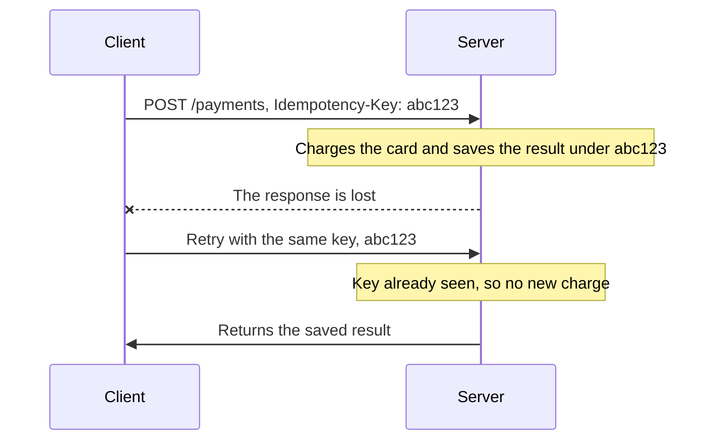
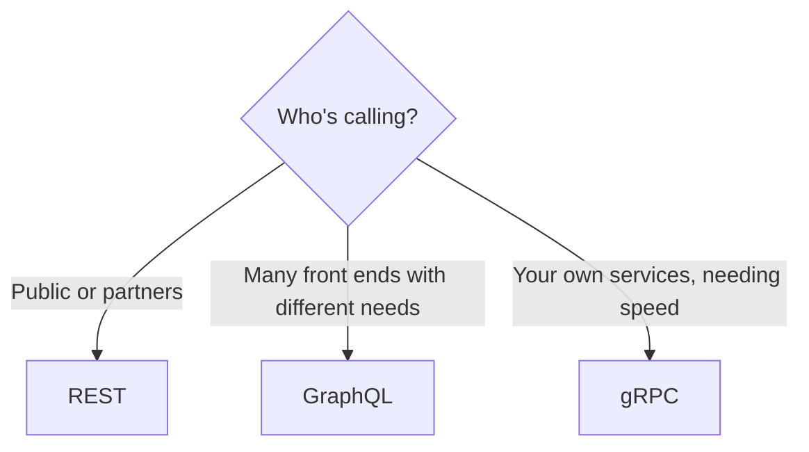

# API Design

← [[43 Design Patterns]] · [[Phase 3 - Start Here|Home]] · **Next:** [[45 Security Fundamentals]] → · [[Software Engineering Roadmap#API Design|Roadmap card]]

> [!abstract] After this note, you can
> Design an API that others find easy to use, and keep improving it without breaking the people who depend on it.

## The Big Idea

An **API** is a promise between your software and someone else's. Once other people depend on it, changing it is like moving the buttons on a lift while people are inside. Code can be rewritten easily. A public API often can't.

**So design from the consumer's point of view:** how will this feel to the person calling it? You covered the basics in [[32 HTTP and HTTPS#JSON APIs and REST]].

## Good API Checklist

| Quality | Meaning |
|---|---|
| **Predictable** | If you learn one endpoint, you can guess the others |
| **Consistent** | The same names and formats everywhere |
| **Hard to misuse** | Mistakes give clear errors |
| **Documented** | Examples you can copy |
| **Stable** | It doesn't break without warning |

## Modelling Resources

Name things after **what they are**. Use plural nouns, and let the HTTP method be the verb.

| Bad | Good | Why |
|---|---|---|
| `GET /getBooks` | `GET /books` | The method is already the verb |
| `POST /books/delete/5` | `DELETE /books/5` | Use the right method |
| `GET /book_list` | `GET /books` | Consistent plural nouns |
| `GET /orders?userId=7` and `GET /invoices?user=7` | Use one name everywhere | Consistency |

**Nest only when it reads naturally, and only one level deep:**

```text
GET  /authors/7/books         the books by author 7
GET  /books/42                one book, using its own address
POST /orders/9/cancel         an action that isn't simple CRUD
```

## Errors People Can Use

An error should tell the caller **what went wrong, and what to do about it**. Use the right status code, and one consistent format.

```json
{
  "error": {
    "code": "validation_failed",
    "message": "Some fields are invalid.",
    "details": [
      {"field": "year", "problem": "must be a whole number"}
    ],
    "request_id": "req_8fa2"
  }
}
```

| Part | For |
|---|---|
| `code` | Programs. It never changes |
| `message` | People. It may change |
| `details` | Fixing the problem |
| `request_id` | Finding this in your logs |

```python
import json

def error_response(status, code, message, details=None):
    body = {"error": {"code": code, "message": message}}
    if details:
        body["error"]["details"] = details
    return status, json.dumps(body)

status, body = error_response(404, "book_not_found", "No book with id 42.")
print(status, body)
```

Output:

```text
404 {"error": {"code": "book_not_found", "message": "No book with id 42."}}
```

> [!warning] Don't leak internals
> Never return a stack trace or a raw database error. It helps attackers. Log the details on the server, and return a `request_id`.

## Pagination

Never return an unlimited list. One day, someone will have a million rows.

![[pagination.svg]]

**Offset pagination:** simple, but slow when deep, because the database must skip all those rows.

**Cursor pagination:** "give me the rows after this one". It stays fast, and stays correct when new rows arrive.

```python
import sqlite3

db = sqlite3.connect(":memory:")
db.execute("CREATE TABLE books (id INTEGER PRIMARY KEY, title TEXT)")
db.executemany("INSERT INTO books (title) VALUES (?)", [(f"Book {i}",) for i in range(1, 8)])

def list_books(after=0, limit=3):
    rows = db.execute(
        "SELECT id, title FROM books WHERE id > ? ORDER BY id LIMIT ?",
        (after, limit + 1),
    ).fetchall()
    has_more = len(rows) > limit
    rows = rows[:limit]
    return {
        "items": [title for _, title in rows],
        "next_cursor": rows[-1][0] if has_more else None,
    }

page = list_books()
print(page)
print(list_books(after=page["next_cursor"]))
print(list_books(after=6))
```

Output:

```text
{'items': ['Book 1', 'Book 2', 'Book 3'], 'next_cursor': 3}
{'items': ['Book 4', 'Book 5', 'Book 6'], 'next_cursor': 6}
{'items': ['Book 7'], 'next_cursor': None}
```

Fetching `limit + 1` rows is a neat trick for knowing whether there's another page. Always set a maximum limit too.

**Filtering and sorting** usually use the query string:

```text
GET /books?author=Asha&year=2024&sort=-created_at&limit=20
```

## Idempotency - Safe Retries

Networks fail. If a response gets lost, the client doesn't know whether the action happened. Retrying a payment could charge someone twice!



```python
import uuid

class PaymentService:
    def __init__(self):
        self.results = {}
        self.charges = 0

    def pay(self, key, amount):
        if key in self.results:
            return self.results[key]
        self.charges = self.charges + 1
        result = {"id": self.charges, "amount": amount}
        self.results[key] = result
        return result

service = PaymentService()
key = str(uuid.uuid4())

first = service.pay(key, 100)
retry = service.pay(key, 100)

print(first == retry)
print("Times charged:", service.charges)
```

Output:

```text
True
Times charged: 1
```

In real systems, store the keys in a database, with a unique constraint and an expiry.

## Changing an API Safely

![[breaking-changes.svg]]

> [!important] The golden rule
> **Add, don't change.** Clients should also ignore fields they don't recognise, so that new fields can't break them.

### Versioning

When a breaking change can't be avoided, add a new version.

| Approach | Example | Notes |
|---|---|---|
| **In the URL** | `/v2/books` | Simple and visible. The most common choice |
| **In a header** | `Accept: application/vnd.api.v2+json` | Tidy URLs, harder to try |
| **By date** | `Api-Version: 2026-01-15` | Used by Stripe, for example |

### Retiring Old Things


### Worked Example - Adding Without Breaking

Say you need to split `name` into `first_name` and `last_name`.

```python
def user_v1(user):
    return {"name": f"{user['first']} {user['last']}"}

def user_v1_extended(user):
    return {
        "name": f"{user['first']} {user['last']}",   # Old clients keep working
        "first_name": user["first"],                 # New clients use these
        "last_name": user["last"],
    }

user = {"first": "Sam", "last": "Perera"}
print(user_v1(user))
print(user_v1_extended(user))
```

Output:

```text
{'name': 'Sam Perera'}
{'name': 'Sam Perera', 'first_name': 'Sam', 'last_name': 'Perera'}
```

## Contracts and OpenAPI

An **OpenAPI** file describes your API in a standard format. Tools can then produce documentation, client code and tests from it.

```yaml
openapi: 3.0.3
info:
  title: Library API
  version: 1.0.0
paths:
  /books/{id}:
    get:
      summary: Get one book
      parameters:
        - name: id
          in: path
          required: true
          schema:
            type: integer
      responses:
        "200":
          description: The book
          content:
            application/json:
              schema:
                $ref: "#/components/schemas/Book"
        "404":
          description: No such book
components:
  schemas:
    Book:
      type: object
      required: [id, title]
      properties:
        id:
          type: integer
        title:
          type: string
```

**Design first:** write this file before the code, and share it for feedback. Changing a text file is much cheaper than changing shipped code. See the [OpenAPI guide](https://learn.openapis.org/). Frameworks like FastAPI can also generate it from your code.

## Choosing a Style

| | REST | GraphQL | gRPC |
|---|---|---|---|
| **Looks like** | URLs and JSON | One endpoint, clients ask for fields | Function calls with binary messages |
| **Best for** | Public APIs, simple resources | Many different clients and screens | Fast traffic between internal services |
| **Strength** | Simple, cacheable, universal | Client gets exactly what it needs | Speed, strict contracts |
| **Weakness** | Too much or too little data | Caching, and costly queries | Harder in browsers, and to debug |



Default to REST, unless you have a clear reason not to. More detail is on the [[Software Engineering Roadmap#GraphQL|GraphQL]] and [[Software Engineering Roadmap#gRPC|gRPC]] cards.

## Library and SDK Design

The same ideas apply to any code other people call.

```python
# Hard to read: what does True mean?
def send_bad(to, text, flag1, flag2):
    return (to, text, flag1, flag2)

# Clear: names at the call site, and safe defaults
def send(to, text, *, urgent=False, retries=3):
    return {"to": to, "urgent": urgent, "retries": retries}

print(send("a@example.com", "hi", urgent=True))
```

Output:

```text
{'to': 'a@example.com', 'urgent': True, 'retries': 3}
```

The `*` forces callers to write the names. Offer simple defaults for common cases, and options for the rest.

## Common Mistakes

> [!warning] Watch out for these
> - Returning 200 with an error inside the body
> - No pagination on lists
> - Renaming a field because it "reads better", and breaking clients
> - Inconsistent names: `userId`, `user_id` and `uid`
> - Returning internal database fields or stack traces
> - No safe way to retry an action

## Practice

**1. Fix these endpoints.**
- `POST /deleteUser?id=5`
- `GET /getAllOrders`
- `GET /Users/5/Orders/9/Items/3/Reviews`

> [!example]- Answer to question 1
> - `DELETE /users/5`
> - `GET /orders`, with pagination
> - `GET /items/3/reviews`. Each item has its own address, so you don't need the deep path.

**2. Safe or breaking?**
- Add an optional `?sort=` parameter
- Change `price` from a number to a string
- Remove the `nickname` field
- Add a new `currency` field to a response

> [!example]- Answer to question 2
> Safe, breaking, breaking, safe.

**3. Design.** Design the errors for `POST /books` when the title is missing.

> [!example]- Answer to question 3
> Status **400**, with a body like this:
> ```json
> {"error": {"code": "validation_failed", "message": "Some fields are invalid.",
>   "details": [{"field": "title", "problem": "is required"}]}}
> ```

**4. Add idempotency.** Why doesn't `DELETE /books/5` need an idempotency key, while `POST /payments` does?

> [!example]- Answer to question 4
> Deleting something twice has the same end result, so DELETE is already idempotent. Each POST creates a new payment, so the server needs a key to recognise a retry.

**5. Roadmap exercise.** Write an OpenAPI file first for your [[34 Phase 2 Final Project|library API]]. Get feedback, implement it, then add a new feature with no breaking change.

## Can You Do This?

- [ ] Design clear resource URLs
- [ ] Write a consistent error format
- [ ] Add cursor pagination
- [ ] Make a POST safe to retry
- [ ] Tell a safe change from a breaking one
- [ ] Add a feature without breaking clients
- [ ] Write a small OpenAPI file
- [ ] Choose between REST, GraphQL and gRPC

## Summary

> [!success] Remember
> - An API is a **promise**. Design it for the caller.
> - **Paginate everything.** Prefer cursors at scale.
> - **Idempotency keys** make retries safe.
> - **Add, don't change.** Version only when you must.

**Next:** [[45 Security Fundamentals]] →
