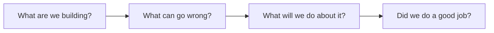

# Security Fundamentals

← [[44 API Design]] · [[Phase 3 - Start Here|Home]] · **Next:** [[46 OWASP Top 10]] → · [[Software Engineering Roadmap#Security Fundamentals|Roadmap card]]

> [!abstract] After this note, you can
> Think like an attacker about your own features, find the biggest risks before you build, and apply the basic principles that prevent most breaches.

## The Big Idea

Most breaches don't involve movie-style hacking. They come from common, avoidable mistakes: a missing permission check, a leaked password, or an old library. **Security is a normal part of building software, not a final step.**

> [!danger] Stay legal
> Only test systems that you own, or have clear written permission to test. Attacking anything else is illegal, even out of curiosity. Practice on sites made for it, such as the [PortSwigger Web Security Academy](https://portswigger.net/web-security).

## What Are We Protecting?

![[cia-triad.svg]]

| Goal | Meaning | If it fails | Protect with |
|---|---|---|---|
| **Confidentiality** | Only the right people can see it | Customer data leaks | Encryption, access control |
| **Integrity** | Nobody changes it without detection | Someone edits a bank balance | Hashes, signatures, audit logs |
| **Availability** | It works when needed | The site is down | Backups, redundancy, rate limits |

Use these when you assess any risk: "Which of the three would this attack damage?"

## Core Principles

### Least Privilege

Give each person and program **only the access they need**. Think of a hotel key card: it opens your room, not all the rooms.

| Instead of | Use |
|---|---|
| Your app connecting to the database as an admin | An account that can only read and write its own tables |
| Every employee having production access | Only those who need it, for a limited time |
| A cloud key that can do anything | A key that can only read one storage bucket |

```python
import sqlite3

# Open a database file read-only: even a bug can't change the data
sqlite3.connect("shop.db").close()
reader = sqlite3.connect("file:shop.db?mode=ro", uri=True)

try:
    reader.execute("CREATE TABLE hacked (id INTEGER)")
except sqlite3.OperationalError as error:
    print(error)
```

Output:

```text
attempt to write a readonly database
```

If an attacker breaks in through a read-only reporting tool, the damage stays limited.

### Defense in Depth

![[defense-in-depth.svg]]

Assume that any single protection can fail. A castle has a moat, walls, guards and a locked keep. Similarly, even when a firewall stops most attacks, your app should still check permissions, and your data should still be encrypted.

### Reduce the Attack Surface

The **attack surface** is every place where an attacker could get in. Less surface means fewer risks.

- Close ports that you don't need
- Remove unused features, accounts and libraries
- Keep admin pages off the public internet
- Don't collect data you don't need. You can't leak what you don't have.

### Fail Securely

When something goes wrong, default to **no access**.

```python
def can_view_bad(user, document):
    try:
        return document["owner"] == user
    except Exception:
        return True          # Error means allowed. Terrible!

def can_view_good(user, document):
    try:
        return document["owner"] == user
    except Exception:
        return False         # Error means denied.

broken_document = {}
print(can_view_bad("sam", broken_document))
print(can_view_good("sam", broken_document))
```

Output:

```text
True
False
```

### Don't Trust Input

Everything from outside can be malicious: form fields, URLs, headers, cookies, files and even data from other services. **Check it on the server.** Checks in the browser are for convenience only, as an attacker can skip them.

```python
ALLOWED_SORT = {"title", "year"}

def validate_sort(field):
    if field not in ALLOWED_SORT:
        raise ValueError("Invalid sort field")
    return field

print(validate_sort("title"))

try:
    validate_sort("title; DROP TABLE books")
except ValueError as error:
    print(error)
```

Output:

```text
title
Invalid sort field
```

**Allow-lists beat block-lists.** Listing what's permitted is safer than trying to list everything dangerous.

### Don't Invent Your Own Crypto

Use well-known libraries, and proven login systems. Designing your own encryption or password storage nearly always goes wrong, in ways that you can't see.

## Secrets Management

A **secret** is a password, API key, token or private key.

> [!danger] Never put secrets in code
> Bots scan public repositories constantly, and can find a leaked key within minutes. Even if you delete it, [[09 Git Basics#Ignoring Files|Git's history remembers]]. **If a secret leaks, replace it immediately.**

```python
import os

def get_required_setting(name):
    value = os.environ.get(name)
    if not value:
        raise RuntimeError(f"Missing required setting: {name}")
    return value

os.environ["DEMO_API_KEY"] = "only-for-this-example"
print(len(get_required_setting("DEMO_API_KEY")) > 0)

try:
    get_required_setting("NOT_SET")
except RuntimeError as error:
    print(error)
```

Output:

```text
True
Missing required setting: NOT_SET
```

| Where | Good for |
|---|---|
| `.env` file, listed in `.gitignore` | Your own machine |
| CI secret store | Pipelines. See [[49 Continuous Integration and Delivery#Secrets in Pipelines]] |
| Secrets manager, such as AWS Secrets Manager or Vault | Production |

**Good habits:** give each environment different secrets, rotate them regularly, never log them, and turn on [secret scanning](https://docs.github.com/en/code-security/secret-scanning).

## Threat Modelling

**Threat modelling** means asking "what could go wrong?" while it's still cheap to fix. You don't need special training. You need 30 minutes and a whiteboard.

### The Four Questions



### Step 1 - Draw It

![[threat-model.svg]]

Draw the parts and the data flows. Then mark **trust boundaries**: places where data moves from less trusted to more trusted. Most problems occur at those crossings.

### Step 2 - Ask STRIDE Questions

![[stride.svg]]

### Step 3 - List and Rank

A simple score: **how likely** × **how bad**.

> [!example] Threat model for a password reset

| Threat | Type | Likely | Bad | Fix |
|---|---|---|---|---|
| Attacker guesses a reset token | Spoofing | Medium | High | Long random tokens with 1-hour expiry |
| Reset link can be reused | Spoofing | Medium | High | Delete the token after use |
| Form reveals who has an account | Disclosure | High | Low | Always say "if the account exists, we sent an email" |
| Someone floods the form | Denial of service | High | Medium | Rate limit |
| No record of resets | Repudiation | Medium | Medium | Log each reset, without the token |

```python
threats = [
    ("Token guessing", 2, 3),
    ("Reusable link", 2, 3),
    ("Reveals accounts", 3, 1),
    ("Form flooding", 3, 2),
]

for name, likely, bad in sorted(threats, key=lambda t: t[1] * t[2], reverse=True):
    print(f"{likely * bad}: {name}")
```

Output:

```text
6: Token guessing
6: Reusable link
6: Form flooding
3: Reveals accounts
```

Fix the highest scores first. This is the roadmap's exercise, so try it on one of your own apps.

## Authentication and Authorization

| | Authentication | Authorization |
|---|---|---|
| **Question** | Who are you? | What may you do? |
| **Like** | Showing your ID | The list of who may enter |
| **Fails with** | 401 | 403 |

Both matter, and many breaches come from checking only the first. See [[46 OWASP Top 10#A01 Broken Access Control]].

**Zero trust** is the modern idea of "never trust, always verify". Being inside the company network doesn't prove anything. Each request must prove who it's from, and be allowed.

## Privacy

Security protects data. **Privacy** is about using it fairly. Laws such as the EU's **GDPR** apply to many apps.

| Principle | Meaning for you |
|---|---|
| **Collect less** | Don't ask for a birth date if you don't need one |
| **Be open** | Tell people what you collect, and why |
| **Delete it** | Don't keep data forever, and let users ask for deletion |
| **Protect it** | Encrypt sensitive data, and keep it out of logs |

```python
import re

def mask_email(text):
    return re.sub(r"[\w.+-]+@[\w-]+\.[\w.]+", "[email hidden]", text)

print(mask_email("Login failed for sam@example.com at 10:02"))
```

Output:

```text
Login failed for [email hidden] at 10:02
```

## Everyday Security Habits

**When you write code:**

- [ ] Validate all input on the server
- [ ] Use `?` placeholders for SQL
- [ ] Check permissions on every request
- [ ] Keep secrets out of code and logs

**When you design a feature:**

- [ ] Ask "how could someone abuse this?"
- [ ] Note what happens when it fails
- [ ] Add limits, such as rate, size and count

**Across a project:**

- [ ] Keep dependencies updated. See [[46 OWASP Top 10#A03 Software Supply Chain Failures]]
- [ ] Use HTTPS everywhere
- [ ] Turn on multi-factor login for your own accounts
- [ ] Keep tested backups

## Common Mistakes

> [!warning] Watch out for these
> - Thinking "nobody would target us". Bots attack everybody.
> - Relying on hidden URLs for security
> - Trusting browser-side checks
> - Committing a `.env` file
> - Showing detailed errors to users
> - Treating security as somebody else's job

## Practice

**1. CIA.** Which goal does each attack hurt?
- Ransomware locks your files
- A stolen database of customer emails
- Someone changes a price in a shop's database

> [!example]- Answer to question 1
> Availability (and possibly confidentiality), confidentiality, integrity.

**2. Least privilege.** A reporting tool only reads sales data. What database permissions should it have?

> [!example]- Answer to question 2
> Only `SELECT`, and only on the tables it needs. No writing, and no admin rights.

**3. STRIDE.** Which type fits each threat?
- Someone logs in as another user with a stolen cookie
- A user says "I never made that payment", and you have no records
- A normal user finds an admin page that works for them

> [!example]- Answer to question 3
> Spoofing, repudiation, elevation of privilege.

**4. Find the problems.** What's wrong here?

```python
API_KEY = "sk_live_51Hxyz"

def charge(card_number, amount):
    print(f"Charging {card_number} for {amount} with key {API_KEY}")
```

> [!example]- Answer to question 4
> A secret is hard-coded, and it's also printed. The card number is printed too, so it ends up in the logs. Read the key from the environment, and never log card numbers.

**5. Threat model.** Draw your [[34 Phase 2 Final Project|library API]]. Mark the trust boundaries, run STRIDE over it, and fix your top three risks.

## Can You Do This?

- [ ] Explain the CIA triad with examples
- [ ] Apply least privilege to a database account
- [ ] Explain defense in depth and attack surface
- [ ] Keep secrets out of code
- [ ] Do a simple threat model using STRIDE
- [ ] Tell authentication from authorization
- [ ] Raise security concerns while designing, not after shipping

## Summary

> [!success] Remember
> - Protect **confidentiality, integrity and availability**.
> - **Least privilege. Defense in depth. Fail securely.**
> - **Never trust input. Never commit secrets.**
> - Ask **"what could go wrong?"** before you build.

**Next:** [[46 OWASP Top 10]] →
