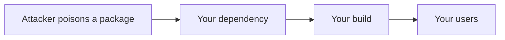
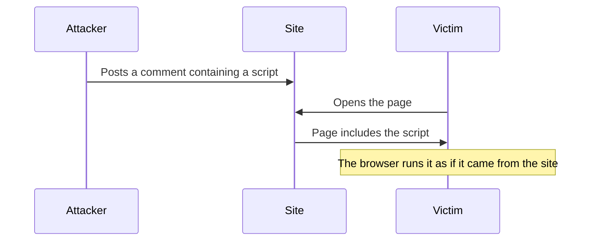

# OWASP Top 10

← [[45 Security Fundamentals]] · [[Phase 3 - Start Here|Home]] · **Next:** [[47 Integration Testing]] → · [[Software Engineering Roadmap#OWASP Top 10|Roadmap card]]

> [!abstract] After this note, you can
> Recognise the ten leading web security risks, and prevent each one in your own code.

## The Big Idea

**OWASP** is a non-profit organization for software security. Its [Top 10](https://top10.owasp.org/2025/) lists the most critical risks for web applications. Engineers everywhere use it as a shared baseline, and this note follows the 2025 edition.

> [!danger] Practice legally
> The examples here are for defending your own code. Practice attacks only on systems built for it, such as [PortSwigger's labs](https://portswigger.net/web-security) and [OWASP Juice Shop](https://owasp.org/www-project-juice-shop/).

| # | Risk | In one line |
|---|---|---|
| A01 | Broken Access Control | Users reach things that aren't theirs |
| A02 | Security Misconfiguration | Unsafe settings and defaults |
| A03 | Software Supply Chain Failures | Dangerous dependencies and build tools |
| A04 | Cryptographic Failures | Data poorly protected |
| A05 | Injection | Input treated as a command |
| A06 | Insecure Design | The design itself is flawed |
| A07 | Authentication Failures | Login can be beaten |
| A08 | Software or Data Integrity Failures | Trusting unverified code or data |
| A09 | Security Logging and Alerting Failures | Attacks go unnoticed |
| A10 | Mishandling of Exceptional Conditions | Errors leave the system unsafe |

## A01 Broken Access Control

![[broken-access.svg]]

The app knows who you are, but doesn't check **what you may do**. This is the number one risk. The most common form is called **IDOR** (Insecure Direct Object Reference): changing an ID in a URL to see someone else's data.

```python
INVOICES = {
    7: {"owner": "sam", "total": 100},
    8: {"owner": "priya", "total": 900},
}

def get_invoice_bad(user, invoice_id):
    return INVOICES[invoice_id]

def get_invoice_good(user, invoice_id):
    invoice = INVOICES.get(invoice_id)
    if invoice is None or invoice["owner"] != user:
        return None          # Looks just like "not found"
    return invoice

print(get_invoice_bad("sam", 8))
print(get_invoice_good("sam", 8))
print(get_invoice_good("sam", 7))
```

Output:

```text
{'owner': 'priya', 'total': 900}
None
{'owner': 'sam', 'total': 100}
```

**Prevent it:**

- [ ] Check ownership on **every** request, on the server
- [ ] Deny by default
- [ ] Filter in the query: `WHERE id = ? AND owner_id = ?`
- [ ] Write tests where one user tries to reach another's data

### SSRF - Making Your Server Fetch for an Attacker

**Server-Side Request Forgery** means tricking your server into calling a URL the attacker chooses, often an internal one. The 2025 edition groups it with access control.

```python
import ipaddress
from urllib.parse import urlparse

ALLOWED_HOSTS = {"images.example.com"}

def is_safe_url(url):
    parsed = urlparse(url)
    return parsed.scheme == "https" and parsed.hostname in ALLOWED_HOSTS

print(is_safe_url("https://images.example.com/cat.png"))
print(is_safe_url("http://169.254.169.254/latest/meta-data/"))
print(ipaddress.ip_address("169.254.169.254").is_link_local)
```

Output:

```text
True
False
True
```

That address is the cloud "metadata service", which can reveal credentials. Use an allow-list.

## A02 Security Misconfiguration

Good code can still be unsafe if it's set up badly.

| Mistake | Fix |
|---|---|
| Debug mode left on in production | Turn it off with configuration |
| Default passwords left in place | Change them at setup |
| Detailed errors shown to users | Log them, and show a generic message |
| Open cloud storage buckets | Block public access by default |
| Missing security headers | Set them at the server or proxy |
| Sample apps and unused features left on | Remove them |

```python
SECURITY_HEADERS = {
    "Strict-Transport-Security": "max-age=31536000",
    "X-Content-Type-Options": "nosniff",
    "Content-Security-Policy": "default-src 'self'",
    "X-Frame-Options": "DENY",
}

def check_settings(settings):
    problems = []
    if settings.get("debug"):
        problems.append("debug must be off")
    if settings.get("admin_password") in ("admin", "password", ""):
        problems.append("change the default admin password")
    return problems

print(check_settings({"debug": True, "admin_password": "admin"}))
print(len(SECURITY_HEADERS))
```

Output:

```text
['debug must be off', 'change the default admin password']
4
```

## A03 Software Supply Chain Failures

Most of your app is code you didn't write. An attacker who poisons a popular package reaches thousands of apps at once.



**Prevent it:**

- [ ] Use a **lockfile**, and pin exact versions
- [ ] Scan dependencies: `pip-audit`, `npm audit` or GitHub Dependabot
- [ ] Remove packages you don't use
- [ ] Watch for **typosquatting**, as in `reqeusts` instead of `requests`
- [ ] Lock down CI, as in [[49 Continuous Integration and Delivery#Hardening the Pipeline]]

```bash
python -m pip install pip-audit
pip-audit
```

## A04 Cryptographic Failures

Sensitive data must be protected, in transit and at rest.

**Passwords in particular:**

![[password-storage.svg]]

```python
import hashlib
import hmac
import os

def hash_password(password):
    salt = os.urandom(16)
    digest = hashlib.scrypt(password.encode(), salt=salt, n=2**14, r=8, p=1)
    return salt, digest

def check_password(password, salt, digest):
    attempt = hashlib.scrypt(password.encode(), salt=salt, n=2**14, r=8, p=1)
    return hmac.compare_digest(attempt, digest)

salt, digest = hash_password("correct horse")
print(check_password("correct horse", salt, digest))
print(check_password("wrong guess", salt, digest))

other_salt, other_digest = hash_password("correct horse")
print(digest == other_digest)
```

Output:

```text
True
False
False
```

The same password gives different results, thanks to the **salt**. So an attacker can't use a pre-built table to crack them all at once. In real projects, prefer a maintained library, such as `argon2-cffi`.

**Prevent it:**

- [ ] Use HTTPS everywhere
- [ ] Hash passwords with Argon2, scrypt or bcrypt. Never MD5 or SHA-1
- [ ] Use `secrets` for tokens, not `random`
- [ ] Don't store what you don't need, especially card numbers

```python
import secrets

token = secrets.token_urlsafe(32)
print(len(token) > 40)
```

Output:

```text
True
```

## A05 Injection

![[sql-injection.svg]]

**Injection** happens when untrusted data is treated as a command.

### SQL Injection

```python
import sqlite3

db = sqlite3.connect(":memory:")
db.execute("CREATE TABLE users (name TEXT, secret TEXT)")
db.execute("INSERT INTO users VALUES ('Sam', 'sam-secret'), ('Priya', 'priya-secret')")

attack = "' OR '1'='1"

bad_query = f"SELECT secret FROM users WHERE name = '{attack}'"
print(db.execute(bad_query).fetchall())

safe = db.execute("SELECT secret FROM users WHERE name = ?", (attack,)).fetchall()
print(safe)
```

Output:

```text
[('sam-secret',), ('priya-secret',)]
[]
```

### Cross-Site Scripting (XSS)

An attacker gets their script to run in other users' browsers, where it can steal data or act as them. **Prevent it by escaping output** so that it displays as text. Modern frameworks do this by default.



```python
import html

comment = "<script>steal(document.cookie)</script>"

print(f"<p>{comment}</p>")
print(f"<p>{html.escape(comment)}</p>")
```

Output:

```text
<p><script>steal(document.cookie)</script></p>
<p>&lt;script&gt;steal(document.cookie)&lt;/script&gt;</p>
```

### Command Injection

```python
import subprocess
import sys

filename = "notes.txt; rm -rf /"

# Dangerous: subprocess.run(f"cat {filename}", shell=True)
# Safe: a list has no shell to interpret the semicolon
result = subprocess.run([sys.executable, "-c", "import sys; print(sys.argv[1])", filename], capture_output=True, text=True)
print(result.stdout.strip())
```

Output:

```text
notes.txt; rm -rf /
```

**Prevent all of these with one rule:** keep data separate from commands. Use placeholders, escaping and argument lists, and validate input with allow-lists.

### Cross-Site Request Forgery (CSRF)

A related attack: a malicious site makes your browser send a request to another site where you're logged in. **Prevent it** with `SameSite` cookies and anti-CSRF tokens. See the [[Software Engineering Roadmap#CSRF|CSRF card]].

## A06 Insecure Design

Here, the code does what was asked, but what was asked is unsafe. No amount of careful coding fixes a flawed design.

> [!example] Examples of flawed designs
> - Password recovery by "What's your favourite colour?"
> - A coupon that can be used without limit
> - A cinema that lets anyone hold all seats for free, with no time limit

**Prevent it** with [[45 Security Fundamentals#Threat Modelling|threat modelling]], and by asking "how could this be abused?" while still designing. Add limits as a matter of routine.

```python
import time
from collections import defaultdict

class RateLimiter:
    def __init__(self, limit, seconds):
        self.limit = limit
        self.seconds = seconds
        self.attempts = defaultdict(list)

    def allow(self, key):
        now = time.monotonic()
        recent = [t for t in self.attempts[key] if now - t < self.seconds]
        self.attempts[key] = recent
        if len(recent) >= self.limit:
            return False
        recent.append(now)
        return True

limiter = RateLimiter(limit=3, seconds=60)
print([limiter.allow("sam") for _ in range(4)])
```

Output:

```text
[True, True, True, False]
```

## A07 Authentication Failures

Weaknesses in login let attackers take over accounts. **Credential stuffing** is the commonest: trying passwords leaked from other sites.

| Weakness | Fix |
|---|---|
| No limit on login attempts | Rate limiting and slowdowns |
| Weak passwords allowed | Check against lists of breached passwords |
| No second factor | Offer multi-factor login or passkeys |
| Different errors reveal who has an account | One message for all failures |
| Tokens that never expire | Short lifetimes, and rotation |

```python
USERS = {"sam": "hash-of-password"}

def login(name, password_hash):
    if USERS.get(name) != password_hash:
        return "Wrong username or password"
    return "Welcome"

print(login("nobody", "x"))
print(login("sam", "x"))
```

Output:

```text
Wrong username or password
Wrong username or password
```

Both failures look the same, so attackers can't use this to find out who has an account. There's more on the [[Software Engineering Roadmap#Authentication Security|Authentication Security card]].

## A08 Software or Data Integrity Failures

This means trusting code or data without checking that it's genuine. Examples are auto-updates with no signature, or a webhook that anyone can fake.

**Check integrity with a signature.** Here, a shared secret proves that a message really came from your payment provider, and wasn't changed.

```python
import hashlib
import hmac

SECRET = b"shared-secret-from-settings"

def sign(body):
    return hmac.new(SECRET, body, hashlib.sha256).hexdigest()

def verify(body, signature):
    return hmac.compare_digest(sign(body), signature)

message = b'{"order": 42, "paid": true}'
signature = sign(message)

print(verify(message, signature))
print(verify(b'{"order": 42, "paid": false}', signature))
```

Output:

```text
True
False
```

**Also:** don't load untrusted data with `pickle`, because doing so can run code. Use JSON.

## A09 Security Logging and Alerting Failures

If nobody notices an attack, it continues for months. Breaches often go undetected for a long time.

**Log these:** logins (pass and fail), permission denials, password changes, admin actions and validation failures.

**Never log these:** passwords, tokens, card numbers or personal data you don't need.

```python
import json

def audit(event, user, **details):
    return json.dumps({"event": event, "user": user, **details})

print(audit("login_failed", "sam", ip="203.0.113.10", attempts=5))
```

Output:

```text
{"event": "login_failed", "user": "sam", "ip": "203.0.113.10", "attempts": 5}
```

A log nobody reads is useless, so **set alerts**, such as "100 failed logins in a minute".

## A10 Mishandling of Exceptional Conditions

This is new in 2025. Systems can become unsafe when something unexpected happens: an error skips a check, or an error message reveals secrets.

```python
def check_payment(service_is_down):
    if service_is_down:
        raise ConnectionError("Payment service unavailable")
    return True

def place_order_bad(service_is_down):
    try:
        check_payment(service_is_down)
    except Exception:
        pass                       # Error ignored, so the order goes through free!
    return "Order placed"

def place_order_good(service_is_down):
    try:
        check_payment(service_is_down)
    except ConnectionError:
        return "Please try again later"
    return "Order placed"

print(place_order_bad(True))
print(place_order_good(True))
```

Output:

```text
Order placed
Please try again later
```

**Prevent it:** fail closed, catch specific errors, roll back partial work with [[52 Transactions and ACID|transactions]], and test what happens when dependencies fail.

## Quick Reference

| Risk | One key defense |
|---|---|
| A01 Access control | Check ownership on every request |
| A02 Misconfiguration | Secure defaults, and no debug in production |
| A03 Supply chain | Lockfiles and dependency scanning |
| A04 Crypto | Argon2 or scrypt, and HTTPS |
| A05 Injection | Placeholders and output escaping |
| A06 Insecure design | Threat modelling |
| A07 Authentication | Rate limits and multi-factor login |
| A08 Integrity | Verify signatures |
| A09 Logging | Log security events and set alerts |
| A10 Exceptions | Fail closed |

The [OWASP Cheat Sheets](https://cheatsheetseries.owasp.org/) give practical detail for each.

## Common Mistakes

> [!warning] Watch out for these
> - Hiding a button, but leaving the API open
> - Trying to filter "bad words" instead of using placeholders
> - Writing your own login system
> - Using `random` for security tokens
> - Catching every exception and carrying on

## Practice

**1. Name the risk.**
- Changing `/orders/5` to `/orders/6` shows someone else's order
- An admin panel with the password `admin`
- Comments that can run scripts in other users' browsers
- 10,000 failed logins, and no alert

> [!example]- Answer to question 1
> A01, A02, A05, A09.

**2. Fix it.** Make this safe.

```python
import sqlite3

db = sqlite3.connect(":memory:")
db.execute("CREATE TABLE books (title TEXT)")
db.execute("INSERT INTO books VALUES ('SQL Fun')")

def search(title):
    return db.execute("SELECT title FROM books WHERE title = '" + title + "'").fetchall()

print(search("SQL Fun"))
```

> [!example]- Answer to question 2
> ```python
> import sqlite3
>
> db = sqlite3.connect(":memory:")
> db.execute("CREATE TABLE books (title TEXT)")
> db.execute("INSERT INTO books VALUES ('SQL Fun')")
>
> def search(title):
>     return db.execute("SELECT title FROM books WHERE title = ?", (title,)).fetchall()
>
> print(search("SQL Fun"))
> print(search("' OR '1'='1"))
> ```
>
> Output:
>
> ```text
> [('SQL Fun',)]
> []
> ```

**3. Audit.** Which risks can you find here?

```python
import hashlib
import pickle

def save_user(password, profile_bytes):
    hashed = hashlib.md5(password.encode()).hexdigest()
    profile = pickle.loads(profile_bytes)
    return hashed, profile
```

> [!example]- Answer to question 3
> **A04:** MD5 with no salt is far too fast and weak for passwords. **A08:** `pickle.loads` on untrusted data can run an attacker's code. Use scrypt or Argon2, and JSON.

**4. Hands on.** Solve one [PortSwigger lab](https://portswigger.net/web-security) for each risk you can. Exploit it, explain it, and write the fix. That's the roadmap's mastery test.

## Can You Do This?

- [ ] Explain all ten risks in your own words
- [ ] Write an ownership check, and test it
- [ ] Prevent SQL injection and XSS
- [ ] Hash passwords with salt
- [ ] Verify a signed message
- [ ] Decide what to log, and what never to log
- [ ] Spot these risks in code review

## Summary

> [!success] Remember
> - **Check ownership on every request.**
> - **Keep data separate from commands.**
> - **Fail closed.** Errors must never open the door.
> - Your **dependencies** are part of your attack surface.

**Next:** [[47 Integration Testing]] →
