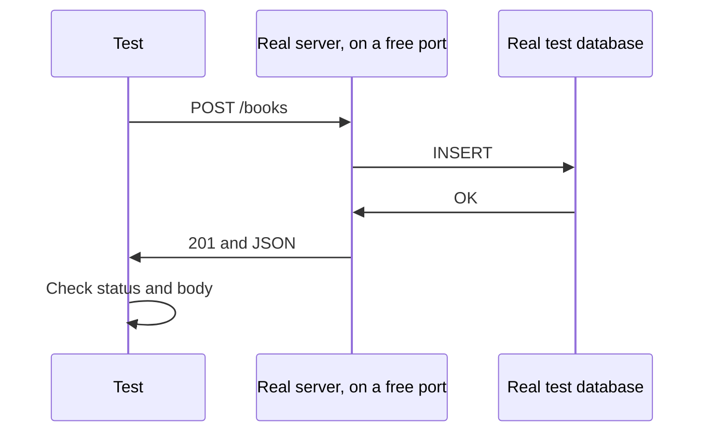
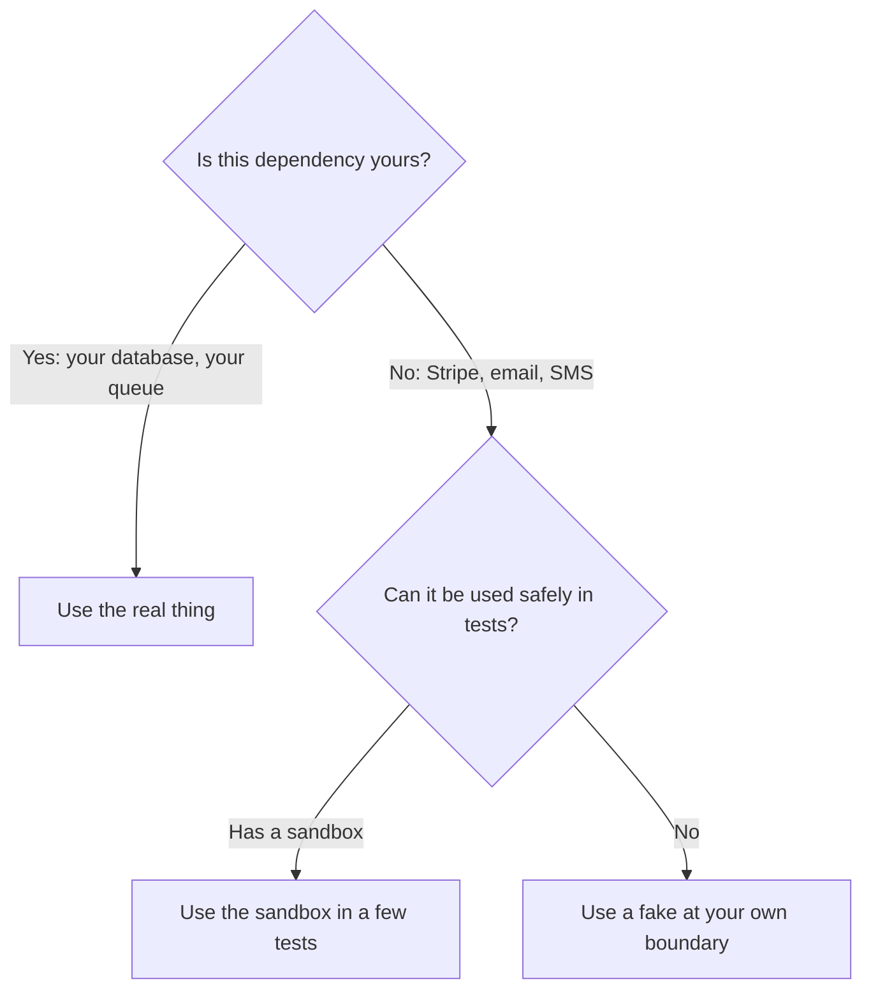
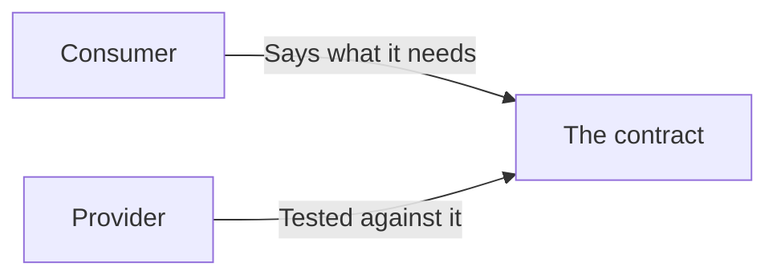

# Integration Testing

← [[46 OWASP Top 10]] · [[Phase 3 - Start Here|Home]] · **Next:** [[48 Docker]] → · [[Software Engineering Roadmap#Integration Testing|Roadmap card]]

> [!abstract] After this note, you can
> Test that the parts of your system really work together, using real dependencies, without making your tests slow or flaky.

## The Big Idea

Each part of a car can pass its own test, and the car can still fail when you put them together. [[11 Unit Testing Basics|Unit tests]] check the parts alone. **Integration tests** check that they work together.

Many real bugs live at the boundaries: a typo in SQL, a wrong column name, a date in the wrong format. Unit tests with fake databases can't catch those.

![[test-pyramid.svg]]

![[integration-scope.svg]]

| | Unit | Integration | End-to-end |
|---|---|---|---|
| **Speed** | Milliseconds | Up to seconds | Seconds to minutes |
| **Tells you** | This logic is right | These parts fit together | A user's journey works |
| **When it fails** | Exact location | A small area | Could be anywhere |
| **How many** | Many | Some | A few |

## What an Integration Test Looks Like

**The code under test:** a small repository, with real SQL.

```python
# file: bookstore.py
import sqlite3

SCHEMA = """
CREATE TABLE IF NOT EXISTS books (
    id    INTEGER PRIMARY KEY,
    title TEXT NOT NULL,
    year  INTEGER NOT NULL CHECK (year > 0)
);
"""

class BookStore:
    def __init__(self, db):
        self.db = db
        self.db.executescript(SCHEMA)

    def add(self, title, year):
        with self.db:
            cursor = self.db.execute("INSERT INTO books (title, year) VALUES (?, ?)", (title, year))
        return cursor.lastrowid

    def find_by_year(self, year):
        rows = self.db.execute("SELECT title FROM books WHERE year = ? ORDER BY title", (year,))
        return [row[0] for row in rows]
```

**The test uses a real database,** so it really runs the SQL.

```python
# file: test_bookstore.py
import sqlite3

import pytest

from bookstore import BookStore

@pytest.fixture
def store(tmp_path):
    db = sqlite3.connect(tmp_path / "test.db")
    yield BookStore(db)
    db.close()

def test_add_then_find(store):
    store.add("SQL Fun", 2024)
    assert store.find_by_year(2024) == ["SQL Fun"]

def test_results_are_sorted(store):
    store.add("Zebra", 2024)
    store.add("Apple", 2024)
    assert store.find_by_year(2024) == ["Apple", "Zebra"]

def test_database_rejects_a_bad_year(store):
    with pytest.raises(sqlite3.IntegrityError):
        store.add("Old", -5)

def test_each_test_starts_empty(store):
    assert store.find_by_year(2024) == []
```

A **fixture** prepares what a test needs, and cleans up afterward. `tmp_path` gives each test its own new folder, so tests can't affect one another.

**These catch what mocks can't:** a misspelled column, a broken constraint, or wrong SQL syntax.

## Testing a Real HTTP API

Start the actual server on a free port, and send real requests. You did this in [[34 Phase 2 Final Project]].



```python
# file: test_http_api.py
import json
import threading
import urllib.request
from http.server import BaseHTTPRequestHandler, ThreadingHTTPServer

import pytest

class Handler(BaseHTTPRequestHandler):
    def do_GET(self):
        body = json.dumps({"status": "ok"}).encode()
        self.send_response(200)
        self.send_header("Content-Type", "application/json")
        self.send_header("Content-Length", str(len(body)))
        self.end_headers()
        self.wfile.write(body)

    def log_message(self, *args):
        pass

@pytest.fixture
def base_url():
    server = ThreadingHTTPServer(("127.0.0.1", 0), Handler)
    threading.Thread(target=server.serve_forever, daemon=True).start()
    yield f"http://127.0.0.1:{server.server_port}"
    server.shutdown()

def test_health_check(base_url):
    with urllib.request.urlopen(f"{base_url}/health") as response:
        assert response.status == 200
        assert response.headers["Content-Type"] == "application/json"
        assert json.loads(response.read()) == {"status": "ok"}
```

Port `0` asks the OS for any free port, so tests won't clash.

## Use the Same Database as Production

SQLite is great for learning, but if production uses PostgreSQL, test on PostgreSQL. Different databases behave differently, so a fake or substitute can hide real bugs.

**Testcontainers** starts a real database in [[48 Docker|Docker]] for each test run, and then throws it away. It needs Docker to be running.

```python
# Needs: python -m pip install "testcontainers[postgres]" "psycopg[binary]"
from testcontainers.postgres import PostgresContainer
import psycopg

def test_with_real_postgres():
    with PostgresContainer("postgres:17") as postgres:
        url = postgres.get_connection_url(driver=None)
        with psycopg.connect(url) as db:
            db.execute("CREATE TABLE books (title TEXT NOT NULL)")
            db.execute("INSERT INTO books VALUES ('SQL Fun')")
            assert db.execute("SELECT count(*) FROM books").fetchone()[0] == 1
```

See [Testcontainers](https://testcontainers.com/) for details and other languages.

## What to Fake, and What to Keep Real



**Don't call real external services in normal tests.** They're slow and can be down, and they could charge real money or email real people. Instead, fake them at a boundary that you own. That's [[42 SOLID Principles#D - Dependency Inversion|dependency inversion]] paying off.

```python
class FakeEmailClient:
    def __init__(self):
        self.sent = []

    def send(self, to, subject):
        self.sent.append((to, subject))

class SignupService:
    def __init__(self, email_client):
        self.email_client = email_client

    def signup(self, address):
        self.email_client.send(address, "Welcome!")

fake = FakeEmailClient()
SignupService(fake).signup("sam@example.com")
print(fake.sent)
```

Output:

```text
[('sam@example.com', 'Welcome!')]
```

## Managing Test Data

Bad test data is a leading cause of flaky and confusing tests.

| Rule | Why |
|---|---|
| **Each test creates what it needs** | You can read the test, and see everything that matters |
| **Tests never depend on each other** | They can run in any order, or in parallel |
| **No shared, long-lived test database** | Old data causes mystery failures |
| **Never use real customer data** | It's a privacy risk |

**Builders** keep tests short, by filling in the details that don't matter:

```python
def make_book(**overrides):
    book = {"title": "Any Title", "year": 2024, "author": "Any Author"}
    book.update(overrides)
    return book

print(make_book())
print(make_book(year=1999))
```

Output:

```text
{'title': 'Any Title', 'year': 2024, 'author': 'Any Author'}
{'title': 'Any Title', 'year': 1999, 'author': 'Any Author'}
```

The second call shows clearly that **the year matters** in that test.

### How to Isolate Tests

| Method | Speed | Notes |
|---|---|---|
| **Rollback after each test** | Fastest | Run each test in a transaction, then roll back |
| **New temporary database** | Good | Simplest. Used above |
| **Truncate tables** | Medium | Empty the tables between tests |

## Contract Testing

Your service calls another team's service. An end-to-end test with both is slow and fragile. A **contract test** checks only the agreement between them.



```python
CONTRACT = {"id": int, "title": str, "year": int}

def check_contract(response):
    problems = []
    for field, expected_type in CONTRACT.items():
        if field not in response:
            problems.append(f"missing {field}")
        elif not isinstance(response[field], expected_type):
            problems.append(f"{field} should be {expected_type.__name__}")
    return problems

print(check_contract({"id": 1, "title": "SQL Fun", "year": 2024, "extra": "ok"}))
print(check_contract({"id": "1", "title": "SQL Fun"}))
```

Output:

```text
[]
['id should be int', 'missing year']
```

Extra fields are fine, as [[44 API Design#Changing an API Safely|adding is safe]]. Tools such as [Pact](https://docs.pact.io/) do this properly, across teams.

## Flaky Tests

A **flaky test** sometimes passes and sometimes fails, with no code change. It's poison, because people soon stop trusting all the tests.

| Cause | Bad | Fix |
|---|---|---|
| **Timing** | `time.sleep(2)`, then check | Wait in a loop until ready, with a timeout |
| **Shared state** | Tests use the same data | Fresh data for each test |
| **Order** | Test B needs test A to run first | Make each test independent |
| **Real clock** | Fails at midnight or at month end | Pass the time in |
| **Randomness** | Different data each time | Fix the random seed |
| **Fixed ports** | Port 8000 is taken | Use port 0 |

```python
import time

def wait_until(condition, timeout=2.0, interval=0.01):
    deadline = time.monotonic() + timeout
    while time.monotonic() < deadline:
        if condition():
            return True
        time.sleep(interval)
    return False

start = time.monotonic()
print(wait_until(lambda: time.monotonic() - start > 0.05))
print(wait_until(lambda: False, timeout=0.05))
```

Output:

```text
True
False
```

> [!important] Fix flaky tests, or remove them
> Don't just press "re-run". Find the cause. If you can't fix one soon, take it out of the main pipeline, and open a ticket. A red build must always mean something.

## Run Them in CI

Integration tests should run on each change. See [[49 Continuous Integration and Delivery]].

```bash
python -m pytest tests/unit
python -m pytest tests/integration
```

Run the fast ones first, so you hear about simple problems quickly.

## Common Mistakes

> [!warning] Watch out for these
> - Mocking everything, so that nothing real gets tested
> - Using SQLite in tests when production uses PostgreSQL
> - Tests that share data
> - Using `sleep` to wait for things
> - Calling real payment or email services
> - Too many slow end-to-end tests, and too few integration tests

## Practice

**1. Which kind?** Unit, integration or end-to-end?
- `calculate_tax(100)` returns 18
- A repository saves a row, and reads it back from a real database
- A browser signs up, logs in and buys something

> [!example]- Answer to question 1
> Unit, integration, end-to-end.

**2. Spot the flakiness.** Why will this test sometimes fail?

```python
import datetime

def test_is_weekday():
    assert datetime.date.today().weekday() < 5
```

> [!example]- Answer to question 2
> It fails every weekend! It depends on the real clock. Pass the date in as a parameter, and test fixed dates.

**3. Fake or real?** For each, what would you use in a normal test run?
- Your own PostgreSQL database
- A payment provider
- Your own Redis cache

> [!example]- Answer to question 3
> Real, using Testcontainers. A fake at your boundary, with a few sandbox tests. Real.

**4. Write tests.** Write integration tests for a `delete(book_id)` method on `BookStore`, covering a book that exists and one that doesn't.

> [!example]- Answer to question 4
> ```python
> import sqlite3
>
> db = sqlite3.connect(":memory:")
> db.execute("CREATE TABLE books (id INTEGER PRIMARY KEY, title TEXT)")
>
> def delete(book_id):
>     with db:
>         return db.execute("DELETE FROM books WHERE id = ?", (book_id,)).rowcount > 0
>
> db.execute("INSERT INTO books (title) VALUES ('A')")
> print(delete(1))
> print(delete(1))
> ```
>
> Output:
>
> ```text
> True
> False
> ```

**5. Roadmap exercise.** Test your API against a real PostgreSQL in Docker, and run it in CI.

## Can You Do This?

- [ ] Explain the test pyramid
- [ ] Say what integration tests catch that unit tests miss
- [ ] Write tests with fixtures and a real database
- [ ] Test a real HTTP server on a free port
- [ ] Decide what to fake, and what to keep real
- [ ] Keep test data isolated
- [ ] Find and fix a flaky test
- [ ] Explain contract testing

## Summary

> [!success] Remember
> - **Test what you own for real. Fake what you don't.**
> - Each test **creates its own data**.
> - Use the **same database** as production.
> - **A flaky test is a bug.** Fix it.

**Next:** [[48 Docker]] →
