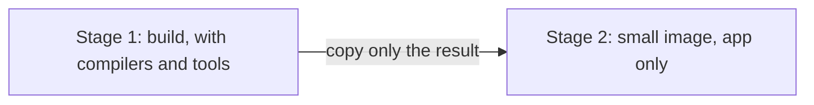
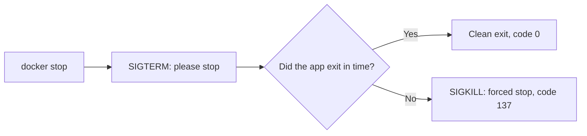
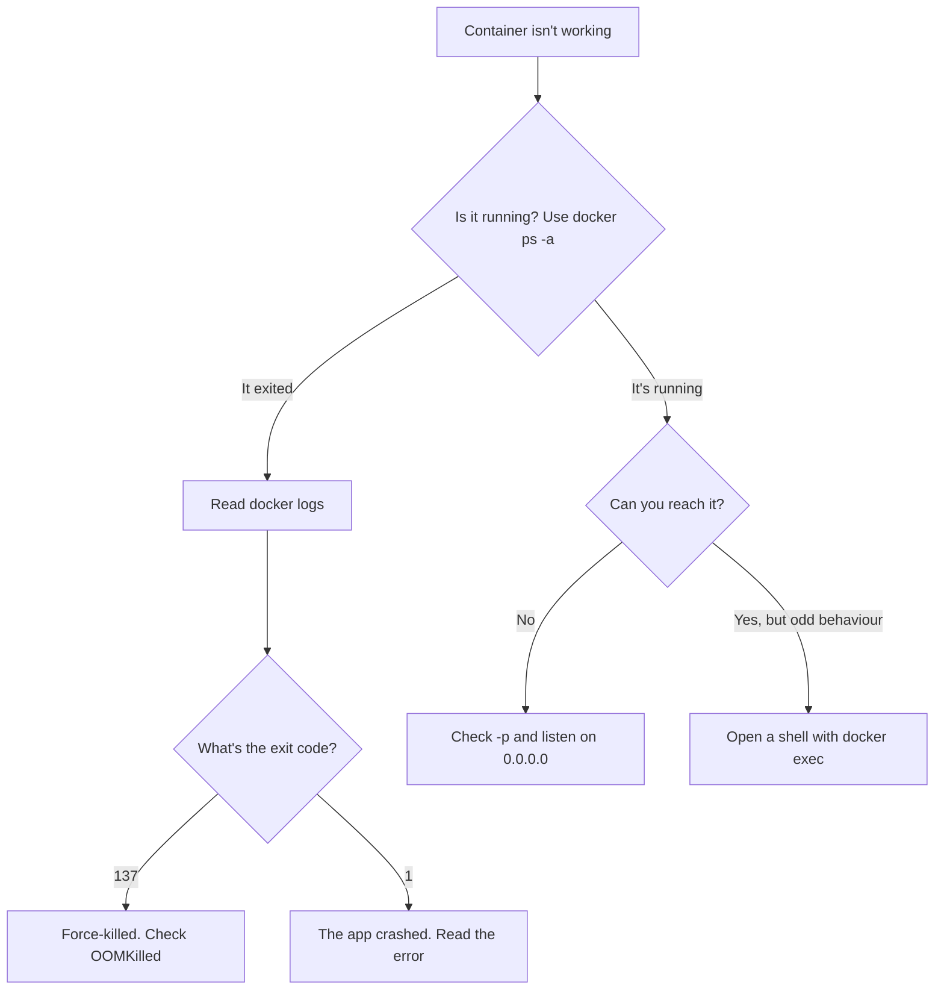

# Docker

← [[47 Integration Testing]] · [[Phase 3 - Start Here|Home]] · **Next:** [[49 Continuous Integration and Delivery]] → · [[Software Engineering Roadmap#Docker|Roadmap card]]

> [!abstract] After this note, you can
> Package an app so that it runs the same everywhere, build small and safe images, and run an app with its database using one command.

## The Big Idea

"It works on my machine" is a famous problem. Your laptop has Python 3.13, while the server has 3.9 and is missing a library.

Think of shipping before containers. Each load was different. Then came the standard **shipping container**: the ship doesn't care what's inside. **Docker** does this for software. You package your app with everything it needs, and it runs the same anywhere.

## What Is a Container?

![[vm-vs-container.svg]]

A **container** isn't a tiny computer. It's a **normal process with walls around it**, as you saw in [[36 Operating Systems#Containers Are Just Processes]].

| Kernel feature | What it does | Like |
|---|---|---|
| **Namespaces** | Limits what a process can **see** | Its own view of files, processes and network |
| **cgroups** | Limits what a process can **use** | A cap on CPU and memory |

| | Virtual machine | Container |
|---|---|---|
| **Includes** | A whole operating system | Just your app and its libraries |
| **Size** | Gigabytes | Megabytes |
| **Starts in** | Minutes | Seconds |
| **Isolation** | Very strong | Good, but shares the kernel |

## Install and Try It

Install [Docker Desktop](https://docs.docker.com/get-started/get-docker/) on Windows or Mac, or Docker Engine on Linux. Start Docker Desktop before you run these commands.

```bash
docker run hello-world
docker run --rm python:3.13-slim python -c "print('Hello from a container')"
```

`--rm` deletes the container when it exits.

## The Three Key Words

![[docker-flow.svg]]

| Word | Meaning | Like |
|---|---|---|
| **Image** | A frozen package: your app and its files | A class, or a recipe |
| **Container** | A running copy of an image | An object, or a meal |
| **Registry** | A place to store and share images | GitHub, but for images |

## Writing a Dockerfile

A **Dockerfile** is the recipe for an image. Here's a small web app to package.

```python
# file: app.py
import json
import signal
import sys
from http.server import BaseHTTPRequestHandler, HTTPServer

class Handler(BaseHTTPRequestHandler):
    def do_GET(self):
        body = json.dumps({"status": "ok"}).encode()
        self.send_response(200)
        self.send_header("Content-Type", "application/json")
        self.send_header("Content-Length", str(len(body)))
        self.end_headers()
        self.wfile.write(body)

def main():
    # Exit cleanly when Docker asks us to stop. See "Stopping Cleanly" below.
    signal.signal(signal.SIGTERM, lambda *args: sys.exit(0))
    HTTPServer(("0.0.0.0", 8000), Handler).serve_forever()

if __name__ == "__main__":
    main()
```

```dockerfile
# Start from an official small Python image
FROM python:3.13-slim

# All later commands run in this folder
WORKDIR /app

# Copy the code into the image
COPY app.py .

# Document the port the app uses
EXPOSE 8000

# The command to run when a container starts
CMD ["python", "app.py"]
```

**Build and run it:**

```bash
docker build -t my-app .
docker run --rm -p 8000:8000 my-app
```

Then visit `http://localhost:8000`.

> [!important] Why `0.0.0.0`?
> Inside a container, `127.0.0.1` means **the container itself**, so nothing outside can reach it. `0.0.0.0` means "listen on all network interfaces". And `-p 8000:8000` connects a port on your laptop to a port in the container.

### Dockerfile Instructions

| Instruction | Purpose |
|---|---|
| `FROM` | The base image to start from |
| `WORKDIR` | Set the working folder |
| `COPY` | Copy files into the image |
| `RUN` | Run a command while building |
| `ENV` | Set an environment variable |
| `EXPOSE` | Document a port |
| `USER` | Choose which user to run as |
| `CMD` | The default command when starting |

### Everyday Commands

| Command | What it does |
|---|---|
| `docker build -t name .` | Build an image |
| `docker run --rm name` | Start a container |
| `docker ps` | List running containers |
| `docker logs ID` | See its output |
| `docker exec -it ID sh` | Open a shell inside it |
| `docker stop ID` | Stop it |
| `docker images` | List images |
| `docker system prune` | Clean up unused data. **Careful:** this also deletes stopped containers |

## Layers and Caching

![[image-layers.svg]]

Each instruction creates a **layer**. Docker reuses unchanged layers, and rebuilds everything after the first change. So **put things that change least at the top**.

```dockerfile
FROM python:3.13-slim
WORKDIR /app

# Dependencies change rarely, so copy and install them first
COPY requirements.txt .
RUN pip install --no-cache-dir -r requirements.txt

# Code changes often, so copy it last
COPY . .

CMD ["python", "app.py"]
```

### Keep Unwanted Files Out

A `.dockerignore` file works like `.gitignore`. It makes builds faster, and it keeps secrets out of your image.

```text
.git
.venv
__pycache__
*.db
.env
tests
```

## Small, Safe Images

### Choosing a Base Image

| Base | Rough size | Notes |
|---|---|---|
| `python:3.13` | Over 1 GB | Has lots of tools |
| `python:3.13-slim` | Around 180 MB | A good default |
| `python:3.13-alpine` | Around 70 MB | Small, but some packages cause trouble |

Pin a specific version. `latest` can change without warning, and suddenly break your build.

### Multi-Stage Builds

Build tools aren't needed to **run** your app. A **multi-stage build** uses one image to build, and copies just the result into a smaller one.



```dockerfile
# Stage 1: install everything, including what's needed to build
FROM python:3.13 AS builder
WORKDIR /app
COPY requirements.txt .
RUN pip install --no-cache-dir --prefix=/install -r requirements.txt

# Stage 2: only what's needed to run
FROM python:3.13-slim
WORKDIR /app
COPY --from=builder /install /usr/local
COPY app.py .
CMD ["python", "app.py"]
```

This matters even more for languages like Go, where the final image can be just one small file.

### Security Basics

| Do | Why |
|---|---|
| **Don't run as root** | If someone breaks in, they get less power |
| **Don't put secrets in images** | Anyone with the image can read them, even from old layers |
| **Scan images** | Finds known vulnerabilities |
| **Update base images often** | They get security fixes |

```dockerfile
FROM python:3.13-slim
WORKDIR /app
COPY app.py .

# Create and switch to a normal user
RUN useradd --create-home appuser
USER appuser

CMD ["python", "app.py"]
```

To scan an image, log in with a free Docker account, then run Docker Scout:

```bash
docker login
docker scout quickview my-app
```

Pass secrets when the container starts, never when you build:

```bash
docker run --rm -e SECRET_KEY="$SECRET_KEY" my-app
```

## Stopping Cleanly

`docker stop` first sends the `SIGTERM` signal, to ask your app to finish up. If the app hasn't exited after a grace period, Docker force-kills it with `SIGKILL`.



> [!warning] Two traps that stop your app hearing the signal
> 1. **The shell form of `CMD`.** With `CMD python app.py`, the main process is a shell, which doesn't pass the signal on. Use the list form: `CMD ["python", "app.py"]`.
> 2. **No signal handler.** A container's main process has process ID 1, and Linux ignores `SIGTERM` for process 1 unless the program handles it. Even a Python app using the list form gets force-killed unless it sets up a handler, as `app.py` above does.

**Check yours:**

```bash
docker run -d --name stop-test my-app
docker stop stop-test
docker inspect stop-test --format "{{.State.ExitCode}}"
docker rm stop-test
```

`0` means a clean stop. `137` means that it was force-killed, which can interrupt work that's in progress. See [[36 Operating Systems#Talking Between Processes|graceful shutdown]].

## Keeping Data - Volumes

A container's files disappear when it's removed. To keep data, such as a database, use a **volume**, which lives outside the container.

```bash
docker volume create library-data
docker run --rm -v library-data:/data my-app
```

| Type | Syntax | Good for |
|---|---|---|
| **Named volume** | `-v library-data:/data` | Databases, real data |
| **Bind mount** | `-v ./src:/app/src` | Live code editing during development |

## Docker Compose

![[compose-network.svg]]

Real apps have several parts. **Compose** describes them all in one file, and starts them with one command. Containers can reach each other using their **service names**.

```yaml
services:
  api:
    build: .
    ports:
      - "8000:8000"
    environment:
      DATABASE_URL: postgresql://app:${DB_PASSWORD}@db:5432/library
    depends_on:
      db:
        condition: service_healthy

  db:
    image: postgres:17
    environment:
      POSTGRES_USER: app
      POSTGRES_PASSWORD: ${DB_PASSWORD}
      POSTGRES_DB: library
    volumes:
      - db-data:/var/lib/postgresql/data
    healthcheck:
      test: ["CMD-SHELL", "pg_isready -U app -d library"]
      interval: 5s
      timeout: 3s
      retries: 10

volumes:
  db-data:
```

Put the password in a `.env` file next to it, and add that file to `.gitignore`:

```text
DB_PASSWORD=choose-a-local-password
```

| Command | What it does |
|---|---|
| `docker compose up --build` | Build and start everything |
| `docker compose up -d` | Start in the background |
| `docker compose logs -f api` | Follow one service's logs |
| `docker compose exec db psql -U app library` | Open a database shell |
| `docker compose down` | Stop everything |
| `docker compose down -v` | Stop, and **delete the data** |

> [!tip] Why `depends_on` needs a health check
> Without `service_healthy`, your app may start while the database is still booting. A **health check** lets Docker know when a service is really ready.

## Debugging Containers



Exit code 137 means that the process was force-killed. Often that's the [[36 Operating Systems#Key Words|OOM killer]], but a slow `docker stop` gives the same code. This tells you which:

```bash
docker inspect NAME --format "{{.State.OOMKilled}}"
```

`true` means it ran out of memory.

## From Here

Running many containers across many machines is the job of **container orchestration**, and [[Software Engineering Roadmap#Kubernetes|Kubernetes]] is the best-known tool. Learn that in a later phase. Many teams don't need it.

## Common Mistakes

> [!warning] Watch out for these
> - Using the `latest` tag
> - Copying code before installing dependencies, which wrecks the cache
> - Running as root
> - Putting secrets in a Dockerfile or image
> - Listening on `127.0.0.1` inside a container
> - Storing important data without a volume
> - Forgetting `.dockerignore`, and copying `.git` and `.env` into the image

## Practice

**1. Which is it?** Image, container or registry?
- Docker Hub
- The running copy of your app
- The frozen package that `docker build` makes

> [!example]- Answer to question 1
> Registry, container, image.

**2. Fix this Dockerfile.** Find at least four problems.

```dockerfile
FROM python:latest
COPY . .
RUN pip install -r requirements.txt
ENV API_KEY=sk_live_abc123
CMD python app.py
```

> [!example]- Answer to question 2
> 1. `latest` isn't pinned. Use `python:3.13-slim`.
> 2. It copies everything before installing, so each code change reinstalls all dependencies.
> 3. It contains a real secret. Pass it in at run time.
> 4. It runs as root. Add a `USER`.
> 5. There's no `WORKDIR`, and `CMD` should use the `["python", "app.py"]` form, so that the app receives stop signals properly.

**3. Connection trouble.** Your API in Compose connects to `localhost:5432`, and fails. Why?

> [!example]- Answer to question 3
> Inside the `api` container, `localhost` means the `api` container itself. Use the service name: `db:5432`.

**4. Data loss.** You ran `docker compose down -v`, and your data vanished. Why?

> [!example]- Answer to question 4
> `-v` deletes volumes too. Plain `docker compose down` keeps them.

**5. Roadmap exercise.** Containerize your [[34 Phase 2 Final Project|library API]] with a Dockerfile and Compose. Keep the image small and run as non-root. Then explain what a container really is, in terms of the kernel.

## Can You Do This?

- [ ] Explain what a container is, using namespaces and cgroups
- [ ] Compare containers with virtual machines
- [ ] Write a Dockerfile, and use the layer cache well
- [ ] Use a multi-stage build
- [ ] Run as a non-root user, and keep secrets out
- [ ] Keep data with a volume
- [ ] Run an app and its database with Compose
- [ ] Debug a container that won't start

## Summary

> [!success] Remember
> - **Image:** frozen package. **Container:** a running copy.
> - A container is a **process with walls**, not a small computer.
> - **Things that change least go first** in a Dockerfile.
> - **No secrets in images. Don't run as root. Pin your versions.**
> - **Compose** runs a whole app with one command.

**Next:** [[49 Continuous Integration and Delivery]] →
