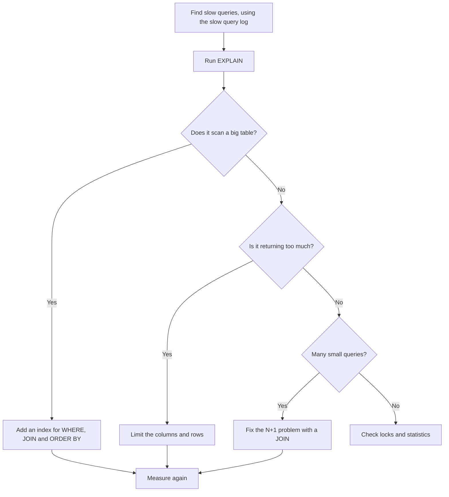

# Indexing

← [[50 Database Design]] · [[Phase 3 - Start Here|Home]] · **Next:** [[52 Transactions and ACID]] → · [[Software Engineering Roadmap#Indexing|Roadmap card]]

> [!abstract] After this note, you can
> Predict which index a query will use, design indexes from real queries, and read a query plan to find out why something is slow.

## The Big Idea

You met [[29 Relational Databases#Indexes in One Picture|indexes in Phase 2]]: they're like the index at the back of a book. Now let's see how they work, because slow queries cause many real production problems, and a good index can turn minutes into milliseconds.

## Inside an Index - The B-tree

![[btree.svg]]

A **B-tree** is a [[20 Trees and Heaps#Why Databases Love Trees|short, wide tree]] that keeps its keys sorted. Each node holds many keys, and fits in one disk page.

**So finding one row in a billion takes only about 4 reads.** Since each node has hundreds of children, the tree stays very shallow.

| Levels | With 500 children per node, it can hold |
|---|---|
| 1 | 500 |
| 2 | 250,000 |
| 3 | 125 million |
| 4 | 62.5 billion |

The bottom level is linked in order, so ranges such as `WHERE age BETWEEN 20 AND 30` are fast too: find the start, then walk along.

### Build Up a Test Table

We'll use this table in the examples below. SQLite shows us its plan with `EXPLAIN QUERY PLAN`. PostgreSQL has `EXPLAIN ANALYZE`, and it even shows real timings. The exact wording of a plan can vary between versions, but the words SCAN and SEARCH are what matter. The exact wording of a plan can vary between versions, but the words SCAN and SEARCH are what matter. The exact wording of a plan can vary between versions, but the words SCAN and SEARCH are what matter.

```python
# file: people.py
import sqlite3

def connect():
    db = sqlite3.connect(":memory:")
    db.execute("""
        CREATE TABLE people (
            id    INTEGER PRIMARY KEY,
            last  TEXT,
            first TEXT,
            city  TEXT,
            age   INTEGER,
            email TEXT
        )
    """)
    rows = [
        (f"Last{i % 100}", f"First{i % 50}", f"City{i % 10}", 18 + i % 60, f"user{i}@example.com")
        for i in range(10000)
    ]
    db.executemany("INSERT INTO people (last, first, city, age, email) VALUES (?, ?, ?, ?, ?)", rows)
    return db

def plan(db, sql):
    return db.execute("EXPLAIN QUERY PLAN " + sql).fetchone()[3]
```

### Before and After

```python
from people import connect, plan

db = connect()
query = "SELECT * FROM people WHERE email = 'user5000@example.com'"

print(plan(db, query))
db.execute("CREATE INDEX idx_email ON people(email)")
print(plan(db, query))
```

Output:

```text
SCAN people
SEARCH people USING INDEX idx_email (email=?)
```

| Plan word | Meaning | Speed |
|---|---|---|
| **SCAN** | Read every row | O(n) |
| **SEARCH USING INDEX** | Jump there | O(log n) |
| **USING COVERING INDEX** | Answered by the index alone | Fastest |

**See the time difference for yourself:**

```python
import time
from people import connect

db = connect()
query = "SELECT * FROM people WHERE email = 'user5000@example.com'"

def run_many():
    start = time.perf_counter()
    for _ in range(100):
        db.execute(query).fetchall()
    return time.perf_counter() - start

before = run_many()
db.execute("CREATE INDEX idx_email ON people(email)")
after = run_many()

print(f"The index made it faster: {after < before}")
```

Output:

```text
The index made it faster: True
```

## Composite Indexes and Column Order

![[composite-index.svg]]

An index can cover several columns. Think of a phone book, sorted by last name and then first name. It helps you find "Khan", or "Khan, Ali", but not everyone named "Ali". This is the **left-prefix rule**.

```python
from people import connect, plan

db = connect()
db.execute("CREATE INDEX idx_name ON people(last, first)")

print(plan(db, "SELECT * FROM people WHERE last = 'Last5'"))
print(plan(db, "SELECT * FROM people WHERE last = 'Last5' AND first = 'First5'"))
print(plan(db, "SELECT id FROM people WHERE age = 30"))
```

Output:

```text
SEARCH people USING INDEX idx_name (last=?)
SEARCH people USING INDEX idx_name (last=? AND first=?)
SCAN people
```

### Which Order?

**Guide:**

1. Put columns tested with **equals** first.
2. Then put a column used for a **range** or for sorting.
3. A range stops the index from helping with the columns after it.

```text
Query:  WHERE city = 'Kandy' AND age > 30

Good: (city, age)   All the Kandy rows sit together, sorted by age. Jump to 30, and read on.
Worse: (age, city)  Rows over 30 are spread across all cities.
```

```python
from people import connect, plan

db = connect()
query = "SELECT * FROM people WHERE city = 'City5' AND age > 30"

db.execute("CREATE INDEX idx_city_age ON people(city, age)")
print(plan(db, query))
```

Output:

```text
SEARCH people USING INDEX idx_city_age (city=? AND age>?)
```

### Indexes Can Also Sort

An index is already sorted, so a query can skip the sort step.

```python
from people import connect

db = connect()

def steps(sql):
    return [row[3] for row in db.execute("EXPLAIN QUERY PLAN " + sql)]

query = "SELECT * FROM people WHERE city = 'City5' ORDER BY age LIMIT 10"
print(steps(query))

db.execute("CREATE INDEX idx_city_age ON people(city, age)")
print(steps(query))
```

Output:

```text
['SCAN people', 'USE TEMP B-TREE FOR ORDER BY']
['SEARCH people USING INDEX idx_city_age (city=?)']
```

The sort step disappeared. For large tables, that's a huge saving.

## Covering Indexes

![[covering-index.svg]]

A normal index finds the row, then must read the table too. If the index already has all the columns the query needs, it can skip the table entirely.

```python
from people import connect, plan

db = connect()
db.execute("CREATE INDEX idx_email_city ON people(email, city)")

print(plan(db, "SELECT email, city FROM people WHERE email = 'user5@example.com'"))
print(plan(db, "SELECT email, age FROM people WHERE email = 'user5@example.com'"))
```

Output:

```text
SEARCH people USING COVERING INDEX idx_email_city (email=?)
SEARCH people USING INDEX idx_email_city (email=?)
```

This is one reason to avoid `SELECT *`: it prevents covering.

## Partial Indexes

Index only the rows you care about. If 2% of orders are `pending`, and you always search those, why index the other 98%?

```python
import sqlite3

db = sqlite3.connect(":memory:")
db.execute("CREATE TABLE orders (id INTEGER PRIMARY KEY, status TEXT, created_at TEXT)")
db.execute("CREATE INDEX idx_pending ON orders(created_at) WHERE status = 'pending'")

plan = db.execute(
    "EXPLAIN QUERY PLAN SELECT id FROM orders WHERE status = 'pending' AND created_at < '2026-01-01'"
).fetchone()[3]
print(plan)
```

Output:

```text
SEARCH orders USING COVERING INDEX idx_pending (created_at<?)
```

## Selectivity

![[selectivity.svg]]

**Selectivity** is how well a column narrows things down. If a condition matches most rows, an index may be slower than simply reading the table, because each match needs an extra jump. So the database's **planner** may ignore your index, and that's often the right choice.

**The planner uses statistics about your data.** After big changes, refresh them.

```python
from people import connect

db = connect()
counts = db.execute("""
    SELECT COUNT(DISTINCT email), COUNT(DISTINCT city), COUNT(*) FROM people
""").fetchone()

print(f"email: {counts[0] / counts[2]:.3f}")
print(f"city:  {counts[1] / counts[2]:.3f}")

db.execute("ANALYZE")
print("Statistics refreshed")
```

Output:

```text
email: 1.000
city:  0.001
Statistics refreshed
```

A value near 1 means that it's highly selective.

## What Stops an Index Being Used

The index stores the column's value. If you change the value in your query, the index can't help.

| Query | Uses index? | Why | Fix |
|---|---|---|---|
| `WHERE email = 'a@x.com'` | Yes | | |
| `WHERE LOWER(email) = 'a@x.com'` | No | The function hides the value | Index the expression |
| `WHERE age + 1 = 30` | No | Math on the column | `WHERE age = 29` |
| `WHERE email LIKE 'sam%'` | Often | Matches the start | |
| `WHERE email LIKE '%sam'` | No | It can't jump to the middle of a word | Full-text search |
| `WHERE last = 'A' OR city = 'B'` | Maybe | Needs two lookups | A separate index for each |

```python
from people import connect, plan

db = connect()
db.execute("CREATE INDEX idx_email ON people(email)")

print(plan(db, "SELECT id FROM people WHERE LOWER(email) = 'a@example.com'"))

db.execute("CREATE INDEX idx_lower_email ON people(LOWER(email))")
print(plan(db, "SELECT id FROM people WHERE LOWER(email) = 'a@example.com'"))
```

Output:

```text
SCAN people USING COVERING INDEX idx_email
SEARCH people USING COVERING INDEX idx_lower_email (<expr>=?)
```

## The Cost of Indexes

![[write-cost.svg]]

Indexes aren't free.

| Cost | Details |
|---|---|
| **Slower writes** | Every insert, update and delete must update each index |
| **Disk space** | Indexes can be as large as the table |
| **Memory** | They compete for cache space |

```python
import time
import sqlite3

def insert_time(index_count):
    db = sqlite3.connect(":memory:")
    db.execute("CREATE TABLE t (a INTEGER, b INTEGER, c INTEGER, d INTEGER)")
    for i in range(index_count):
        db.execute(f"CREATE INDEX i{i} ON t({'abcd'[i]})")
    rows = [(i, i * 7 % 1000, i * 13 % 1000, i * 17 % 1000) for i in range(50000)]
    start = time.perf_counter()
    db.executemany("INSERT INTO t VALUES (?, ?, ?, ?)", rows)
    return time.perf_counter() - start

print(f"Four indexes are slower than none: {insert_time(4) > insert_time(0)}")
```

Output:

```text
Four indexes are slower than none: True
```

**So:** index for your real queries, and remove unused indexes. A column that's in a second index's left prefix doesn't need its own index: `(a, b)` already helps queries on `a`.

## How to Fix a Slow Query



> [!tip] Index your foreign keys
> Some databases, such as PostgreSQL, don't index foreign keys automatically. Joins and deletes then become slow.

### The N+1 Problem

```python
import sqlite3

db = sqlite3.connect(":memory:")
db.executescript("""
    CREATE TABLE authors (id INTEGER PRIMARY KEY, name TEXT);
    CREATE TABLE books (id INTEGER PRIMARY KEY, author_id INTEGER, title TEXT);
    INSERT INTO authors VALUES (1, 'Asha'), (2, 'Ben');
    INSERT INTO books VALUES (1, 1, 'SQL Fun'), (2, 2, 'Bits');
""")

queries = []
db.set_trace_callback(queries.append)

# 1 query for the books, plus 1 per book for its author
for book_id, author_id, title in db.execute("SELECT * FROM books").fetchall():
    db.execute("SELECT name FROM authors WHERE id = ?", (author_id,)).fetchone()
print("N+1 version:", len(queries), "queries")

queries.clear()
db.execute("""
    SELECT books.title, authors.name
    FROM books JOIN authors ON authors.id = books.author_id
""").fetchall()
print("JOIN version:", len(queries), "query")
```

Output:

```text
N+1 version: 3 queries
JOIN version: 1 query
```

With 1,000 books, that would be 1,001 queries against 1.

## Other Index Types

| Type | Good for | Where |
|---|---|---|
| **B-tree** | Equality, ranges and sorting. The default | Everywhere |
| **Hash** | Exact matches only | PostgreSQL, Redis |
| **GIN** | Full-text search, JSON, arrays | PostgreSQL |
| **GiST** | Geographic data, ranges | PostgreSQL |
| **LSM tree** | Very heavy writes | Cassandra, RocksDB |

Learn more with [Use The Index, Luke](https://use-the-index-luke.com/), a free and excellent guide.

## Common Mistakes

> [!warning] Watch out for these
> - Indexing every column
> - Getting column order wrong in a composite index
> - Wrapping an indexed column in a function
> - Using `SELECT *` by habit
> - Forgetting to index foreign keys
> - Guessing instead of running `EXPLAIN`
> - Testing on 10 rows. Indexes only matter with real data sizes

## Practice

**1. Predict.** With an index on `(a, b, c)`, which queries can use it?
- `WHERE a = 1`
- `WHERE a = 1 AND b = 2`
- `WHERE b = 2`
- `WHERE a = 1 AND c = 3`

> [!example]- Answer to question 1
> Yes, yes, no, and partly: the last can use `a`, but it can't jump on `c`, since `b` is skipped.

**2. Design.** What index would you create for this query?

`SELECT id, total FROM orders WHERE user_id = ? AND status = 'paid' ORDER BY created_at DESC LIMIT 20`

> [!example]- Answer to question 2
> `(user_id, status, created_at)`. The two equality columns come first, then the sort column. Adding `total` would make it covering.

**3. Why is this slow?**

`SELECT * FROM users WHERE YEAR(created_at) = 2026`

> [!example]- Answer to question 3
> The function on the column stops the index being used. Use a range instead: `WHERE created_at >= '2026-01-01' AND created_at < '2027-01-01'`.

**4. Worth it?** Should you add an index on `is_deleted`, when 99.9% of rows have `is_deleted = 0`?

> [!example]- Answer to question 4
> A plain one wouldn't help find non-deleted rows, as nearly every row matches. If you often look up deleted rows, a **partial index** on just those is useful.

**5. Experiment.** Using `people.py`, write a query, and predict its plan. Then check using `EXPLAIN QUERY PLAN`. The roadmap's exercise uses 10 million rows: change the range, and compare the timings.

## Can You Do This?

- [ ] Explain why a B-tree needs so few reads
- [ ] Read a query plan
- [ ] Explain the left-prefix rule
- [ ] Choose a composite index's column order
- [ ] Use covering and partial indexes
- [ ] Explain selectivity
- [ ] Say what stops an index being used
- [ ] Fix an N+1 query
- [ ] Predict which index a query will use

## Summary

> [!success] Remember
> - **B-trees** find anything in very few steps.
> - **Left-prefix rule:** use columns from the left.
> - **Equals first, then range or sort.**
> - **Measure with EXPLAIN.** Don't guess.
> - Each index **speeds up reads and slows down writes**.

**Next:** [[52 Transactions and ACID]] →
