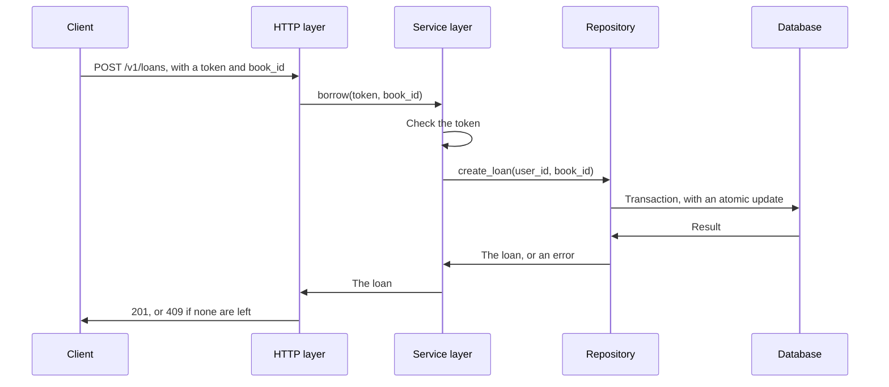
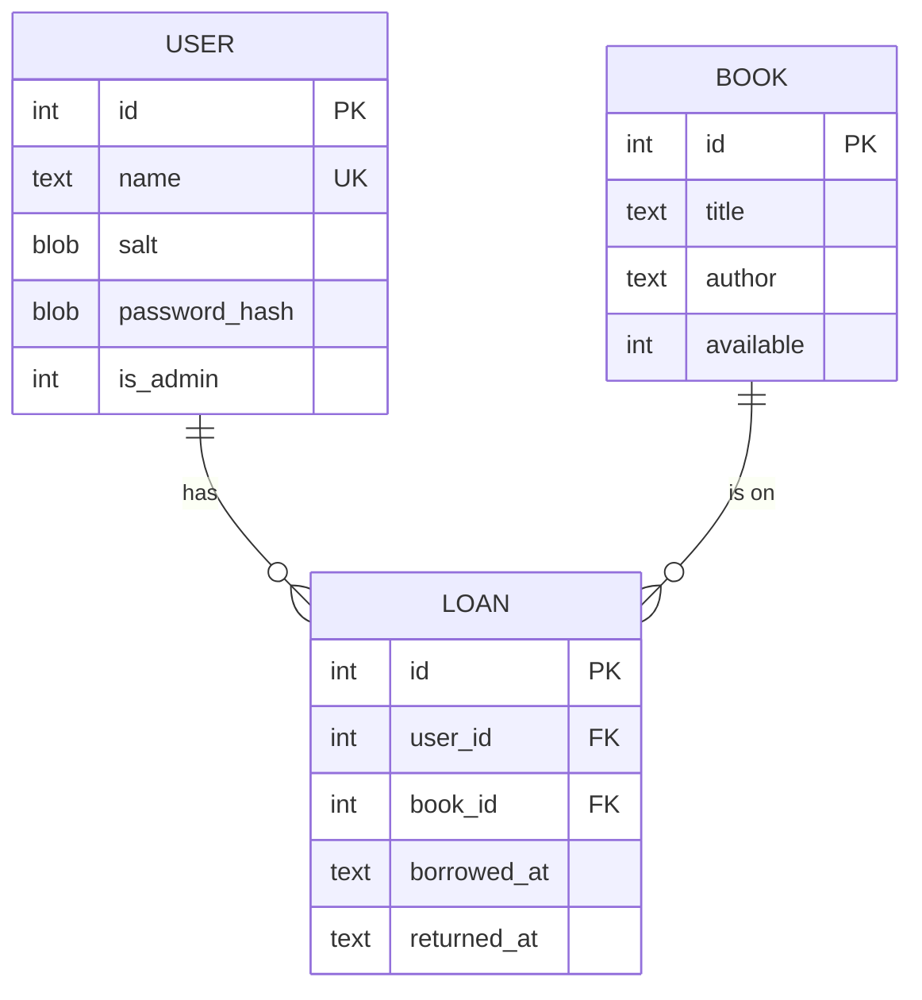

# Phase 3 Final Project - A Production-Ready Library API

← [[52 Transactions and ACID]] · [[Phase 3 - Start Here|Home]]

> [!abstract] Your goal
> Take your [[34 Phase 2 Final Project|Phase 2 API]] and make it professional: clean layers, secure logins, safe under heavy traffic, packaged in Docker, and checked by CI on every change. This is what real backend work looks like, and it's a strong portfolio piece.

## What You'll Build

![[p3-architecture.svg]]

| Method and URL | Who | What it does | Success |
|---|---|---|---|
| `POST /v1/users` | Anyone | Sign up | 201 |
| `POST /v1/login` | Anyone | Get a token | 200 |
| `GET /v1/books?after=0&limit=20` | Anyone | List books | 200 |
| `POST /v1/books` | Admin | Add a book | 201 |
| `POST /v1/loans` | Logged in | Borrow a book | 201 |
| `GET /v1/loans` | Logged in | See **your** loans | 200 |
| `POST /v1/loans/{id}/return` | The borrower | Return a book | 200 |



> [!important] Try it yourself first
> Work through the steps **without** opening the solution. Commit after each step, in small pull requests, as you would on a real team.

## What You'll Use

| Skill | Where you learned it |
|---|---|
| Layers that can be tested alone | [[42 SOLID Principles#D - Dependency Inversion]] |
| Versioning, errors, pagination | [[44 API Design]] |
| Threat modelling | [[45 Security Fundamentals#Threat Modelling]] |
| Password hashing, access checks | [[46 OWASP Top 10]] |
| Tests against a real database | [[47 Integration Testing]] |
| Docker and CI | [[48 Docker]], [[49 Continuous Integration and Delivery]] |
| Schema, migrations | [[50 Database Design]] |
| Indexes | [[51 Indexing]] |
| Safe concurrent updates | [[52 Transactions and ACID]] |

## Step by Step

### Step 1 - Threat Model First

Before writing code, draw the system. Run [[45 Security Fundamentals#Step 2 - Ask STRIDE Questions|STRIDE]] over it, and list your top risks. Save this as `docs/threats.md`.

- [ ] Trust boundaries are marked
- [ ] Each top risk has a planned fix

### Step 2 - Design the Schema, with Migrations



- [ ] Write versioned [[50 Database Design#Safe Schema Changes|migrations]]
- [ ] Add a `CHECK` that `available` can't go below zero
- [ ] Use a partial unique index, so that a user can't hold two copies of a book at once
- [ ] Index your foreign keys

### Step 3 - Build the Repository

SQL goes here, and only here.

- [ ] Every query uses `?` placeholders
- [ ] Borrowing happens in **one transaction**, with an atomic update
- [ ] Tests use a real database file

> [!example]- Hint: borrowing safely
> `UPDATE books SET available = available - 1 WHERE id = ? AND available > 0`. If `rowcount` is 0, there's nothing left. Then insert the loan in the same transaction. See [[52 Transactions and ACID#Fix 1 - Make the Update Atomic]].

### Step 4 - Build the Security Module

- [ ] Hash passwords with scrypt and a random salt
- [ ] Sign tokens with HMAC, and include an expiry time
- [ ] Compare using `hmac.compare_digest`
- [ ] Read the secret key from the environment

> [!warning] Learning only
> Writing your own tokens teaches you how they work. In a real product, use a proven library or identity provider.

### Step 5 - Build the Service Layer

This holds your business rules, and it knows nothing about HTTP.

- [ ] It takes the repository as a parameter (dependency injection)
- [ ] Only admins can add books
- [ ] Users can only see and return **their own** loans
- [ ] Failed logins give the same message, whatever went wrong

### Step 6 - Build the HTTP Layer

- [ ] One error format everywhere
- [ ] Limit the body size
- [ ] Cursor pagination, with a maximum limit
- [ ] Catch unexpected errors, log them, and return a plain 500
- [ ] A `/health` endpoint
- [ ] A clean exit when it receives `SIGTERM`. See [[48 Docker#Stopping Cleanly]]

### Step 7 - Prove It

- [ ] One user can't return another's loan
- [ ] A tampered token is rejected
- [ ] An expired token is rejected
- [ ] SQL injection attempts find nothing
- [ ] **20 threads race for 3 copies, and exactly 3 loans succeed**

### Step 8 - Ship It

- [ ] Write a `Dockerfile`, with a non-root user
- [ ] Write `compose.yaml`
- [ ] Write a CI workflow
- [ ] Protect your main branch
- [ ] Write a README with an architecture diagram

## Check Your Work

- [ ] All endpoints work, with correct status codes
- [ ] No input can crash it
- [ ] All SQL uses placeholders
- [ ] No secrets in Git
- [ ] The concurrency test passes each time
- [ ] CI runs lint, tests and a security scan
- [ ] The image runs as a non-root user
- [ ] Your commit history shows small, clear steps
- [ ] You can draw and explain the whole flow

## One Possible Solution

> [!warning] Finish your own version first
> Compare only when you're done or truly stuck. Standard library only, so that you can see how everything works.

> [!example]- Solution: security.py
> ```python
> # file: security.py
> """Password hashing and signed tokens, using only the standard library."""
> import base64
> import hashlib
> import hmac
> import json
> import os
> import time
>
> TOKEN_LIFETIME_SECONDS = 3600
>
>
> def hash_password(password):
>     salt = os.urandom(16)
>     return salt, _scrypt(password, salt)
>
>
> def check_password(password, salt, expected):
>     return hmac.compare_digest(_scrypt(password, salt), expected)
>
>
> def _scrypt(password, salt):
>     return hashlib.scrypt(password.encode(), salt=salt, n=2**14, r=8, p=1)
>
>
> def make_token(user_id, secret, now=None):
>     now = time.time() if now is None else now
>     payload = json.dumps({"user": user_id, "expires": now + TOKEN_LIFETIME_SECONDS}).encode()
>     body = base64.urlsafe_b64encode(payload).decode()
>     return f"{body}.{_sign(body, secret)}"
>
>
> def read_token(token, secret, now=None):
>     """Return the user id, or None if the token is invalid or expired."""
>     now = time.time() if now is None else now
>     try:
>         body, signature = token.split(".")
>         if not hmac.compare_digest(_sign(body, secret), signature):
>             return None
>         payload = json.loads(base64.urlsafe_b64decode(body))
>     except ValueError:
>         return None
>     if payload["expires"] < now:
>         return None
>     return payload["user"]
>
>
> def _sign(body, secret):
>     return hmac.new(secret.encode(), body.encode(), hashlib.sha256).hexdigest()
> ```

> [!example]- Solution: repository.py
> ```python
> # file: repository.py
> """All SQL lives here. Each call uses its own connection, so threads stay safe."""
> import sqlite3
> from datetime import datetime, timezone
>
> MIGRATIONS = [
>     """
>     CREATE TABLE users (
>         id            INTEGER PRIMARY KEY,
>         name          TEXT NOT NULL UNIQUE,
>         salt          BLOB NOT NULL,
>         password_hash BLOB NOT NULL,
>         is_admin      INTEGER NOT NULL DEFAULT 0 CHECK (is_admin IN (0, 1))
>     )
>     """,
>     """
>     CREATE TABLE books (
>         id        INTEGER PRIMARY KEY,
>         title     TEXT NOT NULL,
>         author    TEXT NOT NULL,
>         available INTEGER NOT NULL CHECK (available >= 0)
>     )
>     """,
>     """
>     CREATE TABLE loans (
>         id          INTEGER PRIMARY KEY,
>         user_id     INTEGER NOT NULL REFERENCES users(id),
>         book_id     INTEGER NOT NULL REFERENCES books(id),
>         borrowed_at TEXT NOT NULL,
>         returned_at TEXT
>     )
>     """,
>     "CREATE INDEX idx_loans_user ON loans(user_id)",
>     "CREATE INDEX idx_loans_book ON loans(book_id)",
>     "CREATE UNIQUE INDEX one_active_loan ON loans(user_id, book_id) WHERE returned_at IS NULL",
> ]
>
>
> class NotAvailable(Exception):
>     pass
>
>
> class AlreadyBorrowed(Exception):
>     pass
>
>
> class NameTaken(Exception):
>     pass
>
>
> class Repository:
>     def __init__(self, path):
>         self.path = path
>         db = self._connect()
>         db.execute("PRAGMA journal_mode = WAL")
>         version = db.execute("PRAGMA user_version").fetchone()[0]
>         for number, sql in enumerate(MIGRATIONS[version:], start=version + 1):
>             with db:
>                 db.execute(sql)
>                 db.execute(f"PRAGMA user_version = {number}")
>         db.close()
>
>     def _connect(self):
>         db = sqlite3.connect(self.path, timeout=30)
>         db.row_factory = sqlite3.Row
>         db.execute("PRAGMA foreign_keys = ON")
>         return db
>
>     def add_user(self, name, salt, password_hash, is_admin=False):
>         db = self._connect()
>         try:
>             with db:
>                 cursor = db.execute(
>                     "INSERT INTO users (name, salt, password_hash, is_admin) VALUES (?, ?, ?, ?)",
>                     (name, salt, password_hash, int(is_admin)),
>                 )
>             return cursor.lastrowid
>         except sqlite3.IntegrityError:
>             raise NameTaken(name)
>         finally:
>             db.close()
>
>     def find_user_by_name(self, name):
>         return self._one("SELECT * FROM users WHERE name = ?", (name,))
>
>     def find_user(self, user_id):
>         return self._one("SELECT * FROM users WHERE id = ?", (user_id,))
>
>     def add_book(self, title, author, copies):
>         db = self._connect()
>         try:
>             with db:
>                 cursor = db.execute(
>                     "INSERT INTO books (title, author, available) VALUES (?, ?, ?)",
>                     (title, author, copies),
>                 )
>             return self._one("SELECT * FROM books WHERE id = ?", (cursor.lastrowid,))
>         finally:
>             db.close()
>
>     def list_books(self, after, limit):
>         return self._all(
>             "SELECT * FROM books WHERE id > ? ORDER BY id LIMIT ?", (after, limit)
>         )
>
>     def create_loan(self, user_id, book_id):
>         db = self._connect()
>         try:
>             with db:
>                 updated = db.execute(
>                     "UPDATE books SET available = available - 1 WHERE id = ? AND available > 0",
>                     (book_id,),
>                 )
>                 if updated.rowcount == 0:
>                     raise NotAvailable(book_id)
>                 cursor = db.execute(
>                     "INSERT INTO loans (user_id, book_id, borrowed_at) VALUES (?, ?, ?)",
>                     (user_id, book_id, _now()),
>                 )
>             return self.find_loan(cursor.lastrowid)
>         except sqlite3.IntegrityError:
>             raise AlreadyBorrowed(book_id)
>         finally:
>             db.close()
>
>     def find_loan(self, loan_id):
>         return self._one("SELECT * FROM loans WHERE id = ?", (loan_id,))
>
>     def loans_for(self, user_id):
>         return self._all("SELECT * FROM loans WHERE user_id = ? ORDER BY id", (user_id,))
>
>     def close_loan(self, loan_id):
>         db = self._connect()
>         try:
>             with db:
>                 updated = db.execute(
>                     "UPDATE loans SET returned_at = ? WHERE id = ? AND returned_at IS NULL",
>                     (_now(), loan_id),
>                 )
>                 if updated.rowcount == 1:
>                     db.execute(
>                         "UPDATE books SET available = available + 1 "
>                         "WHERE id = (SELECT book_id FROM loans WHERE id = ?)",
>                         (loan_id,),
>                     )
>             return updated.rowcount == 1
>         finally:
>             db.close()
>
>     def _one(self, sql, values):
>         db = self._connect()
>         try:
>             row = db.execute(sql, values).fetchone()
>             return dict(row) if row else None
>         finally:
>             db.close()
>
>     def _all(self, sql, values):
>         db = self._connect()
>         try:
>             return [dict(row) for row in db.execute(sql, values)]
>         finally:
>             db.close()
>
>
> def _now():
>     return datetime.now(timezone.utc).isoformat()
> ```

> [!example]- Solution: service.py
> ```python
> # file: service.py
> """Business rules. This layer knows nothing about HTTP or SQL."""
> import repository
> import security
>
>
> class ServiceError(Exception):
>     """An expected failure, with a status code and a stable error code."""
>
>     def __init__(self, status, code, message):
>         super().__init__(message)
>         self.status = status
>         self.code = code
>         self.message = message
>
>
> class LibraryService:
>     def __init__(self, repo, secret):
>         self.repo = repo
>         self.secret = secret
>
>     def register(self, name, password, is_admin=False):
>         if not isinstance(name, str) or not 3 <= len(name) <= 50:
>             raise ServiceError(400, "invalid_name", "Name must be 3 to 50 characters.")
>         if not isinstance(password, str) or len(password) < 10:
>             raise ServiceError(400, "weak_password", "Password must be at least 10 characters.")
>         salt, password_hash = security.hash_password(password)
>         try:
>             user_id = self.repo.add_user(name, salt, password_hash, is_admin)
>         except repository.NameTaken:
>             raise ServiceError(409, "name_taken", "That name is taken.")
>         return {"id": user_id, "name": name}
>
>     def login(self, name, password):
>         user = self.repo.find_user_by_name(name) if isinstance(name, str) else None
>         valid = (
>             user is not None
>             and isinstance(password, str)
>             and security.check_password(password, user["salt"], user["password_hash"])
>         )
>         if not valid:
>             raise ServiceError(401, "bad_credentials", "Wrong name or password.")
>         return security.make_token(user["id"], self.secret)
>
>     def current_user(self, token):
>         user_id = security.read_token(token, self.secret) if token else None
>         user = self.repo.find_user(user_id) if user_id is not None else None
>         if user is None:
>             raise ServiceError(401, "not_logged_in", "Please log in.")
>         return user
>
>     def add_book(self, token, title, author, copies):
>         user = self.current_user(token)
>         if not user["is_admin"]:
>             raise ServiceError(403, "forbidden", "Only admins can add books.")
>         for value in (title, author):
>             if not isinstance(value, str) or not value.strip():
>                 raise ServiceError(400, "invalid_book", "Title and author are required.")
>         if not isinstance(copies, int) or isinstance(copies, bool) or copies < 1:
>             raise ServiceError(400, "invalid_book", "Copies must be a positive whole number.")
>         return self.repo.add_book(title.strip(), author.strip(), copies)
>
>     def list_books(self, after, limit):
>         limit = max(1, min(limit, 100))
>         rows = self.repo.list_books(after, limit + 1)
>         page = rows[:limit]
>         return {"items": page, "next_cursor": page[-1]["id"] if len(rows) > limit else None}
>
>     def borrow(self, token, book_id):
>         user = self.current_user(token)
>         if not isinstance(book_id, int) or isinstance(book_id, bool):
>             raise ServiceError(400, "invalid_book_id", "book_id must be a whole number.")
>         try:
>             return self.repo.create_loan(user["id"], book_id)
>         except repository.NotAvailable:
>             raise ServiceError(409, "not_available", "No copies are available.")
>         except repository.AlreadyBorrowed:
>             raise ServiceError(409, "already_borrowed", "You already have this book.")
>
>     def my_loans(self, token):
>         return self.repo.loans_for(self.current_user(token)["id"])
>
>     def return_book(self, token, loan_id):
>         user = self.current_user(token)
>         loan = self.repo.find_loan(loan_id)
>         if loan is None or loan["user_id"] != user["id"]:
>             raise ServiceError(404, "loan_not_found", "No such loan.")
>         if not self.repo.close_loan(loan_id):
>             raise ServiceError(409, "already_returned", "That loan was already returned.")
>         return self.repo.find_loan(loan_id)
> ```

> [!example]- Solution: api.py
> ```python
> # file: api.py
> """The HTTP layer: routes, JSON and status codes, and nothing else."""
> import json
> import logging
> import os
> import re
> import signal
> import sys
> from http.server import BaseHTTPRequestHandler, ThreadingHTTPServer
> from urllib.parse import parse_qs, urlparse
>
> from repository import Repository
> from service import LibraryService, ServiceError
>
> MAX_BODY_BYTES = 10_000
> log = logging.getLogger("library")
>
>
> def make_handler(service):
>     class Handler(BaseHTTPRequestHandler):
>         def send_json(self, status, data):
>             body = json.dumps(data).encode()
>             self.send_response(status)
>             self.send_header("Content-Type", "application/json")
>             self.send_header("Content-Length", str(len(body)))
>             self.send_header("X-Content-Type-Options", "nosniff")
>             self.end_headers()
>             self.wfile.write(body)
>
>         def send_error_json(self, status, code, message):
>             self.send_json(status, {"error": {"code": code, "message": message}})
>
>         def read_json(self):
>             length = int(self.headers.get("Content-Length", 0))
>             if length > MAX_BODY_BYTES:
>                 raise ServiceError(413, "too_large", "Request body is too large.")
>             try:
>                 data = json.loads(self.rfile.read(length))
>             except ValueError:
>                 raise ServiceError(400, "invalid_json", "Body must be valid JSON.")
>             if not isinstance(data, dict):
>                 raise ServiceError(400, "invalid_json", "Body must be a JSON object.")
>             return data
>
>         def token(self):
>             header = self.headers.get("Authorization", "")
>             return header[7:] if header.startswith("Bearer ") else None
>
>         def run(self, action):
>             try:
>                 action()
>             except ServiceError as error:
>                 self.send_error_json(error.status, error.code, error.message)
>             except Exception:
>                 log.exception("Unexpected error on %s %s", self.command, self.path)
>                 self.send_error_json(500, "internal_error", "Something went wrong.")
>
>         def do_GET(self):
>             self.run(self.handle_get)
>
>         def do_POST(self):
>             self.run(self.handle_post)
>
>         def handle_get(self):
>             url = urlparse(self.path)
>             if url.path == "/health":
>                 self.send_json(200, {"status": "ok"})
>             elif url.path == "/v1/books":
>                 query = parse_qs(url.query)
>                 try:
>                     after = int(query.get("after", ["0"])[0])
>                     limit = int(query.get("limit", ["20"])[0])
>                 except ValueError:
>                     raise ServiceError(400, "invalid_query", "after and limit must be numbers.")
>                 self.send_json(200, service.list_books(after, limit))
>             elif url.path == "/v1/loans":
>                 self.send_json(200, service.my_loans(self.token()))
>             else:
>                 self.send_error_json(404, "not_found", "Not found.")
>
>         def handle_post(self):
>             path = urlparse(self.path).path
>             returning = re.fullmatch(r"/v1/loans/(\d+)/return", path)
>             if path == "/v1/users":
>                 data = self.read_json()
>                 self.send_json(201, service.register(data.get("name"), data.get("password")))
>             elif path == "/v1/login":
>                 data = self.read_json()
>                 self.send_json(200, {"token": service.login(data.get("name"), data.get("password"))})
>             elif path == "/v1/books":
>                 data = self.read_json()
>                 book = service.add_book(self.token(), data.get("title"), data.get("author"), data.get("copies"))
>                 self.send_json(201, book)
>             elif path == "/v1/loans":
>                 data = self.read_json()
>                 self.send_json(201, service.borrow(self.token(), data.get("book_id")))
>             elif returning:
>                 self.send_json(200, service.return_book(self.token(), int(returning.group(1))))
>             else:
>                 self.send_error_json(404, "not_found", "Not found.")
>
>         def log_message(self, *args):
>             pass
>
>     return Handler
>
>
> def main():
>     logging.basicConfig(level=logging.INFO)
>     secret = os.environ.get("SECRET_KEY")
>     if not secret:
>         raise SystemExit("Please set the SECRET_KEY environment variable.")
>     repo = Repository(os.environ.get("DATABASE_PATH", "library.db"))
>     service = LibraryService(repo, secret)
>     admin_password = os.environ.get("ADMIN_PASSWORD")
>     if admin_password and repo.find_user_by_name("admin") is None:
>         service.register("admin", admin_password, is_admin=True)
>     server = ThreadingHTTPServer(("0.0.0.0", 8000), make_handler(service))
>     signal.signal(signal.SIGTERM, lambda *args: sys.exit(0))
>     log.info("Listening on port 8000")
>     server.serve_forever()
>
>
> if __name__ == "__main__":
>     main()
> ```

> [!example]- Solution: test_library.py
> ```python
> # file: test_library.py
> import json
> import threading
> import urllib.error
> import urllib.parse
> import urllib.request
> from http.server import ThreadingHTTPServer
>
> import pytest
>
> import security
> from api import make_handler
> from repository import Repository
> from service import LibraryService, ServiceError
>
> SECRET = "test-only-secret"
> GOOD_PASSWORD = "correct horse battery"
>
>
> @pytest.fixture
> def service(tmp_path):
>     return LibraryService(Repository(tmp_path / "test.db"), SECRET)
>
>
> @pytest.fixture
> def api(service):
>     server = ThreadingHTTPServer(("127.0.0.1", 0), make_handler(service))
>     threading.Thread(target=server.serve_forever, daemon=True).start()
>     yield f"http://127.0.0.1:{server.server_port}"
>     server.shutdown()
>
>
> def call(method, url, data=None, token=None, raw=None):
>     body = raw if raw is not None else (json.dumps(data).encode() if data is not None else None)
>     request = urllib.request.Request(url, data=body, method=method)
>     if token:
>         request.add_header("Authorization", f"Bearer {token}")
>     try:
>         with urllib.request.urlopen(request) as response:
>             return response.status, json.loads(response.read())
>     except urllib.error.HTTPError as error:
>         return error.code, json.loads(error.read())
>
>
> def make_user(service, name="sam", is_admin=False):
>     service.register(name, GOOD_PASSWORD, is_admin=is_admin)
>     return service.login(name, GOOD_PASSWORD)
>
>
> def make_book(service, copies=1):
>     admin = make_user(service, "admin", is_admin=True)
>     return service.add_book(admin, "SQL Fun", "Asha", copies)
>
>
> # ---------- Security ----------
>
> def test_password_check():
>     salt, digest = security.hash_password("my password")
>     assert security.check_password("my password", salt, digest)
>     assert not security.check_password("wrong", salt, digest)
>
>
> def test_same_password_hashes_differently():
>     assert security.hash_password("same")[1] != security.hash_password("same")[1]
>
>
> def test_token_round_trip():
>     assert security.read_token(security.make_token(7, SECRET), SECRET) == 7
>
>
> def test_tampered_token_is_rejected():
>     token = security.make_token(7, SECRET)
>     assert security.read_token("A" + token[1:], SECRET) is None
>
>
> def test_token_from_another_secret_is_rejected():
>     assert security.read_token(security.make_token(7, "other"), SECRET) is None
>
>
> def test_expired_token_is_rejected():
>     token = security.make_token(7, SECRET, now=1000)
>     assert security.read_token(token, SECRET, now=1000 + 3601) is None
>
>
> @pytest.mark.parametrize("junk", ["", "abc", "a.b.c", "!!!.???"])
> def test_junk_tokens_are_rejected(junk):
>     assert security.read_token(junk, SECRET) is None
>
>
> # ---------- Business rules ----------
>
> def test_weak_password_is_refused(service):
>     with pytest.raises(ServiceError) as error:
>         service.register("sam", "short")
>     assert error.value.code == "weak_password"
>
>
> def test_duplicate_name_is_refused(service):
>     service.register("sam", GOOD_PASSWORD)
>     with pytest.raises(ServiceError) as error:
>         service.register("sam", GOOD_PASSWORD)
>     assert error.value.status == 409
>
>
> def test_login_failures_look_the_same(service):
>     service.register("sam", GOOD_PASSWORD)
>     messages = []
>     for name, password in [("sam", "wrong password"), ("nobody", "wrong password")]:
>         with pytest.raises(ServiceError) as error:
>             service.login(name, password)
>         messages.append(error.value.message)
>     assert messages[0] == messages[1]
>
>
> def test_only_admins_add_books(service):
>     token = make_user(service)
>     with pytest.raises(ServiceError) as error:
>         service.add_book(token, "T", "A", 1)
>     assert error.value.status == 403
>
>
> def test_cannot_borrow_the_same_book_twice(service):
>     book = make_book(service, copies=5)
>     token = make_user(service)
>     service.borrow(token, book["id"])
>     with pytest.raises(ServiceError) as error:
>         service.borrow(token, book["id"])
>     assert error.value.code == "already_borrowed"
>
>
> def test_failed_borrow_does_not_lose_a_copy(service):
>     book = make_book(service, copies=5)
>     token = make_user(service)
>     service.borrow(token, book["id"])
>     with pytest.raises(ServiceError):
>         service.borrow(token, book["id"])
>     assert service.repo.list_books(0, 10)[0]["available"] == 4
>
>
> def test_return_makes_a_copy_available_again(service):
>     book = make_book(service, copies=1)
>     token = make_user(service)
>     loan = service.borrow(token, book["id"])
>     service.return_book(token, loan["id"])
>     assert service.repo.list_books(0, 10)[0]["available"] == 1
>
>
> def test_cannot_return_twice(service):
>     book = make_book(service)
>     token = make_user(service)
>     loan = service.borrow(token, book["id"])
>     service.return_book(token, loan["id"])
>     with pytest.raises(ServiceError) as error:
>         service.return_book(token, loan["id"])
>     assert error.value.code == "already_returned"
>
>
> def test_cannot_return_someone_elses_loan(service):
>     book = make_book(service)
>     owner = make_user(service, "sam")
>     stranger = make_user(service, "priya")
>     loan = service.borrow(owner, book["id"])
>     with pytest.raises(ServiceError) as error:
>         service.return_book(stranger, loan["id"])
>     assert error.value.status == 404
>
>
> def test_users_see_only_their_own_loans(service):
>     book = make_book(service, copies=2)
>     sam = make_user(service, "sam")
>     priya = make_user(service, "priya")
>     service.borrow(sam, book["id"])
>     assert service.my_loans(priya) == []
>
>
> # ---------- Concurrency ----------
>
> def test_twenty_users_race_for_three_copies(service):
>     book = make_book(service, copies=3)
>     tokens = [make_user(service, f"user{i}") for i in range(20)]
>     barrier = threading.Barrier(20)
>     wins = []
>
>     def race(token):
>         barrier.wait()
>         try:
>             service.borrow(token, book["id"])
>             wins.append(True)
>         except ServiceError as error:
>             assert error.code == "not_available"
>
>     threads = [threading.Thread(target=race, args=(token,)) for token in tokens]
>     for thread in threads:
>         thread.start()
>     for thread in threads:
>         thread.join()
>
>     assert len(wins) == 3
>     assert service.repo.list_books(0, 10)[0]["available"] == 0
>
>
> # ---------- The real HTTP API ----------
>
> def test_full_journey_over_http(api, service):
>     book = make_book(service)
>     assert call("POST", f"{api}/v1/users", {"name": "sam", "password": GOOD_PASSWORD})[0] == 201
>     status, body = call("POST", f"{api}/v1/login", {"name": "sam", "password": GOOD_PASSWORD})
>     assert status == 200
>     token = body["token"]
>
>     status, loan = call("POST", f"{api}/v1/loans", {"book_id": book["id"]}, token)
>     assert status == 201
>     assert call("GET", f"{api}/v1/loans", token=token)[1][0]["id"] == loan["id"]
>     assert call("POST", f"{api}/v1/loans/{loan['id']}/return", {}, token)[0] == 200
>
>
> def test_pagination(api, service):
>     admin = make_user(service, "admin", is_admin=True)
>     for i in range(5):
>         service.add_book(admin, f"Book {i}", "Asha", 1)
>     _, first = call("GET", f"{api}/v1/books?limit=2")
>     assert [book["title"] for book in first["items"]] == ["Book 0", "Book 1"]
>     _, second = call("GET", f"{api}/v1/books?limit=2&after={first['next_cursor']}")
>     assert [book["title"] for book in second["items"]] == ["Book 2", "Book 3"]
>
>
> @pytest.mark.parametrize("raw", [b"not json", b"[]"])
> def test_bad_json_gives_400(api, raw):
>     status, body = call("POST", f"{api}/v1/login", raw=raw)
>     assert status == 400
>     assert body["error"]["code"] == "invalid_json"
>
>
> def test_body_too_large_gives_413(api):
>     assert call("POST", f"{api}/v1/login", raw=b"x" * 20000)[0] == 413
>
>
> @pytest.mark.parametrize("path", ["/nothing", "/v1/books/1/2", "/v1/loans/abc/return"])
> def test_unknown_paths_give_404(api, path):
>     assert call("POST", f"{api}{path}", {})[0] == 404
>
>
> def test_requests_with_no_token_give_401(api):
>     assert call("GET", f"{api}/v1/loans")[0] == 401
>
>
> def test_sql_injection_in_login_finds_nobody(api, service):
>     service.register("sam", GOOD_PASSWORD)
>     status, _ = call("POST", f"{api}/v1/login", {"name": "' OR '1'='1", "password": "x"})
>     assert status == 401
>
>
> def test_unexpected_errors_reveal_nothing(service, api, monkeypatch):
>     def explode(*args):
>         raise RuntimeError("secret database detail")
>
>     monkeypatch.setattr(service, "list_books", explode)
>     status, body = call("GET", f"{api}/v1/books")
>     assert status == 500
>     assert "secret" not in json.dumps(body)
> ```

**Run it:**

```bash
python -m pytest
SECRET_KEY=local-dev-secret ADMIN_PASSWORD=choose-a-long-password python api.py
```

(On Windows PowerShell, set the two variables first, using `$env:SECRET_KEY = "local-dev-secret"`.)

> [!example]- Solution: Dockerfile and .dockerignore
> ```dockerfile
> FROM python:3.13-slim
> WORKDIR /app
> COPY api.py repository.py security.py service.py .
> RUN useradd --create-home appuser && mkdir /data && chown appuser /data
> USER appuser
> ENV DATABASE_PATH=/data/library.db
> EXPOSE 8000
> CMD ["python", "api.py"]
> ```
>
> ```text
> .git
> .venv
> __pycache__
> *.db
> .env
> test_*.py
> ```

> [!example]- Solution: compose.yaml
> ```yaml
> services:
>   api:
>     build: .
>     ports:
>       - "8000:8000"
>     environment:
>       SECRET_KEY: ${SECRET_KEY:?Set SECRET_KEY in your .env file}
>       ADMIN_PASSWORD: ${ADMIN_PASSWORD:?Set ADMIN_PASSWORD in your .env file}
>     volumes:
>       - library-data:/data
>
> volumes:
>   library-data:
> ```
>
> Compose reads these two values from a `.env` file next to it. Add that file to `.gitignore`.
>
> ```text
> SECRET_KEY=replace-with-a-long-random-value
> ADMIN_PASSWORD=choose-a-long-password
> ```
>
> Then start it, and check that it's healthy:
>
> ```bash
> docker compose up -d --build
> curl http://localhost:8000/health
> ```
>
> Your data stays after `docker compose down`, but `docker compose down -v` deletes it.

> [!example]- Solution: .github/workflows/ci.yml
> ```yaml
> name: CI
>
> on:
>   push:
>     branches: [main]
>   pull_request:
>
> permissions:
>   contents: read
>
> jobs:
>   test:
>     runs-on: ubuntu-latest
>     steps:
>       - uses: actions/checkout@v4
>       - uses: actions/setup-python@v5
>         with:
>           python-version: "3.13"
>       - run: pip install pytest ruff pip-audit
>       - run: ruff check .
>       - run: python -m pytest
>       - run: docker build -t library-api:${{ github.sha }} .
> ```

## Roadmap Projects to Add

- [ ] **A performance case study:** load `books` with a million rows, find a slow query, and speed it up with an index. Write up your before and after numbers. See [[51 Indexing]].
- [ ] **Your own Redis or database:** with persistence and a network protocol, using [[37 Concurrency and Parallelism]] and [[36 Operating Systems#Files and Storage]].
- [ ] **A linked list in C:** clean under AddressSanitizer. See [[38 Memory Management]].

## Make It Your Own

- [ ] **Switch to PostgreSQL,** and test with Testcontainers
- [ ] **Rate-limit logins**, as in [[46 OWASP Top 10#A06 Insecure Design]]
- [ ] **Add metrics and structured logs**
- [ ] **Add idempotency keys** to `POST /v1/loans`
- [ ] **Add an audit log** of who did what
- [ ] **Publish an OpenAPI file**
- [ ] **Rebuild it with FastAPI,** and compare

## Congratulations

> [!success] You've finished Phase 3
> You now know how the machine runs your code, how teams ship safely, how to design for change, how to protect users, and how to keep data correct under pressure. That's the working knowledge of a professional software engineer.

Check the [[Software Engineering Roadmap#Ready for Software Engineer|Ready for Software Engineer]] list, then continue to Phase 4 in the [[Software Engineering Roadmap#Recommended Study Order|study order]].

**Back to:** [[Phase 3 - Start Here]]
