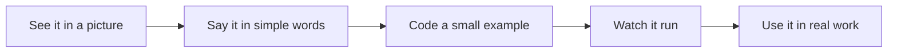
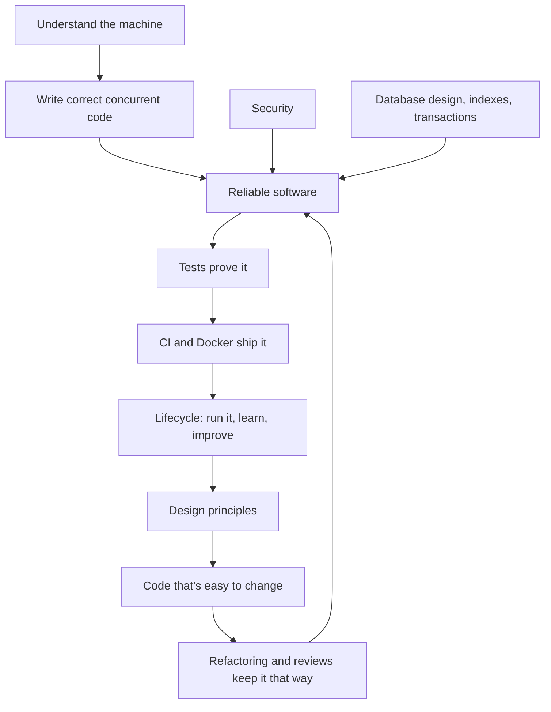

# Phase 3 - Build Real Software Professionally

> [!abstract] Your goal
> By the end of Phase 3, you can deliver a feature from idea to production on your own: designed sensibly, tested properly, secure, and shipped automatically. You'll also understand what the machine does with your code. That's the level of a working Software Engineer.

This is Phase 3 of the [[Software Engineering Roadmap#Recommended Study Order|Software Engineering Roadmap]]. Finish [[Phase 2 - Start Here|Phase 2]] first. The roadmap suggests about 1 to 2 years for this phase, ideally alongside real work or real projects.

![[p3-map.svg]]

## How These Notes Teach

As in Phase 2, each idea starts with a picture.

> [!tip] From exercises to real work
> Phase 3 is different. These skills only really stick when you use them on something real. Use your [[34 Phase 2 Final Project|Phase 2 project]] as a practice ground. Add to it as you go, then finish it in the final project.

## The Notes, in Order

### Part 1 - Understand the machine
- [ ] [[35 Computer Organization and Architecture]]: how a CPU runs your code
- [ ] [[36 Operating Systems]]: processes, threads and virtual memory
- [ ] [[37 Concurrency and Parallelism]]: doing many things safely
- [ ] [[38 Memory Management]]: stack, heap, pointers and leaks

### Part 2 - Work like a professional
- [ ] [[39 Software Development Lifecycle]]: from idea to production and back
- [ ] [[40 Code Reviews]]: give and get useful feedback
- [ ] [[41 Refactoring]]: improve code safely

### Part 3 - Design software that lasts
- [ ] [[42 SOLID Principles]]: five guides for managing change
- [ ] [[43 Design Patterns]]: proven shapes for common problems
- [ ] [[44 API Design]]: promises that last

### Part 4 - Ship it safely
- [ ] [[45 Security Fundamentals]]: think like an attacker
- [ ] [[46 OWASP Top 10]]: the ten leading web risks
- [ ] [[47 Integration Testing]]: test the real thing
- [ ] [[48 Docker]]: package it once, run it anywhere
- [ ] [[49 Continuous Integration and Delivery]]: make deploying boring

### Part 5 - Protect your data
- [ ] [[50 Database Design]]: schemas that protect data
- [ ] [[51 Indexing]]: from minutes to milliseconds
- [ ] [[52 Transactions and ACID]]: correct under pressure

### Part 6 - Put it all together
- [ ] [[53 Phase 3 Final Project]]: a production-ready API

**Need a word explained?** See the [[Phase 3 Glossary]].

## Tools to Install

| Tool | For | Where to get it |
|---|---|---|
| **Docker Desktop** | [[48 Docker]] | [docker.com](https://docs.docker.com/get-started/get-docker/) |
| **A GitHub account** | [[49 Continuous Integration and Delivery]] | [github.com](https://github.com/) |
| **gcc, in WSL or Linux** | [[38 Memory Management]] | Run `sudo apt install gcc` |
| **pytest** | Testing | Run `python -m pip install pytest` |

You can also try C without installing anything, on [Compiler Explorer](https://godbolt.org/).

## How Everything Connects

## A Simple Study Plan

This plan assumes 8 to 10 hours each week. Go slower if you're also working. Depth matters more than speed here.

| Weeks | Study | Apply it to your project |
|---|---|---|
| 1 to 3 | [[35 Computer Organization and Architecture]] | Build the tiny CPU |
| 4 to 7 | [[36 Operating Systems]] | Build a small shell |
| 8 to 11 | [[37 Concurrency and Parallelism]] | Build a bounded queue |
| 12 to 14 | [[38 Memory Management]] | Write a linked list in C |
| 15 to 16 | [[39 Software Development Lifecycle]], [[40 Code Reviews]] | Start using pull requests |
| 17 to 18 | [[41 Refactoring]] | Clean up your Phase 2 code |
| 19 to 22 | [[42 SOLID Principles]], [[43 Design Patterns]] | Add layers |
| 23 to 25 | [[44 API Design]] | Add versioning and pagination |
| 26 to 29 | [[45 Security Fundamentals]], [[46 OWASP Top 10]] | Add login and permissions |
| 30 to 32 | [[47 Integration Testing]] | Test against a real database |
| 33 to 35 | [[48 Docker]] | Containerize it |
| 36 to 38 | [[49 Continuous Integration and Delivery]] | Add a pipeline |
| 39 to 44 | [[50 Database Design]], [[51 Indexing]], [[52 Transactions and ACID]] | Add safe borrowing |
| 45 to 50 | [[53 Phase 3 Final Project]] | Finish and publish |

## When You Finish Phase 3

Check yourself with the roadmap's [[Software Engineering Roadmap#Ready for Software Engineer|Ready for Software Engineer]] list, and read the [[Software Engineering Roadmap#Software Engineer|Software Engineer role card]].

**Start here:** [[35 Computer Organization and Architecture]] →
