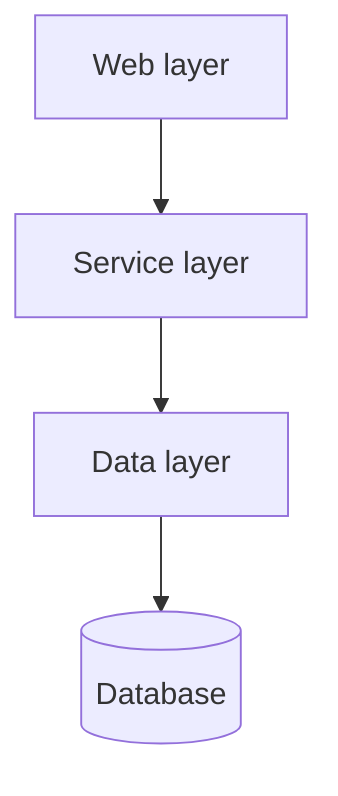

# Layered Architecture

← [[Phase 4 - Start Here|Home]] · **Next:** [[55 Clean Architecture]] → · [[Software Engineering Roadmap#Layered Architecture|Roadmap card]]

> [!abstract] After this note, you can
> Split a tangled app into web, service and data layers, say where any new piece of logic belongs, and swap the data store by changing one file. You'll also have tested a business rule in milliseconds instead of seconds in [[Pagebound - Season 2|Pagebound]].

> [!bug] Incident Card · Pagebound Season 2
> **Tuesday, 10:30.** Two requests land on your desk. The phone team wants a new **mobile endpoint** for borrowing. The partner library wants a **CSV import** of their loans. Both need the lending rules: *three books at most, 14 days, 25 cents a day late*.
>
> A teammate says: *"No problem, I'll copy the code out of `do_POST`."* Three weeks later the limit changes from 3 books to 5. It's fixed in one copy. The other copy still says 3, and a member complains.
>
> **Your job:** find out why the rules can't be reused, and give each kind of code its own home.

## Lab 1 - Break It

*About 10 minutes.* You need [[Pagebound - Season 2#Set Up Your Season 2 Repo|your Season 2 repo]] set up, and the server **stopped**.

**Question one: how hard is it to test one rule?** Take the late fee. To check it today, you must start the whole app. Create `test_fee_slow.py`:

```python
"""How do you test ONE rule today? You have to start the whole app."""
import json
import subprocess
import sys
import time
import urllib.request
from datetime import date, timedelta

import seed

start = time.time()
seed.build("pagebound.db", loans=1000)  # A small database is enough for this test
server = subprocess.Popen([sys.executable, "app.py"], stdout=subprocess.DEVNULL)
time.sleep(1)  # Wait for the server to start


def post(path, body):
    request = urllib.request.Request(
        "http://127.0.0.1:8000" + path, data=json.dumps(body).encode(), method="POST",
        headers={"Content-Type": "application/json"},
    )
    with urllib.request.urlopen(request) as response:
        return json.loads(response.read())


try:
    loan = post("/borrow", {"book_id": 1, "member": "sam"})
    four_days_late = (date.today() + timedelta(days=14 + 4)).isoformat()
    answer = post("/return", {"loan_id": loan["loan_id"], "today": four_days_late})
    print("Late fee test:", "PASS" if answer["fee_cents"] == 100 else "FAIL", answer)
finally:
    server.terminate()
print(f"That one rule took {time.time() - start:.1f} seconds to test.")
```

```bash
python test_fee_slow.py
```

```text
Late fee test: PASS {'result': 'returned', 'days_late': 4, 'fee_cents': 100}
That one rule took 1.4 seconds to test.
```

(It also rebuilds `pagebound.db` with a small history, so run `python seed.py` afterwards to get the big one back.)

One rule, one arithmetic line, and we needed a server, a database and an HTTP client. With 50 rules, your tests would take minutes. People stop running slow tests.

**Question two: how many places know about the database?**

```bash
python -c "print(open('app.py').read().count('db.execute'), 'SQL calls, all inside HTTP handlers')"
```

```text
8 SQL calls, all inside HTTP handlers
```

> [!bug] You just found the problem
> Everything is mixed in `app.py`: the HTTP, the rules and the SQL. You can't reuse a rule without copying a handler. You can't test a rule without a server. You can't change the database without reading every handler.

## The Big Idea

A **layered architecture** gives each kind of code one job, and one place to live.

![[p4-layers.svg]]

| Layer | Its one job | Knows about | Must NOT know about |
|---|---|---|---|
| **Web** (presentation) | Turn HTTP into a function call, and a result into HTTP | The service layer | SQL, rules |
| **Service** (business) | The **rules** and the steps of each use case | The data layer's *promises* | HTTP, SQL |
| **Data** (persistence) | Save and load, using SQL or files | The database | HTTP, rules |

And the **dependency rule** that makes it work:



> [!important] Arrows point down only
> The web layer calls the service. The service calls the data layer. **Never the other way round.** If the data layer imported the web layer, you could not change one without the other. This is the same idea as [[42 SOLID Principles#D - Dependency Inversion|dependency inversion]], at a bigger size.

### Where does this piece of code go?

Ask one question: **"What would force this code to change?"**

| If it changes when... | It belongs in |
|---|---|
| The URL or JSON format changes | Web |
| The business rule changes (3 books becomes 5) | Service |
| The database or table changes | Data |

### MVC and its cousins

**MVC** (Model, View, Controller) is the same idea for apps with screens. The **controller** receives the request (like our web layer), the **model** holds the data and rules (service and data), and the **view** draws the result. Frameworks like Django, Rails and Spring use MVC or a close cousin. Learn the idea, and the framework's names will just be new labels.

### DTOs: what crosses a boundary

A **DTO** (data transfer object) is a plain bundle of data that moves between layers or across the network. Our service returns small dictionaries such as `{"result": "ok", "loan_id": 7}`, and the web layer turns that into JSON. **Mapping** means converting between shapes, for example from a database row to a dictionary. Keep the shapes of the database and of your public API separate, so that a table change doesn't break your API.

> [!note]- Two anti-patterns to avoid
> - **Fat controller:** the web layer holds the rules, like `app.py` today. It can't be reused or tested alone.
> - **Anemic model:** the rules are somewhere else, and the data objects are just bags of fields. This isn't always wrong, and [[56 Domain-Driven Design]] shows the alternative. It's a warning when the rules end up scattered.

## Lab 2 - Fix It

*About 25 minutes.* You'll split `app.py` into the three layers, add a fast test, and then swap the database.

**Step 1: the data layer.** `repo.py` is the *only* file that knows SQL. It also contains `MemoryRepo`, which makes the same promises using plain Python dictionaries. You'll see why soon.

> [!example]- repo.py (new)
> ```python
> """Data layer: the only place that knows about SQLite."""
> import sqlite3
>
>
> class SqliteRepo:
>     def __init__(self, path="pagebound.db"):
>         self.path = path
>
>     def _connect(self):
>         return sqlite3.connect(self.path, timeout=30)
>
>     def get_book(self, book_id):
>         db = self._connect()
>         row = db.execute(
>             "SELECT id, title, copies, available FROM books WHERE id = ?", (book_id,)
>         ).fetchone()
>         db.close()
>         if row is None:
>             return None
>         return {"id": row[0], "title": row[1], "copies": row[2], "available": row[3]}
>
>     def count_active_loans(self, member):
>         db = self._connect()
>         count = db.execute(
>             "SELECT COUNT(*) FROM loans WHERE member = ? AND returned_on IS NULL", (member,)
>         ).fetchone()[0]
>         db.close()
>         return count
>
>     def take_copy(self, book_id):
>         """Take one copy off the shelf. Returns False if none are left."""
>         db = self._connect()
>         with db:
>             taken = db.execute(
>                 "UPDATE books SET available = available - 1 WHERE id = ? AND available > 0", (book_id,)
>             ).rowcount
>         db.close()
>         return taken == 1
>
>     def add_loan(self, book_id, member, borrowed_on, due_on):
>         db = self._connect()
>         with db:
>             cursor = db.execute(
>                 "INSERT INTO loans (book_id, member, borrowed_on, due_on) VALUES (?, ?, ?, ?)",
>                 (book_id, member, borrowed_on, due_on),
>             )
>         db.close()
>         return cursor.lastrowid
>
>     def get_open_loan(self, loan_id):
>         db = self._connect()
>         row = db.execute(
>             "SELECT book_id, due_on FROM loans WHERE id = ? AND returned_on IS NULL", (loan_id,)
>         ).fetchone()
>         db.close()
>         return None if row is None else {"book_id": row[0], "due_on": row[1]}
>
>     def close_loan(self, loan_id, book_id, returned_on):
>         db = self._connect()
>         with db:
>             db.execute("UPDATE loans SET returned_on = ? WHERE id = ?", (returned_on, loan_id))
>             db.execute("UPDATE books SET available = available + 1 WHERE id = ?", (book_id,))
>         db.close()
>
>     def popular(self, limit=5):
>         db = self._connect()
>         rows = db.execute(
>             "SELECT b.title, COUNT(*) AS n, COUNT(DISTINCT l.member) AS readers "
>             "FROM loans l JOIN books b ON b.id = l.book_id GROUP BY b.id ORDER BY readers DESC LIMIT ?",
>             (limit,),
>         ).fetchall()
>         db.close()
>         return [{"title": title, "loans": n, "readers": readers} for title, n, readers in rows]
>
>
> class MemoryRepo:
>     """The same promises, kept in plain Python dicts. Perfect for fast tests."""
>
>     def __init__(self):
>         self.books = {}
>         self.loans = {}
>         self.next_loan_id = 1
>
>     def add_book(self, book_id, title, copies):
>         self.books[book_id] = {"id": book_id, "title": title, "copies": copies, "available": copies}
>
>     def get_book(self, book_id):
>         book = self.books.get(book_id)
>         return None if book is None else dict(book)
>
>     def count_active_loans(self, member):
>         return sum(1 for loan in self.loans.values() if loan["member"] == member and loan["returned_on"] is None)
>
>     def take_copy(self, book_id):
>         if self.books[book_id]["available"] < 1:
>             return False
>         self.books[book_id]["available"] -= 1
>         return True
>
>     def add_loan(self, book_id, member, borrowed_on, due_on):
>         loan_id = self.next_loan_id
>         self.next_loan_id += 1
>         self.loans[loan_id] = {
>             "book_id": book_id, "member": member, "due_on": due_on, "returned_on": None,
>         }
>         return loan_id
>
>     def get_open_loan(self, loan_id):
>         loan = self.loans.get(loan_id)
>         if loan is None or loan["returned_on"] is not None:
>             return None
>         return {"book_id": loan["book_id"], "due_on": loan["due_on"]}
>
>     def close_loan(self, loan_id, book_id, returned_on):
>         self.loans[loan_id]["returned_on"] = returned_on
>         self.books[book_id]["available"] += 1
>
>     def popular(self, limit=5):
>         loans, readers = {}, {}
>         for loan in self.loans.values():
>             title = self.books[loan["book_id"]]["title"]
>             loans[title] = loans.get(title, 0) + 1
>             readers.setdefault(title, set()).add(loan["member"])
>         ranked = sorted(loans, key=lambda title: -len(readers[title]))[:limit]
>         return [{"title": t, "loans": loans[t], "readers": len(readers[t])} for t in ranked]
> ```

**Step 2: the service layer.** `service.py` holds the rules. There is no SQL and no HTTP in it. The things it needs (the repository, the email sender, "today") are **handed in** from outside.

```python
"""Business layer: the rules of lending. No SQL here, and no HTTP either."""
from datetime import date, timedelta

MAX_LOANS = 3
LOAN_DAYS = 14
FEE_CENTS_PER_DAY = 25
MAX_FEE_CENTS = 1000


class Lending:
    def __init__(self, repo, send_email, today=date.today):
        self.repo = repo
        self.send_email = send_email
        self.today = today

    def borrow(self, book_id, member):
        if self.repo.get_book(book_id) is None:
            return {"result": "no_such_book"}
        if self.repo.count_active_loans(member) >= MAX_LOANS:
            return {"result": "limit_reached"}
        if not self.repo.take_copy(book_id):
            return {"result": "none_left"}
        due = self.today() + timedelta(days=LOAN_DAYS)
        loan_id = self.repo.add_loan(book_id, member, self.today().isoformat(), due.isoformat())
        self.send_email(member, f"loan {loan_id}: confirmation")
        return {"result": "ok", "loan_id": loan_id, "due_on": due.isoformat()}

    def give_back(self, loan_id, today=None):
        loan = self.repo.get_open_loan(loan_id)
        if loan is None:
            return {"result": "no_such_loan"}
        today = today or self.today()
        days_late = max(0, (today - date.fromisoformat(loan["due_on"])).days)
        fee_cents = min(days_late * FEE_CENTS_PER_DAY, MAX_FEE_CENTS)
        self.repo.close_loan(loan_id, loan["book_id"], today.isoformat())
        return {"result": "returned", "days_late": days_late, "fee_cents": fee_cents}

    def popular(self):
        return self.repo.popular(5)

    def get_book(self, book_id):
        return self.repo.get_book(book_id)
```

**Step 3: the web layer, the email sender, and the starting point.** `emailer.py` is the slow email pretender, `web.py` turns HTTP into service calls, and `main.py` plugs everything together.

> [!example]- emailer.py (new)
> ```python
> import time
>
>
> def send_email(member, text):
>     """Pretend to talk to a slow email provider."""
>     time.sleep(0.3)
>     with open("sent_emails.log", "a") as log:
>         log.write(f"{text} -> {member}\n")
> ```

> [!example]- web.py (new)
> ```python
> """Web layer: turns HTTP into service calls, and results into HTTP. Nothing else."""
> import json
> from datetime import date
> from http.server import BaseHTTPRequestHandler
> from urllib.parse import urlparse
>
> STATUS = {"ok": 201, "none_left": 409, "limit_reached": 409, "no_such_book": 404,
>           "returned": 200, "no_such_loan": 404}
>
>
> def make_handler(service):
>     class Handler(BaseHTTPRequestHandler):
>         def reply(self, status, body):
>             data = json.dumps(body).encode()
>             self.send_response(status)
>             self.send_header("Content-Type", "application/json")
>             self.send_header("Content-Length", str(len(data)))
>             self.end_headers()
>             self.wfile.write(data)
>
>         def do_GET(self):
>             path = urlparse(self.path).path
>             if path == "/popular":
>                 self.reply(200, service.popular())
>             elif path.startswith("/books/"):
>                 book = service.get_book(int(path.split("/")[-1]))
>                 self.reply(200 if book else 404, book or {"error": "not found"})
>             else:
>                 self.reply(404, {"error": "not found"})
>
>         def do_POST(self):
>             size = int(self.headers.get("Content-Length", 0))
>             data = json.loads(self.rfile.read(size) or b"{}")
>             if self.path == "/borrow":
>                 result = service.borrow(int(data["book_id"]), data["member"])
>             elif self.path == "/return":
>                 today = date.fromisoformat(data["today"]) if "today" in data else None
>                 result = service.give_back(int(data["loan_id"]), today)
>             else:
>                 return self.reply(404, {"error": "not found"})
>             self.reply(STATUS[result["result"]], result)
>
>         def log_message(self, *args):
>             pass
>
>     return Handler
> ```

```python
"""Wires the layers together, then starts the server."""
from http.server import ThreadingHTTPServer

from emailer import send_email
from repo import SqliteRepo
from service import Lending
from web import make_handler

if __name__ == "__main__":
    service = Lending(SqliteRepo("pagebound.db"), send_email)
    print("Pagebound is running at http://127.0.0.1:8000  (Ctrl+C to stop)")
    ThreadingHTTPServer(("127.0.0.1", 8000), make_handler(service)).serve_forever()
```

**Step 4: prove the rules are fast to test.** `test_service.py` runs the rules against `MemoryRepo`, so it needs no server and no database. Install pytest first if you need it (`python -m pip install pytest`).

> [!example]- test_service.py (new)
> ```python
> from datetime import date
>
> from repo import MemoryRepo
> from service import Lending
>
>
> def make_lending():
>     repo = MemoryRepo()
>     repo.add_book(1, "Dune", copies=2)
>     sent = []
>     lending = Lending(repo, lambda member, text: sent.append((member, text)), today=lambda: date(2026, 3, 1))
>     return lending, sent
>
>
> def test_borrow_sends_one_email_and_sets_a_due_date():
>     lending, sent = make_lending()
>     result = lending.borrow(1, "sam")
>     assert result["result"] == "ok"
>     assert result["due_on"] == "2026-03-15"
>     assert len(sent) == 1
>
>
> def test_a_member_may_hold_only_three_books():
>     lending, _ = make_lending()
>     lending.repo.add_book(2, "Emma", copies=9)
>     for _ in range(3):
>         assert lending.borrow(2, "sam")["result"] == "ok"
>     assert lending.borrow(2, "sam")["result"] == "limit_reached"
>
>
> def test_nobody_gets_a_book_with_no_copies_left():
>     lending, _ = make_lending()
>     assert lending.borrow(1, "ann")["result"] == "ok"
>     assert lending.borrow(1, "ben")["result"] == "ok"
>     assert lending.borrow(1, "cat")["result"] == "none_left"
>
>
> def test_late_fee_is_25_cents_a_day():
>     lending, _ = make_lending()
>     loan_id = lending.borrow(1, "sam")["loan_id"]  # Due 2026-03-15
>     result = lending.give_back(loan_id, today=date(2026, 3, 19))
>     assert result["days_late"] == 4
>     assert result["fee_cents"] == 100
>
>
> def test_late_fee_stops_at_ten_dollars():
>     lending, _ = make_lending()
>     loan_id = lending.borrow(1, "sam")["loan_id"]
>     assert lending.give_back(loan_id, today=date(2026, 9, 1))["fee_cents"] == 1000
> ```

```bash
python -m pytest -q
```

```text
.....                                                                    [100%]
5 passed in 0.02s
```

Five rules checked in 0.02 seconds. Before, one rule took 1.4 seconds. That's the boss fight for speed.

**Step 5: check that the app still works.** Run `python seed.py`, then `python main.py`, and repeat the calls from the setup page:

```bash
python tryit.py GET books/1
python tryit.py POST borrow book_id=1 member=sam
python tryit.py POST return loan_id=200001
```

```text
200 {"id": 1, "title": "Dune", "copies": 5, "available": 5}
201 {"result": "ok", "loan_id": 200001, "due_on": "2026-12-08"}
200 {"result": "returned", "days_late": 0, "fee_cents": 0}
```

Same answers as before. `app.py` can now be deleted. (`git rm app.py`, since it is no longer used.)

**Step 6: swap the data store.** This is the real test of a layered design. Create `main_memory.py`. Its "database" is a Python dictionary:

```python
"""The same app, but its "database" is a Python dict. Only this file is new. Nothing else changed."""
from http.server import ThreadingHTTPServer

from emailer import send_email
from repo import MemoryRepo
from service import Lending
from web import make_handler

if __name__ == "__main__":
    repo = MemoryRepo()
    repo.add_book(1, "Dune", copies=5)
    service = Lending(repo, send_email)
    print("Pagebound (in memory) is running at http://127.0.0.1:8000  (Ctrl+C to stop)")
    ThreadingHTTPServer(("127.0.0.1", 8000), make_handler(service)).serve_forever()
```

Stop the server, then run `python main_memory.py` and `python tryit.py GET books/1`:

```text
200 {"id": 1, "title": "Dune", "copies": 5, "available": 5}
```

> [!success] Boss fight won
> You changed where the data lives, and you changed **one new file**. `web.py` and `service.py` didn't change at all. In the old tangle, the same swap meant editing every handler. (This is the exercise from the roadmap: "swap the data store and count the files changed.")

Add this to your `LOG.md`, and commit:

```markdown
## 54 - The rules were trapped in a handler
- **What broke:** A rule copied into two places got out of sync.
- **Why:** HTTP, rules and SQL were mixed in one file.
- **Fix:** Three layers. The rules are tested in 0.02 s, and the database can be swapped in one file.
```

```bash
git add .
git commit -m "Split into web, service and data layers"
```

## How Strict Should the Layers Be?

- **Strict layering:** each layer may only call the one directly below it. This is easy to understand.
- **Relaxed layering:** a layer may call any layer below it. It's more flexible, but it lets you skip the service layer, and the rules end up in the web layer again.

For a small app, strict layers plus a **service function per use case** (`borrow`, `give_back`) is plenty. Notice what we did *not* do: we did not add a layer "just in case". Every layer should pay for itself.

> [!warning] A layer that only forwards calls is waste
> If `service.get_book` just calls `repo.get_book` and does nothing else, that's fine for a tiny app, and a sign that it's too small for strict layers to matter yet. Don't invent rules to justify a layer.

## Practice

**1. Where does it go?** For each, say Web, Service or Data: (a) "A member may not borrow if they owe more than $5 in fees", (b) a query that finds the loans of one member, (c) returning status 404 when a book doesn't exist, (d) turning the due date into `"2026-12-08"` text.

> [!example]- Answer to question 1
> (a) **Service**, since it's a business rule. (b) **Data**, since it's SQL. (c) **Web**, since a status code is HTTP language. (d) **Web**, as part of building the JSON. The service can keep real `date` values.

**2. Spot the leak.** Your `service.py` starts with `import sqlite3`. What went wrong?

> [!example]- Answer to question 2
> The service layer now knows how data is stored. You can't test it with `MemoryRepo`, and you can't change databases without editing the rules. SQL belongs in the data layer. The service should ask the repository for what it needs.

**3. Add a rule.** Members who owe fees may not borrow. Which files do you change, and which stay the same?

> [!example]- Answer to question 3
> `service.py` gets the rule, and `repo.py` gets one method to find a member's fees (plus the same method in `MemoryRepo`). `web.py` needs one new line in `STATUS` for the new result. Nothing else changes, and the test goes in `test_service.py`.

**4. Roadmap exercise.** You swapped the database for memory. Now count the files changed to swap SQLite for a different store of your choice, such as a JSON file. Write the number in your `LOG.md`.

## Can You Do This?

- [ ] Name the three layers and say each one's single job
- [ ] State the dependency rule, and draw it
- [ ] Decide where a new piece of logic belongs, using "what would force it to change?"
- [ ] Test a business rule without a server or database
- [ ] Explain a fat controller and why it hurts
- [ ] Swap a data store by changing one file

## Summary

> [!success] Remember
> - **One job per layer:** web, service, data.
> - **Arrows point down only.** Rules never import HTTP or SQL.
> - Ask **"what would force this to change?"** to place code.
> - Layers pay off in **fast tests** and **swappable parts**. Don't add them for show.

**Next:** [[55 Clean Architecture]] →
