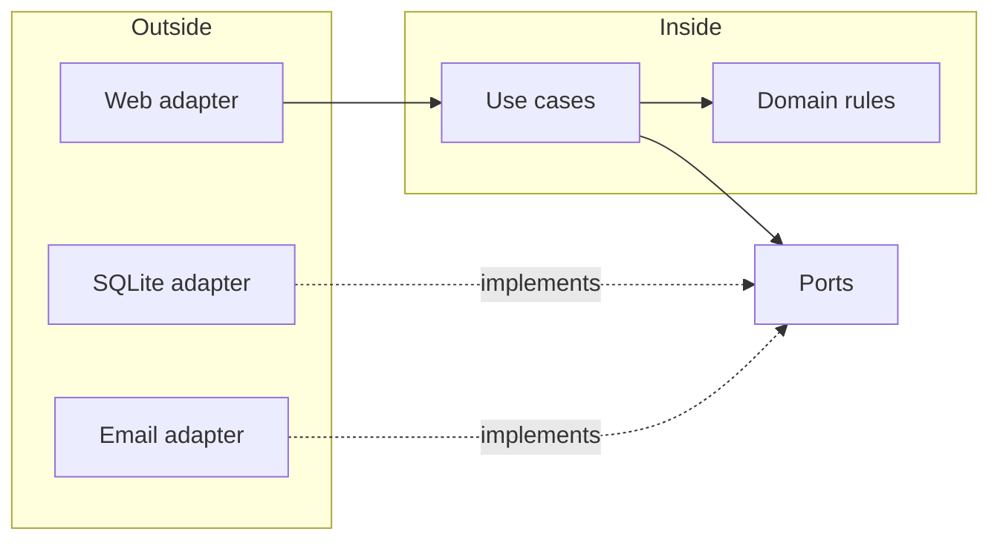

# Clean Architecture

← [[54 Layered Architecture]] · [[Phase 4 - Start Here|Home]] · **Next:** [[56 Domain-Driven Design]] → · [[Software Engineering Roadmap#Clean Architecture|Roadmap card]]

> [!abstract] After this note, you can
> Keep your business rules free of databases and frameworks, define ports and adapters, and protect the design with a test that fails when someone breaks it. You'll have done all this for [[Pagebound - Season 2|Pagebound]].

> [!bug] Incident Card · Pagebound Season 2
> **Thursday, 14:00.** A new teammate needs a quick report of overdue loans. They are in a hurry, so in `service.py` they write `from repo import SqliteRepo` and call it directly. It works. Nobody notices.
>
> Two months later the team wants to try PostgreSQL. Your "pure" service layer turns out to depend on SQLite after all. Tests that used `MemoryRepo` quietly stopped covering that code.
>
> **Your job:** make the design **protect itself**, so that this can't happen again by accident.

## Lab 1 - Break It

*About 10 minutes.* You need the layered code from [[54 Layered Architecture]].

Write the tests you **wish** you could write. Start with the lending rules as plain functions, and a test that guards the design itself.

```python
from datetime import date

import domain


def test_a_member_may_hold_three_books_but_not_four():
    assert domain.may_borrow(2)
    assert not domain.may_borrow(3)


def test_loans_are_due_in_14_days():
    assert domain.due_date(date(2026, 3, 1)) == date(2026, 3, 15)


def test_late_fee_is_25_cents_a_day_and_stops_at_ten_dollars():
    due = date(2026, 3, 15)
    assert domain.late_fee_cents(due, date(2026, 3, 15)) == 0
    assert domain.late_fee_cents(due, date(2026, 3, 19)) == 100
    assert domain.late_fee_cents(due, date(2027, 1, 1)) == 1000
```

> [!example]- test_architecture.py (the design guard)
> ```python
> """A test that guards the design itself: dependencies must point inward."""
> import ast
> from pathlib import Path
>
> # Each file may import only these (plus our own inner files)
> ALLOWED = {
>     "domain.py": {"datetime"},
>     "ports.py": {"typing"},
>     "service.py": {"datetime", "domain", "ports"},
> }
>
>
> def imports_of(filename):
>     tree = ast.parse(Path(filename).read_text(encoding="utf-8"))
>     names = set()
>     for node in ast.walk(tree):
>         if isinstance(node, ast.Import):
>             names.update(alias.name.split(".")[0] for alias in node.names)
>         elif isinstance(node, ast.ImportFrom):
>             names.add(node.module.split(".")[0])
>     return names
>
>
> def test_the_core_does_not_import_the_outside_world():
>     for filename, allowed in ALLOWED.items():
>         extra = imports_of(filename) - allowed
>         assert not extra, f"{filename} must not import {sorted(extra)}"
> ```

```bash
python -m pytest -q
```

```text
E   ModuleNotFoundError: No module named 'domain'. Did you mean: 'main'?
ERROR test_domain.py
1 error in 0.10s
```

Red. That's the point. The rules **have no home of their own**. Today the late fee formula is buried in `Lending.give_back`, mixed with saving and email.

## The Big Idea

Clean Architecture has one rule, called the **dependency rule**:

> [!important] Source code dependencies point inward only
> Inner circles hold business rules. Outer circles hold details: databases, web frameworks, email services. **Inner code never imports outer code.**



| Circle | Pagebound file | Holds | Imports |
|---|---|---|---|
| **Entities / domain** | `domain.py` | The rules: limit, due date, late fee | Almost nothing |
| **Use cases** | `service.py` | The steps of "borrow" and "give back" | `domain`, `ports` |
| **Ports** | `ports.py` | What the core *needs*, as interfaces | `typing` |
| **Adapters** | `repo.py`, `emailer.py`, `web.py` | SQLite, email, HTTP | Anything |

### Ports and adapters (hexagonal architecture)

The core says what it **needs** (a *port*): "something that can find a book and take a copy". An *adapter* plugs into that port: `SqliteRepo` for production, `MemoryRepo` for tests. This idea is called **ports and adapters**, or **hexagonal architecture**. It is the same dependency rule in different words.

The trick is **inversion**. Normally the rules would call the database, so the rules depend on the database. Here the rules define the port, and the database adapter depends on *them*. The arrow flips.

> [!tip] You already did half of it
> In [[54 Layered Architecture]] you passed the repository and the email sender into `Lending`. That's the key move. Now you name the doors, and guard them.

## Lab 2 - Fix It

*About 20 minutes.*

**Step 1: pull the rules out into `domain.py`.** Four small, pure functions. They import only `datetime`.

```python
"""The heart of Pagebound: the lending rules. Pure Python. It imports almost nothing on purpose."""
from datetime import date, timedelta

MAX_LOANS = 3
LOAN_DAYS = 14
FEE_CENTS_PER_DAY = 25
MAX_FEE_CENTS = 1000


def may_borrow(active_loans):
    return active_loans < MAX_LOANS


def due_date(borrowed_on):
    return borrowed_on + timedelta(days=LOAN_DAYS)


def days_late(due_on, returned_on):
    return max(0, (returned_on - due_on).days)


def late_fee_cents(due_on, returned_on):
    return min(days_late(due_on, returned_on) * FEE_CENTS_PER_DAY, MAX_FEE_CENTS)
```

**Step 2: name the doors in `ports.py`.** These are *protocols*: they describe what's needed, and nothing more.

```python
"""The doors of the application core. The core says what it NEEDS. Others plug in."""
from typing import Protocol


class LoanRepository(Protocol):
    def get_book(self, book_id): ...
    def count_active_loans(self, member): ...
    def take_copy(self, book_id): ...
    def add_loan(self, book_id, member, borrowed_on, due_on): ...
    def get_open_loan(self, loan_id): ...
    def close_loan(self, loan_id, book_id, returned_on): ...
    def popular(self, limit=5): ...


class Notifier(Protocol):
    def __call__(self, member, text): ...
```

**Step 3: make `service.py` use them.** The steps stay in the use case, and the rules come from `domain`:

```python
"""Use cases: the steps of "borrow" and "return". They follow the rules in domain.py."""
from datetime import date

import domain
from ports import LoanRepository, Notifier


class Lending:
    def __init__(self, repo: LoanRepository, send_email: Notifier, today=date.today):
        self.repo = repo
        self.send_email = send_email
        self.today = today

    def borrow(self, book_id, member):
        if self.repo.get_book(book_id) is None:
            return {"result": "no_such_book"}
        if not domain.may_borrow(self.repo.count_active_loans(member)):
            return {"result": "limit_reached"}
        if not self.repo.take_copy(book_id):
            return {"result": "none_left"}
        due = domain.due_date(self.today())
        loan_id = self.repo.add_loan(book_id, member, self.today().isoformat(), due.isoformat())
        self.send_email(member, f"loan {loan_id}: confirmation")
        return {"result": "ok", "loan_id": loan_id, "due_on": due.isoformat()}

    def give_back(self, loan_id, today=None):
        loan = self.repo.get_open_loan(loan_id)
        if loan is None:
            return {"result": "no_such_loan"}
        today = today or self.today()
        due = date.fromisoformat(loan["due_on"])
        self.repo.close_loan(loan_id, loan["book_id"], today.isoformat())
        return {
            "result": "returned",
            "days_late": domain.days_late(due, today),
            "fee_cents": domain.late_fee_cents(due, today),
        }

    def popular(self):
        return self.repo.popular(5)

    def get_book(self, book_id):
        return self.repo.get_book(book_id)
```

**Step 4: run the tests.**

```bash
python -m pytest -q
```

```text
.........                                                                [100%]
9 passed in 0.03s
```

Green, including the design guard. The rules are tested with plain numbers and dates, so the test needs no repository, no clock object and no fake email.

**Step 5: try to break the rule on purpose.** Open `domain.py` and add `import sqlite3` at the top. Run the guard:

```bash
python -m pytest -q test_architecture.py
```

```text
E           AssertionError: domain.py must not import ['sqlite3']
1 failed in 0.03s
```

> [!success] The design now defends itself
> A hurried teammate can't sneak a database into the rules. The build goes red, with a message that says why. Remove the `import sqlite3` line, and run the tests again to see green.

(Real teams use tools for this. In Python, `import-linter` checks import rules. In Java, `ArchUnit` does. The idea is the same as our 15-line test.)

Commit it:

```bash
git add .
git commit -m "Move rules into domain, name the ports, guard the dependency rule"
```

Add to `LOG.md`: *"55: a shortcut import made the service depend on SQLite. Fix: domain and ports, plus a test that fails if the core imports the outside world."*

## When Is This Overkill?

Clean Architecture costs extra files and a little indirection. It earns that cost when:

- The **rules are complex** or change often (fees, limits, pricing, permissions).
- You **really will** swap or fake the outside parts (a different database, tests with no network).
- Many people work in the code, and **mistakes need guard rails**.

It is overkill for a 100-line script, a throwaway prototype, or a CRUD app with almost no rules. There, a few simple layers are better.

> [!warning] The common mistake
> Copying the folder structure without the idea. If your "domain" folder imports the web framework, you have the folders but not the architecture. The **dependency rule** is the point, not the names.

## Practice

**1. Which circle?** Where do these go: (a) "a loan lasts 14 days", (b) the SQL that inserts a loan, (c) "after a borrow, notify the member", (d) parsing a JSON request body?

> [!example]- Answer to question 1
> (a) **Domain**. (b) **Adapter** (`repo.py`). (c) **Use case**: the use case decides that a notification happens, and calls the `Notifier` port. The actual email is an **adapter**. (d) **Adapter** (`web.py`).

**2. Invert it.** Your use case needs to know the current time. Today it calls `date.today()` directly. What small change makes it easy to test?

> [!example]- Answer to question 2
> Pass the clock in, as `Lending(..., today=date.today)` does. A test passes `lambda: date(2026, 3, 1)`. The code that needs "now" doesn't reach out and grab it.

**3. Extend the guard.** Add `repo.py` and `emailer.py` to the guard test? Why or why not?

> [!example]- Answer to question 3
> No. Adapters are *allowed* to import the outside world. That is their job. The guard protects the **inside**.

**4. Roadmap exercise.** Run the same core with two different drivers: the HTTP server, and a small command-line script that calls `Lending.borrow` directly. Write the script. How many core files did you change?

> [!example]- Answer to question 4
> Zero. For example: build `Lending(MemoryRepo(), print)`, call `borrow`, and print the result. That is the proof of ports and adapters: new drivers, same core.

## Can You Do This?

- [ ] State the dependency rule in one sentence
- [ ] Explain ports and adapters, and "inversion"
- [ ] Put code into domain, use case or adapter
- [ ] Write a test that guards import rules
- [ ] Say when this structure is overkill

## Summary

> [!success] Remember
> - **Dependencies point inward.** The rules never import frameworks or databases.
> - The core defines **ports**. The outside provides **adapters**.
> - A **test can guard the design**, so shortcuts get caught.
> - Use it when rules are rich and change often. Skip it for tiny scripts.

**Next:** [[56 Domain-Driven Design]] →
