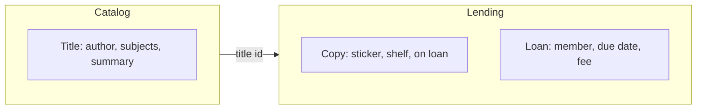

# Domain-Driven Design

← [[55 Clean Architecture]] · [[Phase 4 - Start Here|Home]] · **Next:** [[57 Caching]] → · [[Software Engineering Roadmap#Domain-Driven Design|Roadmap card]]

> [!abstract] After this note, you can
> Build a shared language with the people who know the business, spot bounded contexts, and model rules with value objects, aggregates and events. You'll have written a small model of lending for [[Pagebound - Season 2|Pagebound]] and tagged release **v1.1**.

> [!bug] Incident Card · Pagebound Season 2
> **Friday, 15:00.** Two more libraries are joining, and you sit with their head librarian, Mo. You say: *"So when a member borrows a book, we take one off the shelf."*
>
> Mo frowns. *"Which book? We own five copies of* Dune*. And we reserve some for the reading group. A loan belongs to a physical copy, with a sticker on it."*
>
> Your code has `book_id`, `copies` and `available`. Mo has *title*, *copy*, *reserved* and *loan*. Same people, same building, different words. Bugs are already hiding in the gap.
>
> **Your job:** find the gap in your own code, and close it.

## Lab 1 - Break It

*About 10 minutes.* Do a **word audit** of your code. Look at the words in `service.py` and `repo.py`, and ask Mo's question each time.

| Word in your code | What Mo hears | The trouble |
|---|---|---|
| `book` (as in `book_id`) | A **title**, or a **physical copy**? | It means the title in `get_book` and "something I hold" in `borrow`. One word, two ideas. |
| `member`, and "user" in old notes | A **member**, a **patron**, a **borrower**? | The team uses three words. Nobody checked they mean the same. |
| `available` | Copies on the shelf? Copies **not reserved**? | Reserved copies must not count, but the column doesn't know. |
| "active loan" | A loan **not yet returned** | Not a word in the code at all. It hides inside SQL. |

That last row is a real, countable problem. How many places spell out "active loan"?

```bash
python -c "print(open('repo.py').read().count('returned_on IS NULL'), 'places write the idea of an active loan in SQL')"
```

```text
2 places write the idea of an active loan in SQL
```

> [!bug] The business idea has no home
> The rule *"a loan that is already returned can't be returned again, and charges no second fee"* is spread across two SQL strings and one method. Mo can't read it, and a new engineer can't find it. If Mo changes the rule, you'll change the code in three places and miss one.

## The Big Idea

**Domain-Driven Design (DDD)** puts the *business* at the centre of the code. The **domain** is the part of the world your software is about: for Pagebound, lending books. DDD gives you a few tools.

### 1. Ubiquitous language

Pick **one word for each idea**, together with the people who know the business, and use it **everywhere**: in conversation, in tickets, in tests and in code.

> [!example] Pagebound's glossary, after talking to Mo
> | Word | Meaning |
> |---|---|
> | **Title** | A book as a story: *Dune* by Frank Herbert. Used in search. |
> | **Copy** | One physical book with a sticker. A copy is on a shelf or on a loan. |
> | **Member** | A person with a library card. (Not "user", not "patron".) |
> | **Loan** | A member holds one copy until its due date. |
> | **Active loan** | A loan whose copy has not come back. |

When the code says `copy_id`, `Loan` and `active`, a librarian can read it and say "yes, that's right" or "no, that's wrong". That is the whole value.

### 2. Bounded contexts

The same word can mean different things in different parts of the business. That's fine, **if you draw a border** around each meaning.



In the **Catalog** context, a "book" is a *title* with an author and a summary. In the **Lending** context, a "book" is a *copy* with a sticker. Don't force one class to serve both. Each context has its own model and its own words, and they talk through a small, clear contract (here, the title id). Contexts often become **modules**, or later even [[Software Engineering Roadmap#Microservices|microservices]].

### 3. Building blocks

| Block | Meaning | Pagebound example |
|---|---|---|
| **Entity** | Has an identity that lasts, even when its data changes | A `Loan` (loan number 7 stays loan 7) |
| **Value object** | No identity; defined only by its value; can't be changed | `Money(250)` is just $2.50. Two of them are the same thing |
| **Aggregate** | A cluster of objects with **one door**, which keeps the rules true | `Loan` guards "can't be returned twice" |
| **Domain event** | A fact that happened, in the past tense | `LoanStarted`, `LoanReturned` |
| **Repository** | Saves and loads aggregates, like a collection | Your `repo.py` from [[54 Layered Architecture]] |
| **Domain service** | A rule that doesn't belong to one object | "May this member borrow?" (looks at many loans) |

> [!tip] Aggregates and consistency
> Change an aggregate only through its own methods, and save it as one unit. That way the rules can't be bypassed. This connects to transactions in [[52 Transactions and ACID]].

> [!note]- Event storming: how teams discover the model
> A workshop where people put orange sticky notes on a wall for every **event** in time order ("Loan started", "Copy returned late", "Fee charged"), then add the commands that cause them and the rules in between. You'll quickly see where the business people disagree, and where the contexts split. You don't need software to try it: use paper, and ask Mo.

## Lab 2 - Fix It

*About 25 minutes.* You'll write the lending model in the language of the glossary, with tests. Make a new file `loan.py` (do not edit `domain.py` yet). Read it slowly. Every name is a word from the glossary.

```python
"""Pagebound's lending language, written in code. Words match what the librarians say."""
from dataclasses import dataclass, field
from datetime import date, timedelta

MAX_LOANS = 3
LOAN_DAYS = 14
FEE_PER_DAY = 25
MAX_FEE = 1000


@dataclass(frozen=True)
class Money:
    """A value object: no identity, just an amount. Two Money(100) are the same thing."""
    cents: int

    def __add__(self, other):
        return Money(self.cents + other.cents)

    def __str__(self):
        return f"${self.cents // 100}.{self.cents % 100:02d}"


@dataclass(frozen=True)
class LoanStarted:
    """A domain event: something that happened, in the past tense."""
    loan_id: int
    member: str
    copy_id: int


@dataclass(frozen=True)
class LoanReturned:
    loan_id: int
    fee: Money


class LoanError(Exception):
    pass


@dataclass
class Loan:
    """An aggregate: the one place that protects the rules of a single loan."""
    loan_id: int
    member: str
    copy_id: int          # A COPY is one physical book. A TITLE is the story. They are different words.
    borrowed_on: date
    due_on: date = field(init=False)
    returned_on: date | None = None
    events: list = field(default_factory=list)

    def __post_init__(self):
        self.due_on = self.borrowed_on + timedelta(days=LOAN_DAYS)
        self.events.append(LoanStarted(self.loan_id, self.member, self.copy_id))

    def give_back(self, today):
        if self.returned_on is not None:
            raise LoanError("this copy was already returned")
        self.returned_on = today
        late_days = max(0, (today - self.due_on).days)
        fee = Money(min(late_days * FEE_PER_DAY, MAX_FEE))
        self.events.append(LoanReturned(self.loan_id, fee))
        return fee
```

Now the tests, which read like sentences the librarian would say:

```python
from datetime import date

import pytest

from loan import Loan, LoanError, LoanReturned, LoanStarted, Money


def test_a_new_loan_is_due_in_14_days_and_announces_itself():
    loan = Loan(1, "sam", copy_id=7, borrowed_on=date(2026, 3, 1))
    assert loan.due_on == date(2026, 3, 15)
    assert loan.events == [LoanStarted(1, "sam", 7)]


def test_giving_back_late_charges_a_fee_and_announces_it():
    loan = Loan(1, "sam", copy_id=7, borrowed_on=date(2026, 3, 1))
    fee = loan.give_back(date(2026, 3, 19))
    assert fee == Money(100)
    assert str(fee) == "$1.00"
    assert loan.events[-1] == LoanReturned(1, Money(100))


def test_a_loan_cannot_be_returned_twice():
    loan = Loan(1, "sam", copy_id=7, borrowed_on=date(2026, 3, 1))
    loan.give_back(date(2026, 3, 10))
    with pytest.raises(LoanError):
        loan.give_back(date(2026, 3, 11))


def test_money_is_a_value_two_equal_amounts_are_the_same():
    assert Money(250) == Money(250)
    assert str(Money(5) + Money(250)) == "$2.55"
```

```bash
python -m pytest -q test_loan.py
```

```text
....                                                                     [100%]
4 passed in 0.01s
```

Look at what the model gives you:

- `Money` is a **value object**. You can't add two different kinds of thing by accident, and `str(Money(100))` is `"$1.00"`.
- `Loan` is an **aggregate**. You can't return it twice: the rule lives in **one place**, in one method, in business words.
- Every action leaves an **event** (`LoanStarted`, `LoanReturned`). Later, a queue worker can react to these ([[58 Message Queues]]), without the loan knowing who is listening.

**Now write your own glossary.** Create `GLOSSARY.md` in your repo, using the table above. Add one more word you learned from Mo (maybe *Reserved copy*), and one decision: *"Search belongs to the Catalog context. Loans belong to the Lending context."*

```bash
git add .
git commit -m "Add the lending model and a glossary"
```

## Boss Check - Release v1.1

You've now got the three things that make code easy to change. Check each one:

- [ ] You can swap the data store by changing **one file** (note 54)
- [ ] Lending rules are tested in **milliseconds**, with no database (`python -m pytest -q` is under a second)
- [ ] `test_architecture.py` is green (note 55)
- [ ] `GLOSSARY.md` exists, and `loan.py` speaks its language

```bash
git tag v1.1
git push --tags
```

Add to `LOG.md`: *"56: the code said `book`, the librarians said `title` and `copy`. Fix: a glossary, and a Loan aggregate that guards its own rules."*

## When DDD Is Worth It, and When It Isn't

DDD earns its cost when the **domain is complicated**: insurance, banking, logistics, healthcare. In those worlds, misunderstanding the problem costs far more than any technical choice. For a simple app that just stores and shows data (CRUD), plain tables and a few functions are better. **Borrow the language idea everywhere, and the heavy tools only where the rules are rich.**

## Practice

**1. Entity or value object?** (a) A member's library card number, (b) the amount `$2.50`, (c) a loan, (d) a due date.

> [!example]- Answer to question 1
> (a) **Entity**, since the member has an identity that outlives changes. (Their *card number* itself is a value that identifies them.) (b) **Value object**. (c) **Entity**. (d) **Value object**. A date has no identity: another "March 15th" is the same March 15th.

**2. Find the contexts.** Pagebound adds "reading challenges" with badges and leaderboards. A "member" there has a nickname and a score. Is that a new context? What do you do about the word "member"?

> [!example]- Answer to question 2
> Yes, probably a new context, **Engagement**. Its "member" has different facts than the one in Lending (a nickname and a score, and no due dates). Keep a small model for each, and link them by member id. Don't grow one giant `Member` class.

**3. Name an event.** A member returns a copy that another member had reserved. Write one domain event in the past tense.

> [!example]- Answer to question 3
> For example: `ReservedCopyReturned(copy_id, reserved_by)`. A worker can react by emailing the person who reserved it.

**4. Roadmap exercise.** Use the model in `service.py`: make `borrow` create a `Loan` and `give_back` call `loan.give_back(today)`. What do you need to add to the repository? What gets simpler?

> [!example]- Answer to question 4
> The repository must save and load a `Loan` object instead of raw rows. What gets simpler: the late fee rule exists once, in `Loan`, and you can delete `late_fee_cents` from `domain.py`. This is a good small project. It will touch `repo.py` and `service.py`, and your tests will tell you if you broke anything.

## Can You Do This?

- [ ] Explain ubiquitous language, and build a glossary with a domain expert
- [ ] Spot a word that means two things, and draw a bounded context line
- [ ] Tell an entity from a value object
- [ ] Explain what an aggregate protects
- [ ] Name domain events in the past tense
- [ ] Say when DDD is overkill

## Summary

> [!success] Remember
> - **One word per idea**, shared by the code and the business.
> - **Bounded contexts:** the same word may mean different things, so draw borders.
> - **Entities** have identity. **Value objects** are just values. **Aggregates** guard rules. **Events** are facts.
> - Use the heavy tools only where the rules are rich. Use the shared language everywhere.

**Next:** [[57 Caching]] →
