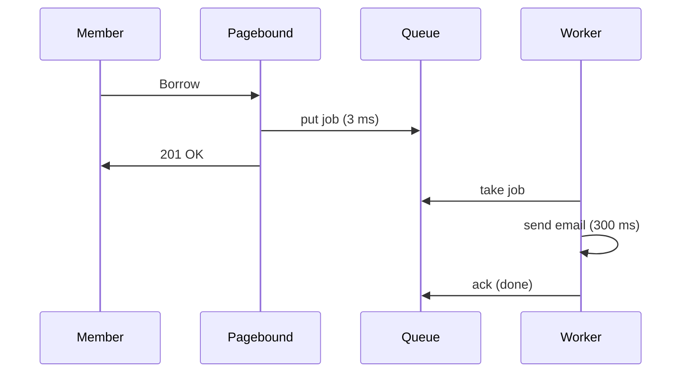

# Message Queues

← [[57 Caching]] · [[Phase 4 - Start Here|Home]] · **Next:** [[59 Observability]] → · [[Software Engineering Roadmap#Message Queues|Roadmap card]]

> [!abstract] After this note, you can
> Move slow work out of a request into a background queue, explain delivery guarantees, survive a crashed worker, and handle repeats and poison messages. You'll have made [[Pagebound - Season 2|Pagebound's]] Borrow button about 10 times faster, and tagged release **v1.2**.

> [!bug] Incident Card · Pagebound Season 2
> **Wednesday, 11:15.** Members say the **Borrow** button "hangs for a moment". Then something worse: the email provider has an outage for 20 minutes. During it, some borrows fail halfway: the loan is saved, but the member never gets a confirmation, and nothing in the system remembers that it was owed.
>
> **Your job:** measure how long a Borrow really takes, find out why, and make sure *no email is ever forgotten*, even if a machine dies.

## Lab 1 - Break It

*About 10 minutes.* Seed the database (`python seed.py`) and start the server (`python main.py`, the version with the cache from the last note).

Create `borrow_speed.py`. It borrows a few books as different members and times each click.

> [!example]- borrow_speed.py (new)
> ```python
> """How long does one Borrow click take? Different members borrow one book each. Usage: python borrow_speed.py [HOW_MANY]"""
> import json
> import sys
> import time
> import urllib.request
>
> times = []
> how_many = int(sys.argv[1]) if len(sys.argv) > 1 else 5
> for number in range(how_many):
>     body = json.dumps({"book_id": number % 16 + 1, "member": f"speed{time.time_ns()}"}).encode()
>     request = urllib.request.Request(
>         "http://127.0.0.1:8000/borrow", data=body, method="POST", headers={"Content-Type": "application/json"}
>     )
>     began = time.perf_counter()
>     urllib.request.urlopen(request).read()
>     times.append((time.perf_counter() - began) * 1000)
>
> print(f"Average Borrow time: {sum(times) / len(times):.0f} ms")
> ```

```bash
python borrow_speed.py
```

```text
Average Borrow time: 332 ms
```

Look at `emailer.py` from [[54 Layered Architecture]]. It sleeps 0.3 seconds to pretend that the email provider is slow, and `Lending.borrow` waits for it **before answering**.

> [!bug] The member waits for something they don't need to wait for
> Borrowing a book takes a few milliseconds. The other **300 ms** is the email, which the member doesn't even need to see yet. And if the provider is down or the server dies during that wait, **the email is lost with no trace**.

Stop the server, and run `python seed.py` again to reset the loans.

## The Big Idea

Don't do slow, unreliable work **while the user waits**. Write down *"someone should send this email"* on a to-do list, and answer straight away. A separate **worker** reads the list and does the job.

![[p4-queue-lease.svg]]

A **message queue** is that list, with rules:

- A **producer** puts messages (jobs) in.
- A **consumer** (worker) takes them out and does the work.
- The producer and the consumer **don't have to be online at the same time**, and they don't have to be written in the same language.



### Acknowledgements and redelivery

How does the queue know a job is finished? The worker must send an **ack** (acknowledgement). If a worker takes a job and **dies**, no ack comes. After a time limit, called the **lease** or *visibility timeout*, the queue gives the job to someone else. Nothing is lost.

### Delivery guarantees

| Guarantee | Meaning | Danger |
|---|---|---|
| **At-most-once** | Sent once, maybe never | Messages can be **lost** |
| **At-least-once** | Always arrives, maybe **more than once** | **Duplicates** |
| **Exactly-once** | Arrives once | Very hard across machines. Usually "at-least-once plus a safe consumer" |

Most real systems choose **at-least-once**. Then the consumer must be **idempotent**: doing the job twice has the same effect as doing it once. For us: *never send the same confirmation email twice*.

### More ideas to know

- **Ordering:** a queue gives *roughly* first-in, first-out. With many workers, finishing order isn't guaranteed. If order matters, process one key (for example one member) on one worker.
- **Poison messages and the dead-letter queue (DLQ):** a job that always fails would be retried forever. After a few attempts, move it to a **dead-letter** area, so it stops blocking the others, and a human looks at it.
- **Backpressure:** if jobs arrive faster than workers finish, the queue grows and grows. Watch its size, add workers, or slow the producers down.
- **Queue or topic?** A **queue** gives each message to *one* worker. A **topic** (publish/subscribe) gives each message to *every* subscriber, as in [[Software Engineering Roadmap#Event-Driven Architecture|event-driven architecture]].

> [!note]- Real tools you will meet
> **RabbitMQ** and **Amazon SQS** are classic queues. **Apache Kafka** is a high-volume log that many consumers can read. **Redis** can run simple job queues. We build our own tiny queue in a **SQLite file** because it shows every moving part with nothing to install, and because a file survives a crash.

## Lab 2 - Fix It

*About 30 minutes.*

**Step 1: the queue.** `jobs.py` stores jobs in a table. `take` claims one job in a **single atomic SQL statement**, so two workers can't take the same job (remember [[37 Concurrency and Parallelism#Race Conditions|race conditions]]). Read the states: `ready`, `running`, `done` and `dead`.

```python
"""A small, durable job queue that lives in a SQLite file. Jobs survive crashes."""
import json
import sqlite3
import time

MAX_ATTEMPTS = 3


class JobQueue:
    def __init__(self, path="queue.db", clock=time.time):
        self.path = path
        self.clock = clock
        with self._connect() as db:
            db.execute(
                "CREATE TABLE IF NOT EXISTS jobs ("
                " id INTEGER PRIMARY KEY, payload TEXT, state TEXT DEFAULT 'ready',"
                " attempts INTEGER DEFAULT 0, lease_until REAL DEFAULT 0)"
            )

    def _connect(self):
        return sqlite3.connect(self.path, timeout=30)

    def put(self, payload):
        with self._connect() as db:
            return db.execute("INSERT INTO jobs (payload) VALUES (?)", (json.dumps(payload),)).lastrowid

    def take(self, lease_seconds=5):
        """Claim one job. If we never ack it, it comes back after lease_seconds."""
        now = self.clock()
        with self._connect() as db:
            row = db.execute(
                "UPDATE jobs SET state = 'running', attempts = attempts + 1, lease_until = ? "
                "WHERE id = (SELECT id FROM jobs WHERE state = 'ready' "
                "            OR (state = 'running' AND lease_until < ?) ORDER BY id LIMIT 1) "
                "RETURNING id, payload, attempts",
                (now + lease_seconds, now),
            ).fetchone()
        if row is None:
            return None
        return {"id": row[0], "payload": json.loads(row[1]), "attempts": row[2]}

    def ack(self, job_id):
        with self._connect() as db:
            db.execute("UPDATE jobs SET state = 'done' WHERE id = ?", (job_id,))

    def fail(self, job_id):
        """Put the job back for another try, or give up and park it in the dead-letter state."""
        with self._connect() as db:
            db.execute(
                "UPDATE jobs SET state = CASE WHEN attempts >= ? THEN 'dead' ELSE 'ready' END WHERE id = ?",
                (MAX_ATTEMPTS, job_id),
            )

    def counts(self):
        with self._connect() as db:
            rows = db.execute("SELECT state, COUNT(*) FROM jobs GROUP BY state").fetchall()
        return dict(rows)
```

**Step 2: the worker.** It loops: take a job, handle it, ack it. If something goes wrong it calls `fail`. The handler first checks whether this email was already sent, which makes the worker **idempotent**. (`CRASH_ON_LOAN` is for the lab only: it makes the worker die *after* sending an email but *before* the ack, the worst moment.)

```python
"""Takes email jobs off the queue and sends them. Run it in its own terminal."""
import os
import time

from emailer import send_email
from jobs import JobQueue

queue = JobQueue()
crash_on = os.environ.get("CRASH_ON_LOAN")  # Only for the lab: die in the middle of this loan's job


def already_sent(text):
    try:
        with open("sent_emails.log") as log:
            return any(line.startswith(text + " ->") for line in log)
    except FileNotFoundError:
        return False


def handle(job):
    member, text = job["payload"]["member"], job["payload"]["text"]
    if already_sent(text):  # A redelivered job must not send a second email
        return
    send_email(member, text)
    if crash_on and text.startswith(f"loan {crash_on}:"):
        os._exit(1)  # Simulate a crash AFTER the email left, but BEFORE we told the queue


if __name__ == "__main__":
    print("Worker is running  (Ctrl+C to stop)")
    while True:
        job = queue.take(lease_seconds=2)
        if job is None:
            time.sleep(0.2)
            continue
        try:
            handle(job)
            queue.ack(job["id"])
        except Exception:
            queue.fail(job["id"])
```

**Step 3: stop waiting for the email.** The service already asks a `Notifier` to "send an email". We only change *what the notifier does*, in `main.py`. The rules in `service.py` don't change at all. That is the payoff of [[55 Clean Architecture|ports and adapters]].

```python
"""Wires the layers together, then starts the server."""
from http.server import ThreadingHTTPServer

from cache import TTLCache
from jobs import JobQueue
from repo import SqliteRepo
from service import Lending
from web import make_handler

if __name__ == "__main__":
    queue = JobQueue("queue.db")

    def notify(member, text):
        queue.put({"member": member, "text": text})  # Instant. A worker sends the email later.

    service = Lending(SqliteRepo("pagebound.db"), notify, cache=TTLCache(ttl_seconds=30))
    print("Pagebound is running at http://127.0.0.1:8000  (Ctrl+C to stop)")
    ThreadingHTTPServer(("127.0.0.1", 8000), make_handler(service)).serve_forever()
```

**Step 4: run it, and measure.** Terminal 1: `python main.py`. Terminal 2:

```bash
python borrow_speed.py
```

```text
Average Borrow time: 30 ms
```

From **332 ms to 30 ms**. Where did the emails go? Into the queue. Look inside:

```bash
python -c "from jobs import JobQueue; print(JobQueue().counts())"
```

```text
{'ready': 5}
```

Five jobs are waiting. Stop the server (`Ctrl+C`).

**Step 5: the worker, and the crash.** First clear old files, so the numbers are clean. Then start a worker that is *told to crash* in the middle of the **second** job:

```bash
python -c "import os; [os.remove(f) for f in ('sent_emails.log',) if os.path.exists(f)]"
```

Git Bash or Linux:

```bash
CRASH_ON_LOAN=200002 python worker.py
```

PowerShell:

```powershell
$env:CRASH_ON_LOAN = "200002"; python worker.py
```

The worker sends email 1, sends email 2, and then **dies**. Check what happened:

```bash
python -c "print(open('sent_emails.log').read()); from jobs import JobQueue; print(JobQueue().counts())"
```

```text
loan 200001: confirmation -> speed0
loan 200002: confirmation -> speed1

{'done': 1, 'ready': 3, 'running': 1}
```

(The member names in your log are long numbers. That's fine.) Job 2 is stuck in `running`: the email *went out*, but the worker died before the ack. Wait 2 seconds for the lease to run out, then start a normal worker, and stop it after a few seconds with `Ctrl+C`:

```bash
python worker.py
```

```bash
python -c "print(open('sent_emails.log').read()); from jobs import JobQueue; print(JobQueue().counts())"
```

```text
loan 200001: confirmation -> speed0
loan 200002: confirmation -> speed1
loan 200003: confirmation -> speed2
loan 200004: confirmation -> speed3
loan 200005: confirmation -> speed4

{'done': 5}
```

> [!success] Nothing lost, nothing doubled
> The queue gave job 2 to the new worker again (at-least-once). The worker saw that the email was **already sent**, skipped it, and acked it. Five loans, five emails, and each email once. Without the `already_sent` check, member 2 would have received two emails.

**Step 6: tests for the queue.** `test_jobs.py` uses a fake clock to test the lease, and checks that a poison job ends up `dead`:

> [!example]- test_jobs.py (new)
> ```python
> import pytest
>
> from jobs import MAX_ATTEMPTS, JobQueue
>
>
> class Clock:
>     def __init__(self):
>         self.now = 1000.0
>
>     def __call__(self):
>         return self.now
>
>
> @pytest.fixture
> def queue(tmp_path):
>     clock = Clock()
>     q = JobQueue(str(tmp_path / "q.db"), clock=clock)
>     q.clock_for_test = clock
>     return q
>
>
> def test_a_job_is_taken_once_and_acked(queue):
>     queue.put({"loan_id": 1})
>     job = queue.take()
>     assert job["payload"] == {"loan_id": 1}
>     assert queue.take() is None            # Nobody else can take it now
>     queue.ack(job["id"])
>     assert queue.counts() == {"done": 1}
>
>
> def test_a_job_nobody_acks_comes_back_after_the_lease(queue):
>     queue.put({"loan_id": 1})
>     queue.take(lease_seconds=5)            # A worker takes it, then "crashes"
>     assert queue.take() is None
>     queue.clock_for_test.now += 6          # Time passes
>     again = queue.take()
>     assert again["payload"] == {"loan_id": 1}
>     assert again["attempts"] == 2
>
>
> def test_a_poison_job_ends_up_in_the_dead_state(queue):
>     queue.put({"loan_id": 1})
>     for _ in range(MAX_ATTEMPTS):
>         job = queue.take()
>         queue.fail(job["id"])
>     assert queue.take() is None
>     assert queue.counts() == {"dead": 1}
> ```

```bash
python -m pytest -q
```

```text
...................                                                       [100%]
19 passed in 0.18s
```

Add to `LOG.md`, and commit:

```markdown
## 58 - Borrow was slow, and emails could vanish
- **What broke:** Borrow took about 330 ms, and a crash lost confirmation emails.
- **Why:** The email was sent inside the request, with no record of what was owed.
- **Fix:** A durable queue with leases, and a worker that skips emails it already sent. Borrow is now about 30 ms.
```

```bash
git add .
git commit -m "Send confirmation emails from a durable queue"
```

## Boss Check - Release v1.2

- [ ] `GET /popular` is answered from the cache (note 57): `python hammer.py popular 400 10` runs above 1,000 requests per second
- [ ] `python borrow_speed.py` shows about **30 ms**, not 300
- [ ] You killed the worker in the middle of a job, restarted it, and every email went out **exactly once**
- [ ] `python -m pytest -q` is green

```bash
git tag v1.2
git push --tags
```

## What Could Still Go Wrong

- **Our queue is one SQLite file.** It's fine for learning and for small systems. Many workers on many machines, or thousands of jobs per second, call for a real broker.
- **Borrow and enqueue aren't one atomic step.** If the server dies after saving the loan but before adding the job, the email is lost. The **outbox pattern** fixes this: save the loan **and** the job in the *same database transaction*, then a relay moves jobs onward. See [[52 Transactions and ACID]].
- **Idempotency by "look in the log" isn't safe with many workers.** Two workers could both see "not sent". Real systems use a unique key in a database, as you'll do in [[63 Distributed Computing]].

## Practice

**1. Which guarantee?** For each, choose at-most-once or at-least-once: (a) a "like" counter on a photo, (b) charging a credit card, (c) sending a password reset email.

> [!example]- Answer to question 1
> (a) **At-most-once** can be fine: losing one like matters little. (b) **At-least-once with idempotency**: never lose a charge, and never double-charge. (c) **At-least-once**: it's better to send twice than never, and sending twice is harmless.

**2. Why a lease?** What would happen without the lease timeout?

> [!example]- Answer to question 2
> A job taken by a worker that died would stay "running" forever. Nobody would ever do it, and nobody would know.

**3. Poison.** One job fails every time, because of a bad email address. How does `jobs.py` stop it from looping forever?

> [!example]- Answer to question 3
> `fail` checks the number of attempts. After `MAX_ATTEMPTS` (3), the state becomes `dead`, and `take` ignores dead jobs. A human can look at the `dead` rows later.

**4. Too many jobs.** Jobs arrive at 100 per second, and one worker finishes 10 per second. What happens, and what can you do?

> [!example]- Answer to question 4
> The queue grows by 90 jobs every second. That's missing **backpressure**. Add more workers (9 more would balance it), make the job faster, or slow down the producers. And **alert** when the queue is longer than some limit.

**5. Roadmap exercise.** Build the "email service via queue" and kill the consumers mid-work: you just did. Now do it again with **two workers** at once. What new problem appears?

> [!example]- Answer to question 5
> Both may take the same *kind* of job, and the `already_sent` check can race: two workers check at the same moment and both send. The fix is a **unique constraint** in a database (insert the key first, and send only if the insert succeeds).

## Can You Do This?

- [ ] Explain why slow work moves out of the request
- [ ] Describe ack, lease and redelivery
- [ ] Compare at-most-once and at-least-once, and say why exactly-once is hard
- [ ] Make a consumer idempotent
- [ ] Explain a dead-letter queue and backpressure
- [ ] Kill a worker mid-job, and show that nothing was lost

## Summary

> [!success] Remember
> - A queue lets you **answer fast** and **do the slow work later**.
> - **No ack means redelivery**, so you get at-least-once.
> - Workers must be **idempotent**, because jobs can arrive twice.
> - **Dead-letter** poison jobs. Watch the queue size.

**Next:** [[59 Observability]] →
