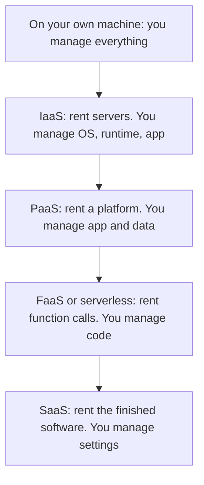

# Cloud Computing

← [[59 Observability]] · [[Phase 4 - Start Here|Home]] · **Next:** [[61 Infrastructure as Code]] → · [[Software Engineering Roadmap#Cloud Computing|Roadmap card]]

> [!abstract] After this note, you can
> Explain what you rent from a cloud and what you still own, make an app ready to run in any environment through its settings, estimate a monthly bill, and apply least privilege. You'll have made [[Pagebound - Season 2|Pagebound]] ready to be moved off its cupboard.

> [!bug] Incident Card · Pagebound Season 2
> **Saturday, 03:10.** Pagebound runs on an old computer in the corner of the first library, in a cupboard. Last night the cleaner unplugged it to use the vacuum. It stayed off until Monday. Three libraries had no app all weekend.
>
> Now the three new libraries want a promise: *"It must be up when we open."* You decide to move to the cloud. A friend gives you a free hour on a rented server, and says: *"Just put your code there and set the port."*
>
> You try. **Your job:** find out whether Pagebound can even be told where to run.

## Lab 1 - Break It

*About 10 minutes.* A cloud or a container doesn't edit your code. It starts your program and passes **environment variables**, like `PORT=9100`. So test that: can your app obey?

Create `check_cloud_ready.py`. It starts `main.py` on port 9100 with its own database, using only environment variables, and calls the health check.

> [!example]- check_cloud_ready.py (new)
> ```python
> """Can Pagebound be told where to run? A cloud will not edit your code. It sets environment variables."""
> import os
> import subprocess
> import sys
> import time
> import urllib.request
>
> import seed
>
> seed.build("cloud_test.db", loans=100)
> env = dict(os.environ, PORT="9100", DB_PATH="cloud_test.db", QUEUE_PATH="cloud_queue.db")
> server = subprocess.Popen([sys.executable, "main.py"], env=env, stdout=subprocess.DEVNULL)
> time.sleep(1.5)
> try:
>     with urllib.request.urlopen("http://127.0.0.1:9100/healthz", timeout=3) as response:
>         print("Health check on port 9100:", response.status, response.read().decode())
>     print("CLOUD CHECK: PASS")
> except Exception as error:
>     print("Health check on port 9100 failed:", type(error).__name__)
>     print("CLOUD CHECK: FAIL")
> finally:
>     server.terminate()
> ```

```bash
python check_cloud_ready.py
```

```text
Health check on port 9100 failed: URLError
CLOUD CHECK: FAIL
```

> [!bug] The app ignores its instructions
> `main.py` has `127.0.0.1` and `8000` and `"pagebound.db"` written *inside the code*. On a rented server you can't change those without editing code. Also `127.0.0.1` means "only this very machine can connect", so even a correct port wouldn't be reachable from outside. A container needs `0.0.0.0`.

## The Big Idea

**Cloud computing** means renting computers, storage, networks and software **by the hour or the byte**, from a provider such as AWS, Azure or Google Cloud, instead of owning them. You can get a server in a minute, and give it back in a minute.

### Who looks after what?



| Model | You rent | Example | You still own |
|---|---|---|---|
| **IaaS** | Virtual machines, disks, networks | A Linux server | Updates, security patches, scaling |
| **PaaS** | A place to run your app | A service that builds and runs your Git repo | Your code and its settings |
| **FaaS** (serverless) | Running one function at a time | Code that runs when a file is uploaded | Only the function; limits apply |
| **SaaS** | A finished product | Email, spreadsheets | Your data and accounts |

> [!tip] The shared responsibility model
> The provider secures the **cloud** (buildings, hardware, hypervisors). You secure **what you put in it**: your accounts, settings, code and data. Most cloud breaches are the customer's settings, like a public storage bucket, and not the provider.

### The building blocks

- **Regions and availability zones (AZs).** A **region** is a part of the world (for example "Western Europe") with several separate data centres called **zones**. Spread your servers over two zones, and one power cut can't take you down. Choose a region near your users, and mind the law about where data may live.
- **Compute:** virtual machines, containers ([[48 Docker]]), or functions.
- **Storage:** *block* storage (a disk for one server), *object* storage (files in buckets, cheap and huge), and **managed databases** (the provider runs, backs up and patches them).
- **Networking:** a **VPC** (virtual private cloud) is your own private network. **Subnets** divide it. The rule: *databases live in private subnets, and only the web servers face the internet*.
- **IAM** (identity and access management): who and what may do which action.

### Least privilege

Give each person and each program **only the permissions it needs**. The email worker needs to read one queue. It does **not** need to delete databases. A typical shape (this example is for illustration only, and I haven't run it against a real account):

```json
{
  "Effect": "Allow",
  "Action": ["sqs:ReceiveMessage", "sqs:DeleteMessage"],
  "Resource": "arn:aws:sqs:eu-west-1:123456789012:pagebound-email-jobs"
}
```

Two actions, one queue. If the worker's key leaks, the damage is small. This is the same idea as [[45 Security Fundamentals#Least Privilege|least privilege]] in security.

### Cost is a design choice

Cloud bills are **usage-based**, so every design choice has a price: always-on servers, data going *out* of the cloud, and managed databases all cost money. **FinOps** is the habit of watching and managing that cost. Set a **budget alarm** on day one.

> [!note]- Serverless, in a few words
> With serverless you upload a function and the provider runs it **only when called**, and scales it from zero to thousands. You pay per call, not per hour. It's great for spiky or rare work (resize an image after upload). The costs: startup delay for rarely used functions (*cold starts*), time limits, and being tied to one provider's tools.

## Make It Cloud-Ready: Settings from the Environment

The [Twelve-Factor App](https://12factor.net/) is a list of habits for apps that run well in the cloud. The ones we need today:

| Habit | Meaning | In Pagebound |
|---|---|---|
| **Config in the environment** | Anything that changes between machines comes from environment variables | `PORT`, `HOST`, `DB_PATH` |
| **Logs to the output** | Write logs to the standard output, and let the platform collect them | Already true since [[59 Observability]] |
| **Stateless processes** | Don't keep important state in memory or on the local disk | Our cache is only a copy. The database holds the truth. (SQLite on a local file is a limit. See [[62 Scalability]].) |
| **Disposable** | Start fast, stop cleanly, can be killed any time | The queue from [[58 Message Queues]] survives kills |
| **Health check** | A URL that says "I'm alive" | `GET /healthz` |

## Lab 2 - Fix It

*About 20 minutes.*

**Step 1: one place for all settings.** `config.py` reads each setting from the environment, with a sensible default for your laptop:

```python
"""All settings in one place. They come from the environment, so the same code runs anywhere."""
import os

HOST = os.environ.get("HOST", "127.0.0.1")        # In a container or cloud VM, set HOST=0.0.0.0
PORT = int(os.environ.get("PORT", "8000"))        # Many clouds tell you which port to use
DB_PATH = os.environ.get("DB_PATH", "pagebound.db")
QUEUE_PATH = os.environ.get("QUEUE_PATH", "queue.db")
CACHE_TTL_SECONDS = int(os.environ.get("CACHE_TTL_SECONDS", "30"))
```

**Step 2: use it in `main.py`.** The host, the port and the file names now come from `config`:

```python
"""Wires the layers together, then starts the server."""
import os
from http.server import ThreadingHTTPServer

import config
from cache import TTLCache
from jobs import JobQueue
from obs import TimedRepo
from repo import SqliteRepo
from service import Lending
from web import make_handler

if __name__ == "__main__":
    queue = JobQueue(config.QUEUE_PATH)

    def notify(member, text):
        queue.put({"member": member, "text": text})  # Instant. A worker sends the email later.

    repo = SqliteRepo(config.DB_PATH)
    if os.environ.get("MYSTERY"):  # Used by a lab, later
        from faults import MysteryRepo
        repo = MysteryRepo(repo)
    service = Lending(TimedRepo(repo), notify, cache=TTLCache(ttl_seconds=config.CACHE_TTL_SECONDS))
    print(f"Pagebound is running at http://{config.HOST}:{config.PORT}  (Ctrl+C to stop)", flush=True)
    ThreadingHTTPServer((config.HOST, config.PORT), make_handler(service)).serve_forever()
```

**Step 3: run the check again.**

```bash
python check_cloud_ready.py
```

```text
Health check on port 9100: 200 {"status": "ok"}
CLOUD CHECK: PASS
```

> [!success] Same code, new place
> The code now takes its orders from its surroundings. To run it anywhere: set `HOST=0.0.0.0`, `PORT` and `DB_PATH`, and start it. No edits.

**Step 4: package it.** A `Dockerfile` (from [[48 Docker]]) is the usual way to ship it to a cloud. Notice the two `ENV` lines: they match the settings we just made. I haven't run this one, because the Docker engine wasn't running on the machine where I tested these notes. If you have Docker, try it.

```dockerfile
FROM python:3.12-slim
WORKDIR /app
COPY *.py ./
ENV HOST=0.0.0.0 PORT=8000
EXPOSE 8000
CMD ["python", "main.py"]
```

```bash
docker build -t pagebound .
docker run -p 8000:8000 -e DB_PATH=/tmp/pagebound.db pagebound
```

**Step 5: estimate the monthly bill.** Make `cost.py`. **Every price in it is made up.** Replace them with the real numbers from your provider's price page before you trust the result. The *method* is the lesson: count what you use, multiply by the price, add up.

> [!example]- cost.py (new)
> ```python
> """A back-of-the-envelope monthly bill. EVERY price below is a made-up example. Replace them with the
> real numbers from your provider's price page before you trust the result."""
>
> HOURS_PER_MONTH = 730
>
> prices = {
>     "small server (per hour)": 0.02,
>     "managed database (per hour)": 0.03,
>     "storage (per GB per month)": 0.10,
>     "data going out (per GB)": 0.09,
> }
>
> # What Pagebound needs
> servers = 2                # Two copies of the app, so one can fail
> database_gb = 20
> traffic_gb = 150           # Pages and JSON sent out each month
>
> bill = {
>     "app servers": servers * prices["small server (per hour)"] * HOURS_PER_MONTH,
>     "database": prices["managed database (per hour)"] * HOURS_PER_MONTH,
>     "storage": database_gb * prices["storage (per GB per month)"],
>     "traffic": traffic_gb * prices["data going out (per GB)"],
> }
>
> for item, cost in bill.items():
>     print(f"{item:12} ${cost:8.2f}")
> print(f"{'TOTAL':12} ${sum(bill.values()):8.2f} a month")
> ```

```bash
python cost.py
```

```text
app servers  $   29.20
database     $   21.90
storage      $    2.00
traffic      $   13.50
TOTAL        $   66.60 a month
```

Which line would you cut first if the boss says "$40"? (You'll think about it in Practice.)

**Step 6: a first real deployment** (steps I have **not** run, because every provider's screens differ and need your account):

1. Push your repo to GitHub.
2. Create a small service on a platform of your choice from that repo (or from the Dockerfile).
3. Set the environment variables `HOST=0.0.0.0` and the port the platform tells you.
4. Set the platform's health check path to `/healthz`.
5. Set a **budget alarm**, for example at $20, before you do anything else.
6. Open the public address, and call `/healthz`.

> [!warning] Don't forget SQLite
> A SQLite file on a rented server disk works for a demo, but the disk can vanish if the server is replaced. For a real launch you'd use a **managed database**. Treat this lab as "ready to move", and the move itself as the next step.

Add to `LOG.md`, and commit:

```markdown
## 60 - The app lived in a cupboard and ignored its settings
- **What broke:** A cleaner unplugged the server. The app couldn't be told where to run.
- **Why:** Host, port and file names were written inside the code.
- **Fix:** config.py reads the environment. Passes the cloud-ready check. Estimated bill and a budget alarm planned.
```

```bash
git add .
git commit -m "Read settings from the environment"
```

## Practice

**1. IaaS, PaaS or FaaS?** (a) You rent a Linux machine and install Python yourself, (b) you push your Git repo and the platform builds and runs it, (c) you upload a function that runs when a photo is uploaded.

> [!example]- Answer to question 1
> (a) **IaaS**. (b) **PaaS**. (c) **FaaS** (serverless).

**2. Two zones.** Why put two copies of the app in two availability zones?

> [!example]- Answer to question 2
> A zone can fail (power, network). With copies in two zones, the app stays up. This is *redundancy*, and it removes a **single point of failure**. We'll build on it in [[62 Scalability]].

**3. Cut the bill.** The estimate is $66.60. The boss says "$40". Name two ways.

> [!example]- Answer to question 3
> Run **one** app server at night, or in a quiet period. Cut data transfer (cache more, compress, use a CDN). Use a smaller database size. Pick a cheaper plan, or buy a commitment if usage is steady. Each one trades cost against availability or speed, so say what you're giving up.

**4. Too many permissions.** The email worker uses an admin key "to make it work". What's the risk, and the fix?

> [!example]- Answer to question 4
> If the key leaks, an attacker owns the whole account. The fix is **least privilege**: a separate identity for the worker with only the queue permissions it needs.

**5. Roadmap exercise.** Deploy a real app on one cloud, with a database, a CDN and a budget alarm. Write down each choice and its monthly price in `LOG.md`.

> [!example]- Answer to question 5
> There's no single answer. A good result lists: the compute type and why, the managed database size, which files go through the CDN, the alarm amount, and the **estimated vs real** bill after a week. The gap between those two numbers is what you learn from.

## Can You Do This?

- [ ] Explain IaaS, PaaS, FaaS and SaaS, and who manages what
- [ ] Explain regions, zones, VPCs and why databases sit in private subnets
- [ ] Explain the shared responsibility model
- [ ] Write permissions with least privilege
- [ ] Make an app take its settings from the environment
- [ ] Estimate a monthly bill and set a budget alarm

## Summary

> [!success] Remember
> - The cloud is **rented computing**. You choose how much you manage.
> - **Config comes from the environment**, so the same code runs anywhere.
> - Spread over **zones**, keep databases **private**, give **least privilege**.
> - **Cost is a design choice.** Estimate it, and set an alarm early.

**Next:** [[61 Infrastructure as Code]] →
