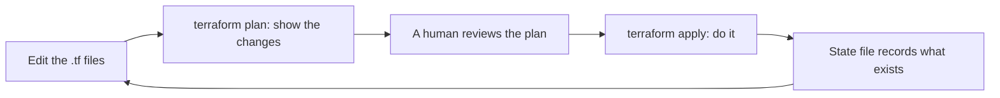

# Infrastructure as Code

← [[60 Cloud Computing]] · [[Phase 4 - Start Here|Home]] · **Next:** [[62 Scalability]] → · [[Software Engineering Roadmap#Infrastructure as Code|Roadmap card]]

> [!abstract] After this note, you can
> Describe an environment in code, preview a change before it happens, spot drift, and recreate an environment from code alone. You'll have written Terraform for [[Pagebound - Season 2|Pagebound's]] two environments, and tagged release **v1.3**.

> [!bug] Incident Card · Pagebound Season 2
> **Thursday, 16:20.** You deploy to **production**. It fails to start: *"port not set"*. Staging worked fine. You compare the two environments by eye and find a typo, `PROT` instead of `PORT`, typed by hand into the production settings two months ago and never used until now.
>
> Then you ask: *"Does anyone remember everything we changed on the production server?"* Nobody does. Staging and production have **drifted apart**, and the real setup lives in people's heads.
>
> **Your job:** stop setting environments up by hand.

## Lab 1 - Break It

*About 10 minutes.* Two environments, two settings files, **typed by hand**. Create these:

```text
HOST=0.0.0.0
PORT=8000
DB_PATH=pagebound-staging.db
QUEUE_PATH=queue-staging.db
CACHE_TTL_SECONDS=5
```

Save that as `staging.env`. Now `production.env`. Look closely. It's *almost* the same, and one thing is wrong:

```text
HOST=0.0.0.0
PROT=8000
DB_PATH=pagebound.db
QUEUE_PATH=queue.db
CACHE_TTL_SECONDS=60
```

Make a checker. It knows the settings Pagebound needs, and compares them with a file:

> [!example]- check_env.py (new)
> ```python
> """Does this settings file have everything Pagebound needs, and nothing strange?  Usage: python check_env.py FILE"""
> import sys
>
> REQUIRED = {"HOST", "PORT", "DB_PATH", "QUEUE_PATH", "CACHE_TTL_SECONDS"}
>
> path = sys.argv[1]
> found = {}
> for line in open(path, encoding="utf-8"):
>     line = line.strip()
>     if line and not line.startswith("#"):
>         key, _, value = line.partition("=")
>         found[key] = value
>
> missing = REQUIRED - found.keys()
> unknown = found.keys() - REQUIRED
> print(f"{path}: {len(found)} settings")
> for key in sorted(missing):
>     print(f"  MISSING  {key}")
> for key in sorted(unknown):
>     print(f"  UNKNOWN  {key}  (a typo?)")
> print("ENV CHECK:", "PASS" if not missing and not unknown else "FAIL")
> sys.exit(0 if not missing and not unknown else 1)
> ```

```bash
python check_env.py staging.env
python check_env.py production.env
```

```text
staging.env: 5 settings
ENV CHECK: PASS
production.env: 5 settings
  MISSING  PORT
  UNKNOWN  PROT  (a typo?)
ENV CHECK: FAIL
```

> [!bug] Hand-built environments rot
> People forget steps, mistype, and fix things "just this once" on one server. Two environments that should be twins slowly become strangers. And you can't *review* a change that was typed into a server at midnight.

## The Big Idea

**Infrastructure as Code (IaC)** means you describe your servers, networks, databases and settings in **files**, keep them in Git, and let a tool make reality match them. You get what you already get for code: **history, review, repeatability and rollback**.

| Hand-made (a "snowflake") | Infrastructure as Code |
|---|---|
| Clicks in a web console | Text files in Git |
| Nobody knows exactly what exists | The files **are** the list |
| A change can't be reviewed | A change is a pull request |
| Recreating it takes days and memory | Recreating it takes one command |

### Declarative: say *what*, not *how*

In a script you write the **steps** ("create a server, then open a port"). In a **declarative** tool such as [Terraform](https://developer.hashicorp.com/terraform/tutorials) (or its open-source fork OpenTofu, or Pulumi, or CloudFormation) you write the **end result** ("there is one server with this size"). The tool works out the steps: *create it if missing, change it if different, leave it alone if right.* Running it twice is safe. That property is **idempotent**, as in [[58 Message Queues|queues]] and [[63 Distributed Computing|retries]].

### Plan, review, apply



The **plan** is the safety net. It says: *"I will add 1, change 0, destroy 0"* **before** anything happens. In a team, you attach the plan to the pull request, and someone checks it.

### State

Terraform remembers what it made in a **state file**. It compares three things: your code (what you want), the state (what it thinks exists) and reality (what really exists). Two big rules:

- **Never edit the state by hand**, and never commit it to Git, since it can contain secrets.
- On a team, keep state in a **shared remote place with locking**, so that two people can't apply at the same moment. (Locking is the same idea as the locks in [[37 Concurrency and Parallelism]].)

### Modules, drift and policy

- **Modules:** reusable bundles ("a web service with a database") that you call with different inputs. Staging and production use the **same module** with different numbers.
- **Drift:** reality no longer matches the code, because someone clicked in the console. `terraform plan` shows the difference. Detect drift on a schedule, and fix it by changing the code, or by re-applying.
- **Policy as code:** rules checked automatically on every plan ("no public storage bucket", "every resource has a cost tag"), with tools such as OPA or Sentinel.

## Lab 2 - Fix It

*About 30 minutes.*

> [!warning] I did not run this lab
> I wrote these Terraform files and checked the checker (`check_env.py`) against the output they should produce. But I could **not** run Terraform itself on the machine where I tested these notes, so the exact wording of its messages may differ a little from mine. If a command behaves differently, trust Terraform's own message, and tell me so I can fix the note.

**Step 0: install Terraform** from [developer.hashicorp.com/terraform/install](https://developer.hashicorp.com/terraform/install), then check it works:

```bash
terraform version
```

**Step 1: describe both environments once.** Create `main.tf`. It uses the **`local` provider**, which makes files on your own computer. That is a safe way to learn the workflow with no cloud account. Real cloud providers work the *same way*: only the resource types change.

```hcl
terraform {
  required_providers {
    local = {
      source  = "hashicorp/local"
      version = "~> 2.5"
    }
  }
}

variable "environment" {
  type        = string
  description = "staging or production"
}

variable "port" {
  type    = number
  default = 8000
}

locals {
  settings = {
    HOST              = "0.0.0.0"
    PORT              = var.port
    DB_PATH           = "pagebound-${var.environment}.db"
    QUEUE_PATH        = "queue-${var.environment}.db"
    CACHE_TTL_SECONDS = var.environment == "production" ? 60 : 5
  }
}

# One file that holds every setting of this environment
resource "local_file" "settings" {
  filename = "${path.module}/${var.environment}/pagebound.env"
  content  = join("\n", [for key, value in local.settings : "${key}=${value}"])
}

output "settings_file" {
  value = local_file.settings.filename
}
```

Read it from the top:

- `variable "environment"` is an input: staging or production.
- `locals` builds the settings. The cache time is 60 seconds in production and 5 in staging, decided **in one place**.
- `resource "local_file"` is the thing to create: one file of settings per environment.

**Step 2: initialise, and preview.**

```bash
terraform init
terraform plan -var environment=staging
```

You should see `local_file.settings will be created`, and a last line like `Plan: 1 to add, 0 to change, 0 to destroy.` **Nothing has been created yet.** That is the plan.

**Step 3: apply it, for both environments.** Each environment gets its **own state**, so we use one *workspace* each:

```bash
terraform apply -var environment=staging -auto-approve
terraform workspace new production
terraform apply -var environment=production -auto-approve
```

You should see `Apply complete! Resources: 1 added, 0 changed, 0 destroyed.` Two files now exist: `staging/pagebound.env` and `production/pagebound.env`. Check them with the checker from Lab 1:

```bash
python check_env.py staging/pagebound.env
python check_env.py production/pagebound.env
```

```text
staging/pagebound.env: 5 settings
ENV CHECK: PASS
production/pagebound.env: 5 settings
ENV CHECK: PASS
```

> [!success] No typo is possible any more
> `PORT` is written **once**, in `main.tf`. Both files are made from the same code, so they can't differ by accident, and the difference you want (the cache time) is a single, visible line.

**Step 4: cause drift, and see it.** Delete the production file by hand, as if someone "cleaned up":

```bash
python -c "import os; os.remove('production/pagebound.env')"
terraform plan -var environment=production
```

Terraform notices that reality doesn't match the code, and plans to **create the file again**. Apply it, and the file is back, with identical content.

**Step 5: destroy, and recreate.** This is the roadmap exercise, and it's the real test of IaC:

```bash
terraform destroy -var environment=production -auto-approve
terraform apply -var environment=production -auto-approve
python check_env.py production/pagebound.env
```

The environment came back from **code alone**. Run the app with it. Settings files are just `NAME=value` lines, so you can export them in your shell, and `main.py` (from [[60 Cloud Computing]]) reads them. For example: `PORT=8000 DB_PATH=pagebound-production.db python main.py`.

**Step 6: commit the code, not the results.** Add `terraform.tfstate*`, `.terraform/` and the generated `staging/` and `production/` folders to `.gitignore`. Commit `main.tf`:

```bash
git add main.tf check_env.py .gitignore
git commit -m "Describe both environments with Terraform"
```

> [!note]- What this looks like with a real cloud
> The workflow is identical. Only the resources change. A real file would hold things like a server, a database and a network, for example (illustration only, not run):
>
> ```hcl
> resource "aws_instance" "app" {
>   ami           = "ami-0123456789abcdef0"
>   instance_type = "t3.small"
>   tags          = { Name = "pagebound-${var.environment}" }
> }
> ```
>
> Plan, review, apply, state and drift all work the same way as in your lab.

## Boss Check - Release v1.3

- [ ] You found the hidden slow step from **logs and metrics only** (note 59)
- [ ] `python check_cloud_ready.py` prints **PASS** (note 60)
- [ ] You destroyed an environment and **recreated it from code** (this note), and both settings files pass `check_env.py`
- [ ] `python -m pytest -q` is still green

```bash
git tag v1.3
git push --tags
```

Add to `LOG.md`: *"61: production failed with a typo in a hand-made settings file. Fix: both environments come from one Terraform file. Destroyed and recreated with no differences."*

## Practice

**1. Declarative or not?** (a) "Install Python, then copy the code, then start it", (b) "Two servers of size small, in two zones".

> [!example]- Answer to question 1
> (a) **Imperative**: it lists steps. (b) **Declarative**: it states the end result, and the tool finds the steps.

**2. Read a plan.** A plan says `Plan: 1 to add, 0 to change, 1 to destroy.` Your pull request was meant to rename a server tag. What should you do?

> [!example]- Answer to question 2
> **Stop and look.** "Destroy" on a rename means the server may be **replaced**, which can mean downtime and lost data. The plan caught it *before* it happened. That's exactly its job. Change the code so the change happens in place, or plan the replacement carefully.

**3. Why not commit the state?** Name two reasons.

> [!example]- Answer to question 3
> It can contain **secrets** (passwords, keys). And two people changing a state file through Git can corrupt it. Use a remote state backend with locking instead.

**4. Drift.** A teammate opened a port in the cloud console "for a quick test", and forgot. How do you find out, and what do you do?

> [!example]- Answer to question 4
> `terraform plan` shows the difference. Then decide: if the port should stay, put it in the code. If not, apply, and the port is closed. Run plans on a schedule so drift is found in a day and not in a year. And agree as a team: **no console edits** to anything under IaC.

**5. Roadmap exercise.** Provision a full environment, destroy it, and recreate it unchanged. Add a **third** environment, `test`, to your lab. How much code do you write?

> [!example]- Answer to question 5
> Almost none: run `terraform workspace new test` and apply with `-var environment=test`. You may add one line for its cache time. That's the **module** idea: one definition, many environments.

## Can You Do This?

- [ ] Explain why hand-built environments drift
- [ ] Explain declarative vs imperative, and idempotent
- [ ] Describe the plan, review, apply loop
- [ ] Say what the state file is, and the two rules about it
- [ ] Explain drift, and how to catch it
- [ ] Recreate an environment from code alone

## Summary

> [!success] Remember
> - **Describe infrastructure in code**, keep it in Git, and review changes.
> - **Declarative** tools find the steps, and are safe to re-run.
> - Always **plan before you apply**, and read the plan.
> - **Protect the state.** Catch **drift** early. No hand edits.

**Next:** [[62 Scalability]] →
