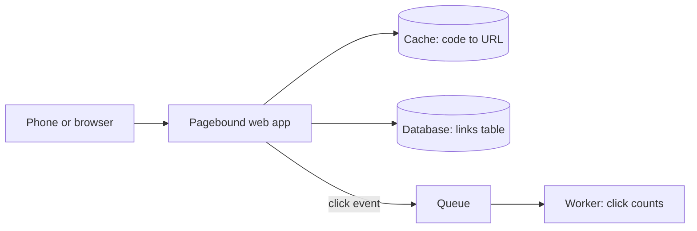

# System Design

← [[63 Distributed Computing]] · [[Phase 4 - Start Here|Home]] · **Next:** [[65 Technical Communication]] → · [[Software Engineering Roadmap#System Design|Roadmap card]]

> [!abstract] After this note, you can
> Take a vague request, ask the right questions, estimate the size, choose a data model and API, draw the components, and name the bottlenecks and failure modes, in about 45 minutes. You'll have designed and built the core of a link shortener for [[Pagebound - Season 2|Pagebound]], and tagged release **v1.4**.

> [!bug] Incident Card · Pagebound Season 2
> **Monday, 10:00.** The marketing lead stops by your desk: *"Members love sharing books. We want short links, like* `pagebound.link/q0U`*, that open a book page. Can you build it? We want to put them on posters."*
>
> It sounds like an afternoon's work. Your first idea: *"I'll make a random 4-character code for each link."*
>
> **Your job:** before you write a line of the real thing, test that first idea. Then design it properly.

## Lab 1 - Break It

*About 5 minutes.* Test the "random 4-character code" idea with a small simulation. Create `collide.py`:

> [!example]- collide.py (new)
> ```python
> """The simplest idea for short codes: pick random ones. How often do two links get the same code?"""
> import random
>
> ALPHABET = "0123456789abcdefghijklmnopqrstuvwxyzABCDEFGHIJKLMNOPQRSTUVWXYZ"
> random.seed(1)
>
> links = 100_000
> seen = set()
> clashes = 0
> for _ in range(links):
>     code = "".join(random.choices(ALPHABET, k=4))
>     if code in seen:
>         clashes += 1  # Two different links would now share one code!
>     seen.add(code)
>
> print(f"{links:,} links, codes of 4 characters ({62**4:,} possible)")
> print(f"Clashes: {clashes}")
> ```

```bash
python collide.py
```

```text
100,000 links, codes of 4 characters (14,776,336 possible)
Clashes: 317
```

> [!bug] Fourteen million codes, and we already clash at 100,000 links
> Fourteen million sounds huge. But with random choices, two links get the same code far sooner than you'd expect. (This is the **birthday problem**: in a room of 23 people, two probably share a birthday.) Each clash means a poster that opens **the wrong book**. A design that "feels fine" can be broken by simple arithmetic, and you can find that out **in five minutes** and not after the posters are printed.

## The Big Idea

**System design** means choosing the parts of a system, and how they fit together, so that it meets its **requirements** at the **scale** you expect. The answer isn't a drawing. It's a *reasoned set of choices*, each with a trade-off you can defend.

A reliable order of work, with a rough time budget for a 45-minute design session:

| Step | Question | Minutes |
|---|---|---|
| 1. **Clarify** | What must it do? How big? What matters most? | 5 |
| 2. **Estimate** | How many requests, how much data? | 5 |
| 3. **Data and API** | What do we store? What do clients call? | 10 |
| 4. **Components** | Which boxes, and how do they talk? | 10 |
| 5. **Bottlenecks and failures** | What breaks first? What if X dies? | 10 |
| 6. **Evolve** | What changes if we grow 10 times? | 5 |

> [!tip] Skip no step
> The most common mistake is to jump to boxes and buzzwords ("we'll use Kafka and microservices") before knowing the size. A design that can't say *why* is just decoration.

### Drawing the design: the C4 model

The [C4 model](https://c4model.com/) gives four zoom levels for diagrams: **Context** (the system and the people and systems around it), **Containers** (the deployable parts: apps, databases, queues), **Components** (the parts inside one container) and **Code**. For most design talks, **Context** and **Containers** are what you need. Keep every box labelled with *what it does*, and every arrow with *what it carries*.

## Lab 2 - Design It, Then Build the Core

*About 60 minutes.* Walk through the six steps for **Pagebound share links**.

### Step 1 - Clarify

Ask, and write the answers down:

- **Must do:** make a short link from a long URL; open a short link and go to the long one.
- **Nice to have:** custom names, click counts, expiry.
- **Scale:** 1,000,000 members; each makes about 2 new links a month; each link is opened about 100 times.
- **Quality:** opening a link must be **fast** (under 100 ms), and a link must **never** open the wrong page. Losing a *click count* is acceptable. Losing a *link* is not.

> [!important] Say what you're NOT building
> "No custom names or expiry in version one" is a decision, and it keeps the design small.

### Step 2 - Estimate

Do the arithmetic with code, so you can change the assumptions and re-run. Create `estimate.py`:

> [!example]- estimate.py (new)
> ```python
> """Back-of-the-envelope maths for Pagebound share links. Change the numbers and re-run."""
> members = 1_000_000
> shares_per_member_per_month = 2
> reads_per_share = 100          # Each link is opened about 100 times
> peak_factor = 5                # The busiest second is about 5 times the average
> bytes_per_link = 500           # Short code, long URL, dates, owner
> years_to_keep = 5
>
> seconds_per_month = 30 * 24 * 3600
>
> new_links_per_month = members * shares_per_member_per_month
> write_qps = new_links_per_month / seconds_per_month
> read_qps = write_qps * reads_per_share
> total_links = new_links_per_month * 12 * years_to_keep
> storage_gb = total_links * bytes_per_link / 1e9
>
> print(f"New links per month:      {new_links_per_month:,}")
> print(f"Writes per second (avg):  {write_qps:.1f}")
> print(f"Reads per second (avg):   {read_qps:.0f}")
> print(f"Reads per second (peak):  {read_qps * peak_factor:.0f}")
> print(f"Links after {years_to_keep} years:     {total_links:,}")
> print(f"Storage after {years_to_keep} years:   {storage_gb:.0f} GB")
> ```

```bash
python estimate.py
```

```text
New links per month:      2,000,000
Writes per second (avg):  0.8
Reads per second (avg):   77
Reads per second (peak):  386
Links after 5 years:     120,000,000
Storage after 5 years:   60 GB
```

Read the numbers like an engineer:

- **Under 1 write per second.** Writes are easy. One database handles this.
- **About 400 reads per second at peak.** A single modest server can serve this. And links rarely change, so a **cache** will absorb most of it ([[57 Caching]]).
- **60 GB in 5 years.** It fits on one disk. No sharding is needed *yet*.
- **120 million links.** How long must a code be? 62⁶ = 56 billion, so 6 characters would do. We'll use 7: room to grow.

That one table settled many arguments before they started. It also tells us **what not to build**: no sharding, no huge cluster.

### Step 3 - Data and API

**Data** (one table):

| Column | Meaning |
|---|---|
| `id` | A number. The short code is this number written in base 62 |
| `url` | The long URL |

**API:**

| Call | Does | Success |
|---|---|---|
| `POST /links` with `{"url": "https://..."}` | Make a link, return the code | 201 |
| `GET /{code}` | Look up the code and redirect | 302 (or 404) |

### Step 4 - Components



The click counts go through a **queue** ([[58 Message Queues]]), so a redirect never waits for them, and losing one is okay, as we agreed in step 1.

### Step 5 - The core: a code that can't clash

Lab 1 showed that random codes clash. Here's the fix: don't choose a code. **Use the next id number, and write it in base 62** (digits, then a to z, then A to Z). Different ids always give different codes, so a clash is **impossible by construction**.

```python
"""The core of a link shortener: turn a number into a short code, and back."""
import sqlite3

ALPHABET = "0123456789abcdefghijklmnopqrstuvwxyzABCDEFGHIJKLMNOPQRSTUVWXYZ"  # 62 characters


def encode(number):
    if number == 0:
        return ALPHABET[0]
    code = ""
    while number > 0:
        number, rest = divmod(number, 62)
        code = ALPHABET[rest] + code
    return code


def decode(code):
    number = 0
    for character in code:
        number = number * 62 + ALPHABET.index(character)
    return number


class Shortener:
    """Each new link gets the next database id. The id IS the short code, so two links can never collide."""

    def __init__(self, path=":memory:"):
        self.db = sqlite3.connect(path)
        self.db.execute("CREATE TABLE IF NOT EXISTS links (id INTEGER PRIMARY KEY, url TEXT NOT NULL)")

    def shorten(self, url):
        # Start ids at 100000, so every code has at least 3 characters
        with self.db:
            cursor = self.db.execute("INSERT INTO links (id, url) VALUES ((SELECT COALESCE(MAX(id), 99999) + 1 FROM links), ?)", (url,))
        return encode(cursor.lastrowid)

    def lookup(self, code):
        row = self.db.execute("SELECT url FROM links WHERE id = ?", (decode(code),)).fetchone()
        return row[0] if row else None
```

```bash
python -c "from shortener import encode; print(encode(100000), encode(62**7 - 1))"
```

```text
q0U ZZZZZZZ
```

Seven characters reach 62⁷ − 1, about **3.5 trillion** links. Tests prove the claims:

> [!example]- test_shortener.py (new)
> ```python
> from shortener import Shortener, decode, encode
>
>
> def test_encode_and_decode_are_opposites():
>     for number in [0, 1, 61, 62, 100000, 3_521_614_606_207]:
>         assert decode(encode(number)) == number
>
>
> def test_seven_characters_hold_over_3_trillion_links():
>     assert len(encode(62**7 - 1)) == 7
>
>
> def test_two_links_get_two_different_codes_and_both_work():
>     shortener = Shortener()
>     first = shortener.shorten("https://pagebound.example/books/1")
>     second = shortener.shorten("https://pagebound.example/books/2")
>     assert first != second
>     assert shortener.lookup(first) == "https://pagebound.example/books/1"
>     assert shortener.lookup(second) == "https://pagebound.example/books/2"
>
>
> def test_an_unknown_code_finds_nothing():
>     assert Shortener().lookup("zzzzzz") is None
> ```

```bash
python -m pytest -q test_shortener.py
```

```text
....                                                                     [100%]
4 passed in 0.02s
```

One honest limit: `shorten` picks the next id with a sub-select, which is fine for one writer. With many writers you'd use the database's own counter (`AUTOINCREMENT` or a sequence), so that two requests can never pick the same number. *Predictable ids* also let people guess other people's links. If that matters, scramble the id (for example with a secret permutation) before encoding.

### Step 6 - Bottlenecks and failures

| Question | Answer |
|---|---|
| What breaks first at 10x? | Reads: 3,860 per second at peak. The cache absorbs most. The database sees only misses. |
| What if the cache dies? | Reads fall through to the database. It can take about 400 reads per second, so we survive. Warm it up slowly. |
| What if the database dies? | Links can't be made or opened. Add a replica for reads and daily backups. *Losing links is the thing we can't accept*, so backups come first. |
| What if the queue or worker dies? | Click counts pause or are lost. Redirects still work. |
| Abuse? | Someone shortens a link to a bad site. Add rate limits, and a report-and-block process. |

**Write it down.** Create `docs/share-links-design.md` with these six sections: the answers to steps 1 to 6, in your own words, and the diagram. One page. Someone should be able to read it in five minutes and say *"yes"* or *"have you thought about X?"* You'll polish this in [[65 Technical Communication]].

```bash
git add .
git commit -m "Design share links: estimate, core, and design doc"
```

Add to `LOG.md`: *"64: my first idea (random 4-character codes) clashed 317 times in 100,000 links. Fix: base-62 of the id, and a six-step design on paper."*

## Boss Check - Release v1.4

- [ ] Your `LOG.md` has the **three load-test rounds** with numbers (note 62)
- [ ] `python phone.py --key` leaves **4** copies, not 3 (note 63)
- [ ] `docs/share-links-design.md` exists, with estimates and failure modes (this note)
- [ ] `python -m pytest -q` is green

```bash
git tag v1.4
git push --tags
```

## Practice

**1. Estimate.** A chat feature: 50,000 active members send 20 messages a day each, and each message averages 200 bytes. How many messages per second on average, and how much storage per year?

> [!example]- Answer to question 1
> 50,000 × 20 = 1,000,000 messages a day, and 1,000,000 ÷ 86,400 ≈ **12 per second** on average (maybe 5 times that at peak: 60). Storage: 1,000,000 × 200 bytes = 200 MB a day, so about **73 GB a year**. Tiny. One ordinary database is plenty. Good design saves you from building too much.

**2. Spot the missing step.** A teammate draws a design with a message queue, a cache, three databases and a search cluster, and has not mentioned how many users there are. What do you ask?

> [!example]- Answer to question 2
> *"What are the numbers?"* (Requests per second, data size, growth.) Without them you can't say whether any of those boxes earns its cost. Every box adds something to run, watch and pay for.

**3. Failure mode.** In our design, a member opens a short link. The cache has no entry and the database is down. What does the member see, and what should you do?

> [!example]- Answer to question 3
> A server error (503). Make it a clear, friendly page with a retry. Also **alert** on it: the database being down is an incident. This is why the table lists "what if the database dies" *before* it happens.

**4. Roadmap exercise.** Design a URL shortener, a chat app, a news feed, a ride-sharing service and a payment system, and implement the core of at least one. You just did one: the shortener. Now choose a second and do steps 1 to 3 on paper. Which has the hardest *consistency* needs?

> [!example]- Answer to question 4
> The **payment system**. Money can't be lost or double-counted, so it needs transactions, idempotency keys ([[63 Distributed Computing]]) and careful ledgers. A news feed can be a little stale, and a chat needs ordering, but a payment must be exactly right.

## Can You Do This?

- [ ] Follow the six steps, with a time budget
- [ ] Turn a vague request into functional and non-functional requirements
- [ ] Do a back-of-the-envelope estimate, and read the result
- [ ] Choose a data model and API
- [ ] Draw a context or container diagram
- [ ] Name bottlenecks and failure modes, and say what you'd do about each
- [ ] Defend each choice against "why not X?"

## Summary

> [!success] Remember
> - **Clarify, estimate, model, draw, stress-test, evolve.** In that order.
> - **Numbers first.** They tell you what to build, and what *not* to.
> - Test the first idea against arithmetic. Random short codes **clash**.
> - Every box needs a reason. Every design needs its **failure modes** written down.

**Next:** [[65 Technical Communication]] →
