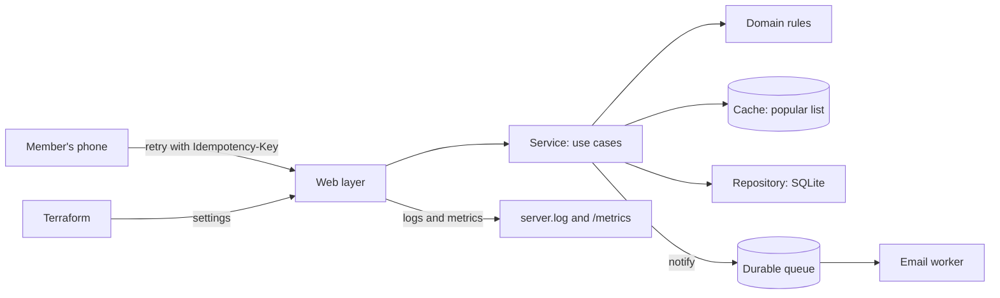

# Phase 4 Final Project - You Own Pagebound

← [[67 System Ownership]] · [[Phase 4 - Start Here|Home]]

> [!abstract] Your goal
> Phase 3 left you with an app that was safe to ship. Phase 4 made it a system you can **shape, watch, grow, explain and keep healthy**. In this project you pull it together and prove it with **one command**. Then you hand it over, the way an owner does: with a README, decisions, a runbook and a release. This is a strong portfolio piece, and a source of real stories for interviews.

## What You Have Built



| Piece | What it does | Where you learned it |
|---|---|---|
| Layers, and a core with no framework | Rules are tested in milliseconds, and the data store can be swapped | [[54 Layered Architecture]], [[55 Clean Architecture]] |
| A shared language | Code that a librarian can read | [[56 Domain-Driven Design]] |
| A 30-second cache | The popular list is about 50 times faster | [[57 Caching]] |
| A durable queue and worker | Borrow takes about 30 ms, and emails survive a crash | [[58 Message Queues]] |
| Logs, metrics, request ids | You find a hidden slow step with no new code | [[59 Observability]] |
| Settings from the environment, a Dockerfile | Runs anywhere | [[60 Cloud Computing]] |
| Terraform for two environments | An environment is recreated from code | [[61 Infrastructure as Code]] |
| Load test rounds and a write-up | You know what breaks first | [[62 Scalability]] |
| Idempotency keys | A lost reply doesn't borrow twice | [[63 Distributed Computing]] |
| A design doc for share links | Thought through on paper first | [[64 System Design]], [[65 Technical Communication]] |
| An onboarding page | A newcomer is useful in week one | [[66 Mentoring]] |
| SLOs, a runbook and a postmortem | You can run it, and hand it over | [[67 System Ownership]] |

> [!important] Try it yourself first
> Each step below is something to **do**, then compare with the hints. Commit after each step, in small pull requests, as you would on a real team.

## Step by Step

### Step 1 - Take stock

Run the tests, and list what is in your repo.

```bash
python -m pytest -q
```

```text
.....................                                                     [100%]
21 passed in 0.16s
```

Make sure these exist (your file names may differ a little, which is fine):

- [ ] **Code:** `web.py`, `service.py`, `domain.py`, `ports.py`, `repo.py`, `cache.py`, `jobs.py`, `worker.py`, `idem.py`, `obs.py`, `config.py`, `main.py`
- [ ] **Tools:** `loadtest.py`, `logsummary.py`, `trace.py`, `slo.py`
- [ ] **Docs:** `GLOSSARY.md`, `LOG.md`, `docs/share-links-design.md`, `docs/ONBOARDING.md`, `docs/SLOs.md`, `docs/RUNBOOK.md`, a postmortem
- [ ] **Setup:** `Dockerfile`, `main.tf`

If something is missing, go back to its note. Each one is a small piece.

### Step 2 - One command that says "ship it"

An owner doesn't trust memory. They trust a check that runs the same way every time. Create `release_check.py`. It runs your **tests**, starts the **real app** on a spare port with its own database, plays **100 members** through it, and then checks the **SLOs** on the log it wrote.

> [!example]- release_check.py (new)
> ```python
> """One command that answers: is this build good enough to tag as v2.0?"""
> import os
> import subprocess
> import sys
> import time
>
> import seed
>
> results = []
>
>
> def check(name, ok, detail=""):
>     results.append(ok)
>     print(f"{'PASS' if ok else 'FAIL'}  {name}  {detail}")
>
>
> # 1. The tests (rules, cache, queue, and the architecture guard)
> tests = subprocess.run([sys.executable, "-m", "pytest", "-q"], capture_output=True, text=True)
> check("tests pass", tests.returncode == 0, tests.stdout.strip().splitlines()[-1])
>
> # 2. Start the real app on a spare port with its own database, and run a load test
> seed.build("release_test.db", loans=50_000)
> env = dict(os.environ, PORT="9300", DB_PATH="release_test.db", QUEUE_PATH="release_queue.db")
> with open("release_server.log", "w") as log_file:
>     server = subprocess.Popen([sys.executable, "main.py"], env=env, stdout=log_file)
>     time.sleep(2)
>     try:
>         load = subprocess.run([sys.executable, "loadtest.py", "100", "5"], env=dict(env, PORTS="9300"),
>                               capture_output=True, text=True)
>         check("load test finishes with no failures", "0 failed" in load.stdout, load.stdout.strip().splitlines()[0])
>     finally:
>         server.terminate()
>         server.wait()
>
> # 3. Did the app keep its promises (SLOs) during the test?
> slo = subprocess.run([sys.executable, "slo.py", "release_server.log"], capture_output=True, text=True)
> check("SLOs met", "MISSED" not in slo.stdout)
> print(slo.stdout)
>
> print("RELEASE CHECK:", "PASS, tag v2.0" if all(results) else "FAIL")
> ```

(It needs `slo.py` and `loadtest.py` next to it, and `pytest` installed.)

```bash
python release_check.py
```

```text
PASS  tests pass  21 passed in 0.16s
PASS  load test finishes with no failures  100 members finished, 0 failed, in 2.3s
PASS  SLOs met
SLO 1  availability     target 99.5%   actual 100.0%   OK   (error budget used: 0 of 2)
SLO 2  Borrow < 300 ms  target 95.0%   actual 100.0%   OK

RELEASE CHECK: PASS, tag v2.0
```

> [!success] One command, the whole story
> The tests guard the **rules** and the **design**. The load test guards **speed and stability**. The SLOs guard **what users feel**. Together they say: *safe to ship*.

### Step 3 - Prove the check can fail

A check that never fails isn't a check. Bring back the hidden fault from [[59 Observability]], and run it again.

Git Bash or Linux:

```bash
MYSTERY=1 python release_check.py
```

PowerShell:

```powershell
$env:MYSTERY = "1"; python release_check.py; Remove-Item Env:MYSTERY
```

```text
PASS  tests pass  21 passed in 0.15s
PASS  load test finishes with no failures  100 members finished, 0 failed, in 3.4s
FAIL  SLOs met
SLO 1  availability     target 99.5%   actual 100.0%   OK   (error budget used: 0 of 2)
SLO 2  Borrow < 300 ms  target 95.0%   actual 75.0%   MISSED

RELEASE CHECK: FAIL
```

This is exactly the action item from your postmortem: the bad change from last night would have been **stopped before the deploy**. (In a real team you'd run this in CI, as in [[49 Continuous Integration and Delivery]], and block the merge when it fails.)

### Step 4 - Write the decisions down

A new owner needs the *why*, not only the what. Create `docs/decisions.md`. Use one short entry per decision, like this:

```markdown
## Why is the queue a SQLite file?
- **Decision:** Jobs live in a table in a SQLite file, with leases.
- **Why:** It survives crashes, needs nothing to install, and we send under 1 job a second.
- **Revisit when:** more than one machine runs workers, or load is above about 100 jobs a second. Then use a real broker.

## Why an in-memory cache and not Redis?
- **Decision:** A 30-second cache inside each app process.
- **Why:** It's the simplest thing that fixed the problem (50x faster). We state its staleness: up to 30 s.
- **Revisit when:** we run several copies and need one shared view.
```

Write at least **five**: the data store, the cache, the queue, idempotency keys, and "what we would change next" (for example PostgreSQL, because [[62 Scalability#Round 3 - Add a second copy of the app|writes share one file]]). Every entry ends with **"revisit when"**. That line turns a decision into a plan. (Phase 5 begins with [[Software Engineering Roadmap#Architectural Decision-Making|architectural decision-making]], and this is the habit it builds on.)

### Step 5 - Write the README

The README is the front door. In about a page, say: what Pagebound is, how to run it in **three commands**, a picture of the architecture (the diagram above), how to run the tests and `release_check.py`, and links to `docs/`. Someone should be able to clone it and be productive in an hour: [[66 Mentoring#Step 3: write an onboarding page|your onboarding page]] is the model.

### Step 6 - Ship v2.0

```bash
python release_check.py
git add .
git commit -m "Pagebound v2.0: a system you can own"
git tag v2.0
git push --tags
```

Then read your `LOG.md` from top to bottom. You'll find about **fifteen real stories**, each with a number:

| # | Story | The number |
|---|---|---|
| 54 | Rules trapped in a handler | One rule took 1.4 s to test, then 0.02 s |
| 57 | The slow home page | 44 requests per second became over 2,000 |
| 58 | Borrow waited for email | 332 ms became 30 ms. No email lost |
| 59 | Blind to a slow step | Found `add_loan` from logs in a minute |
| 62 | Will it cope with 10 times? | 25 members per second became about 70 |
| 63 | One tap, two loans | 3 copies left became 4 |
| 64 | Random short codes clashed | 317 clashes in 100,000 links |
| 67 | A bad deploy | SLO at 75%, rolled back, postmortem |

> [!tip] In an interview
> "Tell me about a time you improved performance" has an answer with **numbers**: *"The popular page handled 44 requests a second. I cached it with a 30-second lifetime, measured again, and got over 2,000. I also wrote down how stale it could get."* That's the difference between listing a skill and showing it.

## Stretch Goals

- [ ] Replace SQLite with **PostgreSQL** (run it in Docker), changing only `repo.py`. Does `release_check.py` still pass? Does the write speed change?
- [ ] Replace the in-memory cache with **Redis**, and share it across two copies of the app
- [ ] Make the idempotency store process-safe with an `INSERT` of the key first ([[63 Distributed Computing]], Practice 4)
- [ ] Add **tracing** with OpenTelemetry, and view one request across the web layer, the service and the repository
- [ ] Implement the **share links** design from [[64 System Design]], and add its numbers to `release_check.py`
- [ ] Deploy to a real cloud with a **budget alarm**, using Terraform for the resources
- [ ] Mentor a real person through the onboarding page, and note what they stumbled on

## When You Finish Phase 4

You can now do what a Mid-Level engineer does: own a piece of a system over time, design it, keep it healthy, and make the people around you better. Check yourself against the roadmap's [[Software Engineering Roadmap#Ready for Mid-Level|Ready for Mid-Level]] list, and read the [[Software Engineering Roadmap#Mid-Level Software Engineer|Mid-Level role card]].

Phase 5 is about **multiplying others**: decisions that affect many teams, strategy, and the business behind the software. You've already started: your decision log, design doc and postmortem are the first documents of that kind.

← [[67 System Ownership]] · [[Phase 4 - Start Here|Home]]
