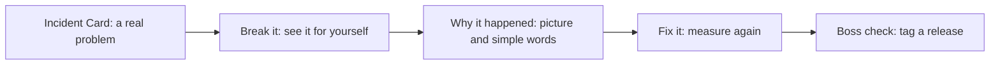
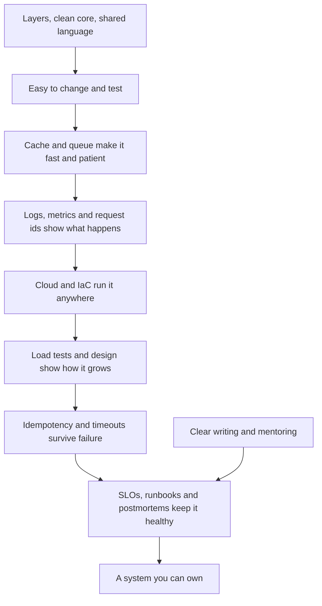

# Phase 4 - Own Systems

> [!abstract] Your goal
> By the end of Phase 4, you can **own a system**: shape it so it's easy to change, make it fast and resilient, watch it, run it, explain it, grow it, and help others work on it. That's the level of a Mid-Level engineer: the team trusts you with a component end to end.

This is Phase 4 of the [[Software Engineering Roadmap#Recommended Study Order|Software Engineering Roadmap]]. Finish [[Phase 3 - Start Here|Phase 3]] first. The roadmap suggests about 2 to 3 years for this phase. Most of that is **real work**, because ownership is learned by owning things. These notes cover the study part, and take about a year at 8 to 10 hours a week.

## How These Notes Teach

Every note works the same way, as in Phase 3. But now there are **no short examples**: you grow **one system**.

> [!tip] What's different from Phase 3
> Phase 3 asked *"Is the code correct and safe?"* Phase 4 asks bigger questions: *"Can it change? Can it handle more? Can I see inside it? What happens when something fails? Can someone else take it over?"* So the proof is usually a **number you measured**, like requests per second, milliseconds, or an error budget.

## Your Story: Pagebound, Season 2

A year has passed since you shipped Pagebound v1.0. It now has **5,000 members** and **200,000 past loans**, and three more libraries want in. The problems have changed: not "a bug in one function", but "the code is a tangle", "the home page is slow", "something is slow *sometimes*", and "a phone on bad Wi-Fi borrowed twice". You'll fix each one, and prove it with numbers.

![[p4-season-map.svg]]

**After each Part, you pass a boss check and tag a release.** Set up your Season 2 repo first. It takes about 10 minutes: [[Pagebound - Season 2]].

> [!info] Did you build Pagebound in Phase 3?
> It helps, because you'll recognise the shape. But Season 2 comes with **its own starter**, so you don't need your Phase 3 repo.

## The Notes, in Order

### Part 1 - Shape it
- [ ] [[54 Layered Architecture]]: give each kind of code a home
- [ ] [[55 Clean Architecture]]: keep the rules free of the outside world
- [ ] [[56 Domain-Driven Design]]: speak the business's language · **v1.1**

### Part 2 - Make it fast and patient
- [ ] [[57 Caching]]: stop answering the same question twice
- [ ] [[58 Message Queues]]: do the slow work later, and never lose it · **v1.2**

### Part 3 - See it, and move it
- [ ] [[59 Observability]]: make the system explain itself
- [ ] [[60 Cloud Computing]]: rent computers, and be ready to move
- [ ] [[61 Infrastructure as Code]]: environments from code, not memory · **v1.3**

### Part 4 - Grow it
- [ ] [[62 Scalability]]: measure, find the bottleneck, fix one thing
- [ ] [[63 Distributed Computing]]: when the network fails
- [ ] [[64 System Design]]: design on paper before you build · **v1.4**

### Part 5 - Lead it
- [ ] [[65 Technical Communication]]: write so people can act
- [ ] [[66 Mentoring]]: help others become able
- [ ] [[67 System Ownership]]: run it, and keep it healthy · **v1.5**

### Part 6 - Put it all together
- [ ] [[68 Phase 4 Final Project]]: one command that says "ship it" · **v2.0**

## Tools to Install

| Tool | For | Where to get it |
|---|---|---|
| **Python 3.10 or newer** | All labs | [python.org](https://www.python.org/downloads/) |
| **pytest** | Tests in every Part | Run `python -m pip install pytest` |
| **Git and a GitHub account** | Releases and pull requests | You have them from Phase 3 |
| **Terraform** | [[61 Infrastructure as Code]] | [developer.hashicorp.com/terraform/install](https://developer.hashicorp.com/terraform/install) |
| **Docker Desktop** (optional) | [[60 Cloud Computing]] | You have it from Phase 3 |

Everything else (the queue, the cache, the metrics, the load tester) is **built from Python's standard library** in the labs, so you can see how each part works. Real tools like Redis, RabbitMQ, Prometheus and Kafka are named in the notes, for when you outgrow ours.

## How Everything Connects

## A Simple Study Plan

This plan assumes 8 to 10 hours each week. Go slower if you're also working, and learn from your work as you go.

| Weeks | Study | Apply it to your project | Release |
|---|---|---|---|
| 1 to 3 | [[54 Layered Architecture]] | Split the tangle into layers | |
| 4 to 6 | [[55 Clean Architecture]] | Move the rules into a protected core | |
| 7 to 10 | [[56 Domain-Driven Design]] | Write the glossary and the Loan model | **v1.1** Clean bones |
| 11 to 13 | [[57 Caching]] | Cache the popular list | |
| 14 to 17 | [[58 Message Queues]] | Send emails from a durable queue | **v1.2** Fast and patient |
| 18 to 21 | [[59 Observability]] | Add logs and metrics, then find a hidden slow step | |
| 22 to 24 | [[60 Cloud Computing]] | Read settings from the environment | |
| 25 to 28 | [[61 Infrastructure as Code]] | Describe two environments in Terraform | **v1.3** Seen and portable |
| 29 to 33 | [[62 Scalability]] | Three measured load-test rounds | |
| 34 to 38 | [[63 Distributed Computing]] | Make retries safe | |
| 39 to 42 | [[64 System Design]] | Design share links | **v1.4** Ready to grow |
| 43 to 45 | [[65 Technical Communication]] | Write the update and the design doc | |
| 46 to 48 | [[66 Mentoring]] | Review a PR, write the onboarding page | |
| 49 to 52 | [[67 System Ownership]] | Set SLOs, run a drill, write a postmortem | **v1.5** Team and trust |
| 53 to 60 | [[68 Phase 4 Final Project]] | Assemble, check and hand over | **v2.0** You own it |

The boss check for each release is in [[Pagebound - Season 2#Your Season Map|your Season Map]].

## When You Finish Phase 4

Check yourself with the roadmap's [[Software Engineering Roadmap#Ready for Mid-Level|Ready for Mid-Level]] list, and read the [[Software Engineering Roadmap#Mid-Level Software Engineer|Mid-Level role card]].

**Start here:** [[54 Layered Architecture]] →
