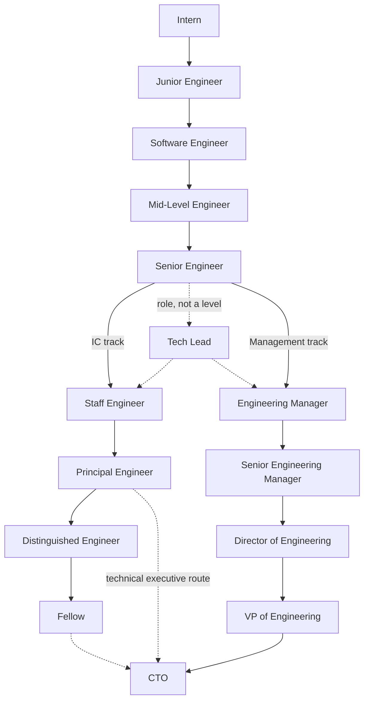

# Software Engineering Self-Study Roadmap

> [!abstract] What this is
> A long-term curriculum, competency framework and career guide that takes you from internship level to senior engineering and technical leadership. At any point you should be able to see where you stand, what you are missing, what to study next, and what your target role demands.

**Jump to:** [[#1. Introduction and How to Use This Roadmap]] · [[#2. Software Engineering Career Progression]] · [[#3. Computer Science Foundation]] · [[#4. Mathematics Roadmap]] · [[#5. Core Software Engineering Knowledge]] · [[#6. Software Design and Architecture]] · [[#7. Frontend, Backend, Mobile and Desktop Engineering]] · [[#8. Databases and Data Engineering]] · [[#9. Computer Systems and Networking]] · [[#10. Testing and Quality Engineering]] · [[#11. DevOps, Cloud and Infrastructure]] · [[#12. Security Engineering]] · [[#13. Distributed Systems and System Design]] · [[#14. Specialized Engineering Career Paths]] · [[#15. Professional and Leadership Development]] · [[#16. Career-Level Competency Matrices]] · [[#17. Practical Projects and Portfolio Progression]] · [[#18. Recommended Learning Resources]] · [[#19. Self-Assessment and Mastery Tracking]] · [[#20. Long-Term Career Development Strategy]]

---

## 1. Introduction and How to Use This Roadmap

> [!important] Four things to believe before you start
> - **Nobody masters all of this.** Strong engineers have a broad base, deep expertise in a few areas, and the ability to learn the rest when needed. This document is a map, not a to-do list you must finish.
> - **A programming language is not software engineering.** Knowing syntax is the smallest part of the job. Engineering is building systems that keep working, keep changing, and keep serving people, usually in a team.
> - **Software engineering is not only web development.** Embedded, systems, data, ML, games, security and infrastructure are all software engineering. They share a universal core and diverge after it.
> - **Competence is demonstrated, not read.** A checkbox only counts when you have evidence: code, a design, a working system, a decision you can defend.

### Reading a Topic Card

Every topic in sections 3 to 13 and 15 uses the same compact card, so you can scan rather than read.

| Card field | Your requested item |
|---|---|
| Heading | Topic name |
| First line | Priority tag, and which career levels need which depth |
| **What** | What it is |
| **Why** | Why software engineers need it |
| **Learn** | Important concepts and subtopics, as a checklist |
| **Skills** | Practical skills to develop |
| **Exercise** | Hands-on exercise or project |
| **Mastery** | How to assess mastery |
| **Prereqs** and **Next** | Prerequisites and recommended next topics |

### Priority Levels

Each card carries a tag, so Obsidian's tag pane and search can filter by priority. A checklist item inherits its card's priority unless marked **(I)** Important, **(A)** Advanced or **(S)** Specialized.

| Tag          | Meaning                                          | Rule of thumb                             |
| ------------ | ------------------------------------------------ | ----------------------------------------- |
| #essential   | Must understand for general software engineering | Learn regardless of specialty             |
| #important   | Strongly recommended for professional competency | Learn within your first few working years |
| #advanced    | Required for senior-level or specialized work    | Learn when your work approaches it        |
| #specialized | Required only for specific domains               | Skip unless your path needs it            |

### Depth of Knowledge

Knowing about something, using it, and being trusted to decide about it are three different abilities. Each card names the earliest level at which each depth is generally expected.

| Depth | Meaning | Evidence |
|---|---|---|
| **Know** | You can explain it correctly and recognise it in the wild | You can teach it to a peer without notes |
| **Apply** | You have used it in real projects, with guidance if necessary | Working code or a system, including debugging when it broke |
| **Decide** | You can choose whether and how to use it, independently, and own the consequences | A defended decision with trade-offs, ideally one you revisited after seeing the result |

### Progress Tracking with Checkboxes

Use these four states everywhere in the document.

- [ ] `- [ ]` **Not started**
- [/] `- [/]` **Currently learning**
- [p] `- [p]` **Practiced** (used it hands-on at least once, not yet reliable)
- [x] `- [x]` **Mastered** (passes the card's Mastery check)

> [!tip] Working with the four states
> Clicking a box only toggles it between blank and done, so type `/` or `p` between the brackets in editing view. Default Obsidian draws every non-blank state as a tick. To tell them apart, save the snippet below as `.obsidian/snippets/task-states.css` and enable it under Settings → Appearance → CSS snippets. Many community themes, such as Minimal, also style alternate checkboxes.

```css
/* Currently learning = amber, Practiced = blue, Mastered keeps the theme colour */
input[data-task="/"]:checked, li[data-task="/"] > input:checked, li[data-task="/"] > p > input:checked { --checkbox-color: #d99a00; --checkbox-color-hover: #b98300; }
input[data-task="p"]:checked, li[data-task="p"] > input:checked, li[data-task="p"] > p > input:checked { --checkbox-color: #2f7fd6; --checkbox-color-hover: #2568b0; }
```

### Recommended Study Order

The sections below are grouped by subject for reference. **This is the order to actually learn them in.** Durations assume steady part-time study alongside school or work, and they vary widely.

> [!note] Phase 1: Learn to program (about 3 to 6 months), target Intern
> **Study notes:** [[Phase 1 - Start Here]]
> [[#Computational Thinking]] → [[#Programming Fundamentals]] → [[#Problem-Solving Techniques]] → [[#Linux]] basics → [[#Version Control with Git]] → [[#Debugging]] → [[#Unit Testing]] basics → [[#Mathematical Logic]] → [[#Boolean Algebra]]

> [!note] Phase 2: Build the computer science core (about 6 to 12 months), target Junior
> **Study notes:** [[Phase 2 - Start Here]]
> [[#Discrete Mathematics]] → [[#Complexity Analysis]] → [[#Data Structures]] → [[#Algorithms]] → [[#Object-Oriented Programming]] → [[#Programming Paradigms]] → [[#Clean Code]] → [[#SQL]] → [[#Relational Databases]] → [[#Networking Fundamentals]] → [[#HTTP and HTTPS]] → pick one delivery area: [[#7. Frontend, Backend, Mobile and Desktop Engineering]], [[#Embedded Systems Engineering Path]], [[#Data Engineering Path]] or similar

> [!note] Phase 3: Build real software professionally (about 1 to 2 years), target Software Engineer
> **Study notes:** [[Phase 3 - Start Here]]
> [[#Computer Organization and Architecture]] → [[#Operating Systems]] → [[#Concurrency and Parallelism]] → [[#Memory Management]] → [[#Software Development Lifecycle]] → [[#Code Reviews]] → [[#Refactoring]] → [[#SOLID Principles]] → [[#Design Patterns]] → [[#API Design]] → [[#Security Fundamentals]] → [[#OWASP Top 10]] → [[#Integration Testing]] → [[#Docker]] → [[#Continuous Integration and Delivery]] → [[#Database Design]] → [[#Indexing]] → [[#Transactions and ACID]]

> [!note] Phase 4: Own systems (about 2 to 3 years), target Mid-Level to Senior
> **Study notes:** [[Phase 4 - Start Here]]
> [[#Layered Architecture]] → [[#Clean Architecture]] → [[#Domain-Driven Design]] → [[#Caching]] → [[#Message Queues]] → [[#Observability]] → [[#Cloud Computing]] → [[#Infrastructure as Code]] → [[#Scalability]] → [[#Distributed Computing]] → [[#System Design]] → [[#Technical Communication]] → [[#Mentoring]] → [[#System Ownership]]

> [!note] Phase 5: Multiply others (ongoing), target Senior and beyond
> [[#Architectural Decision-Making]] → [[#Consensus Algorithms]] → [[#Technical Decision-Making]] → [[#Strategic Thinking]] → [[#Business and Product Understanding]] → one or two paths in [[#14. Specialized Engineering Career Paths]], or the management track via [[#Engineering Management]]

### If You Are a University Student or Self-Taught

- **University students:** Your degree probably covers much of sections 3, 4 and 9. Use the roadmap to find what it skips, which is usually [[#Version Control with Git]], [[#Code Reviews]], [[#Test Automation]], [[#Continuous Integration and Delivery]], [[#Observability]] and shipping anything to real users. Do an internship, contribute to [[#Open-Source Projects to Study and Contribute To]], and build something people use.
- **Self-taught developers:** You probably got productive fast and may have gaps in [[#Data Structures]], [[#Complexity Analysis]], [[#Operating Systems]] and [[#Discrete Mathematics]]. Filling them is what unlocks performance work, system design and many interviews. [OSSU](https://github.com/ossu/computer-science) offers a free degree-shaped path.
- **Both:** Follow the [[#Weekly Learning Loop]]. Spend more time building than watching, and aim for at least 70% of study time hands-on.

### Where Each Subject Lives

| Subject | Section |
|---|---|
| CS fundamentals and programming languages | [[#3. Computer Science Foundation]] |
| Mathematics | [[#4. Mathematics Roadmap]] |
| Software development fundamentals | [[#5. Core Software Engineering Knowledge]] |
| Design and architecture | [[#6. Software Design and Architecture]] |
| Frontend, backend, mobile, desktop | [[#7. Frontend, Backend, Mobile and Desktop Engineering]] |
| Databases | [[#8. Databases and Data Engineering]] |
| Computer systems and networking | [[#9. Computer Systems and Networking]] |
| Testing | [[#10. Testing and Quality Engineering]] |
| DevOps and cloud | [[#11. DevOps, Cloud and Infrastructure]] |
| Security | [[#12. Security Engineering]] |
| Distributed systems | [[#13. Distributed Systems and System Design]] |
| Specializations | [[#14. Specialized Engineering Career Paths]] |
| Professional skills | [[#15. Professional and Leadership Development]] |

---

## 2. Software Engineering Career Progression

### Two Tracks, One Foundation

Careers share a common path up to about Senior, then may branch. The **individual contributor (IC)** track grows impact through technical judgement and influence. The **management** track grows impact through people, teams and organizations. Neither is a promotion over the other, and at healthy companies a Staff Engineer and an Engineering Manager are peers. Many people cross between them at least once, especially around Senior to Staff or Manager.



> [!warning] Titles vary by company
> This ladder is a composite. Many companies treat "Software Engineer" and "Mid-Level" as one level, a startup "Senior" may be a large company's mid-level, and the Distinguished and Fellow levels exist only at large organizations. A Tech Lead is usually a **role** held by a Senior or Staff engineer, not a rung. A CTO may run engineering or may be a technical strategist alongside a VP of Engineering, and at a startup is often simply the first engineer. Year ranges below are rough norms, not entitlements. Promotion follows demonstrated scope. Compare a real published ladder in the [Dropbox career framework](https://dropbox.github.io/dbx-career-framework/), and level mappings between companies at [Levels.fyi](https://www.levels.fyi/).

### Scope at a Glance

| Level | Typical experience | Scope of impact | Ambiguity handled |
|---|---|---|---|
| Intern | Student or bootcamp | A task | None: the task is defined |
| Junior | 0 to 2 years | A ticket or small feature | Low: the how is mostly given |
| Software Engineer | 1 to 3 years | A feature | Some: the what is given, the how is yours |
| Mid-Level | 2 to 5 years | A component or service | Moderate: scopes projects with light input |
| Senior | 5+ years | A system or a team's outcomes | High: turns a problem into a plan |
| Tech Lead (role) | Usually Senior+ | A team's technical delivery | High |
| Staff | 8+ years | Multiple teams | Very high: finds the right problem |
| Principal | 10 to 12+ years | An organization | Extreme: sets direction under uncertainty |
| Distinguished | 15+ years | A company, sometimes the industry | Defines the field's open problems |
| Fellow | 20+ years, rare | Company and industry | Sets multi-year technical bets |
| Engineering Manager | Usually Senior first | One team, about 5 to 10 people | People and delivery ambiguity |
| Senior EM | 3+ years managing | Several teams or a critical team | Org-level trade-offs |
| Director | 7+ years managing | An area, through managers | Strategy for a domain |
| VP of Engineering | 10+ years managing | The engineering org or a large part | Org design, budget, company planning |
| CTO | Varies by company stage | Company technology | Technology as business strategy |

### Individual Track, Early Career

#### Software Engineering Intern

- **Responsibilities:** Complete a well-defined project or tasks, learn the team's tools, ask good questions, and present your work.
- **Technical knowledge:** One language at a working level. [[#Programming Fundamentals]], basic [[#Data Structures]], the basics of [[#Version Control with Git]].
- **Practical skills:** Read existing code, run a project locally, write simple functions and tests, open a pull request, use a debugger.
- **System design:** None expected. Understand how your task fits into the wider system when it is explained to you.
- **Leadership and communication:** Report progress honestly, ask for help after trying first, take feedback without defensiveness.
- **Problem-solving:** Break down a defined problem, search docs effectively, and try hypotheses before escalating.
- **Typical projects:** An internal tool, a small feature behind a flag, test coverage, a bug-fix series.
- **To reach next level:** Finish work with decreasing supervision, write readable code, and learn the team's workflow from ticket to merge.
- **Competent means:** You shipped a mentored project that was merged, and you can explain what it does and why it was built that way.

#### Junior Software Engineer

- **Responsibilities:** Deliver small features and bug fixes, write tests, participate in reviews, fix what you break.
- **Technical knowledge:** Working fluency in one stack. [[#Data Structures]], [[#Algorithms]], [[#Complexity Analysis]], [[#SQL]], [[#HTTP and HTTPS]], [[#Unit Testing]].
- **Practical skills:** Debug with logs and a debugger, read stack traces, follow code conventions, use CI, write clear pull requests and small commits.
- **System design:** Understand the architecture of the service you work on. Design at the level of functions and classes.
- **Leadership and communication:** Raise blockers early, give accurate estimates for small tasks, write clear tickets, and receive review well.
- **Problem-solving:** Solve bugs with defined scope, identify when you are stuck, and find root cause for simple failures.
- **Typical projects:** A CRUD feature, an endpoint, a UI component, a migration script, bug fixes across a module.
- **To reach next level:** Deliver a whole feature end to end with little guidance, test without being asked, and catch your own mistakes before review.
- **Competent means:** Your tickets ship predictably with few review rounds, and your bug fixes come with tests that would have caught the bug.

#### Software Engineer

- **Responsibilities:** Own features from design note to production, handle on-call for your area if the team runs it, and review peers' code.
- **Technical knowledge:** [[#Object-Oriented Design]], [[#Design Patterns]], [[#Database Design]], [[#Indexing]], [[#Concurrency and Parallelism]] basics, [[#OWASP Top 10]], [[#Continuous Integration and Delivery]].
- **Practical skills:** Refactor safely, profile a slow path, instrument with logs and metrics, roll out and roll back changes.
- **System design:** Design a feature within an existing architecture, weigh two or three options, and write a short design note.
- **Leadership and communication:** Give useful reviews, explain trade-offs to peers, and help onboard newcomers.
- **Problem-solving:** Debug across module boundaries, diagnose production issues with help, and choose between implementation options on your own.
- **Typical projects:** A multi-week feature, integration with a third-party API, a performance fix, a subsystem refactor.
- **To reach next level:** Take on ambiguous work, own a component long term, and think about operations and failure modes before they happen.
- **Competent means:** You reliably turn a defined product need into shipped, tested, monitored software without close supervision.

#### Mid-Level Software Engineer

- **Responsibilities:** Own a component or service, scope projects into tasks, lead small efforts of 2 to 3 people, drive incident follow-ups.
- **Technical knowledge:** [[#API Design]], [[#Transactions and ACID]], [[#Caching]], [[#Message Queues]], [[#Observability]], [[#Security Fundamentals]], plus real depth in one area.
- **Practical skills:** Write design docs, debug production independently, plan safe migrations, build useful dashboards and alerts.
- **System design:** Design a service or component including data model, API, failure modes and rollout, with senior review.
- **Leadership and communication:** Mentor juniors informally, represent your component in discussions, and flag risk before it becomes a surprise.
- **Problem-solving:** Decompose ambiguous problems, find root cause across services, and make most local decisions without escalating.
- **Typical projects:** A new service, a schema migration with no downtime, a major reliability improvement, a cross-team integration.
- **To reach next level:** Own outcomes rather than tasks, influence the team's technical direction, and make others better.
- **Competent means:** The team trusts you to own a component end to end, and when you are on a project it lands without needing rescue.

> [!question] Software Engineer vs Mid-Level
> Many ladders merge these. The useful distinction is **delivery versus ownership**. A Software Engineer delivers features well inside a system someone else shaped. A Mid-Level engineer owns a piece of the system over time: its health, its roadmap, its on-call pain, and its design decisions.

### Individual Track, Senior and Beyond

#### Senior Software Engineer

- **Responsibilities:** Own a system's technical outcomes, lead projects across several engineers, raise the quality bar, mentor, and prevent problems as well as solve them.
- **Technical knowledge:** Deep expertise in your domain, plus strong breadth across [[#System Design]], [[#Distributed Computing]], [[#Query Optimization]], [[#Application Security]], and performance.
- **Practical skills:** Lead incidents, design for operations and change, de-risk projects with prototypes, and cut scope intelligently.
- **System design:** Design whole systems independently, handling scale, reliability, security, cost and team constraints. Say what you chose **not** to do and why.
- **Leadership and communication:** Influence without authority, translate between engineering and product, mentor deliberately, and disagree well.
- **Problem-solving:** Turn vague problems into executable plans, make reversible decisions quickly and irreversible ones carefully, and spot second-order effects.
- **Typical projects:** Re-architecting a critical subsystem, leading a multi-quarter initiative, setting the team's testing or reliability strategy.
- **To reach next level:** Solve problems beyond your team, identify what the organization should be doing but isn't, and produce multipliers rather than just output.
- **Competent means:** You can be given a business problem and return with shipped results, and the people around you grow. The team runs better because you are on it.

> [!quote] What separates senior engineers from ordinary developers
> Not years, and not language trivia. Seniors see the whole lifecycle: they ask whether the thing should be built, simplify what others would over-build, design for failure, consider the next engineer, communicate risk early, and take responsibility for outcomes rather than just tickets.

#### Tech Lead

- **Responsibilities:** Be responsible for a team's technical delivery: direction, sequencing, quality, and cross-team coordination, while still coding. Usually a role, not a rung, and it may rotate.
- **Technical knowledge:** Senior-level breadth across the team's stack, plus [[#Architectural Decision-Making]] and [[#Technical Debt]] strategy.
- **Practical skills:** Break down projects, create technical roadmaps, delegate well, run design reviews, and keep work moving.
- **System design:** Own the team's architecture and make sure its parts stay consistent.
- **Leadership and communication:** Align engineers on a direction, partner with the product and engineering managers, and shield the team from churn.
- **Problem-solving:** Balance speed against quality against team growth. Remove blockers before they stall work.
- **Typical projects:** Leading a team through a launch, a migration or a platform change.
- **To reach next level:** Choose your direction deliberately: Staff through wider technical scope, or Engineering Manager through people responsibility.
- **Competent means:** The team ships coherent work, everyone knows the plan, and you are not the bottleneck. Delivery survives your vacation.

#### Staff Software Engineer

- **Responsibilities:** Solve problems that span teams, set technical direction, and fill gaps nobody owns. See the common archetypes at [StaffEng](https://staffeng.com/guides/staff-archetypes/): tech lead, architect, solver, right hand.
- **Technical knowledge:** Deep in at least one area, credible across many, and fluent in organization-level concerns like platform, migration and cost.
- **Practical skills:** Write strategy and vision documents, run multi-team migrations, build consensus, and spot systemic problems in data.
- **System design:** Design across system boundaries. Define standards and paved roads others build on, and evaluate build versus buy.
- **Leadership and communication:** Influence teams you don't belong to, communicate clearly to directors and VPs, and sponsor other engineers.
- **Problem-solving:** Find the problem worth solving, not just the solution. Weigh organizational constraints as seriously as technical ones.
- **Typical projects:** Org-wide reliability programs, a platform used by many teams, a migration away from a critical legacy system.
- **To reach next level:** Shape direction for a whole org, deliver multi-year results, and be sought out for your hardest decisions.
- **Competent means:** Several teams are measurably better off because of work that would not have happened without you, and leaders act on your technical judgement.

#### Principal Software Engineer

- **Responsibilities:** Set multi-year technical direction for an organization and own its most consequential technical bets. Advise executives.
- **Technical knowledge:** Recognised authority in a domain, plus a strong grasp of the industry, its trends and the economics of technology.
- **Practical skills:** Write org-level strategy, assess risk and cost at scale, stay hands-on enough to keep credibility, and investigate failures at a systemic level.
- **System design:** Architect at the level of many systems and teams. Plan decade-relevant data and platform decisions and set organizational principles.
- **Leadership and communication:** Align senior leaders, teach at scale, develop Staff engineers, and represent engineering in business decisions.
- **Problem-solving:** Decide under deep uncertainty, with incomplete information, and clearly state which assumptions would change the decision.
- **Typical projects:** Next-generation architecture, a new platform strategy, company-wide technical standards.
- **To reach next level:** Have impact visible across the company and beyond, and originate ideas others adopt.
- **Competent means:** The organization's technical direction is demonstrably better and more coherent because of your decisions, and those decisions held up.

#### Distinguished Engineer

- **Responsibilities:** Solve company-defining problems, set technical direction across divisions, and represent the company externally. This level exists mostly at large companies.
- **Technical knowledge:** Field-level expertise, often including original contributions such as standards, patents, papers or widely used software.
- **Practical skills:** Identify industry shifts early, design programs spanning years and hundreds of engineers.
- **System design:** Define architectural paradigms for the company.
- **Leadership and communication:** Influence executives and the wider industry through talks, standards bodies and publications.
- **Problem-solving:** Choose which unsolved problems are worth years of investment.
- **Typical projects:** A new database or language runtime, a company-wide infrastructure generation, a shaping contribution to an industry standard.
- **To reach next level:** Sustained, recognised impact on both the company and the field.
- **Competent means:** The company's future options differ because of your technical work, and peers across the industry recognise it.

#### Fellow or Technical Fellow

- **Responsibilities:** Act as the company's highest technical authority. Very few people ever hold this title.
- **Technical knowledge:** World-class expertise and a record of inventing or redefining something.
- **Practical skills:** Choose your own problems, and start new fields of work inside the company.
- **System design:** Influence how a generation of systems gets built, often beyond one company.
- **Leadership and communication:** Advise the CEO and board, and mentor Distinguished engineers.
- **Problem-solving:** Work on problems with a decade-long horizon and no known solution.
- **Typical projects:** Foundational inventions or long-range technical strategy.
- **To reach next level:** There is no next level. The work is its own continuation.
- **Competent means:** Your work changed the industry or the company's technological trajectory in a way others can name.

### Management Track

> [!info] Management is a career change
> Moving into management is not a promotion for being the best coder. Your output becomes your team's output, and your core tools become hiring, feedback, planning and organizational design. Try it through Tech Lead or mentoring work first. See [[#Engineering Management]].

#### Engineering Manager

- **Responsibilities:** Hire, grow and retain a team of about 5 to 10 people, deliver its commitments, run one-on-ones and performance reviews, and keep the team healthy.
- **Technical knowledge:** Enough current technical understanding to judge designs, ask good questions, and detect risk. You don't need to be the best engineer on the team.
- **Practical skills:** Coaching, giving hard feedback, hiring, project planning, performance management, and stakeholder management.
- **System design:** Ensure sound design happens. You facilitate and challenge rather than dictate. Understand the system's constraints and its risk.
- **Leadership and communication:** Create clarity and psychological safety, communicate up and down, and represent the team truthfully.
- **Problem-solving:** Resolve people and process problems, prioritize against capacity, and address causes rather than symptoms.
- **Typical projects:** Rebuilding team health, staffing a roadmap, improving delivery, growing a senior engineer to Staff.
- **To reach next level:** Run a team that functions without you, manage bigger scope, and develop a strategy for your area.
- **Competent means:** The team delivers predictably, people are growing and want to stay, and underperformance gets handled fairly and promptly.

#### Senior Engineering Manager

- **Responsibilities:** Manage several teams or a critical team, may manage new managers, and handle cross-team planning.
- **Technical knowledge:** System-level understanding across your teams, with clear sight of technical debt and architectural risk.
- **Practical skills:** Coaching managers, multi-team planning, budget input, and hiring at scale.
- **System design:** Align team structure with architecture, recognising [Conway's Law](https://martinfowler.com/bliki/ConwaysLaw.html) in practice.
- **Leadership and communication:** Lead through other leaders, communicate trade-offs to directors, and resolve conflict across teams.
- **Problem-solving:** Reallocate people to priorities, and fix systemic delivery or culture problems.
- **Typical projects:** Reorganizing teams around a domain, a large cross-team launch, establishing an org's engineering practices.
- **To reach next level:** Develop managers who succeed independently, and own a strategy, not just its execution.
- **Competent means:** Multiple teams are healthy and delivering, and your managers and senior ICs are growing.

#### Director of Engineering

- **Responsibilities:** Own an engineering area through managers: strategy, headcount and budget planning, org design, and senior hiring.
- **Technical knowledge:** Architectural literacy and a clear view of technology risk, build-versus-buy and cost at your scale.
- **Practical skills:** Multi-quarter planning, budgeting, org design, executive communication, succession planning.
- **System design:** Sponsor long-term investments and partner with Principal engineers on technical direction.
- **Leadership and communication:** Set vision for an area, build trust across functions, and communicate clearly through several layers.
- **Problem-solving:** Trade off investments across competing business goals with imperfect data.
- **Typical projects:** Standing up a new org, a platform investment, turning around a struggling area.
- **To reach next level:** Run a function that contributes visibly to company strategy, and partner well with peers at executive level.
- **Competent means:** Your area reliably achieves business outcomes, with a strong leadership bench and clear priorities.

#### VP of Engineering

- **Responsibilities:** Lead the engineering organization or a large division: delivery, org health, hiring strategy, budget, and engineering culture.
- **Technical knowledge:** Broad understanding of the technology landscape. You rely on technical leaders for depth but can evaluate their judgement.
- **Practical skills:** Org scaling, executive hiring, financial planning, board-level reporting, and company-level planning.
- **System design:** Ensure architectural governance exists, then fund and sequence the major bets.
- **Leadership and communication:** Be a company leader, not just an engineering one. Communicate to the whole org and the executive team.
- **Problem-solving:** Make calls with company-level impact on structure, investment and risk.
- **Typical projects:** Scaling from 50 to 500 engineers, merging orgs post-acquisition, defining engineering's operating model.
- **To reach next level:** Own technology as a business strategy and earn board-level credibility.
- **Competent means:** Engineering is seen as a predictable, high-trust business partner, and it can scale without you personally intervening.

#### CTO

- **Responsibilities:** Own the company's technology strategy and how technology creates business value. The shape varies hugely by stage, from first engineer at a seed startup to executive at a public company.
- **Technical knowledge:** Enough breadth to see through hype and to evaluate technology bets, security, data, compliance, AI and platform strategy.
- **Practical skills:** Strategy, board communication, M&A diligence, risk management, vendor decisions, and building the executive team.
- **System design:** Set principles and long-range direction, and stay accountable for security and reliability at company level.
- **Leadership and communication:** Explain technology to non-technical leaders and the business to engineers. Represent the company externally.
- **Problem-solving:** Decide with company-level stakes where technology can change the business, and when not to invest.
- **Typical projects:** Company technology strategy, major platform or AI bets, security and compliance programs, due diligence.
- **To reach next level:** CEO, board or advisory roles, founding, or a larger CTO mandate.
- **Competent means:** Technology demonstrably advances the company's strategy, major risks are managed, and strong technical leaders want to work with you.

---

## 3. Computer Science Foundation

These topics change slowly and pay off throughout a career. Learn them in this order. Resources are in [[#Computer Science Fundamentals Resources]].

### Thinking and Problem Solving

#### Computational Thinking
#essential · Know: Intern · Apply: Intern · Decide: Junior
- **What:** Expressing problems so a computer can solve them, through decomposition, abstraction, pattern recognition and algorithm design.
- **Why:** It is the mental basis of programming and outlasts every language.
- **Learn:**
  - [ ] Decomposition
  - [ ] Abstraction and modelling
  - [ ] Pattern recognition
  - [ ] Algorithmic thinking
  - [ ] State and state transitions
  - [ ] Representing information as bits, numbers and structures
- **Skills:** Writing a step-by-step procedure, and modelling a real situation as data.
- **Exercise:** Before any code, write the logic for a parking-lot system or vending machine as states and transitions.
- **Mastery:** Given an unfamiliar task, you can produce a correct plan another person could implement.
- **Prereqs:** None → **Next:** [[#Programming Fundamentals]], [[#Problem-Solving Techniques]]
- **Study notes:** [[01 Computational Thinking]]

#### Problem-Solving Techniques
#essential · Know: Intern · Apply: Junior · Decide: Software Engineer
- **What:** Systematic approaches to unfamiliar problems, in algorithms and in real engineering.
- **Why:** Most engineering work is an unfamiliar problem. Technique beats waiting for inspiration.
- **Learn:**
  - [ ] Restating the problem and clarifying constraints
  - [ ] Working small examples by hand, including edge cases
  - [ ] Brute force first, then optimize
  - [ ] Divide and conquer, reduction to a known problem
  - [ ] Working backward, invariants
  - [ ] Rubber-duck reasoning and hypothesis testing
  - [ ] Estimation and order-of-magnitude reasoning (I)
- **Skills:** Getting unstuck methodically, and knowing when to ask for help.
- **Exercise:** Solve 30 problems on [Exercism](https://exercism.org/) or [LeetCode](https://leetcode.com/), writing down your approach before coding.
- **Mastery:** You can narrate a clear approach to a new medium-difficulty problem in under 10 minutes.
- **Prereqs:** [[#Computational Thinking]] → **Next:** [[#Algorithms]], [[#Debugging]]
- **Study notes:** [[07 Problem-Solving Techniques]]

### Programming

#### Programming Fundamentals
#essential · Know: Intern · Apply: Intern · Decide: Junior
- **What:** The core constructs shared by nearly all languages.
- **Why:** Everything else builds on these. Weak fundamentals slow every later topic.
- **Learn:**
  - [ ] Variables, types, expressions
  - [ ] Conditionals, loops, recursion
  - [ ] Functions, scope, parameters, return values
  - [ ] Arrays, strings, maps
  - [ ] Input and output, files
  - [ ] Error handling
  - [ ] Modules and packages
  - [ ] Pointers or references, value vs reference semantics
  - [ ] Using the standard library and reading docs
- **Skills:** Write, run and debug small programs without tutorials. Start with Python, JavaScript, Java, C# or Go, and learn C later to expose how the machine works.
- **Exercise:** Build a CLI to-do app with file persistence, then a text-based game, and finish [CS50x](https://cs50.harvard.edu/x/).
- **Mastery:** You can write a 200-line program from a blank file with only reference docs.
- **Prereqs:** [[#Computational Thinking]] → **Next:** [[#Data Structures]], [[#Object-Oriented Programming]], [[#Version Control with Git]]
- **Study notes:** [[02 Variables, Types and Expressions]], [[03 Conditions and Loops]], [[04 Functions and Scope]], [[05 Lists, Strings and Dictionaries]], [[06 Files, Errors and Modules]]

#### Programming Paradigms
#important · Know: Junior · Apply: Software Engineer · Decide: Senior
- **What:** Styles of organizing computation: imperative, procedural, object-oriented, functional, declarative, logic, concurrent and reactive.
- **Why:** Each paradigm makes different problems easy. Knowing several gives you more ways to think.
- **Learn:**
  - [ ] Imperative and procedural
  - [ ] Object-oriented
  - [ ] Functional
  - [ ] Declarative (SQL, HTML, Terraform)
  - [ ] Event-driven and reactive
  - [ ] Concurrent models: threads, actors, CSP, async
  - [ ] Logic programming (S)
  - [ ] Metaprogramming (A)
- **Skills:** Choosing a suitable style within a multi-paradigm language.
- **Exercise:** Implement the same text-analysis tool in procedural, OO and functional styles, and compare them.
- **Mastery:** You can explain which style fits a problem and why, with examples.
- **Prereqs:** [[#Programming Fundamentals]] → **Next:** [[#Functional Programming]], [[#Language Design Concepts]]
- **Study notes:** [[27 Programming Paradigms]]

#### Object-Oriented Programming
#essential · Know: Junior · Apply: Junior · Decide: Software Engineer
- **What:** Modelling programs as objects that combine state and behaviour.
- **Why:** It dominates enterprise, mobile and game code. Even if you favour other styles, you will read and maintain it.
- **Learn:**
  - [ ] Classes, objects, constructors
  - [ ] Encapsulation
  - [ ] Inheritance, and its pitfalls
  - [ ] Polymorphism
  - [ ] Abstraction, interfaces, abstract classes
  - [ ] Composition over inheritance
  - [ ] Coupling and cohesion
- **Skills:** Modelling a domain, and using interfaces to decouple code.
- **Exercise:** Build a library management system, then add a new item type without modifying existing classes.
- **Mastery:** You can spot and fix an inappropriate inheritance hierarchy.
- **Prereqs:** [[#Programming Fundamentals]] → **Next:** [[#Object-Oriented Design]], [[#SOLID Principles]]
- **Study notes:** [[26 Object-Oriented Programming]]

#### Functional Programming
#important · Know: Software Engineer · Apply: Software Engineer · Decide: Senior
- **What:** Building programs from pure functions, immutable data and function composition.
- **Why:** It reduces state bugs, helps concurrency, and has shaped modern languages and frameworks.
- **Learn:**
  - [ ] Pure functions and side effects
  - [ ] Immutability
  - [ ] First-class and higher-order functions
  - [ ] Map, filter, reduce
  - [ ] Closures, currying, composition
  - [ ] Recursion and tail calls
  - [ ] Algebraic data types and pattern matching (I)
  - [ ] Functors, monads, effect systems (A)
- **Skills:** Isolating side effects, and writing small composable transformations.
- **Exercise:** Write a JSON parser with parser combinators in your language, or work through a portion of [SICP](https://sarabander.github.io/sicp/).
- **Mastery:** You can restructure stateful code into a pure core with a thin effectful layer.
- **Prereqs:** [[#Programming Paradigms]] → **Next:** [[#Type Systems]], [[#State Management]]

### Data Structures and Algorithms

#### Complexity Analysis
#essential · Know: Junior · Apply: Junior · Decide: Software Engineer
- **What:** Describing how time and memory grow with input size.
- **Why:** It predicts whether code survives real data, and tells you what to optimize.
- **Learn:**
  - [ ] Big-O, Big-Theta, Big-Omega
  - [ ] Best, average and worst case
  - [ ] Time and space complexity
  - [ ] Amortized analysis (I)
  - [ ] Recurrences and the Master Theorem (I)
  - [ ] Cache and constant-factor effects (A)
  - [ ] P, NP and intractability (A)
- **Skills:** Estimating complexity by reading code, and estimating runtime from input size.
- **Exercise:** Benchmark several solutions to one problem across input sizes and compare them with the theory.
- **Mastery:** You can state complexity on sight for typical code, including library calls.
- **Prereqs:** [[#Programming Fundamentals]], basic [[#Discrete Mathematics]] → **Next:** [[#Data Structures]], [[#Algorithms]]
- **Study notes:** [[16 Complexity Analysis]]

#### Data Structures
#essential · Know: Intern · Apply: Junior · Decide: Software Engineer
- **What:** Ways of organizing data for efficient access and change.
- **Why:** Picking the right structure often makes a hard problem easy, and underlies databases, caches and compilers.
- **Learn:**
  - [ ] Arrays and dynamic arrays
  - [ ] Linked lists
  - [ ] Stacks, queues, deques
  - [ ] Hash tables, collisions, load factor
  - [ ] Binary trees, BSTs, balanced trees
  - [ ] Heaps and priority queues
  - [ ] Graph representations
  - [ ] Tries (I)
  - [ ] B-trees and LSM trees (I)
  - [ ] Union-find (I)
  - [ ] Bloom filters, skip lists, segment trees (A)
  - [ ] Lock-free and persistent structures (A)
- **Skills:** Implementing core structures from scratch and choosing library ones wisely.
- **Exercise:** Implement a hash map, heap and LRU cache from scratch with tests.
- **Mastery:** You can justify a structure choice by its operations and costs.
- **Prereqs:** [[#Programming Fundamentals]], [[#Complexity Analysis]] → **Next:** [[#Algorithms]], [[#Indexing]]
- **Study notes:** [[17 Arrays and Linked Lists]], [[18 Stacks, Queues and Deques]], [[19 Hash Tables]], [[20 Trees and Heaps]], [[21 Graphs]]

#### Algorithms
#essential · Know: Junior · Apply: Junior · Decide: Software Engineer
- **What:** Reusable procedures and design techniques for computing results efficiently.
- **Why:** They build reasoning skills, solve real performance problems, and are still common in interviews.
- **Learn:**
  - [ ] Searching, binary search and its variants
  - [ ] Sorting: merge, quick, heap, counting
  - [ ] Two pointers, sliding window
  - [ ] Recursion and backtracking
  - [ ] BFS, DFS, topological sort
  - [ ] Greedy algorithms
  - [ ] Dynamic programming
  - [ ] Shortest paths: Dijkstra, Bellman-Ford (I)
  - [ ] Minimum spanning trees (I)
  - [ ] String algorithms (A)
  - [ ] Randomized and approximation algorithms (A)
  - [ ] External-memory and streaming algorithms (A)
- **Skills:** Recognising problem patterns, proving correctness informally, testing edge cases.
- **Exercise:** Work through [MIT 6.006](https://ocw.mit.edu/courses/6-006-introduction-to-algorithms-spring-2020/) and solve about 150 mixed-difficulty problems.
- **Mastery:** You solve most medium problems unaided, and can explain why your solution is correct.
- **Prereqs:** [[#Data Structures]], [[#Complexity Analysis]] → **Next:** [[#Graph Theory]], [[#Query Optimization]]
- **Study notes:** [[22 Searching and Sorting]], [[23 Algorithm Patterns]], [[24 Dynamic Programming]], [[25 Graph Algorithms]]

#### Theory of Computation
#advanced · Know: Senior · Apply: As needed · Decide: As needed
- **What:** The formal study of what can be computed: automata, grammars, computability.
- **Why:** It underlies regex, parsers and compilers, and teaches what cannot be solved at all.
- **Learn:**
  - [ ] Finite automata and regular expressions
  - [ ] Context-free grammars and parsing
  - [ ] Turing machines
  - [ ] Decidability and the halting problem
  - [ ] Complexity classes
- **Skills:** Writing grammars, and recognising undecidable or NP-hard problems in disguise.
- **Exercise:** Build a regex engine, then a small expression parser.
- **Mastery:** You can recognise when a problem is NP-hard and choose a practical approximation.
- **Prereqs:** [[#Discrete Mathematics]], [[#Algorithms]] → **Next:** [[#Language Design Concepts]]

### Programming Languages

> [!tip] Choosing languages
> Learn one language deeply before collecting more. Over time, try for one high-level language (Python, JavaScript or TypeScript), one statically typed industry language (Java, C#, Go or Kotlin), and one close to the machine (C, C++ or Rust). A new language should teach you a new idea, not just new syntax.

#### Low-Level vs High-Level Languages
#essential · Know: Junior · Apply: Software Engineer · Decide: Senior
- **What:** The spectrum from machine-oriented control (assembly, C) to expressive abstraction (Python, JavaScript).
- **Why:** Language choice trades control and performance against productivity and safety.
- **Learn:**
  - [ ] Machine code and assembly basics
  - [ ] What the compiler does for you
  - [ ] Cost of abstractions
  - [ ] Foreign function interfaces (A)
- **Skills:** Reading basic C and assembly output from a compiler.
- **Exercise:** Write the same algorithm in Python and C, compare performance, then inspect the assembly on [Compiler Explorer](https://godbolt.org/).
- **Mastery:** You can explain where high-level overhead comes from.
- **Prereqs:** [[#Programming Fundamentals]] → **Next:** [[#Memory Management]], [[#Computer Organization and Architecture]]

#### Compiled vs Interpreted Languages
#essential · Know: Junior · Apply: Software Engineer · Decide: Senior
- **What:** How source code becomes execution: ahead-of-time compilers, interpreters, bytecode VMs and JITs.
- **Why:** It affects performance, startup, deployment and debugging. Most real languages are a hybrid.
- **Learn:**
  - [ ] Lexing, parsing, AST, code generation
  - [ ] Bytecode and virtual machines (JVM, CLR, CPython)
  - [ ] JIT compilation
  - [ ] Linking, static vs dynamic (I)
  - [ ] Build tools and artifacts
- **Skills:** Understanding build output and common compile, link and runtime errors.
- **Exercise:** Write a small interpreter following [Crafting Interpreters](https://craftinginterpreters.com/).
- **Mastery:** You can trace how one line of your language reaches the CPU.
- **Prereqs:** [[#Low-Level vs High-Level Languages]] → **Next:** [[#Language Design Concepts]]

#### Static and Dynamic Typing, Strong and Weak Typing
#essential · Know: Junior · Apply: Junior · Decide: Software Engineer
- **What:** Two separate questions: **when** types are checked (static vs dynamic), and **how strictly** implicit conversions are allowed (strong vs weak, a loose spectrum).
- **Why:** They shape tooling, refactoring safety and which bugs reach production.
- **Learn:**
  - [ ] Compile-time and runtime type checking
  - [ ] Implicit conversions and coercion bugs
  - [ ] Type inference
  - [ ] Gradual typing (TypeScript, Python type hints)
- **Skills:** Using types to document intent and prevent classes of bugs.
- **Exercise:** Add type hints or TypeScript to an untyped project and record the bugs it finds.
- **Mastery:** You can make the correct typing trade-off for a project and team.
- **Prereqs:** [[#Programming Fundamentals]] → **Next:** [[#Type Systems]], [[#TypeScript]]

#### Type Systems
#important · Know: Software Engineer · Apply: Software Engineer · Decide: Senior
- **What:** The rules that assign types to code and reject invalid programs.
- **Why:** A good type model makes illegal states unrepresentable and removes entire categories of tests.
- **Learn:**
  - [ ] Generics and parametric polymorphism
  - [ ] Nominal and structural typing
  - [ ] Sum and product types
  - [ ] Null safety and option types
  - [ ] Variance (A)
  - [ ] Ownership and lifetimes (A)
  - [ ] Higher-kinded and dependent types (S)
- **Skills:** Designing APIs that use types to prevent misuse.
- **Exercise:** Model a payment workflow so invalid transitions fail to compile.
- **Mastery:** You can use types to eliminate invalid states, and know when the types are over-engineered.
- **Prereqs:** [[#Static and Dynamic Typing, Strong and Weak Typing]] → **Next:** [[#Language Design Concepts]]

#### Memory Management
#essential · Know: Junior · Apply: Software Engineer · Decide: Senior
- **What:** How programs acquire, use and release memory.
- **Why:** It is behind leaks, crashes, security holes and performance problems, in every language.
- **Learn:**
  - [ ] Stack and heap
  - [ ] Allocation and deallocation, malloc and free
  - [ ] Pointers and references
  - [ ] Leaks, dangling pointers, buffer overflows
  - [ ] RAII and smart pointers (I)
  - [ ] Ownership and borrowing in Rust (A)
  - [ ] Allocators and memory pools (A)
- **Skills:** Using memory profilers and sanitizers, and writing correct C at a basic level.
- **Exercise:** Write a linked list in C and run it clean under Valgrind or AddressSanitizer, then write a simple allocator.
- **Mastery:** You can find and fix a memory leak in both a managed and an unmanaged language.
- **Prereqs:** [[#Programming Fundamentals]] → **Next:** [[#Garbage Collection]], [[#Virtual Memory]]
- **Study notes:** [[38 Memory Management]]

#### Garbage Collection
#important · Know: Software Engineer · Apply: Mid-Level · Decide: Senior
- **What:** Automatic reclamation of unused memory.
- **Why:** Its pauses and allocation pressure affect latency and throughput, particularly in production JVM, .NET, Go and Node services.
- **Learn:**
  - [ ] Reference counting and cycles
  - [ ] Mark and sweep, generational GC
  - [ ] Stop-the-world pauses and concurrent collectors
  - [ ] Heap tuning and allocation profiling (A)
- **Skills:** Reading GC logs and heap dumps.
- **Exercise:** Cause a leak in a managed-language service, then find it using a heap profiler.
- **Mastery:** You can diagnose a GC-related latency spike.
- **Prereqs:** [[#Memory Management]] → **Next:** [[#Backend Performance Optimization]]
- **Study notes:** [[38 Memory Management]]

#### Language Design Concepts
#advanced · Know: Senior · Apply: As needed · Decide: Principal
- **What:** The decisions behind languages: syntax, semantics, error handling, concurrency, modules.
- **Why:** It helps you learn languages quickly, evaluate adoption, and design DSLs and APIs.
- **Learn:**
  - [ ] Syntax vs semantics
  - [ ] Scoping and closures
  - [ ] Error models: exceptions, results, panics
  - [ ] Concurrency models
  - [ ] Module and package systems
  - [ ] Macros and metaprogramming
  - [ ] Domain-specific languages
- **Skills:** Evaluating a language on its trade-offs rather than popularity.
- **Exercise:** Design and implement a small configuration language.
- **Mastery:** You can write a defensible evaluation of whether your org should adopt a language.
- **Prereqs:** [[#Compiled vs Interpreted Languages]], [[#Type Systems]] → **Next:** [[#Systems Programming Path]]

#### Language Ecosystems
#important · Know: Junior · Apply: Software Engineer · Decide: Senior
- **What:** The package managers, build tools, frameworks, runtimes and communities around a language.
- **Why:** In daily work the ecosystem matters as much as the language itself. Dependencies also bring risk.
- **Learn:**
  - [ ] Package managers and lockfiles
  - [ ] Semantic versioning
  - [ ] Build, lint and format tools
  - [ ] Test frameworks
  - [ ] Runtime versions and upgrades
  - [ ] Idioms of each language
  - [ ] Dependency risk (see [[#Software Supply Chain Security]]) (I)
- **Skills:** Setting up a project with reproducible builds, and evaluating libraries.
- **Exercise:** Create a template repo in your main language with formatter, linter, tests and CI.
- **Mastery:** You can bootstrap a production-quality project and defend every tooling choice.
- **Prereqs:** [[#Programming Fundamentals]] → **Next:** [[#Continuous Integration and Delivery]]

---

## 4. Mathematics Roadmap

Most software jobs need less math than people fear, but discrete math and basic probability pay off everywhere. Learn specialized math when your path demands it.

| Topic | General SE | AI and ML | Graphics and games | Cryptography | Data and systems |
|---|---|---|---|---|---|
| [[#Mathematical Logic]] | Essential | Important | Important | Essential | Essential |
| [[#Boolean Algebra]] | Essential | Important | Important | Essential | Essential |
| [[#Discrete Mathematics]] | Essential | Important | Important | Essential | Essential |
| [[#Graph Theory]] | Important | Important | Important | Important | Important |
| [[#Probability and Statistics]] | Important | Essential | Important | Essential | Essential |
| [[#Linear Algebra]] | Specialized | Essential | Essential | Important | Important |
| [[#Calculus]] | Specialized | Essential | Important | Specialized | Specialized |
| [[#Number Theory]] | Specialized | Specialized | Specialized | Essential | Specialized |

### General Mathematics

#### Mathematical Logic
#essential · Know: Intern · Apply: Junior · Decide: Software Engineer
- **What:** The formal rules of reasoning, including propositions, predicates and proofs.
- **Why:** Conditionals, SQL queries, specifications and reasoning about correctness all rest on it.
- **Learn:**
  - [ ] Propositions, truth tables
  - [ ] Implication, contrapositive
  - [ ] Predicates and quantifiers
  - [ ] Proof by induction and by contradiction
  - [ ] Loop invariants (I)
  - [ ] Formal specification (TLA+) (A)
- **Skills:** Simplifying conditionals and arguing that code is correct.
- **Exercise:** Prove a sorting algorithm correct using a loop invariant.
- **Mastery:** You can write a correct induction proof, and find a flaw in someone's logic.
- **Prereqs:** None → **Next:** [[#Boolean Algebra]], [[#Discrete Mathematics]]
- **Study notes:** [[12 Mathematical Logic]]

#### Boolean Algebra
#essential · Know: Intern · Apply: Junior · Decide: Junior
- **What:** The algebra of true and false, which also describes digital circuits.
- **Why:** Used in every conditional, bit operation, search filter, and CPU.
- **Learn:**
  - [ ] AND, OR, NOT, XOR
  - [ ] De Morgan's laws
  - [ ] Bitwise operations and masks
  - [ ] Logic gates and adders (I)
  - [ ] Karnaugh maps (S)
- **Skills:** Refactoring tangled conditions, and using bit flags.
- **Exercise:** Build a 4-bit adder in the early chapters of [Nand2Tetris](https://www.nand2tetris.org/).
- **Mastery:** You can simplify a messy conditional and verify it with a truth table.
- **Prereqs:** [[#Mathematical Logic]] → **Next:** [[#Computer Organization and Architecture]]
- **Study notes:** [[13 Boolean Algebra]]

#### Discrete Mathematics
#essential · Know: Junior · Apply: Software Engineer · Decide: Mid-Level
- **What:** Mathematics of distinct structures: sets, relations, counting, recurrences.
- **Why:** It is the language of computer science, and underlies algorithm analysis, databases and security.
- **Learn:**
  - [ ] Sets, relations, functions
  - [ ] Combinatorics: permutations and combinations
  - [ ] Pigeonhole principle
  - [ ] Recurrence relations
  - [ ] Modular arithmetic
  - [ ] Discrete probability (I)
- **Skills:** Counting possibilities, and modelling problems formally.
- **Exercise:** Work through selected units of [MIT 6.1200J / 6.042J](https://ocw.mit.edu/courses/6-042j-mathematics-for-computer-science-spring-2015/).
- **Mastery:** You can calculate hash-collision odds or keyspace size for a design, unaided.
- **Prereqs:** [[#Mathematical Logic]] → **Next:** [[#Complexity Analysis]], [[#Graph Theory]], [[#Probability and Statistics]]
- **Study notes:** [[15 Discrete Mathematics]]

#### Graph Theory
#important · Know: Junior · Apply: Software Engineer · Decide: Senior
- **What:** The study of nodes and edges.
- **Why:** Dependencies, networks, social data, routing and build systems are all graphs.
- **Learn:**
  - [ ] Directed, undirected and weighted graphs
  - [ ] Paths, cycles, connectivity
  - [ ] DAGs and topological order
  - [ ] Trees as graphs
  - [ ] Matching and flows (A)
  - [ ] Graph coloring (S)
- **Skills:** Recognising when a problem is actually a graph problem.
- **Exercise:** Build a dependency resolver for a mini package manager, including cycle detection.
- **Mastery:** You can model a new problem as a graph and pick the right algorithm.
- **Prereqs:** [[#Discrete Mathematics]] → **Next:** [[#Algorithms]], [[#Graph Databases]]
- **Study notes:** [[21 Graphs]], [[25 Graph Algorithms]]

#### Probability and Statistics
#important · Know: Software Engineer · Apply: Mid-Level · Decide: Senior
- **What:** Reasoning under uncertainty and learning from data.
- **Why:** Needed for latency percentiles, A/B tests, capacity planning, reliability and ML.
- **Learn:**
  - [ ] Probability rules, conditional probability, Bayes' theorem
  - [ ] Random variables, expectation, variance
  - [ ] Common distributions: normal, binomial, Poisson, exponential
  - [ ] Percentiles and why averages mislead
  - [ ] Sampling and confidence intervals
  - [ ] Hypothesis testing, A/B tests (I)
  - [ ] Queueing theory basics (A)
  - [ ] Regression and Bayesian inference (S)
- **Skills:** Reading p99 charts properly, and judging whether an experiment means anything.
- **Exercise:** Simulate a queue at various utilization levels and plot how latency explodes near capacity.
- **Mastery:** You can spot statistical errors in a performance report or experiment.
- **Prereqs:** [[#Discrete Mathematics]] → **Next:** [[#Performance, Load and Stress Testing]], [[#AI and Machine Learning Engineering Path]]

### Specialized Mathematics

#### Linear Algebra
#specialized · Know: As needed · Apply: Graphics, ML · Decide: Graphics, ML
- **What:** Vectors, matrices and linear transformations.
- **Why:** The foundation of ML, graphics, simulation and recommender systems. Rarely needed in ordinary product work.
- **Learn:**
  - [ ] Vectors, dot product
  - [ ] Matrices and multiplication
  - [ ] Linear transformations
  - [ ] Eigenvalues and eigenvectors
  - [ ] SVD and PCA
  - [ ] 3D transforms and quaternions (S)
- **Skills:** Using NumPy fluently, and thinking of matrices geometrically.
- **Exercise:** Implement image compression with SVD, or a small 3D renderer. Start from [3Blue1Brown](https://www.3blue1brown.com/topics/linear-algebra), then [MIT 18.06](https://ocw.mit.edu/courses/18-06-linear-algebra-spring-2010/).
- **Mastery:** You can explain what a matrix does geometrically and apply PCA correctly.
- **Prereqs:** Algebra basics → **Next:** [[#AI and Machine Learning Engineering Path]], [[#Game Development Path]]

#### Calculus
#specialized · Know: As needed · Apply: ML, simulation · Decide: ML, simulation
- **What:** The mathematics of change and accumulation.
- **Why:** Needed for optimization in ML, physics simulation and signal processing.
- **Learn:**
  - [ ] Limits and derivatives
  - [ ] Integrals
  - [ ] Partial derivatives and gradients
  - [ ] Chain rule and backpropagation
  - [ ] Gradient descent
  - [ ] Differential equations (S)
- **Skills:** Reasoning about gradients and optimization.
- **Exercise:** Write a tiny autograd engine, following [Karpathy's micrograd lecture](https://karpathy.ai/zero-to-hero.html).
- **Mastery:** You can derive backpropagation for a small network.
- **Prereqs:** Algebra basics → **Next:** [[#AI and Machine Learning Engineering Path]]

#### Number Theory
#specialized · Know: As needed · Apply: Cryptography · Decide: Cryptography
- **What:** Properties of integers: primes, divisibility, modular arithmetic.
- **Why:** The basis of public-key cryptography. It also appears in hashing and randomness.
- **Learn:**
  - [ ] Modular arithmetic (Essential for all engineers at a basic level)
  - [ ] Primes and factorization
  - [ ] GCD and the Euclidean algorithm
  - [ ] Modular inverse and exponentiation
  - [ ] Fermat's little theorem, Euler's theorem
  - [ ] Elliptic curves (S)
- **Skills:** Implementing modular arithmetic correctly.
- **Exercise:** Implement textbook RSA for learning only, then see how it breaks in [Cryptopals](https://cryptopals.com/).
- **Mastery:** You can explain why RSA works and why textbook RSA is insecure.
- **Prereqs:** [[#Discrete Mathematics]] → **Next:** [[#Public-Key Cryptography]]

---

## 5. Core Software Engineering Knowledge

This section is what separates engineering from programming. It is universal to every domain.

### Process and Lifecycle

#### Software Development Lifecycle
#essential · Know: Junior · Apply: Software Engineer · Decide: Senior
- **What:** The phases software moves through: planning, requirements, design, implementation, testing, deployment, operation, retirement.
- **Why:** Most of a system's cost arrives after the first release, so engineers must think beyond writing code.
- **Learn:**
  - [ ] Phases of the lifecycle
  - [ ] Cost of late defects
  - [ ] Environments: dev, staging, production
  - [ ] Release management
  - [ ] Maintenance and deprecation (I)
  - [ ] DORA metrics for delivery performance (I)
- **Skills:** Following work from idea to production and beyond.
- **Exercise:** Take a small app through every phase, documenting each, including one real production fix.
- **Mastery:** You can explain which lifecycle step in your team most limits delivery, with evidence.
- **Prereqs:** [[#Programming Fundamentals]] → **Next:** [[#Requirements Engineering]], [[#Development Methodologies]]
- **Study notes:** [[39 Software Development Lifecycle]]

#### Requirements Engineering
#important · Know: Junior · Apply: Software Engineer · Decide: Senior
- **What:** Discovering, documenting and validating what software should do.
- **Why:** Building the wrong thing is the most expensive bug there is.
- **Learn:**
  - [ ] Functional and non-functional requirements
  - [ ] User stories and acceptance criteria
  - [ ] Stakeholder interviews
  - [ ] Edge cases and constraints
  - [ ] Prioritization (MoSCoW, RICE) (I)
  - [ ] Quality attributes and SLOs (A)
- **Skills:** Asking clarifying questions, and turning vague requests into testable statements.
- **Exercise:** Interview a real user, write a one-page spec with acceptance criteria, then build it.
- **Mastery:** Your specs surface hidden assumptions before implementation starts.
- **Prereqs:** [[#Software Development Lifecycle]] → **Next:** [[#Business and Product Understanding]], [[#Domain-Driven Design]]

#### Development Methodologies
#important · Know: Junior · Apply: Software Engineer · Decide: Senior
- **What:** Ways of organizing software work: Waterfall, iterative, Agile, Lean, Kanban, XP, DevOps.
- **Why:** Teams differ, and no process suits every context. Regulated, embedded and web work have distinct constraints.
- **Learn:**
  - [ ] Waterfall and when it is justified
  - [ ] Iterative and incremental delivery
  - [ ] Lean and Kanban, flow, WIP limits
  - [ ] Extreme Programming practices
  - [ ] Continuous delivery culture
- **Skills:** Adapting to a team's process, and improving it with evidence.
- **Exercise:** Run a personal project with Kanban and WIP limits for a month, and track cycle time.
- **Mastery:** You can recommend a suitable process for a given team and defend it.
- **Prereqs:** [[#Software Development Lifecycle]] → **Next:** [[#Agile and Scrum]]

#### Agile and Scrum
#important · Know: Junior · Apply: Junior · Decide: Senior
- **What:** Agile is a set of values favouring iteration and feedback. Scrum is a specific framework with sprints, roles and events.
- **Why:** Most teams use some version of these, often poorly. Know the intent so you can tell useful practice from ritual.
- **Learn:**
  - [ ] [Agile Manifesto](https://agilemanifesto.org/)
  - [ ] [Scrum Guide](https://scrumguides.org/): roles, events, artifacts
  - [ ] Backlogs, sprints, retrospectives
  - [ ] Estimation and its limits
  - [ ] Definition of Done
  - [ ] Common anti-patterns
- **Skills:** Breaking work into small shippable slices, and contributing useful retrospectives.
- **Exercise:** Split a large feature into vertical slices, each of which ships value on its own.
- **Mastery:** You can tell when a ceremony has stopped helping, and fix or remove it.
- **Prereqs:** [[#Development Methodologies]] → **Next:** [[#Project Management]]

### Everyday Engineering Craft

#### Version Control with Git
#essential · Know: Intern · Apply: Intern · Decide: Junior
- **What:** Tracking changes and coordinating work on code using Git.
- **Why:** Practically all professional software uses it. It is your safety net and collaboration medium.
- **Learn:**
  - [ ] Commits, staging, history, branches
  - [ ] Merge and rebase
  - [ ] Remotes, pull requests
  - [ ] Conflict resolution
  - [ ] Good commit messages
  - [ ] Stash, reset, revert, reflog (I)
  - [ ] Bisect, cherry-pick (I)
  - [ ] Trunk-based development vs GitFlow (I)
  - [ ] Git internals: objects and refs (A)
  - [ ] Monorepos and large repo tooling (A)
- **Skills:** Keeping small, clean commits and recovering from mistakes.
- **Exercise:** Complete [Learn Git Branching](https://learngitbranching.js.org/), then use `git bisect` to find a bug you planted.
- **Mastery:** You can recover from a bad rebase without help, and explain what a commit really is.
- **Prereqs:** Command-line basics → **Next:** [[#Code Reviews]], [[#Continuous Integration and Delivery]]
- **Study notes:** [[09 Git Basics]]

#### Code Quality
#essential · Know: Junior · Apply: Junior · Decide: Software Engineer
- **What:** Properties that make code correct, readable and safe to change, and the tooling that enforces them.
- **Why:** Code gets read far more than written, and low quality slows every later change.
- **Learn:**
  - [ ] Linters, formatters, static analysis
  - [ ] Style guides
  - [ ] Cyclomatic complexity
  - [ ] Coupling and cohesion
  - [ ] Automated quality gates in CI (I)
- **Skills:** Setting up automated checks so reviewers can focus on design.
- **Exercise:** Add a linter, formatter and static analysis to an existing project and clear the results.
- **Mastery:** You can name concrete quality problems in code and fix them in priority order.
- **Prereqs:** [[#Programming Fundamentals]] → **Next:** [[#Clean Code]], [[#Technical Debt]]

#### Clean Code
#essential · Know: Junior · Apply: Junior · Decide: Software Engineer
- **What:** Writing code that clearly expresses its intent.
- **Why:** Teams pay continuously for code that's hard to understand.
- **Learn:**
  - [ ] Meaningful names
  - [ ] Small, focused functions
  - [ ] Avoid duplication, while avoiding premature abstraction
  - [ ] Explicit error handling
  - [ ] Useful comments that explain why
  - [ ] Simplicity (KISS, YAGNI)
- **Skills:** Writing code a teammate can follow without an explanation. Treat rules as heuristics, not dogma.
- **Exercise:** Come back to your code from six months ago and rewrite the worst module.
- **Mastery:** Reviewers rarely comment on readability in your pull requests.
- **Prereqs:** [[#Programming Fundamentals]] → **Next:** [[#Refactoring]], [[#SOLID Principles]]
- **Study notes:** [[28 Clean Code]]

#### Refactoring
#essential · Know: Junior · Apply: Software Engineer · Decide: Mid-Level
- **What:** Improving code structure without changing what it does.
- **Why:** It keeps systems changeable. Without it, codebases slowly become unworkable.
- **Learn:**
  - [ ] Code smells
  - [ ] Catalog moves: extract, inline, rename, move ([catalog](https://refactoring.com/catalog/))
  - [ ] Refactoring under test
  - [ ] IDE-automated refactors
  - [ ] Working with legacy code and characterization tests (I)
  - [ ] Large-scale refactors and strangler fig (A)
- **Skills:** Making small, safe, separately reviewable steps.
- **Exercise:** Take an untested module, add characterization tests, then refactor it step by step.
- **Mastery:** You can significantly restructure live code with no behaviour regressions.
- **Prereqs:** [[#Clean Code]], [[#Unit Testing]] → **Next:** [[#Design Patterns]], [[#Technical Debt]]
- **Study notes:** [[41 Refactoring]]

#### Debugging
#essential · Know: Intern · Apply: Junior · Decide: Software Engineer
- **What:** Systematically finding the cause of unexpected behaviour.
- **Why:** Engineers spend a large fraction of their time here, and it is a clear differentiator between levels.
- **Learn:**
  - [ ] Reproducing issues reliably
  - [ ] Using breakpoints and debuggers
  - [ ] Reading stack traces and logs
  - [ ] Hypothesis-driven narrowing, binary search
  - [ ] Profilers and memory tools (I)
  - [ ] Distributed tracing (A)
  - [ ] Core dumps, `strace`, `perf` (A)
  - [ ] Debugging concurrency and timing bugs (A)
- **Skills:** Forming, testing and discarding hypotheses quickly.
- **Exercise:** Keep a bug journal for a month, recording symptoms, hypotheses, cause and prevention.
- **Mastery:** You can find root cause in unfamiliar code and write a test to prevent recurrence.
- **Prereqs:** [[#Programming Fundamentals]] → **Next:** [[#Observability]]
- **Study notes:** [[10 Debugging]]

#### Documentation
#essential · Know: Junior · Apply: Junior · Decide: Software Engineer
- **What:** Written explanations of how software works, how to use it and why it exists. This also covers writing technical documentation as a professional skill.
- **Why:** It scales knowledge beyond your presence, and is often how others first judge your work.
- **Learn:**
  - [ ] READMEs and setup guides
  - [ ] Code comments and API docs
  - [ ] The [Diátaxis](https://diataxis.fr/) model: tutorials, how-tos, reference, explanation
  - [ ] Runbooks (I)
  - [ ] Architecture Decision Records (I)
  - [ ] Design documents and RFCs (I)
  - [ ] Docs as code (A)
- **Skills:** Writing for a specific reader, and keeping docs close to code. Google's [technical writing courses](https://developers.google.com/tech-writing) are free and short.
- **Exercise:** Have someone set up your project using only your README, and fix each place they get stuck.
- **Mastery:** People get things done with your docs without asking you questions.
- **Prereqs:** None → **Next:** [[#Technical Communication]]

#### Code Reviews
#essential · Know: Junior · Apply: Software Engineer · Decide: Mid-Level
- **What:** Peer inspection of changes before they merge.
- **Why:** It catches defects, spreads knowledge and creates shared ownership of the codebase.
- **Learn:**
  - [ ] Writing reviewable pull requests
  - [ ] What to look for: correctness, design, tests, security
  - [ ] Respectful, specific comments
  - [ ] Distinguishing blockers from nits
  - [ ] [Google's review guide](https://google.github.io/eng-practices/review/)
- **Skills:** Reviewing promptly and receiving critique constructively.
- **Exercise:** Review pull requests in an open-source project you use, focusing on understanding them.
- **Mastery:** Your reviews catch real problems, and people seek them out.
- **Prereqs:** [[#Version Control with Git]], [[#Clean Code]] → **Next:** [[#Code Review Leadership]]
- **Study notes:** [[40 Code Reviews]]

#### Technical Debt
#important · Know: Junior · Apply: Mid-Level · Decide: Senior
- **What:** The future cost of shortcuts and outdated decisions in a codebase.
- **Why:** Some debt is a sensible trade. Unmanaged debt quietly stops teams from delivering.
- **Learn:**
  - [ ] Deliberate and accidental debt ([debt quadrant](https://martinfowler.com/bliki/TechnicalDebtQuadrant.html))
  - [ ] Measuring impact on delivery
  - [ ] Paying debt during feature work
  - [ ] Making the business case (A)
  - [ ] Dependency and platform upgrades (I)
- **Skills:** Explaining debt in terms of business cost.
- **Exercise:** Audit a codebase, rank its top five debts by delivery impact, and pay off one.
- **Mastery:** You can win agreement for a debt project by showing its cost and payoff.
- **Prereqs:** [[#Code Quality]] → **Next:** [[#Architectural Decision-Making]], [[#Strategic Thinking]]

#### AI-Assisted Software Engineering
#important · Know: Junior · Apply: Junior · Decide: Software Engineer
- **What:** Using LLM coding assistants and agents as part of normal engineering work.
- **Why:** They are now common in professional workflows, and raise output only for those able to judge the results. They do not replace fundamentals. They make them more important.
- **Learn:**
  - [ ] How LLMs work at a high level, including context limits and non-determinism
  - [ ] Writing clear specifications and prompts
  - [ ] Verifying output through tests and review
  - [ ] Common failures: invented APIs, subtle bugs, insecure defaults
  - [ ] Privacy, licensing and company policy (I)
  - [ ] Agent workflows and tool integration (A)
- **Skills:** Reviewing generated code as critically as a colleague's. Beginners should solve problems unaided first, or the learning won't stick.
- **Exercise:** Build a feature with an assistant, then write down each error you caught and how.
- **Mastery:** You ship faster with no drop in quality, and you can explain every line you merge.
- **Prereqs:** [[#Programming Fundamentals]], [[#Code Reviews]] → **Next:** [[#AI and Machine Learning Engineering Path]]

---

## 6. Software Design and Architecture

Design is choosing where complexity lives. Learn the principles first, since the styles are only useful once you understand what they are trying to protect. Distributed systems as an architectural concern are covered in [[#13. Distributed Systems and System Design]].

### Design Principles

#### Object-Oriented Design
#important · Know: Junior · Apply: Software Engineer · Decide: Mid-Level
- **What:** Turning requirements into classes and their responsibilities and relationships.
- **Why:** It decides how well code absorbs change, even at small scale.
- **Learn:**
  - [ ] Responsibility assignment
  - [ ] Dependency direction and injection
  - [ ] Interface design
  - [ ] UML class and sequence diagrams, kept lightweight
  - [ ] Value objects and entities
- **Skills:** Sketching a design before writing code.
- **Exercise:** Design an elevator system or a chess game, then add a new requirement to test the design.
- **Mastery:** New requirements usually mean adding code, not rewriting it.
- **Prereqs:** [[#Object-Oriented Programming]] → **Next:** [[#SOLID Principles]], [[#Design Patterns]]

#### SOLID Principles
#important · Know: Junior · Apply: Software Engineer · Decide: Mid-Level
- **What:** Five object-oriented design heuristics.
- **Why:** They give a shared vocabulary for decoupling. They are guidelines, and applying them mechanically causes over-engineering.
- **Learn:**
  - [ ] Single Responsibility
  - [ ] Open/Closed
  - [ ] Liskov Substitution
  - [ ] Interface Segregation
  - [ ] Dependency Inversion
- **Skills:** Noticing violations that genuinely hurt, and leaving harmless ones alone.
- **Exercise:** Refactor a "god class" using these principles and record what improved.
- **Mastery:** You can argue when not to apply a SOLID principle.
- **Prereqs:** [[#Object-Oriented Programming]] → **Next:** [[#Design Patterns]], [[#Clean Architecture]]
- **Study notes:** [[42 SOLID Principles]]

#### Design Patterns
#important · Know: Junior · Apply: Software Engineer · Decide: Mid-Level
- **What:** Named reusable solutions to recurring design problems.
- **Why:** They speed up communication and design. They become harmful when applied without a need.
- **Learn:**
  - [ ] Creational: factory, builder, singleton and its risks
  - [ ] Structural: adapter, decorator, facade, proxy
  - [ ] Behavioural: strategy, observer, command, state, iterator
  - [ ] Dependency injection
  - [ ] Concurrency patterns: producer-consumer, thread pool (I)
  - [ ] Anti-patterns (I)
- **Skills:** Recognising patterns in real code, for example in framework source. See [Refactoring.Guru](https://refactoring.guru/design-patterns).
- **Exercise:** Find five patterns in an open-source framework, and explain why each was used.
- **Mastery:** You use patterns only when they reduce complexity, and can remove them when they don't.
- **Prereqs:** [[#Object-Oriented Programming]] → **Next:** [[#Domain-Driven Design]], [[#Resilience Patterns]]
- **Study notes:** [[43 Design Patterns]]

#### Maintainability
#important · Know: Software Engineer · Apply: Mid-Level · Decide: Senior
- **What:** How cheaply a system can be understood, modified and operated over time.
- **Why:** Most cost lies in maintenance, so this quality often matters more than initial speed.
- **Learn:**
  - [ ] Modularity and information hiding
  - [ ] Managing dependencies between modules
  - [ ] Simplicity vs accidental complexity
  - [ ] Operability, evolvability
  - [ ] Backwards compatibility (I)
  - [ ] Team cognitive load (A)
- **Skills:** Designing for change where change is likely, and only there.
- **Exercise:** Measure how many files a typical change touches in a project, then lower it.
- **Mastery:** New team members can make safe changes to your systems within days.
- **Prereqs:** [[#Clean Code]], [[#Refactoring]] → **Next:** [[#Architectural Decision-Making]]

### Architecture Styles

| Style | Good fit | Main risk |
|---|---|---|
| [[#Monolithic Architecture]] | Most new products and small teams | Lost boundaries over time |
| [[#Layered Architecture]] | Typical business apps | Business logic leaks across layers |
| [[#Clean Architecture]] and [[#Hexagonal Architecture]] | Long-lived, rule-heavy domains | Ceremony in simple apps |
| [[#Microservices]] | Many teams needing to deploy independently | Distributed-system cost and complexity |
| [[#Event-Driven Architecture]] | Asynchronous workflows and decoupled consumers | Hard debugging, eventual consistency |

#### Layered Architecture
#essential · Know: Junior · Apply: Software Engineer · Decide: Mid-Level
- **What:** Organizing code into layers such as presentation, business and data access.
- **Why:** It is the most common structure, and a simple way to separate concerns.
- **Learn:**
  - [ ] Layer responsibilities and dependency direction
  - [ ] MVC and related patterns
  - [ ] DTOs and mapping
  - [ ] Layer-related anti-patterns, such as fat controllers and anemic models (I)
- **Skills:** Keeping business logic out of controllers and queries.
- **Exercise:** Build an API with clear layers, then swap the data store and count the files changed.
- **Mastery:** You can explain where any new piece of logic belongs, and why.
- **Prereqs:** [[#Object-Oriented Design]] → **Next:** [[#Clean Architecture]]
- **Study notes:** [[54 Layered Architecture]]

#### Clean Architecture
#advanced · Know: Software Engineer · Apply: Mid-Level · Decide: Senior
- **What:** Organizing systems so dependencies point inward toward business rules.
- **Why:** It keeps core logic independent of frameworks and databases, so both are replaceable and testable.
- **Learn:**
  - [ ] Entities, use cases, adapters
  - [ ] The dependency rule
  - [ ] Inversion at the boundaries
  - [ ] When it is overkill
- **Skills:** Testing business logic with no database or framework.
- **Exercise:** Refactor a small app so its domain code imports nothing from the framework.
- **Mastery:** You can say when this structure earns its cost, and when it doesn't.
- **Prereqs:** [[#Layered Architecture]], [[#SOLID Principles]] → **Next:** [[#Hexagonal Architecture]], [[#Domain-Driven Design]]
- **Study notes:** [[55 Clean Architecture]]

#### Hexagonal Architecture
#advanced · Know: Software Engineer · Apply: Mid-Level · Decide: Senior
- **What:** Also called ports and adapters: the application core talks to the outside world only through defined interfaces.
- **Why:** You can run the core with test adapters, and change technologies at the edge.
- **Learn:**
  - [ ] Ports and adapters
  - [ ] Driving and driven sides
  - [ ] Test adapters
- **Skills:** Defining ports according to what the domain needs, not what the vendor offers.
- **Exercise:** Run the same core with HTTP and CLI drivers, and with SQL and in-memory stores.
- **Mastery:** You can swap an external provider while touching only one adapter.
- **Prereqs:** [[#Clean Architecture]] → **Next:** [[#Domain-Driven Design]]

#### Domain-Driven Design
#advanced · Know: Mid-Level · Apply: Senior · Decide: Senior
- **What:** Modelling software closely on the business domain, with language shared with domain experts.
- **Why:** In complex domains, confusion about the problem costs more than any technical issue. Its boundaries also guide team and service splits.
- **Learn:**
  - [ ] Ubiquitous language
  - [ ] Bounded contexts, context mapping
  - [ ] Entities, value objects, aggregates
  - [ ] Domain events
  - [ ] Repositories and domain services
  - [ ] Event storming (I)
- **Skills:** Facilitating modelling workshops with domain experts.
- **Exercise:** Model an e-commerce or insurance domain and identify its bounded contexts.
- **Mastery:** Your context boundaries reduce cross-team coupling in practice.
- **Prereqs:** [[#Object-Oriented Design]], [[#Requirements Engineering]] → **Next:** [[#Microservices]], [[#Event-Driven Architecture]]
- **Study notes:** [[56 Domain-Driven Design]]

#### Monolithic Architecture
#essential · Know: Junior · Apply: Software Engineer · Decide: Senior
- **What:** One deployable application. A **modular monolith** keeps strong internal boundaries in one deployment.
- **Why:** It is the correct default for most products, being simpler to build, test and operate.
- **Learn:**
  - [ ] Single deployment benefits
  - [ ] Modular monolith design
  - [ ] Enforcing module boundaries
  - [ ] Scaling a monolith
- **Skills:** Keeping a large monolith modular.
- **Exercise:** Build a modular monolith, and enforce boundaries with an automated dependency check.
- **Mastery:** You can explain the concrete signals that would justify leaving a monolith.
- **Prereqs:** [[#Layered Architecture]] → **Next:** [[#Microservices]]

#### Microservices
#advanced · Know: Software Engineer · Apply: Mid-Level · Decide: Senior
- **What:** A system split into independently deployable services around business capabilities.
- **Why:** Lets many teams ship independently, at a heavy operational cost. It primarily solves an organizational problem.
- **Learn:**
  - [ ] Service boundaries
  - [ ] Database per service
  - [ ] Synchronous and asynchronous communication
  - [ ] API gateways, service discovery, service mesh
  - [ ] Sagas and data consistency
  - [ ] Distributed tracing
  - [ ] Conway's Law
  - [ ] Migration using the strangler fig pattern
- **Skills:** Resisting premature splitting, and keeping services independently deployable. See [microservices.io](https://microservices.io/).
- **Exercise:** Extract a service from a monolith with tracing, retries and a contract test.
- **Mastery:** You can advise against microservices when they don't fit, and operate them when they do.
- **Prereqs:** [[#API Design]], [[#Docker]], [[#Distributed Computing]] → **Next:** [[#Kubernetes]], [[#Distributed Transactions]]

#### Event-Driven Architecture
#advanced · Know: Software Engineer · Apply: Mid-Level · Decide: Senior
- **What:** Components communicate by publishing and reacting to events.
- **Why:** Decouples producers from consumers, and suits asynchronous and high-throughput workflows.
- **Learn:**
  - [ ] Events, commands, queries
  - [ ] Pub-sub
  - [ ] Choreography and orchestration
  - [ ] Idempotency and at-least-once delivery
  - [ ] Outbox pattern
  - [ ] Schema evolution
  - [ ] Event sourcing and CQRS (A)
- **Skills:** Debugging asynchronous flows, and designing idempotent consumers.
- **Exercise:** Build an order pipeline on Kafka or RabbitMQ that survives duplicate and out-of-order messages.
- **Mastery:** Your consumers are safe under retry, replay and reordering.
- **Prereqs:** [[#Message Queues]] → **Next:** [[#Message Brokers]], [[#Eventual Consistency]]

### Cross-Cutting Design

#### API Design
#essential · Know: Junior · Apply: Software Engineer · Decide: Mid-Level
- **What:** Defining the contracts through which software components interact.
- **Why:** APIs outlast implementations, and a poor one is very expensive to fix once it has consumers.
- **Learn:**
  - [ ] Resource and contract modelling
  - [ ] Versioning and backward compatibility
  - [ ] Error models
  - [ ] Pagination, filtering, idempotency keys
  - [ ] [OpenAPI](https://learn.openapis.org/) specs
  - [ ] Choosing between [[#REST]], [[#GraphQL]] and [[#gRPC]] (I)
  - [ ] Library and SDK design (A)
- **Skills:** Designing from the consumer's point of view.
- **Exercise:** Write an OpenAPI spec first, get feedback, then implement it. Evolve it with no breaking change.
- **Mastery:** You can add features to a public API with no consumer breakage.
- **Prereqs:** [[#HTTP and HTTPS]] → **Next:** [[#API Development]], [[#Rate Limiting]]
- **Study notes:** [[44 API Design]]

#### Scalability
#important · Know: Software Engineer · Apply: Mid-Level · Decide: Senior
- **What:** The ability to handle growing load without a proportional growth in cost or a collapse in performance.
- **Why:** Knowing when to scale, and when not to, avoids both outages and wasted engineering.
- **Learn:**
  - [ ] Vertical and horizontal scaling
  - [ ] Statelessness
  - [ ] Bottleneck analysis, Amdahl's Law
  - [ ] Capacity planning and back-of-envelope estimates
  - [ ] Caching, replication, partitioning
  - [ ] Backpressure and load shedding (A)
  - [ ] Cost as a scaling dimension (I)
- **Skills:** Finding the actual bottleneck using data, not guesses.
- **Exercise:** Load-test an app, fix the top bottleneck, repeat three times, and record each change.
- **Mastery:** You can predict what breaks first at ten times today's load, and be right.
- **Prereqs:** [[#Caching]], [[#Load Balancing]] → **Next:** [[#System Design]], [[#Sharding]]
- **Study notes:** [[62 Scalability]]

#### Architectural Decision-Making
#advanced · Know: Mid-Level · Apply: Senior · Decide: Staff
- **What:** Choosing structures and technologies given constraints, and communicating the reasoning.
- **Why:** These decisions are costly to reverse. The skill lies in weighing trade-offs rather than knowing a "best" architecture.
- **Learn:**
  - [ ] Quality attributes and trade-offs
  - [ ] One-way and two-way doors
  - [ ] [Architecture Decision Records](https://adr.github.io/)
  - [ ] Build, buy or adopt
  - [ ] Fitness functions
  - [ ] Team and org constraints
  - [ ] Evolutionary architecture
- **Skills:** Writing decisions down along with the rejected options.
- **Exercise:** Write ADRs for a real project, then revisit them after six months.
- **Mastery:** Your decisions hold up, and your documents let others reach sound decisions without you.
- **Prereqs:** [[#Maintainability]], [[#Scalability]] → **Next:** [[#Technical Decision-Making]], [[#Strategic Thinking]]

---

## 7. Frontend, Backend, Mobile and Desktop Engineering

> [!tip] You don't need all of these
> These are delivery areas. Go deep in one, gain working knowledge of a neighbouring one, and understand the rest well enough to collaborate. The priority tags below apply **within that area**: #essential here means essential for someone working in that area. Backend engineers can skim Frontend and vice versa. If your direction is something else, such as embedded or data, see [[#14. Specialized Engineering Career Paths]].

### Frontend Engineering

#### HTML
#essential · Know: Intern · Apply: Junior · Decide: Software Engineer
- **What:** The markup language that gives web pages their structure and meaning.
- **Why:** Semantic HTML gives you accessibility, SEO and behaviour for free.
- **Learn:**
  - [ ] Semantic elements
  - [ ] Forms and validation
  - [ ] Media and links
  - [ ] Metadata
  - [ ] Native interactive elements such as `dialog` and `details` (I)
- **Skills:** Choosing the right element before reaching for a `div`.
- **Exercise:** Build a multi-page site with no CSS or JavaScript that is fully keyboard usable.
- **Mastery:** A screen reader user can navigate your unstyled page.
- **Prereqs:** None → **Next:** [[#CSS]], [[#Accessibility]]

#### CSS
#essential · Know: Intern · Apply: Junior · Decide: Software Engineer
- **What:** The language for styling and laying out web content.
- **Why:** Layout and visual state make up much of frontend work, and CSS rewards understanding over trial and error.
- **Learn:**
  - [ ] Cascade, specificity, inheritance
  - [ ] Box model
  - [ ] Flexbox and Grid
  - [ ] Positioning and stacking contexts
  - [ ] Custom properties
  - [ ] Container queries, animations (I)
  - [ ] CSS architecture and design tokens (A)
- **Skills:** Building layouts intentionally. Utility frameworks like Tailwind help, but don't replace this.
- **Exercise:** Rebuild a complex public layout from a screenshot using only Grid and Flexbox.
- **Mastery:** You can explain why a layout does what it does and fix it without guessing.
- **Prereqs:** [[#HTML]] → **Next:** [[#Responsive Design]]

#### JavaScript
#essential · Know: Intern · Apply: Junior · Decide: Software Engineer
- **What:** The programming language of the web, also used on servers.
- **Why:** It runs in all browsers. Frameworks come and go, while its core stays.
- **Learn:**
  - [ ] Types, scope, closures
  - [ ] Prototypes and classes
  - [ ] `this`
  - [ ] Promises, async and await
  - [ ] The event loop, tasks and microtasks
  - [ ] Modules
  - [ ] Fetch and browser APIs
  - [ ] Memory leaks and profiling (A)
- **Skills:** Writing vanilla JavaScript before depending on frameworks. See [javascript.info](https://javascript.info/) and [MDN](https://developer.mozilla.org/en-US/docs/Web/JavaScript).
- **Exercise:** Build a small reactive UI library, or a Kanban board with no framework.
- **Mastery:** You can predict the output of code mixing timers, promises and rendering.
- **Prereqs:** [[#Programming Fundamentals]], [[#HTML]] → **Next:** [[#TypeScript]], [[#Browser Internals]]

#### TypeScript
#essential · Know: Junior · Apply: Junior · Decide: Software Engineer
- **What:** JavaScript with a static type system.
- **Why:** The professional default for large JavaScript codebases.
- **Learn:**
  - [ ] Interfaces, type aliases, unions
  - [ ] Generics
  - [ ] Narrowing and discriminated unions
  - [ ] Strict mode
  - [ ] Utility and mapped types (I)
  - [ ] Conditional types (A)
- **Skills:** Modelling states precisely and avoiding `any`. See the [handbook](https://www.typescriptlang.org/docs/handbook/intro.html).
- **Exercise:** Migrate a JavaScript project with strict mode, and type the API layer from an OpenAPI schema.
- **Mastery:** Your types prevent invalid states without becoming unreadable.
- **Prereqs:** [[#JavaScript]], [[#Static and Dynamic Typing, Strong and Weak Typing]] → **Next:** [[#Component Architecture]]

#### Browser Internals
#important · Know: Junior · Apply: Software Engineer · Decide: Mid-Level
- **What:** How browsers load, parse, render and run a page, including the DOM and the rendering pipeline.
- **Why:** It is the basis for debugging performance and correct behaviour.
- **Learn:**
  - **The DOM**
    - [ ] Tree structure and traversal
    - [ ] Events: capture, bubble, delegation
    - [ ] Shadow DOM (A)
  - **Rendering**
    - [ ] Critical rendering path
    - [ ] Style, layout, paint, composite
    - [ ] Reflows and repaints
    - [ ] Client, server and static rendering, and hydration (I)
  - **Platform**
    - [ ] Browser storage: cookies, localStorage, IndexedDB
    - [ ] Same-origin policy and CORS
    - [ ] Service workers and Web Workers (A)
- **Skills:** Using DevTools' Performance, Network and Memory panels.
- **Exercise:** Trace a page load in DevTools and remove a layout-thrashing issue you find.
- **Mastery:** You can explain what happens between a URL and pixels, and find a jank source.
- **Prereqs:** [[#JavaScript]], [[#HTTP and HTTPS]] → **Next:** [[#Frontend Performance]]

#### Accessibility
#essential · Know: Junior · Apply: Junior · Decide: Software Engineer
- **What:** Making software usable by people with disabilities.
- **Why:** It serves real users, improves usability, and is a legal requirement in many places.
- **Learn:**
  - [ ] [WCAG](https://www.w3.org/WAI/standards-guidelines/wcag/) principles
  - [ ] Semantic HTML and ARIA, used sparingly
  - [ ] Keyboard navigation and focus management
  - [ ] Screen readers
  - [ ] Color contrast and motion
- **Skills:** Testing with keyboard, screen reader and automated tools.
- **Exercise:** Audit a site with axe and a screen reader, then fix the top 10 problems.
- **Mastery:** You can complete all flows by keyboard and screen reader in what you ship.
- **Prereqs:** [[#HTML]] → **Next:** [[#Component Architecture]]

#### Responsive Design
#essential · Know: Junior · Apply: Junior · Decide: Software Engineer
- **What:** Interfaces that adapt to any screen size, input type and user setting.
- **Why:** Your users arrive on phones, tablets, desktops and zoomed-in displays.
- **Learn:**
  - [ ] Fluid layouts and relative units
  - [ ] Media and container queries
  - [ ] Responsive images
  - [ ] Touch vs pointer inputs
  - [ ] User preferences such as dark mode and reduced motion
- **Skills:** Designing mobile-first, and testing on real devices.
- **Exercise:** Build a dashboard that works from 320px to ultrawide with no horizontal scroll.
- **Mastery:** Layouts hold at any width, without breakpoint hacks.
- **Prereqs:** [[#CSS]] → **Next:** [[#Component Architecture]]

#### Component Architecture
#important · Know: Junior · Apply: Software Engineer · Decide: Mid-Level
- **What:** Building UIs from small, composable, reusable units.
- **Why:** Good boundaries are what keep large frontends maintainable.
- **Learn:**
  - [ ] Props, composition, slots
  - [ ] Presentational and stateful components
  - [ ] Controlled vs uncontrolled inputs
  - [ ] Design systems and tokens (I)
  - [ ] Monorepos and micro-frontends (A)
- **Skills:** Identifying the right component boundary and API. Use Storybook for isolated development.
- **Exercise:** Build a small accessible component library: button, modal, combobox, table.
- **Mastery:** Others use your components without reading their implementation.
- **Prereqs:** [[#JavaScript]] → **Next:** [[#State Management]], [[#Modern Frontend Frameworks]]

#### State Management
#important · Know: Junior · Apply: Software Engineer · Decide: Mid-Level
- **What:** Organizing how UI data is stored, shared and synchronized.
- **Why:** Most frontend complexity and bugs come from state.
- **Learn:**
  - [ ] Local, shared, server and URL state
  - [ ] Unidirectional data flow
  - [ ] Derived state, avoiding duplication
  - [ ] Server-state caching (TanStack Query and similar)
  - [ ] State machines (I)
  - [ ] Optimistic updates (I)
  - [ ] Real-time sync and CRDTs (S)
- **Skills:** Keeping state as local as possible, and storing the minimum.
- **Exercise:** Build a shopping cart with optimistic updates and failure rollback.
- **Mastery:** You can explain which state goes where, and why, for any feature.
- **Prereqs:** [[#Component Architecture]] → **Next:** [[#Frontend Performance]]

#### Frontend Performance
#important · Know: Software Engineer · Apply: Mid-Level · Decide: Senior
- **What:** Making pages load and respond quickly.
- **Why:** Speed directly affects user retention and revenue.
- **Learn:**
  - [ ] [Core Web Vitals](https://web.dev/articles/vitals)
  - [ ] Bundle size, splitting, tree-shaking
  - [ ] Image and font optimization
  - [ ] Caching and CDNs
  - [ ] Render optimization and virtualization
  - [ ] Real-user monitoring (A)
- **Skills:** Profiling first, and setting performance budgets.
- **Exercise:** Improve a real page's Lighthouse and field vitals, and document the measurable result.
- **Mastery:** You can find and fix the top cause of a slow load or interaction using data.
- **Prereqs:** [[#Browser Internals]] → **Next:** [[#CDNs]]

#### Frontend Testing
#important · Know: Junior · Apply: Software Engineer · Decide: Mid-Level
- **What:** Verifying UI behaviour at component and browser level.
- **Why:** UIs change often and can break in ways types can't catch.
- **Learn:**
  - [ ] Component tests with Testing Library
  - [ ] Browser tests with [Playwright](https://playwright.dev/docs/intro)
  - [ ] Network mocking
  - [ ] Visual regression (I)
  - [ ] Accessibility tests (I)
- **Skills:** Testing user-visible behaviour rather than internals.
- **Exercise:** Add tests for a critical checkout flow, and make them reliable in CI.
- **Mastery:** Refactoring components doesn't break your tests, but real bugs do.
- **Prereqs:** [[#Unit Testing]], [[#Component Architecture]] → **Next:** [[#End-to-End Testing]]

#### Modern Frontend Frameworks
#important · Know: Junior · Apply: Junior · Decide: Mid-Level
- **What:** Libraries like [React](https://react.dev/learn), [Vue](https://vuejs.org/guide/introduction), [Angular](https://angular.dev/) and [Svelte](https://svelte.dev/docs), and meta-frameworks like Next.js and Nuxt.
- **Why:** Most jobs use one. Learn one well, as the ideas transfer.
- **Learn:**
  - [ ] Reactivity and rendering model
  - [ ] Components and lifecycle
  - [ ] Routing and data loading
  - [ ] SSR, SSG, streaming, and server components (I)
  - [ ] Build tools such as Vite (I)
  - [ ] Choosing a framework for a project (A)
- **Skills:** Understanding what the framework does for you, so its abstractions don't surprise you.
- **Exercise:** Build a real full-stack app with auth, routing, forms and data fetching.
- **Mastery:** You can move to another framework in weeks, and explain the differences.
- **Prereqs:** [[#JavaScript]], [[#Component Architecture]] → **Next:** [[#Frontend Performance]]

### Backend Engineering

#### Server-Side Programming
#essential · Know: Junior · Apply: Junior · Decide: Software Engineer
- **What:** Writing programs that handle requests, apply business logic and manage data.
- **Why:** This is where business rules live and where data integrity is protected.
- **Learn:**
  - [ ] One backend language and framework (Java/Spring, C#/.NET, Python/Django or FastAPI, Go, Node.js)
  - [ ] Request lifecycle, routing, middleware
  - [ ] Validation and error handling
  - [ ] Configuration and secrets
  - [ ] ORMs vs raw SQL
  - [ ] Concurrency model of your runtime (I)
- **Skills:** Building reliable services, and handling failures explicitly.
- **Exercise:** Build a blog or task API from scratch with database, auth, tests and Docker.
- **Mastery:** Your service handles bad input and dependency failures gracefully.
- **Prereqs:** [[#Programming Fundamentals]], [[#HTTP and HTTPS]], [[#SQL]] → **Next:** [[#API Development]]

#### API Development
#essential · Know: Junior · Apply: Junior · Decide: Software Engineer
- **What:** Implementing the service contracts specified during [[#API Design]].
- **Why:** APIs are how systems and frontends connect.
- **Learn:**
  - [ ] Handlers, serialization and validation
  - [ ] Status codes and consistent errors
  - [ ] Pagination and filtering
  - [ ] Idempotent writes
  - [ ] Generated docs and client SDKs (I)
  - [ ] Contract tests (I)
- **Skills:** Writing APIs which are predictable, documented and safe to retry.
- **Exercise:** Add idempotency keys to a payment-style endpoint and prove retries are safe.
- **Mastery:** Client teams use your API with little support from you.
- **Prereqs:** [[#Server-Side Programming]], [[#REST]] → **Next:** [[#Authentication and Authorization]]

#### Authentication and Authorization
#essential · Know: Junior · Apply: Software Engineer · Decide: Senior
- **What:** Authentication proves who someone is. Authorization decides what they may do.
- **Why:** Failures here are among the most damaging and most common security issues.
- **Learn:**
  - [ ] Password storage basics and using established libraries
  - [ ] Tokens, [JWT](https://datatracker.ietf.org/doc/html/rfc7519) and its pitfalls
  - [ ] [OAuth 2.0](https://oauth.net/2/) and OpenID Connect
  - [ ] Role checks on every request
  - [ ] MFA and passkeys (I)
  - [ ] SSO and enterprise identity (A)
- **Skills:** Using proven identity solutions. Avoid inventing your own. See [[#Authentication Security]] and [[#Authorization Models]] for the depth.
- **Exercise:** Add OIDC login and per-resource authorization, then try to bypass it with a second account.
- **Mastery:** You can threat-model an auth flow and find its weaknesses.
- **Prereqs:** [[#Server-Side Programming]], [[#Security Fundamentals]] → **Next:** [[#Session Management]]

#### Session Management
#important · Know: Junior · Apply: Software Engineer · Decide: Mid-Level
- **What:** Maintaining a user's logged-in state across requests.
- **Why:** Session bugs let attackers hijack accounts.
- **Learn:**
  - [ ] Cookies and `HttpOnly`, `Secure`, `SameSite`
  - [ ] Server sessions vs stateless tokens
  - [ ] Session stores like Redis
  - [ ] Expiry, rotation and revocation
  - [ ] Refresh token rotation (I)
- **Skills:** Implementing logout and revocation properly.
- **Exercise:** Implement "log out of all devices" for both session cookies and JWTs, and compare them.
- **Mastery:** You can justify cookie settings and token lifetimes for a given threat model.
- **Prereqs:** [[#Authentication and Authorization]] → **Next:** [[#CSRF]], [[#XSS]]

#### Background Jobs
#important · Know: Junior · Apply: Software Engineer · Decide: Mid-Level
- **What:** Work run outside the request cycle, such as emails, reports, imports and scheduled tasks.
- **Why:** Keeps requests fast and allows retrying work that can fail.
- **Learn:**
  - [ ] Job queues and workers
  - [ ] Scheduling and cron
  - [ ] Retries with backoff
  - [ ] Idempotent jobs and dead-letter queues
  - [ ] Workflow engines such as Temporal (A)
- **Skills:** Making jobs safe to run twice, and observing queue health.
- **Exercise:** Build a video or image processing pipeline that survives worker crashes.
- **Mastery:** A crash at any point loses no work and duplicates no side effects.
- **Prereqs:** [[#Server-Side Programming]] → **Next:** [[#Message Queues]]

#### Message Queues
#important · Know: Software Engineer · Apply: Software Engineer · Decide: Mid-Level
- **What:** Middleware that passes messages asynchronously between producers and consumers.
- **Why:** Decouples systems and smooths traffic bursts.
- **Learn:**
  - [ ] Queues and topics
  - [ ] Acknowledgements and redelivery
  - [ ] Delivery guarantees
  - [ ] Ordering limits
  - [ ] Dead-letter queues and poison messages
  - [ ] Backpressure (I)
- **Skills:** Using [RabbitMQ](https://www.rabbitmq.com/docs), SQS or similar. Monitoring consumer lag.
- **Exercise:** Build an email service via queue, then kill consumers mid-work and check results.
- **Mastery:** You can select delivery semantics for a use case and implement them.
- **Prereqs:** [[#Background Jobs]] → **Next:** [[#Message Brokers]], [[#Event-Driven Architecture]]
- **Study notes:** [[58 Message Queues]]

#### File Handling
#important · Know: Junior · Apply: Software Engineer · Decide: Mid-Level
- **What:** Accepting, storing, serving and processing files.
- **Why:** Uploads are a common source of security issues and memory problems.
- **Learn:**
  - [ ] Streaming vs buffering
  - [ ] Multipart and resumable uploads
  - [ ] Object storage and presigned URLs
  - [ ] Validating type and size, scanning uploads
  - [ ] Processing pipelines (I)
- **Skills:** Handling large files without exhausting memory.
- **Exercise:** Build uploads directly to S3-compatible storage with validation and thumbnails.
- **Mastery:** A 5GB file or a malicious upload cannot take down your service.
- **Prereqs:** [[#Server-Side Programming]], [[#File Systems]] → **Next:** [[#Background Jobs]]

#### Real-Time Systems
#important · Know: Software Engineer · Apply: Mid-Level · Decide: Senior
- **What:** Systems that push updates to clients with low latency, such as chat and live dashboards. Hard real-time control is a distinct discipline covered in [[#Embedded Systems Engineering Path]].
- **Why:** Long-lived connections change how you scale and handle state.
- **Learn:**
  - [ ] Polling, Server-Sent Events, [[#WebSockets]]
  - [ ] Presence and fan-out
  - [ ] Connection state and reconnects
  - [ ] Pub-sub across server instances
  - [ ] Collaborative editing, CRDTs (S)
- **Skills:** Scaling stateful connections, and handling reconnection.
- **Exercise:** Build multi-instance chat with presence and message recovery after reconnect.
- **Mastery:** A server restart doesn't lose messages or confuse clients.
- **Prereqs:** [[#WebSockets]], [[#Message Queues]] → **Next:** [[#Scalability]]

#### Backend Performance Optimization
#important · Know: Software Engineer · Apply: Mid-Level · Decide: Senior
- **What:** Reducing latency and resource use on the server side.
- **Why:** It lowers both user-visible delay and infrastructure cost.
- **Learn:**
  - [ ] Profiling CPU, memory and I/O
  - [ ] N+1 queries and connection pools
  - [ ] [[#Caching]] and batching
  - [ ] Async I/O and thread pools
  - [ ] Tail latency and percentiles (A)
  - [ ] Flame graphs (A)
- **Skills:** Measuring before changing, and validating under load.
- **Exercise:** Use a profiler and tracing to cut p99 latency by half on a sample service.
- **Mastery:** You find real bottlenecks on the first try, and show before and after data.
- **Prereqs:** [[#Query Optimization]], [[#Observability]] → **Next:** [[#Scalability]]

#### Backend Architecture
#advanced · Know: Software Engineer · Apply: Mid-Level · Decide: Senior
- **What:** Structuring backend services and how they interact.
- **Why:** It determines how the backend scales with both load and team size.
- **Learn:**
  - [ ] Stateless services and [the Twelve-Factor App](https://12factor.net/)
  - [ ] Modules, domains and service boundaries
  - [ ] Data ownership
  - [ ] Synchronous and asynchronous flows
  - [ ] API gateways and backend-for-frontend
  - [ ] Multi-tenancy (A)
- **Skills:** Choosing the simplest structure that handles today's needs and likely change.
- **Exercise:** Design and document the architecture for a multi-tenant SaaS and have it critiqued.
- **Mastery:** You can draw and defend your system's boundaries, and show how they'd evolve.
- **Prereqs:** [[#Layered Architecture]], [[#API Design]] → **Next:** [[#Microservices]], [[#System Design]]

> [!note] Backend security
> Backend security is covered as one discipline in [[#12. Security Engineering]]. Backend engineers should prioritize [[#OWASP Top 10]], [[#Secure Coding]] and [[#SQL Injection]].

### Mobile and Desktop Engineering

#### Native Mobile Development
#essential · Know: Junior · Apply: Junior · Decide: Software Engineer
- **What:** Building apps with platform SDKs: Kotlin and Jetpack Compose on [Android](https://developer.android.com/courses), Swift and SwiftUI on [iOS](https://developer.apple.com/tutorials/swiftui).
- **Why:** Offers the best performance and access to platform features. Knowing a platform also improves cross-platform work.
- **Learn:**
  - [ ] **Android:** activities, Compose, ViewModel, Room, Gradle
  - [ ] **iOS:** SwiftUI, UIKit basics, Swift concurrency, Xcode
  - [ ] Navigation and state
  - [ ] Permissions, storage and networking
  - [ ] Push notifications
  - [ ] App signing and store release
  - [ ] Device performance and battery (I)
- **Skills:** Using platform guidelines, and debugging on real devices.
- **Exercise:** Ship a real app to a store, with sync, push and crash reporting.
- **Mastery:** Your app survives rotation, process death and poor networks.
- **Prereqs:** [[#Object-Oriented Programming]], [[#Application Lifecycle]] → **Next:** [[#Mobile Engineering Path]]

#### Cross-Platform Mobile Development
#important · Know: Junior · Apply: Junior · Decide: Mid-Level
- **What:** One codebase on many platforms, notably [Flutter](https://docs.flutter.dev/) and [React Native](https://reactnative.dev/docs/getting-started).
- **Why:** Saves cost for many apps, at the price of an additional abstraction layer.
- **Learn:**
  - [ ] Flutter: Dart, widgets, rendering
  - [ ] React Native: architecture, native modules
  - [ ] State management patterns
  - [ ] Writing platform-specific code when necessary
  - [ ] Choosing native or cross-platform (A)
- **Skills:** Dropping into native code when the abstraction leaks.
- **Exercise:** Build one app in Flutter or React Native on both platforms, including one native module.
- **Mastery:** You can recommend native or cross-platform for a product and defend the call.
- **Prereqs:** [[#Programming Fundamentals]] → **Next:** [[#Offline-First Architecture]]

#### Application Lifecycle
#essential · Know: Junior · Apply: Junior · Decide: Software Engineer
- **What:** How the operating system starts, suspends, resumes and kills client apps.
- **Why:** Ignoring it causes lost data and crashes.
- **Learn:**
  - [ ] Foreground and background states
  - [ ] Process death and state restoration
  - [ ] Background work limits
  - [ ] Desktop app startup, updates, and window lifecycle
- **Skills:** Saving and restoring state correctly.
- **Exercise:** Force-kill your app mid-form, and make sure nothing is lost.
- **Mastery:** Your app recovers from any lifecycle transition.
- **Prereqs:** [[#Operating Systems]] basics → **Next:** [[#Native Mobile Development]], [[#Offline-First Architecture]]

#### Offline-First Architecture
#advanced · Know: Software Engineer · Apply: Mid-Level · Decide: Senior
- **What:** Apps that work on local data and sync when connectivity allows.
- **Why:** Networks are unreliable, and instant local responses feel better.
- **Learn:**
  - [ ] Local databases such as SQLite
  - [ ] Sync queues
  - [ ] Conflict resolution
  - [ ] CRDTs (S)
  - [ ] Optimistic UI
- **Skills:** Handling conflicts in a way users understand.
- **Exercise:** Build a notes app in which two offline devices edit and later merge safely.
- **Mastery:** No user edits are lost after long offline periods.
- **Prereqs:** [[#Application Lifecycle]], [[#Eventual Consistency]] → **Next:** [[#Mobile Engineering Path]]

#### Desktop Application Development
#specialized · Know: As needed · Apply: Desktop roles · Decide: Desktop roles
- **What:** Applications for Windows, macOS and Linux, using web-based shells like [Electron](https://www.electronjs.org/docs/latest/) and [Tauri](https://tauri.app/), or native tools such as WinUI, SwiftUI and Qt.
- **Why:** Still the leading choice for professional tools, IDEs and heavy local workloads.
- **Learn:**
  - [ ] Electron main and renderer processes, and its security model
  - [ ] Tauri and lightweight alternatives
  - [ ] Native toolkits: WinUI, AppKit/SwiftUI, Qt, GTK
  - [ ] Installers, code signing, auto-update
  - [ ] File system and OS integration
  - [ ] Memory and startup performance (I)
- **Skills:** Packaging, signing and updating on multiple OSes.
- **Exercise:** Build and sign a Markdown editor with auto-update on two OSes.
- **Mastery:** You can ship safe auto-updates, and choose Electron or native with a real reason.
- **Prereqs:** [[#Programming Fundamentals]], [[#Operating Systems]] → **Next:** [[#Application Lifecycle]]

---

## 8. Databases and Data Engineering

Data usually outlives code. Mistakes here tend to be the most expensive and hardest to reverse.

### Relational Foundations

#### Relational Databases
#essential · Know: Junior · Apply: Junior · Decide: Software Engineer
- **What:** Databases that store data in tables with enforced relationships and constraints.
- **Why:** The right default for most business data. Learn [PostgreSQL](https://www.postgresql.org/docs/current/) if unsure which to pick.
- **Learn:**
  - [ ] Tables, keys, relationships
  - [ ] Constraints as data-integrity tools
  - [ ] Relational model and algebra (I)
  - [ ] Connection pools (I)
  - [ ] Storage engines and pages (A)
  - [ ] Write-ahead logging (A)
- **Skills:** Installing, connecting to, and inspecting a database.
- **Exercise:** Model and load a real open dataset into PostgreSQL, with proper constraints.
- **Mastery:** The database itself rejects invalid data in your schemas.
- **Prereqs:** [[#Programming Fundamentals]] → **Next:** [[#SQL]], [[#Database Design]]
- **Study notes:** [[29 Relational Databases]]

#### SQL
#essential · Know: Intern · Apply: Junior · Decide: Software Engineer
- **What:** The standard language for querying and changing relational data.
- **Why:** Decades old and still everywhere, across all software and data roles.
- **Learn:**
  - [ ] SELECT, WHERE, ORDER BY
  - [ ] Joins of every type
  - [ ] GROUP BY, aggregates
  - [ ] Subqueries, CTEs
  - [ ] Insert, update, delete
  - [ ] Window functions (I)
  - [ ] Views and stored procedures (I)
  - [ ] Recursive CTEs (A)
- **Skills:** Writing correct queries by hand. Practise with [SQLBolt](https://sqlbolt.com/).
- **Exercise:** Answer 30 business questions from a sample dataset using only SQL.
- **Mastery:** You can do reporting with window functions, and don't use the app layer for what SQL can do.
- **Prereqs:** [[#Relational Databases]] → **Next:** [[#Database Design]], [[#Indexing]]
- **Study notes:** [[30 SQL]]

### Design

#### Data Modeling
#important · Know: Junior · Apply: Software Engineer · Decide: Mid-Level
- **What:** Deciding how to represent real-world concepts as data.
- **Why:** Models outlive code and are very expensive to change later.
- **Learn:**
  - [ ] Entities, attributes, relationships, ER diagrams
  - [ ] Relational modelling vs document modelling
  - [ ] Modelling around access patterns
  - [ ] Time, history, soft deletes (I)
  - [ ] Multi-tenancy models (A)
  - [ ] Dimensional modelling (S)
- **Skills:** Translating business rules into constraints.
- **Exercise:** Model a booking system including double-booking prevention and history.
- **Mastery:** Your model handles new requirements with only additive changes.
- **Prereqs:** [[#Relational Databases]] → **Next:** [[#Database Design]], [[#Domain-Driven Design]]

#### Database Design
#essential · Know: Junior · Apply: Software Engineer · Decide: Mid-Level
- **What:** Turning a data model into concrete schemas: tables, types, keys and constraints.
- **Why:** Good schema design avoids most data bugs, and many performance ones.
- **Learn:**
  - [ ] Primary keys, natural vs surrogate keys, UUID choices
  - [ ] Foreign keys
  - [ ] Data types: money, time, text
  - [ ] Check and unique constraints
  - [ ] Many-to-many relationships
  - [ ] JSON columns and when they're acceptable (I)
- **Skills:** Choosing types and constraints with care.
- **Exercise:** Review an existing schema for integrity problems and write a fix-up migration.
- **Mastery:** Reviewers rarely find missing constraints or wrong types.
- **Prereqs:** [[#Data Modeling]], [[#SQL]] → **Next:** [[#Normalization]], [[#Database Migrations]]
- **Study notes:** [[50 Database Design]]

#### Normalization
#essential · Know: Junior · Apply: Software Engineer · Decide: Mid-Level
- **What:** Organizing data to reduce redundancy and anomalies.
- **Why:** Prevents contradictory data. Deliberate denormalization then serves performance.
- **Learn:**
  - [ ] Functional dependencies
  - [ ] 1NF, 2NF, 3NF, BCNF
  - [ ] Update, insert and delete anomalies
  - [ ] Denormalization trade-offs (I)
- **Skills:** Spotting redundancy, and denormalizing on purpose.
- **Exercise:** Normalize a messy spreadsheet to 3NF, then denormalize one read path and keep it consistent.
- **Mastery:** You can justify every denormalization with measurement.
- **Prereqs:** [[#Database Design]] → **Next:** [[#Indexing]]

#### Database Migrations
#important · Know: Junior · Apply: Software Engineer · Decide: Mid-Level
- **What:** Versioned, controlled schema and data changes.
- **Why:** A bad migration can cause an outage or lost data.
- **Learn:**
  - [ ] Migration tools (Flyway, Alembic, Prisma and others)
  - [ ] Forward-only vs reversible
  - [ ] Locks taken by schema changes
  - [ ] Expand and contract pattern (I)
  - [ ] Backfills at scale (A)
  - [ ] Online schema change tools (A)
- **Skills:** Writing migrations safe to run under live traffic.
- **Exercise:** Rename a column on a busy table with zero downtime using expand and contract.
- **Mastery:** You can change a production schema with no outage.
- **Prereqs:** [[#Database Design]], [[#Version Control with Git]] → **Next:** [[#Deployment Strategies]]

### Performance and Correctness

#### Indexing
#essential · Know: Junior · Apply: Software Engineer · Decide: Mid-Level
- **What:** Auxiliary data structures that speed up reads at the cost of writes and storage.
- **Why:** It's the main tool for database performance. See [Use The Index, Luke](https://use-the-index-luke.com/).
- **Learn:**
  - [ ] B-tree indexes
  - [ ] Composite indexes and column order
  - [ ] Covering and partial indexes
  - [ ] Selectivity
  - [ ] Write cost of indexes
  - [ ] Hash, GIN, GiST and full-text indexes (A)
  - [ ] LSM trees (A)
- **Skills:** Designing indexes from real query patterns.
- **Exercise:** Take a slow query on 10M rows, try various indexes, and compare plans and timing.
- **Mastery:** You can predict which index a query will use and why.
- **Prereqs:** [[#SQL]], [[#Data Structures]] → **Next:** [[#Query Optimization]]
- **Study notes:** [[51 Indexing]]

#### Query Optimization
#important · Know: Software Engineer · Apply: Mid-Level · Decide: Senior
- **What:** Making queries efficient by understanding how the database executes them.
- **Why:** Slow queries are among the top causes of production incidents.
- **Learn:**
  - [ ] Reading `EXPLAIN ANALYZE` plans
  - [ ] Scans and join algorithms
  - [ ] Statistics and cardinality estimates
  - [ ] N+1 query problems
  - [ ] Pagination at scale
  - [ ] Table partitioning (A)
  - [ ] Lock and buffer analysis (A)
- **Skills:** Using plans and slow-query logs to diagnose problems.
- **Exercise:** Find the top slow queries in a sample app, and fix each with evidence.
- **Mastery:** You can resolve a slow query in production under pressure.
- **Prereqs:** [[#Indexing]] → **Next:** [[#Backend Performance Optimization]]

#### Transactions and ACID
#essential · Know: Junior · Apply: Software Engineer · Decide: Mid-Level
- **What:** Grouping operations so they succeed or fail together, with Atomicity, Consistency, Isolation and Durability guarantees.
- **Why:** Without them, money, inventory and other important data goes wrong under failure.
- **Learn:**
  - [ ] Atomicity, consistency, isolation, durability
  - [ ] Commit and rollback
  - [ ] Transaction boundaries in application code
  - [ ] Deadlocks and retries (I)
  - [ ] Write-ahead log (A)
- **Skills:** Choosing transaction scope, and keeping transactions short.
- **Exercise:** Implement a bank transfer, then break it with concurrency tests until it's right.
- **Mastery:** Your code keeps invariants under concurrent load and crashes.
- **Prereqs:** [[#SQL]] → **Next:** [[#Isolation Levels]], [[#Concurrency Control]]
- **Study notes:** [[52 Transactions and ACID]]

#### Isolation Levels
#important · Know: Software Engineer · Apply: Mid-Level · Decide: Senior
- **What:** Settings for how much concurrent transactions can see of each other.
- **Why:** Many subtle data bugs come from assuming stronger isolation than you actually have.
- **Learn:**
  - [ ] Read uncommitted, read committed, repeatable read, serializable
  - [ ] Dirty read, non-repeatable read, phantom
  - [ ] Lost updates and write skew
  - [ ] Your database's actual defaults
- **Skills:** Reproducing anomalies, and picking appropriate levels.
- **Exercise:** Reproduce write skew in two `psql` sessions, then fix it.
- **Mastery:** You can find an isolation bug by reading code.
- **Prereqs:** [[#Transactions and ACID]] → **Next:** [[#Concurrency Control]], [[#Consistency Models]]

#### Concurrency Control
#advanced · Know: Software Engineer · Apply: Mid-Level · Decide: Senior
- **What:** How databases and apps coordinate simultaneous access to data.
- **Why:** Determines correctness and throughput under contention.
- **Learn:**
  - [ ] Pessimistic locks: row, table, `SELECT FOR UPDATE`
  - [ ] Optimistic locking and version columns
  - [ ] MVCC
  - [ ] Two-phase locking
  - [ ] Deadlock detection
- **Skills:** Choosing optimistic or pessimistic strategies for each workload.
- **Exercise:** Build a ticket-reservation system that doesn't oversell at 1,000 concurrent requests.
- **Mastery:** You can analyze lock contention in production and reduce it.
- **Prereqs:** [[#Isolation Levels]], [[#Concurrency and Parallelism]] → **Next:** [[#Distributed Transactions]]

### Non-Relational and Scaling

#### NoSQL Databases
#important · Know: Junior · Apply: Software Engineer · Decide: Senior
- **What:** The family of non-relational data stores: document, key-value, wide-column, graph, time-series and vector.
- **Why:** Some workloads fit them well. Using them without a reason gives up guarantees you may need.
- **Learn:**
  - [ ] Which model fits which problem
  - [ ] Schema flexibility and its cost
  - [ ] Modelling around queries
  - [ ] Wide-column stores like [Cassandra](https://cassandra.apache.org/doc/latest/) (A)
  - [ ] Time-series stores (S)
  - [ ] Vector databases and embeddings (S)
- **Skills:** Justifying a non-default database choice.
- **Exercise:** Implement one feature in PostgreSQL and a NoSQL store, and compare them.
- **Mastery:** You can name what you would lose by moving away from relational.
- **Prereqs:** [[#Relational Databases]] → **Next:** [[#Document Databases]], [[#Key-Value Databases]], [[#Graph Databases]]

#### Document Databases
#important · Know: Software Engineer · Apply: Software Engineer · Decide: Senior
- **What:** Stores for JSON-like documents, such as [MongoDB](https://www.mongodb.com/docs/manual/).
- **Why:** A good fit for hierarchical data read as one unit.
- **Learn:**
  - [ ] Embedding vs referencing
  - [ ] Secondary indexes
  - [ ] Aggregation pipelines
  - [ ] Multi-document transactions
  - [ ] Schema validation and versioning
- **Skills:** Modelling documents around access patterns.
- **Exercise:** Model a product catalogue with varied attributes, and evolve the schema safely.
- **Mastery:** Your schema avoids cross-document joins for common reads.
- **Prereqs:** [[#NoSQL Databases]] → **Next:** [[#Sharding]]

#### Key-Value Databases
#important · Know: Junior · Apply: Software Engineer · Decide: Mid-Level
- **What:** Fast stores for looking up values by key, such as [Redis](https://redis.io/docs/latest/) and DynamoDB.
- **Why:** Good for sessions, counters, caches and extreme-scale key lookups.
- **Learn:**
  - [ ] Redis data structures
  - [ ] TTLs and eviction
  - [ ] Persistence options
  - [ ] Partition keys and single-table design in [DynamoDB](https://docs.aws.amazon.com/amazondynamodb/latest/developerguide/Introduction.html) (A)
- **Skills:** Designing keys that avoid hot partitions.
- **Exercise:** Implement a leaderboard and a rate limiter with Redis.
- **Mastery:** You know what happens to your system when the store loses data or restarts.
- **Prereqs:** [[#NoSQL Databases]] → **Next:** [[#Caching]], [[#Rate Limiting]]

#### Graph Databases
#specialized · Know: As needed · Apply: Relevant domains · Decide: Relevant domains
- **What:** Stores optimized for relationship traversal, such as [Neo4j](https://neo4j.com/docs/).
- **Why:** Useful for recommendations, fraud detection and knowledge graphs. Often relational recursive queries suffice.
- **Learn:**
  - [ ] Property graph model
  - [ ] Cypher queries
  - [ ] Traversal performance
  - [ ] When SQL suffices
- **Skills:** Modelling relationships as data.
- **Exercise:** Build friend-of-friend recommendations in Neo4j and in SQL, and compare them.
- **Mastery:** You can say when a graph store truly pays off.
- **Prereqs:** [[#Graph Theory]], [[#NoSQL Databases]] → **Next:** [[#AI and Machine Learning Engineering Path]]

#### Caching
#essential · Know: Junior · Apply: Software Engineer · Decide: Mid-Level
- **What:** Storing copies of data somewhere faster. It appears at CPU, browser, CDN, app and database layers.
- **Why:** Often the single most effective performance fix, and also a common source of incorrect data.
- **Learn:**
  - [ ] Cache-aside, read-through, write-through, write-behind
  - [ ] Invalidation strategies and TTLs
  - [ ] LRU and other eviction policies
  - [ ] HTTP caching headers
  - [ ] Cache stampede prevention (I)
  - [ ] Multi-level and distributed caches (A)
- **Skills:** Deciding what to cache, and proving that it helps.
- **Exercise:** Add Redis caching to an API, measure hit rate, and handle stampedes and stale data.
- **Mastery:** You can state how stale your cache may get, and what happens when it goes down.
- **Prereqs:** [[#Key-Value Databases]], [[#Memory Hierarchy]] → **Next:** [[#CDNs]], [[#Scalability]]
- **Study notes:** [[57 Caching]]

#### Database Replication
#advanced · Know: Software Engineer · Apply: Mid-Level · Decide: Senior
- **What:** Keeping copies of data on several nodes.
- **Why:** Provides read scaling, availability and disaster protection. It also introduces lag and failover risk.
- **Learn:**
  - [ ] Leader-follower replication
  - [ ] Synchronous and asynchronous replication
  - [ ] Replication lag and read-your-writes
  - [ ] Failover and split brain
  - [ ] Multi-leader and leaderless replication (A)
  - [ ] Quorums (A)
- **Skills:** Handling reads from lagging replicas correctly.
- **Exercise:** Set up PostgreSQL streaming replication, simulate failover, and measure data loss.
- **Mastery:** You can state your RPO and RTO and have tested them.
- **Prereqs:** [[#Transactions and ACID]] → **Next:** [[#Sharding]], [[#Consistency Models]]

#### Sharding
#advanced · Know: Mid-Level · Apply: Senior · Decide: Senior
- **What:** Splitting data across nodes by partition key. Also referred to as partitioning.
- **Why:** Lets data outgrow one machine, at considerable complexity. Exhaust simpler options first.
- **Learn:**
  - [ ] Hash and range partitioning
  - [ ] Consistent hashing
  - [ ] Shard key selection and hot spots
  - [ ] Rebalancing
  - [ ] Cross-shard queries and transactions
- **Skills:** Evaluating whether you truly need it.
- **Exercise:** Implement consistent hashing, simulate adding nodes, and measure key movement.
- **Mastery:** You can choose a shard key and explain the queries it will make harder.
- **Prereqs:** [[#Database Replication]], [[#Scalability]] → **Next:** [[#Distributed Transactions]]

#### Data Engineering Foundations
#important · Know: Software Engineer · Apply: Mid-Level · Decide: Senior
- **What:** The basics of moving and shaping data for analysis, useful to all backend engineers.
- **Why:** Almost every system eventually feeds analytics and ML, and poor source design breaks those pipelines.
- **Learn:**
  - [ ] OLTP vs OLAP
  - [ ] ETL and ELT
  - [ ] Batch and stream processing
  - [ ] Change data capture
  - [ ] Columnar storage
- **Skills:** Designing events and schemas with downstream use in mind.
- **Exercise:** Build a small pipeline from PostgreSQL to a columnar store, with one report.
- **Mastery:** You can tell when analytics should stop running on the production database.
- **Prereqs:** [[#SQL]] → **Next:** [[#Data Engineering Path]]

---

## 9. Computer Systems and Networking

Abstractions leak. When something is slow, stuck or strange, the explanation is usually here. This section divides people who can use tools from people who understand them.

### Computer Systems

#### Computer Organization and Architecture
#important · Know: Junior · Apply: Mid-Level · Decide: Senior
- **What:** How computers are built, from logic gates to instruction execution.
- **Why:** It explains performance and low-level behaviour, and is required for systems work.
- **Learn:**
  - [ ] Binary, two's complement, floating point
  - [ ] Logic gates, ALU, registers
  - [ ] Instruction sets: x86-64, ARM, RISC-V
  - [ ] Fetch, decode, execute
  - [ ] Assembly basics
  - [ ] Pipelining and branch prediction (A)
  - [ ] Out-of-order execution (A)
  - [ ] SIMD (S)
- **Skills:** Reading simple assembly, and spotting floating-point and overflow bugs.
- **Exercise:** Complete [Nand2Tetris](https://www.nand2tetris.org/), or the bomb lab from [CMU 15-213](https://www.cs.cmu.edu/~213/).
- **Mastery:** You can trace a small C function through to registers and memory.
- **Prereqs:** [[#Boolean Algebra]], [[#Programming Fundamentals]] → **Next:** [[#CPU and GPU Fundamentals]], [[#Memory Hierarchy]]
- **Study notes:** [[35 Computer Organization and Architecture]]

#### CPU and GPU Fundamentals
#important · Know: Software Engineer · Apply: Senior · Decide: Senior
- **What:** How CPUs (fast sequential cores) and GPUs (massive parallel throughput) execute work.
- **Why:** Knowing which processor suits a workload affects speed and cost, especially in ML and graphics.
- **Learn:**
  - [ ] Cores, threads, clocks
  - [ ] Hyper-threading
  - [ ] Throughput vs latency
  - [ ] NUMA (A)
  - [ ] GPU architecture and compute shaders (S)
  - [ ] CUDA and GPU memory transfer (S)
- **Skills:** Using `perf` or a similar tool to see where cycles go.
- **Exercise:** Measure a matrix multiply on single-thread, multi-thread and GPU.
- **Mastery:** You can determine whether a workload would really benefit from a GPU.
- **Prereqs:** [[#Computer Organization and Architecture]] → **Next:** [[#Concurrency and Parallelism]]
- **Study notes:** [[35 Computer Organization and Architecture]]

#### Memory Hierarchy
#important · Know: Junior · Apply: Mid-Level · Decide: Senior
- **What:** The tiers of storage from CPU registers to disk, each trading speed for size.
- **Why:** Explains why data layout can matter more than Big-O. The idea recurs at every level of systems.
- **Learn:**
  - [ ] Registers, L1, L2, L3, RAM, SSD, HDD
  - [ ] [Latency numbers](https://colin-scott.github.io/personal_website/research/interactive_latency.html)
  - [ ] Locality, cache lines
  - [ ] False sharing (A)
  - [ ] Cache-friendly data layout (A)
- **Skills:** Writing cache-aware code when it counts.
- **Exercise:** Benchmark row-major vs column-major traversal of a large matrix.
- **Mastery:** You can estimate rough time for a task from latency numbers alone.
- **Prereqs:** [[#Computer Organization and Architecture]] → **Next:** [[#Virtual Memory]], [[#Caching]]
- **Study notes:** [[35 Computer Organization and Architecture]]

#### Operating Systems
#essential · Know: Junior · Apply: Software Engineer · Decide: Senior
- **What:** Software that manages hardware and provides services to programs.
- **Why:** All your software runs on one. Much production behaviour is OS behaviour. [OSTEP](https://pages.cs.wisc.edu/~remzi/OSTEP/) is free and excellent.
- **Learn:**
  - [ ] Kernel and user space, system calls
  - [ ] Scheduling
  - [ ] Interrupts
  - [ ] Device drivers (S)
  - [ ] Permissions
  - [ ] Containers as namespaces and cgroups (I)
- **Skills:** Inspecting system behaviour with `top`, `ps`, `lsof`, `strace`.
- **Exercise:** Build your own shell, then do xv6 labs from [MIT 6.1810](https://pdos.csail.mit.edu/6.828/).
- **Mastery:** You can diagnose whether slowness comes from CPU, memory, disk or network.
- **Prereqs:** [[#Computer Organization and Architecture]] → **Next:** [[#Processes and Threads]], [[#Virtual Memory]], [[#File Systems]]
- **Study notes:** [[36 Operating Systems]]

#### Processes and Threads
#essential · Know: Junior · Apply: Software Engineer · Decide: Mid-Level
- **What:** Units of execution. Processes isolate memory. Threads share it.
- **Why:** Every server and app is built on them, and your framework's concurrency model depends on them.
- **Learn:**
  - [ ] Process lifecycle, fork and exec
  - [ ] Thread stacks and shared memory
  - [ ] Context switching and its cost
  - [ ] Inter-process communication
  - [ ] Signals
  - [ ] Green threads, fibers and goroutines (I)
- **Skills:** Inspecting running processes and thread states.
- **Exercise:** Write a pre-forking server and a threaded server and compare them under load.
- **Mastery:** You can explain your runtime's threading model and what blocks it.
- **Prereqs:** [[#Operating Systems]] → **Next:** [[#Concurrency and Parallelism]]
- **Study notes:** [[36 Operating Systems]]

#### Concurrency and Parallelism
#essential · Know: Junior · Apply: Software Engineer · Decide: Senior
- **What:** Concurrency is managing many tasks at once. Parallelism is executing many at the same instant.
- **Why:** Essential to modern software, and home to the hardest bugs.
- **Learn:**
  - [ ] Race conditions and critical sections
  - [ ] Mutexes, semaphores, condition variables
  - [ ] Deadlocks and livelocks
  - [ ] Async I/O and event loops
  - [ ] Thread pools, futures
  - [ ] Channels and actors (I)
  - [ ] Atomics and memory models (A)
  - [ ] Lock-free programming (A)
- **Skills:** Choosing a concurrency model, and testing for races.
- **Exercise:** Build a thread-safe bounded queue, and run a web crawler using worker pools.
- **Mastery:** You can spot a race in code review and correct it with the least locking.
- **Prereqs:** [[#Processes and Threads]] → **Next:** [[#Concurrency Control]], [[#Distributed Computing]]
- **Study notes:** [[37 Concurrency and Parallelism]]

#### Virtual Memory
#important · Know: Software Engineer · Apply: Mid-Level · Decide: Senior
- **What:** The illusion that each process has its own large private address space.
- **Why:** Explains out-of-memory kills, swapping, memory-mapped files and container limits.
- **Learn:**
  - [ ] Address translation and pages
  - [ ] TLB and page faults
  - [ ] Swapping
  - [ ] Copy-on-write
  - [ ] Memory-mapped files
  - [ ] OOM killer (I)
- **Skills:** Reading RSS versus virtual size, and investigating OOM events.
- **Exercise:** Measure page-fault and TLB effects, and use `mmap` to process a big file.
- **Mastery:** You can explain why a container was OOM-killed from its metrics.
- **Prereqs:** [[#Operating Systems]], [[#Memory Management]] → **Next:** [[#File Systems]]
- **Study notes:** [[36 Operating Systems]]

#### File Systems
#important · Know: Junior · Apply: Software Engineer · Decide: Senior
- **What:** How data is arranged and persisted on storage.
- **Why:** Durability, logs, uploads and databases all depend on it.
- **Learn:**
  - [ ] Inodes, directories, links
  - [ ] Buffered I/O and `fsync`
  - [ ] Journaling
  - [ ] SSD vs HDD behaviour
  - [ ] Copy-on-write file systems (A)
  - [ ] Object storage semantics (I)
  - [ ] Distributed file systems (S)
- **Skills:** Writing files atomically and durably.
- **Exercise:** Implement a crash-safe key-value log file, then simulate crashes.
- **Mastery:** You can explain when written data is truly safe.
- **Prereqs:** [[#Operating Systems]] → **Next:** [[#Relational Databases]], [[#File Handling]]

### Networking Foundations

#### Networking Fundamentals
#essential · Know: Junior · Apply: Software Engineer · Decide: Mid-Level
- **What:** How computers exchange data, as described in the **OSI and TCP/IP models**.
- **Why:** Nearly all modern software is networked, and network failures are common.
- **Learn:**
  - [ ] OSI seven layers, as a vocabulary
  - [ ] TCP/IP four layers, as actually implemented
  - [ ] Encapsulation and headers
  - [ ] Bandwidth and latency
  - [ ] Packet loss
  - [ ] MTU and fragmentation (I)
- **Skills:** Using `ping`, `traceroute`, `curl`, `dig`, `ss`, Wireshark.
- **Exercise:** Capture one HTTPS page load in Wireshark and identify each protocol step.
- **Mastery:** You can explain what happens at each layer when loading a URL.
- **Prereqs:** [[#Programming Fundamentals]] → **Next:** [[#IP Addressing and Routing]], [[#TCP and UDP]]
- **Study notes:** [[31 Networking Fundamentals]]

#### IP Addressing and Routing
#important · Know: Junior · Apply: Software Engineer · Decide: Senior
- **What:** How machines are addressed, and how packets find their way across networks.
- **Why:** Needed for cloud networking, VPCs, firewalls and connection debugging.
- **Learn:**
  - [ ] IPv4, IPv6
  - [ ] CIDR, subnets
  - [ ] Private addresses, NAT
  - [ ] Gateways and route tables
  - [ ] ARP (I)
  - [ ] BGP and anycast (A)
- **Skills:** Planning subnets, and reading route tables.
- **Exercise:** Design a VPC with public and private subnets, then trace a packet through it.
- **Mastery:** You can debug "connection timed out" between two cloud hosts.
- **Prereqs:** [[#Networking Fundamentals]] → **Next:** [[#Network Security]], [[#Cloud Computing]]

#### TCP and UDP
#essential · Know: Junior · Apply: Software Engineer · Decide: Senior
- **What:** Core transport protocols. TCP is reliable and ordered. UDP is lightweight and unreliable.
- **Why:** Explains latency, retries, timeouts and connection limits.
- **Learn:**
  - [ ] Three-way handshake and teardown
  - [ ] Ports and sockets
  - [ ] Flow and congestion control
  - [ ] Retransmission
  - [ ] Connection pooling, keep-alive
  - [ ] Socket states like TIME_WAIT (I)
  - [ ] QUIC (A)
- **Skills:** Writing socket programs. See [Beej's Guide](https://beej.us/guide/bgnet/).
- **Exercise:** Build a TCP chat server and a UDP pinger, then the labs in [Stanford CS144](https://cs144.github.io/).
- **Mastery:** You can explain a latency spike by looking at a packet capture.
- **Prereqs:** [[#Networking Fundamentals]] → **Next:** [[#HTTP and HTTPS]], [[#WebSockets]]

#### DNS
#essential · Know: Junior · Apply: Software Engineer · Decide: Mid-Level
- **What:** The distributed system translating names into addresses.
- **Why:** Failures and TTL mistakes are behind many well-known outages.
- **Learn:**
  - [ ] Recursive and authoritative resolvers
  - [ ] Record types: A, AAAA, CNAME, MX, TXT, NS
  - [ ] TTLs and propagation
  - [ ] DNS-based load balancing (I)
  - [ ] DNSSEC and DoH (A)
- **Skills:** Using `dig`, and planning DNS changes.
- **Exercise:** Configure a real domain with email and web records, and migrate it with no downtime.
- **Mastery:** You can trace a lookup step by step with `dig +trace`.
- **Prereqs:** [[#Networking Fundamentals]] → **Next:** [[#HTTP and HTTPS]], [[#CDNs]]

#### HTTP and HTTPS
#essential · Know: Intern · Apply: Junior · Decide: Software Engineer
- **What:** The web's request-response protocol, and its encrypted form.
- **Why:** It's the common language of web and API systems.
- **Learn:**
  - [ ] Methods and their semantics
  - [ ] Status codes
  - [ ] Headers, cookies
  - [ ] Caching headers
  - [ ] HTTP/2 and HTTP/3 (I)
  - [ ] CORS (I)
  - [ ] [RFC 9110](https://www.rfc-editor.org/rfc/rfc9110) (A)
- **Skills:** Using `curl` and DevTools to inspect traffic.
- **Exercise:** Write a minimal HTTP server from sockets, without any framework.
- **Mastery:** You can tell why a request failed from just its headers and status code.
- **Prereqs:** [[#TCP and UDP]], [[#DNS]] → **Next:** [[#TLS and Certificates]], [[#REST]]
- **Study notes:** [[32 HTTP and HTTPS]]

#### TLS and Certificates
#important · Know: Junior · Apply: Software Engineer · Decide: Senior
- **What:** The protocol encrypting traffic and authenticating servers, and the trust chain behind it.
- **Why:** Expired or misconfigured certificates cause real outages and vulnerabilities.
- **Learn:**
  - [ ] Handshake overview
  - [ ] Certificates and chains of trust
  - [ ] [ACME and Let's Encrypt](https://letsencrypt.org/how-it-works/)
  - [ ] TLS termination
  - [ ] Automatic renewal
  - [ ] Mutual TLS (I)
  - [ ] Certificate Transparency (A)
- **Skills:** Using `openssl s_client`, and automating renewals.
- **Exercise:** Set up HTTPS with automatic renewal, then mTLS between two services.
- **Mastery:** You can diagnose a certificate error and prevent recurrence.
- **Prereqs:** [[#HTTP and HTTPS]], [[#Public-Key Cryptography]] → **Next:** [[#Network Security]]

### Traffic Infrastructure

#### Load Balancing
#important · Know: Junior · Apply: Mid-Level · Decide: Senior
- **What:** Distributing traffic across many servers.
- **Why:** Foundation of horizontal scale and availability.
- **Learn:**
  - [ ] Layer 4 and Layer 7
  - [ ] Round robin, least connections, consistent hashing
  - [ ] Health checks
  - [ ] Session affinity, connection draining
  - [ ] Global load balancing (A)
- **Skills:** Configuring health checks that reflect true readiness.
- **Exercise:** Put HAProxy or Nginx in front of three servers, and kill one during a load test.
- **Mastery:** You can remove a backend under traffic with zero failed requests.
- **Prereqs:** [[#HTTP and HTTPS]] → **Next:** [[#Reverse Proxies]], [[#High Availability]]

#### Reverse Proxies
#important · Know: Junior · Apply: Software Engineer · Decide: Mid-Level
- **What:** Servers in front of applications handling routing, TLS, compression and buffering.
- **Why:** Nearly every production web stack has one.
- **Learn:**
  - [ ] Forward vs reverse proxy
  - [ ] TLS termination
  - [ ] Path routing
  - [ ] Forwarded headers
  - [ ] Timeouts and buffering
  - [ ] API gateways (I)
- **Skills:** Debugging 502s and 504s. See also [[#Nginx]].
- **Exercise:** Route two apps through one domain with HTTPS and compression.
- **Mastery:** You can tell from logs where a 502 originated.
- **Prereqs:** [[#HTTP and HTTPS]] → **Next:** [[#Nginx]], [[#Load Balancing]]

#### CDNs
#important · Know: Junior · Apply: Software Engineer · Decide: Mid-Level
- **What:** Globally distributed servers caching content near users.
- **Why:** Cuts latency and origin load, and helps absorb attacks.
- **Learn:**
  - [ ] Points of presence, cache hits and misses
  - [ ] Cache keys and purging
  - [ ] Asset fingerprinting
  - [ ] Edge compute (A)
  - [ ] DDoS mitigation (A)
- **Skills:** Setting cache headers for static and dynamic content.
- **Exercise:** Put a site behind a CDN and measure latency from various regions.
- **Mastery:** You can get a high cache-hit ratio without ever serving wrong data.
- **Prereqs:** [[#Caching]], [[#DNS]] → **Next:** [[#Frontend Performance]]

### Application Protocols

| Style | Strength | Weakness | Typical use |
|---|---|---|---|
| [[#REST]] | Simple, cacheable, universal | Over- and under-fetching | Public and CRUD APIs |
| [[#GraphQL]] | Client-chosen data shape | Caching, query cost | Aggregating data for varied UIs |
| [[#gRPC]] | Performance, strong contracts | Harder browser use and debugging | Internal service communication |
| [[#WebSockets]] | Bidirectional, low latency | Stateful connections | Chat, collaboration, live data |

#### WebSockets
#important · Know: Junior · Apply: Software Engineer · Decide: Mid-Level
- **What:** A persistent, two-way connection over a single TCP connection.
- **Why:** Enables real-time features without polling.
- **Learn:**
  - [ ] HTTP upgrade handshake
  - [ ] Frames, ping and pong
  - [ ] Authentication on connect
  - [ ] Scaling with pub-sub
  - [ ] Server-Sent Events as a simpler option
- **Skills:** Handling reconnects and backoff.
- **Exercise:** Build a live scoreboard that recovers cleanly from dropped connections.
- **Mastery:** Your system handles thousands of connections through a rolling restart.
- **Prereqs:** [[#HTTP and HTTPS]], [[#TCP and UDP]] → **Next:** [[#Real-Time Systems]]

#### REST
#essential · Know: Junior · Apply: Junior · Decide: Software Engineer
- **What:** An architectural style for APIs built around resources and standard HTTP semantics.
- **Why:** The most common style for web APIs.
- **Learn:**
  - [ ] Resources and URIs
  - [ ] Safe and idempotent methods
  - [ ] Statelessness
  - [ ] Status codes and errors
  - [ ] HATEOAS, and why it's rarely adopted (A)
- **Skills:** Modelling resources clearly.
- **Exercise:** Design and build an API for a library, including search, pagination and conflicts.
- **Mastery:** Your API behaves predictably to someone who only knows HTTP.
- **Prereqs:** [[#HTTP and HTTPS]] → **Next:** [[#API Design]], [[#API Development]]

#### GraphQL
#important · Know: Software Engineer · Apply: Mid-Level · Decide: Senior
- **What:** A query language that lets clients request exactly the data they need.
- **Why:** Useful when many clients need differing data shapes. See the [official guide](https://graphql.org/learn/).
- **Learn:**
  - [ ] Schemas, queries, mutations, subscriptions
  - [ ] Resolvers and the N+1 problem
  - [ ] DataLoader
  - [ ] Query cost and depth limits
  - [ ] Federation (A)
- **Skills:** Protecting a server from expensive queries.
- **Exercise:** Add a GraphQL layer over two REST services with batching.
- **Mastery:** You can state when GraphQL is the wrong answer.
- **Prereqs:** [[#API Design]] → **Next:** [[#Backend Architecture]]

#### gRPC
#important · Know: Software Engineer · Apply: Mid-Level · Decide: Senior
- **What:** A high-performance RPC framework using HTTP/2 and Protocol Buffers. See the [docs](https://grpc.io/docs/).
- **Why:** Common for internal service communication because of its strict contracts and performance.
- **Learn:**
  - [ ] Protocol Buffers and schema evolution
  - [ ] Unary and streaming calls
  - [ ] Deadlines and cancellation
  - [ ] Interceptors
  - [ ] Load balancing challenges (A)
- **Skills:** Evolving protos safely, and propagating deadlines.
- **Exercise:** Build two services with a bidirectional streaming call and deadline propagation.
- **Mastery:** You can change a contract with no client breakage.
- **Prereqs:** [[#API Design]], [[#TCP and UDP]] → **Next:** [[#Microservices]]

---

## 10. Testing and Quality Engineering

Testing buys confidence to change software. Optimize for useful feedback, not raw counts. Martin Fowler's [Practical Test Pyramid](https://martinfowler.com/articles/practical-test-pyramid.html) is the standard starting point.

### Test Levels

#### Unit Testing
#essential · Know: Intern · Apply: Junior · Decide: Software Engineer
- **What:** Fast tests of small pieces of logic in isolation.
- **Why:** They give fast feedback, and they make refactoring safe.
- **Learn:**
  - [ ] Arrange, Act, Assert
  - [ ] Test naming and clarity
  - [ ] Boundary and error cases
  - [ ] Test frameworks in your language
  - [ ] Parameterized tests
  - [ ] Property-based testing (A)
- **Skills:** Testing behaviour instead of implementation details.
- **Exercise:** Write tests for a pricing engine covering all boundaries and rounding rules.
- **Mastery:** Your tests catch bugs when logic changes, and survive harmless refactors.
- **Prereqs:** [[#Programming Fundamentals]] → **Next:** [[#Mocking and Test Doubles]], [[#Test-Driven Development]]
- **Study notes:** [[11 Unit Testing Basics]]

#### Integration Testing
#essential · Know: Junior · Apply: Software Engineer · Decide: Mid-Level
- **What:** Tests that components work together, such as with a real database or queue.
- **Why:** Many real bugs live at the boundaries, which unit tests don't reach.
- **Learn:**
  - [ ] Testing against real dependencies
  - [ ] [Testcontainers](https://testcontainers.com/)
  - [ ] Test data management
  - [ ] Contract testing (I)
- **Skills:** Keeping integration tests isolated and repeatable.
- **Exercise:** Test your API against a real PostgreSQL in Docker, running in CI.
- **Mastery:** Your integration tests aren't flaky and catch query or schema errors.
- **Prereqs:** [[#Unit Testing]], [[#Docker]] → **Next:** [[#End-to-End Testing]]
- **Study notes:** [[47 Integration Testing]]

#### End-to-End Testing
#important · Know: Junior · Apply: Software Engineer · Decide: Mid-Level
- **What:** Testing complete user journeys through the full system.
- **Why:** The closest automated check to reality, but also slow and prone to flakiness.
- **Learn:**
  - [ ] Browser automation, such as Playwright
  - [ ] Mobile automation, such as Appium (S)
  - [ ] Picking only critical journeys
  - [ ] Handling flakiness
  - [ ] Test environments and data
- **Skills:** Diagnosing flaky tests rather than rerunning them.
- **Exercise:** Cover signup through purchase with a stable suite that runs on every merge.
- **Mastery:** A red E2E run means a real problem nearly every time.
- **Prereqs:** [[#Integration Testing]] → **Next:** [[#Test Automation]]

#### Functional Testing
#important · Know: Junior · Apply: Software Engineer · Decide: Mid-Level
- **What:** Verifying that software meets its functional requirements, regardless of how it's built.
- **Why:** It keeps tests tied to what users and the business actually need.
- **Learn:**
  - [ ] Black-box testing
  - [ ] Equivalence classes and boundary values
  - [ ] Acceptance and regression testing
  - [ ] Exploratory testing
  - [ ] Test plans (I)
- **Skills:** Deriving test cases from requirements.
- **Exercise:** Write a test plan for a signup flow, then find bugs through exploratory testing.
- **Mastery:** You find defects that automated tests and specs both missed.
- **Prereqs:** [[#Requirements Engineering]] → **Next:** [[#Behavior-Driven Development]]

#### Performance, Load and Stress Testing
#important · Know: Software Engineer · Apply: Mid-Level · Decide: Senior
- **What:** **Performance testing** measures speed and resource use. **Load testing** checks expected traffic. **Stress testing** pushes beyond limits to find the failure mode. Soak tests look for slow degradation.
- **Why:** Discover capacity limits before your users do.
- **Learn:**
  - [ ] Load testing: expected and peak traffic
  - [ ] Stress testing: breaking points and recovery
  - [ ] Soak and spike tests
  - [ ] Throughput, latency, percentiles
  - [ ] Realistic workload modelling
  - [ ] Tools such as [k6](https://grafana.com/docs/k6/latest/)
  - [ ] Coordinated omission (A)
- **Skills:** Running reliable tests, and analyzing results using observability data.
- **Exercise:** Find your API's breaking point, identify the failing resource, and fix it.
- **Mastery:** You can make capacity predictions which hold up in production.
- **Prereqs:** [[#Probability and Statistics]], [[#Observability]] → **Next:** [[#Scalability]], [[#Backend Performance Optimization]]

#### Security Testing
#important · Know: Software Engineer · Apply: Mid-Level · Decide: Senior
- **What:** Actively verifying defenses by testing for vulnerabilities.
- **Why:** Attackers will test your system whether or not you do.
- **Learn:**
  - [ ] SAST, DAST, dependency scanning
  - [ ] Secret scanning
  - [ ] Fuzzing (A)
  - [ ] Penetration testing basics (A)
  - [ ] Security regression tests
- **Skills:** Adding scanners to CI, and triaging findings.
- **Exercise:** Add SAST and dependency scans to a pipeline, then attack [OWASP Juice Shop](https://owasp.org/www-project-juice-shop/).
- **Mastery:** Your pipeline catches common flaws, and false positives get triaged rather than ignored.
- **Prereqs:** [[#OWASP Top 10]] → **Next:** [[#Vulnerability Assessment]]

### Test Practices

#### Test-Driven Development
#important · Know: Junior · Apply: Software Engineer · Decide: Mid-Level
- **What:** Writing a failing test first, then code to pass it, then refactoring.
- **Why:** Encourages testable design and forces clarity about behaviour. Useful as a tool, not a universal rule.
- **Learn:**
  - [ ] Red, green, refactor
  - [ ] Small steps
  - [ ] Outside-in and inside-out styles
  - [ ] When TDD works poorly
- **Skills:** Fixing bugs by first writing a failing test.
- **Exercise:** Build a bowling score kata and a real small module using strict TDD.
- **Mastery:** You can say when TDD helps and when it gets in the way.
- **Prereqs:** [[#Unit Testing]] → **Next:** [[#Behavior-Driven Development]], [[#Refactoring]]

#### Behavior-Driven Development
#specialized · Know: Software Engineer · Apply: Where used · Decide: Senior
- **What:** Describing behaviour in shared, example-based language, like Given-When-Then.
- **Why:** Helps when business stakeholders actively engage with specifications. Without them it often adds overhead.
- **Learn:**
  - [ ] Given-When-Then scenarios
  - [ ] Cucumber and Gherkin
  - [ ] Three amigos sessions
  - [ ] When it isn't worth it
- **Skills:** Writing scenarios that a non-engineer can validate.
- **Exercise:** Write and automate scenarios for a discount policy with a non-technical reader.
- **Mastery:** Stakeholders genuinely read and correct your scenarios.
- **Prereqs:** [[#Functional Testing]], [[#Test-Driven Development]] → **Next:** [[#Domain-Driven Design]]

#### Mocking and Test Doubles
#essential · Know: Junior · Apply: Junior · Decide: Software Engineer
- **What:** Stand-ins for dependencies: dummies, stubs, spies, mocks and fakes.
- **Why:** They make tests fast and deterministic, but overuse makes tests brittle and misleading.
- **Learn:**
  - [ ] Distinguishing the types of test double
  - [ ] Mock at system boundaries
  - [ ] Fakes over mocks
  - [ ] Dependency injection for testability
  - [ ] Avoiding over-mocking
- **Skills:** Writing tests that don't simply restate the implementation.
- **Exercise:** Replace a mock-heavy test suite with fakes, and compare how each handles a refactor.
- **Mastery:** Your mocks never hide real integration failures.
- **Prereqs:** [[#Unit Testing]] → **Next:** [[#Integration Testing]]

#### Test Automation
#important · Know: Junior · Apply: Software Engineer · Decide: Mid-Level
- **What:** Running tests automatically as part of delivery.
- **Why:** Tests that aren't automated eventually stop being run.
- **Learn:**
  - [ ] Running tests in CI
  - [ ] Test selection and parallelism
  - [ ] Flaky test handling
  - [ ] Test pyramid vs test trophy
  - [ ] Test environments as code (I)
  - [ ] Testing in production and canaries (A)
- **Skills:** Keeping pipelines fast, and fixing flakes quickly.
- **Exercise:** Reduce a slow test pipeline's time by half with no lost coverage.
- **Mastery:** Your team trusts the pipeline enough to deploy on green.
- **Prereqs:** [[#Unit Testing]], [[#Continuous Integration and Delivery]] → **Next:** [[#Deployment Strategies]]

#### Code Coverage
#important · Know: Junior · Apply: Junior · Decide: Software Engineer
- **What:** A measure of which code ran during tests.
- **Why:** Useful for finding untested areas. Not a measure of test quality, and a poor target when chased.
- **Learn:**
  - [ ] Line and branch coverage
  - [ ] Interpreting gaps
  - [ ] Why 100% can still miss bugs
  - [ ] Mutation testing (A)
- **Skills:** Using coverage to find risk, not to chase a number.
- **Exercise:** Run mutation testing on a well-covered module, and fix the tests it exposes.
- **Mastery:** You can explain which uncovered code matters and which doesn't.
- **Prereqs:** [[#Unit Testing]] → **Next:** [[#Test Automation]]

---

## 11. DevOps, Cloud and Infrastructure

DevOps is a practice, not a job description. Teams that build software should understand how it's shipped and run. Learn concepts first, as the tools in this section change more quickly than most.

### Foundations

#### Linux
#essential · Know: Intern · Apply: Junior · Decide: Software Engineer
- **What:** The operating system running most servers, containers and cloud workloads.
- **Why:** You'll work with it in almost every software role.
- **Learn:**
  - [ ] File system layout, navigation
  - [ ] Permissions and users
  - [ ] Processes and signals
  - [ ] Package management
  - [ ] Text tools: `grep`, `awk`, `sed`, `jq`
  - [ ] `systemd` and services (I)
  - [ ] SSH and keys (I)
  - [ ] Namespaces and cgroups (A)
- **Skills:** Being comfortable working only in a terminal. Try [OverTheWire Bandit](https://overthewire.org/wargames/bandit/) and [The Missing Semester](https://missing.csail.mit.edu/).
- **Exercise:** Set up a VPS from nothing and host an app with SSH keys, a firewall and a service unit.
- **Mastery:** You can troubleshoot a broken server over SSH without a GUI.
- **Prereqs:** None → **Next:** [[#Shell Scripting]], [[#Docker]], [[#Operating Systems]]
- **Study notes:** [[08 Linux Basics]]

#### Shell Scripting
#important · Know: Junior · Apply: Junior · Decide: Software Engineer
- **What:** Automating command-line tasks in Bash or similar shells.
- **Why:** It's the glue of automation, build steps and operations.
- **Learn:**
  - [ ] Variables, loops, conditions
  - [ ] Pipes and redirection
  - [ ] Exit codes and `set -euo pipefail`
  - [ ] Quoting rules
  - [ ] Cron
  - [ ] Knowing when to switch to Python (I)
- **Skills:** Writing safe scripts, and checking them with ShellCheck.
- **Exercise:** Write a backup script with rotation, logging and failure alerts.
- **Mastery:** Your scripts behave correctly with odd filenames and partial failures.
- **Prereqs:** [[#Linux]] → **Next:** [[#Continuous Integration and Delivery]]

#### Server Management
#important · Know: Junior · Apply: Software Engineer · Decide: Mid-Level
- **What:** Configuring, patching and looking after servers.
- **Why:** Even with managed cloud services, you need to understand what's underneath.
- **Learn:**
  - [ ] Provisioning and configuration management, such as [Ansible](https://docs.ansible.com/)
  - [ ] Patching, upgrades
  - [ ] Disk, CPU and memory monitoring
  - [ ] Backups and restores
  - [ ] Log rotation
  - [ ] Hardening
- **Skills:** Treating servers as replaceable rather than hand-tended.
- **Exercise:** Rebuild a server from zero using only automation, and time it.
- **Mastery:** Losing a server is routine, not an emergency.
- **Prereqs:** [[#Linux]] → **Next:** [[#Infrastructure as Code]]

#### Nginx
#important · Know: Junior · Apply: Software Engineer · Decide: Mid-Level
- **What:** A widely used web server, reverse proxy and load balancer. See its [documentation](https://nginx.org/en/docs/).
- **Why:** A very common way to implement [[#Reverse Proxies]] and TLS termination.
- **Learn:**
  - [ ] Server and location blocks
  - [ ] Proxying and upstreams
  - [ ] TLS configuration
  - [ ] Compression, caching
  - [ ] Rate limiting
  - [ ] Log analysis
- **Skills:** Reading and writing configurations confidently. Alternatives: Caddy, Envoy, HAProxy.
- **Exercise:** Serve static files, proxy an API, and enable HTTPS, caching and rate limiting.
- **Mastery:** You can fix a misrouted request with only config and logs.
- **Prereqs:** [[#Reverse Proxies]], [[#Linux]] → **Next:** [[#Load Balancing]]

### Containers and Delivery

#### Docker
#essential · Know: Junior · Apply: Junior · Decide: Software Engineer
- **What:** A tool for packaging software and its dependencies into portable containers. See [Get Started](https://docs.docker.com/get-started/).
- **Why:** The standard packaging format for server software.
- **Learn:**
  - [ ] Images, containers, registries
  - [ ] Dockerfile and layers
  - [ ] Volumes and networks
  - [ ] Compose
  - [ ] Multi-stage builds, small images (I)
  - [ ] Running as non-root, image scanning (I)
- **Skills:** Writing small, secure and reproducible images.
- **Exercise:** Containerize a web app with database using Compose, keeping the image small.
- **Mastery:** You can explain what a container actually is, in terms of the kernel.
- **Prereqs:** [[#Linux]] → **Next:** [[#Kubernetes]], [[#Continuous Integration and Delivery]]
- **Study notes:** [[48 Docker]]

#### Kubernetes
#advanced · Know: Software Engineer · Apply: Mid-Level · Decide: Senior
- **What:** The dominant **container orchestration** platform, which schedules, scales and heals containers. See the [docs](https://kubernetes.io/docs/home/).
- **Why:** Common at larger organizations. It's powerful but operationally heavy, and many teams don't need it.
- **Learn:**
  - [ ] Why orchestration exists
  - [ ] Pods, Deployments, Services
  - [ ] ConfigMaps and Secrets
  - [ ] Probes and resource limits
  - [ ] Ingress and Gateway API
  - [ ] Helm or Kustomize
  - [ ] Autoscaling
  - [ ] Operators and CRDs (A)
  - [ ] Cluster networking and service mesh (A)
- **Skills:** Debugging with `kubectl describe` and `logs`. Simpler options are often enough: ECS, Cloud Run, Nomad.
- **Exercise:** Deploy a 3-tier app on a local cluster with kind, using rolling updates and autoscaling.
- **Mastery:** You can diagnose a CrashLoopBackOff, and can argue when not to adopt Kubernetes.
- **Prereqs:** [[#Docker]], [[#Networking Fundamentals]] → **Next:** [[#DevOps and Platform Engineering Path]]

#### Continuous Integration and Delivery
#essential · Know: Junior · Apply: Software Engineer · Decide: Mid-Level
- **What:** Automatically building, testing and releasing every change (CI/CD).
- **Why:** Small, frequent, automated releases are safer and faster. [DORA research](https://dora.dev/) links this to high delivery performance.
- **Learn:**
  - [ ] Build, test, package, deploy stages
  - [ ] Trunk-based development
  - [ ] Build artifacts
  - [ ] Secrets in pipelines
  - [ ] Continuous delivery vs continuous deployment
  - [ ] Feature flags (I)
  - [ ] GitOps (A)
  - [ ] Pipeline and supply-chain hardening (A)
- **Skills:** Keeping pipelines fast and trustworthy.
- **Exercise:** Build a pipeline that tests, scans, builds and deploys on each merge.
- **Mastery:** You can deploy on any day with confidence, and roll back in minutes.
- **Prereqs:** [[#Version Control with Git]], [[#Unit Testing]], [[#Docker]] → **Next:** [[#GitHub Actions]], [[#Deployment Strategies]]
- **Study notes:** [[49 Continuous Integration and Delivery]]

#### GitHub Actions
#important · Know: Junior · Apply: Junior · Decide: Software Engineer
- **What:** GitHub's built-in automation for CI/CD. See the [docs](https://docs.github.com/en/actions). The concepts transfer to GitLab CI, Jenkins and others.
- **Why:** The most accessible way to practice CI/CD on real projects.
- **Learn:**
  - [ ] Workflows, jobs, steps
  - [ ] Triggers, matrix builds
  - [ ] Caching and artifacts
  - [ ] Secrets and OIDC to cloud (I)
  - [ ] Pinning actions, least-privilege tokens (I)
  - [ ] Reusable workflows (A)
- **Skills:** Writing maintainable workflows with secure defaults.
- **Exercise:** Add lint, test, build and deploy jobs to a project, with OIDC-based cloud auth.
- **Mastery:** Your workflows are fast and safe against untrusted pull requests.
- **Prereqs:** [[#Continuous Integration and Delivery]] → **Next:** [[#Software Supply Chain Security]]

#### Deployment Strategies
#important · Know: Junior · Apply: Software Engineer · Decide: Mid-Level
- **What:** Techniques for releasing changes without harming users.
- **Why:** Most incidents follow a change, so releasing safely reduces outages.
- **Learn:**
  - [ ] Rolling deployments
  - [ ] Blue-green
  - [ ] Canary releases
  - [ ] Feature flags
  - [ ] Rollback and roll-forward
  - [ ] Separating deploy from release (I)
  - [ ] Automated canary analysis (A)
- **Skills:** Pairing app and schema changes with backward compatibility.
- **Exercise:** Implement a canary with automatic rollback on error rate.
- **Mastery:** A bad release reaches few users and reverts automatically.
- **Prereqs:** [[#Continuous Integration and Delivery]] → **Next:** [[#High Availability]], [[#Database Migrations]]

### Cloud

#### Cloud Computing
#important · Know: Junior · Apply: Software Engineer · Decide: Senior
- **What:** On-demand compute, storage, networking and managed services, rented from a provider.
- **Why:** Most modern software runs there, and architecture choices are also cost choices.
- **Learn:**
  - [ ] IaaS, PaaS, SaaS, FaaS
  - [ ] Regions and availability zones
  - [ ] Compute, storage and managed databases
  - [ ] VPCs and subnets
  - [ ] IAM and least privilege
  - [ ] Serverless (I)
  - [ ] Cost management and FinOps (I)
  - [ ] [Well-Architected Framework](https://aws.amazon.com/architecture/well-architected/) (A)
- **Skills:** Choosing managed services wisely, and watching cost.
- **Exercise:** Deploy a real app on one cloud with a database, CDN, and a budget alarm.
- **Mastery:** You can estimate your system's monthly cost and reduce it.
- **Prereqs:** [[#Linux]], [[#Networking Fundamentals]] → **Next:** [[#AWS, Azure and GCP]], [[#Infrastructure as Code]]
- **Study notes:** [[60 Cloud Computing]]

#### AWS, Azure and GCP
#important · Know: Junior · Apply: Software Engineer · Decide: Senior
- **What:** The three largest public clouds.
- **Why:** Concepts transfer across providers. Learn one well, and map others onto it when needed.
- **Learn:**
  - [ ] Compute: EC2, Azure VMs, Compute Engine
  - [ ] Containers: ECS and EKS, AKS, GKE and Cloud Run
  - [ ] Serverless: Lambda, Azure Functions, Cloud Functions
  - [ ] Object storage: S3, Blob Storage, Cloud Storage
  - [ ] Databases: RDS and DynamoDB, Azure SQL and Cosmos DB, Cloud SQL and Spanner
  - [ ] Identity: IAM and Entra ID
  - [ ] Multi-cloud trade-offs (A)
- **Skills:** Picking whichever is common in your job market. Use free tiers and set budget alerts first.
- **Exercise:** Build a serverless image pipeline on your chosen cloud, then map it to a second one on paper.
- **Mastery:** You can design a secure, cost-aware deployment on your primary cloud without a tutorial.
- **Prereqs:** [[#Cloud Computing]] → **Next:** [[#Cloud Engineering Path]]

#### Infrastructure as Code
#important · Know: Junior · Apply: Software Engineer · Decide: Mid-Level
- **What:** Defining infrastructure in version-controlled code, using [Terraform](https://developer.hashicorp.com/terraform/tutorials), OpenTofu, Pulumi or CloudFormation.
- **Why:** Environments become reproducible, reviewable and recoverable.
- **Learn:**
  - [ ] Declarative infrastructure
  - [ ] State files and locking
  - [ ] Modules
  - [ ] Plan, review, apply
  - [ ] Drift detection (I)
  - [ ] Policy as code (A)
- **Skills:** Reviewing plans, and managing state safely.
- **Exercise:** Provision a full environment with Terraform, destroy it, and recreate it unchanged.
- **Mastery:** You can recreate an environment from code alone.
- **Prereqs:** [[#Cloud Computing]] → **Next:** [[#Disaster Recovery]], [[#DevOps and Platform Engineering Path]]
- **Study notes:** [[61 Infrastructure as Code]]

### Operations

#### Monitoring
#essential · Know: Junior · Apply: Software Engineer · Decide: Mid-Level
- **What:** Collecting metrics and alerting on known failure conditions.
- **Why:** You should learn of problems before your users tell you.
- **Learn:**
  - [ ] Counters, gauges, histograms
  - [ ] Golden signals: latency, traffic, errors, saturation
  - [ ] [Prometheus](https://prometheus.io/docs/introduction/overview/) and Grafana
  - [ ] Dashboards
  - [ ] Actionable alerting
  - [ ] SLIs, SLOs, error budgets (I)
- **Skills:** Writing alerts on user-visible symptoms, not on every cause.
- **Exercise:** Add metrics and a dashboard to a service, and an SLO-based alert.
- **Mastery:** Every page you get is real, urgent and actionable.
- **Prereqs:** [[#Server-Side Programming]] → **Next:** [[#Logging]], [[#Observability]]

#### Logging
#essential · Know: Junior · Apply: Junior · Decide: Software Engineer
- **What:** Recording discrete events from running software.
- **Why:** Your primary source of detail during investigations.
- **Learn:**
  - [ ] Log levels
  - [ ] Structured logging
  - [ ] Correlation and request IDs
  - [ ] Never logging secrets or personal data
  - [ ] Central aggregation, such as ELK or Loki (I)
  - [ ] Cost and sampling (A)
- **Skills:** Logging what will help you at 3 a.m.
- **Exercise:** Add structured logs to a service, then answer five debugging questions using only logs.
- **Mastery:** You can reconstruct what happened to one request across services.
- **Prereqs:** [[#Programming Fundamentals]] → **Next:** [[#Observability]]

#### Observability
#important · Know: Software Engineer · Apply: Mid-Level · Decide: Senior
- **What:** The ability to understand a system's internal state from its outputs, including for failures you did not predict.
- **Why:** Modern distributed systems fail in novel ways that dashboards alone don't explain.
- **Learn:**
  - [ ] Metrics, logs and traces
  - [ ] Distributed tracing, context propagation
  - [ ] [OpenTelemetry](https://opentelemetry.io/docs/)
  - [ ] High-cardinality exploration
  - [ ] Continuous profiling (A)
  - [ ] Sampling (A)
- **Skills:** Instrumenting code, and working from symptom to cause.
- **Exercise:** Instrument three services with OpenTelemetry, then find an injected latency fault.
- **Mastery:** You can debug an unfamiliar failure without shipping new code.
- **Prereqs:** [[#Monitoring]], [[#Logging]] → **Next:** [[#Site Reliability Engineering Path]]
- **Study notes:** [[59 Observability]]

#### High Availability
#advanced · Know: Software Engineer · Apply: Mid-Level · Decide: Senior
- **What:** Designing systems to stay up despite component failure.
- **Why:** Downtime has a real cost, but each additional nine costs far more than the last, so match it to business need.
- **Learn:**
  - [ ] Availability math and nines
  - [ ] Redundancy and single points of failure
  - [ ] Multi-AZ and multi-region
  - [ ] Failover and health checks
  - [ ] Graceful degradation
- **Skills:** Finding hidden single points of failure, such as DNS, config or auth.
- **Exercise:** Deploy across two zones, kill one, and measure the user impact.
- **Mastery:** You can state how many nines you actually achieve, and prove it.
- **Prereqs:** [[#Load Balancing]], [[#Database Replication]] → **Next:** [[#Disaster Recovery]], [[#Fault Tolerance]]

#### Disaster Recovery
#advanced · Know: Software Engineer · Apply: Mid-Level · Decide: Senior
- **What:** Restoring service and data after major events such as region loss, ransomware or accidental deletion.
- **Why:** An untested backup should be considered no backup at all.
- **Learn:**
  - [ ] RPO and RTO
  - [ ] Backup strategies, including 3-2-1
  - [ ] Point-in-time recovery
  - [ ] Immutable backups
  - [ ] Pilot light, warm standby, active-active
  - [ ] Game days
- **Skills:** Regularly rehearsing recovery.
- **Exercise:** Delete a production-like database in a sandbox, restore it, and time the process.
- **Mastery:** You've recently run a restore and hit your stated RTO and RPO.
- **Prereqs:** [[#Infrastructure as Code]], [[#Database Replication]] → **Next:** [[#Site Reliability Engineering Path]]

---

## 12. Security Engineering

Security is everyone's job, not only a final check. These cards cover what general engineers need, while [[#Cybersecurity Engineering Path]] goes further. Only practice attacks on systems you own or have explicit permission to test, such as intentionally vulnerable labs and sanctioned CTFs.

### Principles and Crypto

#### Security Fundamentals
#essential · Know: Junior · Apply: Software Engineer · Decide: Mid-Level
- **What:** The core concepts behind protecting systems and data.
- **Why:** Breaches come from common, preventable errors far more often than exotic attacks.
- **Learn:**
  - [ ] CIA triad
  - [ ] Least privilege
  - [ ] Defense in depth
  - [ ] Attack surface
  - [ ] Secrets management
  - [ ] Threat modelling basics such as STRIDE (I)
  - [ ] Zero trust (A)
  - [ ] Privacy and regulation, such as GDPR (I)
- **Skills:** Thinking like an attacker about your own features.
- **Exercise:** Threat-model an app you built, and fix the top three risks.
- **Mastery:** You naturally raise security concerns during design, not after shipping.
- **Prereqs:** [[#HTTP and HTTPS]] → **Next:** [[#OWASP Top 10]], [[#Secure Coding]]
- **Study notes:** [[45 Security Fundamentals]]

#### OWASP Top 10
#essential · Know: Junior · Apply: Software Engineer · Decide: Mid-Level
- **What:** The standard awareness list of leading web application security risks. See [the latest edition](https://top10.owasp.org/2025/).
- **Why:** It's a shared baseline expected of web and backend engineers.
- **Learn (2025 edition):**
  - [ ] A01 Broken Access Control
  - [ ] A02 Security Misconfiguration
  - [ ] A03 Software Supply Chain Failures
  - [ ] A04 Cryptographic Failures
  - [ ] A05 Injection
  - [ ] A06 Insecure Design
  - [ ] A07 Authentication Failures
  - [ ] A08 Software or Data Integrity Failures
  - [ ] A09 Security Logging and Alerting Failures
  - [ ] A10 Mishandling of Exceptional Conditions
- **Skills:** Recognising each category in code review.
- **Exercise:** Solve the [PortSwigger Web Security Academy](https://portswigger.net/web-security) labs for each category, and [OWASP Juice Shop](https://owasp.org/www-project-juice-shop/).
- **Mastery:** You can exploit, explain and fix each category in a lab.
- **Prereqs:** [[#Security Fundamentals]] → **Next:** [[#Secure Coding]], [[#SQL Injection]], [[#XSS]], [[#CSRF]], [[#SSRF]]
- **Study notes:** [[46 OWASP Top 10]]

#### Secure Coding
#essential · Know: Junior · Apply: Software Engineer · Decide: Mid-Level
- **What:** Writing code that resists attacks by default.
- **Why:** Fixing a flaw while writing is far cheaper than after release.
- **Learn:**
  - [ ] Input validation and output encoding
  - [ ] Parameterized queries
  - [ ] Safe error handling
  - [ ] Secrets outside code
  - [ ] Safe defaults and frameworks' protections
  - [ ] Memory-safe languages (I)
  - [ ] [OWASP Cheat Sheets](https://cheatsheetseries.owasp.org/)
- **Skills:** Treating all external data as untrusted.
- **Exercise:** Review your own project against the cheat sheets, and write up the fixes.
- **Mastery:** Security reviews of your code rarely find basic flaws.
- **Prereqs:** [[#OWASP Top 10]] → **Next:** [[#Application Security]]

#### Encryption
#essential · Know: Junior · Apply: Software Engineer · Decide: Senior
- **What:** Transforming data so only those with the key can read it.
- **Why:** Protects data at rest and in transit. Use vetted libraries and never invent your own.
- **Learn:**
  - [ ] Symmetric encryption, AES-GCM
  - [ ] Authenticated encryption
  - [ ] Encryption at rest and in transit
  - [ ] Key management, KMS, rotation (I)
  - [ ] Envelope encryption (A)
  - [ ] Post-quantum migration (A)
- **Skills:** Picking high-level libraries, and managing keys properly.
- **Exercise:** Add envelope encryption to one sensitive column using a cloud KMS.
- **Mastery:** You can explain your key lifecycle, and how to rotate keys.
- **Prereqs:** [[#Security Fundamentals]] → **Next:** [[#Public-Key Cryptography]], [[#TLS and Certificates]]

#### Hashing
#essential · Know: Junior · Apply: Junior · Decide: Software Engineer
- **What:** One-way functions that map data to fixed-size digests.
- **Why:** Used for integrity, password storage and data structures, with different requirements for each.
- **Learn:**
  - [ ] Cryptographic hashes: SHA-256, BLAKE
  - [ ] Password hashing: Argon2, bcrypt, scrypt
  - [ ] Salts and peppers
  - [ ] HMAC
  - [ ] Non-cryptographic hashes (I)
- **Skills:** Choosing the right hash for the job.
- **Exercise:** Implement password storage with Argon2 and signed webhooks using HMAC.
- **Mastery:** You can explain why SHA-256 alone is wrong for passwords.
- **Prereqs:** [[#Security Fundamentals]] → **Next:** [[#Authentication Security]]

#### Public-Key Cryptography
#important · Know: Junior · Apply: Software Engineer · Decide: Senior
- **What:** Using key pairs for encryption, signatures and key exchange.
- **Why:** Underlies TLS, SSH, code signing and passkeys.
- **Learn:**
  - [ ] Public and private keys
  - [ ] Digital signatures
  - [ ] Diffie-Hellman key exchange
  - [ ] RSA and elliptic curves
  - [ ] Certificates and PKI
  - [ ] Post-quantum algorithms (A)
- **Skills:** Using SSH keys, signing commits, and verifying signatures.
- **Exercise:** Implement signed API requests, or sign and verify release artifacts.
- **Mastery:** You can explain how a browser comes to trust a server.
- **Prereqs:** [[#Encryption]], [[#Number Theory]] for depth → **Next:** [[#TLS and Certificates]]

### Common Attacks

#### SQL Injection
#essential · Know: Junior · Apply: Junior · Decide: Software Engineer
- **What:** Using unsanitized input to alter database queries.
- **Why:** Long known, simple to prevent, and still causing serious breaches.
- **Learn:**
  - [ ] In-band and blind injection
  - [ ] Parameterized queries
  - [ ] ORM escape hatches
  - [ ] Least-privileged DB accounts
  - [ ] Other injections: command, template, NoSQL (I)
- **Skills:** Writing only parameterized queries, and spotting string concatenation in review.
- **Exercise:** Exploit injection in a PortSwigger lab, then fix a sample app.
- **Mastery:** You can find and fix injection in unfamiliar code.
- **Prereqs:** [[#SQL]], [[#OWASP Top 10]] → **Next:** [[#Application Security]]

#### XSS
#essential · Know: Junior · Apply: Junior · Decide: Software Engineer
- **What:** Cross-Site Scripting: injecting script that runs in other users' browsers.
- **Why:** Enables session and data theft and malicious actions as the victim.
- **Learn:**
  - [ ] Stored, reflected and DOM-based XSS
  - [ ] Contextual output encoding
  - [ ] Framework escape hatches
  - [ ] Content Security Policy (I)
  - [ ] HttpOnly cookies
- **Skills:** Sanitizing rich text with vetted libraries.
- **Exercise:** Exploit each type in labs, then add a strict CSP to an app.
- **Mastery:** You can explain why an escaping approach fails in a given context.
- **Prereqs:** [[#JavaScript]], [[#OWASP Top 10]] → **Next:** [[#CSRF]]

#### CSRF
#essential · Know: Junior · Apply: Junior · Decide: Software Engineer
- **What:** Cross-Site Request Forgery: tricking a logged-in browser into sending unwanted requests.
- **Why:** It abuses the way browsers attach cookies automatically.
- **Learn:**
  - [ ] How the attack works
  - [ ] `SameSite` cookies
  - [ ] Anti-CSRF tokens
  - [ ] Origin checks
- **Skills:** Identifying which endpoints are exposed.
- **Exercise:** Exploit a lab, then protect cookie-based forms.
- **Mastery:** You can tell whether a given app is exposed, and why.
- **Prereqs:** [[#Session Management]] → **Next:** [[#SSRF]]

#### SSRF
#important · Know: Software Engineer · Apply: Mid-Level · Decide: Senior
- **What:** Server-Side Request Forgery: making a server send requests of the attacker's choosing, often to internal systems.
- **Why:** Especially dangerous in cloud environments, where metadata services can expose credentials.
- **Learn:**
  - [ ] Attack patterns, cloud metadata exposure
  - [ ] Allow-lists
  - [ ] DNS rebinding and redirects
  - [ ] Network egress controls
  - [ ] IMDSv2 and similar protections
- **Skills:** Reviewing any feature that fetches user-supplied URLs.
- **Exercise:** Build a safe URL preview service, and test it against bypass payloads.
- **Mastery:** Your URL fetchers withstand known bypass techniques.
- **Prereqs:** [[#OWASP Top 10]], [[#Cloud Computing]] → **Next:** [[#Network Security]]

### Identity

#### Authentication Security
#essential · Know: Junior · Apply: Software Engineer · Decide: Senior
- **What:** Defending identity flows against attack.
- **Why:** Stolen credentials are one of the most common ways attackers get in.
- **Learn:**
  - [ ] Credential stuffing and brute-force defense
  - [ ] MFA, passkeys and WebAuthn
  - [ ] Secure recovery flows
  - [ ] Token theft and rotation
  - [ ] OAuth pitfalls and PKCE (I)
  - [ ] [NIST SP 800-63B](https://pages.nist.gov/800-63-4/sp800-63b.html) guidance (A)
- **Skills:** Using an identity provider where you can, and auditing custom flows.
- **Exercise:** Add passkeys and rate limiting to a login flow, then attack the recovery path.
- **Mastery:** You can name the weakest link in a login system and fix it.
- **Prereqs:** [[#Authentication and Authorization]], [[#Hashing]] → **Next:** [[#Authorization Models]]

#### Authorization Models
#important · Know: Junior · Apply: Software Engineer · Decide: Senior
- **What:** Ways to represent and enforce who may do what.
- **Why:** Broken access control is the top risk in the OWASP Top 10.
- **Learn:**
  - [ ] RBAC
  - [ ] ABAC
  - [ ] Ownership checks and IDOR
  - [ ] Relationship-based access, such as Zanzibar (A)
  - [ ] Policy engines such as OPA (A)
- **Skills:** Enforcing authorization centrally, and testing it.
- **Exercise:** Build multi-tenant permissions with roles and sharing, with automated cross-tenant tests.
- **Mastery:** You can prove that one tenant cannot access another's data.
- **Prereqs:** [[#Authentication and Authorization]] → **Next:** [[#Application Security]]

### Security Practice

#### Network Security
#important · Know: Junior · Apply: Mid-Level · Decide: Senior
- **What:** Protecting data and systems at the network level.
- **Why:** It limits blast radius when application layers fail.
- **Learn:**
  - [ ] Firewalls and security groups
  - [ ] Segmentation and private subnets
  - [ ] VPNs and bastions
  - [ ] DDoS mitigation
  - [ ] mTLS and service identity (A)
  - [ ] Intrusion detection (S)
- **Skills:** Keeping services non-public by default.
- **Exercise:** Lock down a cloud network so only the load balancer is publicly reachable, then verify with `nmap`.
- **Mastery:** You can draw every network path to your data and justify each.
- **Prereqs:** [[#IP Addressing and Routing]], [[#TLS and Certificates]] → **Next:** [[#Cybersecurity Engineering Path]]

#### Application Security
#advanced · Know: Software Engineer · Apply: Mid-Level · Decide: Senior
- **What:** Building security into the entire lifecycle of an application.
- **Why:** Manual checks at the end don't scale. Secure design and automation do.
- **Learn:**
  - [ ] Secure SDLC
  - [ ] Threat modelling
  - [ ] Security code review
  - [ ] Automated scanning in CI
  - [ ] [OWASP ASVS](https://asvs.owasp.org/)
  - [ ] Security incident response
- **Skills:** Adding security requirements to design reviews.
- **Exercise:** Bring a project up to ASVS Level 1, and record any gaps.
- **Mastery:** Your team's process catches serious issues before release.
- **Prereqs:** [[#Secure Coding]], [[#Security Testing]] → **Next:** [[#Vulnerability Assessment]]

#### Software Supply Chain Security
#important · Know: Junior · Apply: Software Engineer · Decide: Senior
- **What:** Protecting everything your software depends on: packages, build systems and CI.
- **Why:** Attackers increasingly target dependencies and pipelines, and most modern code is third-party.
- **Learn:**
  - [ ] Dependency scanning and lockfiles
  - [ ] Typosquatting and malicious packages
  - [ ] SBOMs
  - [ ] Signed artifacts and [SLSA](https://slsa.dev/)
  - [ ] CI secrets and least privilege
- **Skills:** Evaluating and updating dependencies regularly.
- **Exercise:** Generate an SBOM, enable dependency updates, and sign a release.
- **Mastery:** You can answer "are we affected?" for a new CVE within minutes.
- **Prereqs:** [[#Language Ecosystems]], [[#Continuous Integration and Delivery]] → **Next:** [[#Security Auditing]]

#### Vulnerability Assessment
#advanced · Know: Software Engineer · Apply: Senior · Decide: Senior
- **What:** Systematically finding and prioritizing weaknesses.
- **Why:** You can't fix everything at once, so you need sound prioritization.
- **Learn:**
  - [ ] Scanners and their limits
  - [ ] CVE, CVSS and [CWE Top 25](https://cwe.mitre.org/top25/)
  - [ ] EPSS and exploitability
  - [ ] Risk-based prioritization
  - [ ] Coordinated disclosure and bug bounties
  - [ ] Penetration testing (S)
- **Skills:** Triage according to real exposure rather than scanner scores.
- **Exercise:** Scan a lab environment you own, then produce a prioritized remediation plan.
- **Mastery:** Your priorities match real risk and survive scrutiny.
- **Prereqs:** [[#Application Security]], [[#Security Testing]] → **Next:** [[#Security Auditing]]

#### Security Auditing
#advanced · Know: Mid-Level · Apply: Senior · Decide: Staff
- **What:** Reviewing systems and controls against a standard, and keeping evidence.
- **Why:** Needed for compliance, customer trust and post-incident investigation.
- **Learn:**
  - [ ] Audit logs: tamper-evident and complete
  - [ ] SOC 2, ISO 27001, PCI DSS, HIPAA overview
  - [ ] [NIST Cybersecurity Framework](https://www.nist.gov/cyberframework)
  - [ ] Access reviews
  - [ ] Evidence automation
- **Skills:** Answering who did what and when, from logs.
- **Exercise:** Map one system to SOC 2 controls, and identify gaps.
- **Mastery:** You can get a system through an external audit without last-minute scrambling.
- **Prereqs:** [[#Application Security]], [[#Logging]] → **Next:** [[#Strategic Thinking]]

---

## 13. Distributed Systems and System Design

Everything fails eventually, and at scale it's always failing somewhere. Read [Designing Data-Intensive Applications](https://dataintensive.net/) and take [MIT 6.5840](https://pdos.csail.mit.edu/6.824/) for the depth.

### Theory

#### Distributed Computing
#important · Know: Software Engineer · Apply: Mid-Level · Decide: Senior
- **What:** Multiple machines cooperating over an unreliable network.
- **Why:** Practically all modern systems are distributed, even a simple app with a database and a cache.
- **Learn:**
  - [ ] [Fallacies of distributed computing](https://en.wikipedia.org/wiki/Fallacies_of_distributed_computing)
  - [ ] Partial failure
  - [ ] Timeouts: slow vs dead
  - [ ] Clocks and ordering, Lamport timestamps
  - [ ] Idempotency
  - [ ] Delivery semantics
  - [ ] Vector clocks (A)
  - [ ] Gossip protocols (A)
- **Skills:** Asking "what if this call fails halfway?" of every network call.
- **Exercise:** Complete the [Gossip Glomers](https://fly.io/dist-sys/) challenges.
- **Mastery:** You can spot partial-failure bugs in a design review.
- **Prereqs:** [[#Networking Fundamentals]], [[#Concurrency and Parallelism]] → **Next:** [[#CAP Theorem]], [[#Fault Tolerance]]
- **Study notes:** [[63 Distributed Computing]]

#### CAP Theorem
#important · Know: Software Engineer · Apply: Mid-Level · Decide: Senior
- **What:** During a network partition, a system must choose between consistency and availability.
- **Why:** Frames the essential trade-off, though it's often misquoted.
- **Learn:**
  - [ ] Precise definitions of C, A and P
  - [ ] Partitions aren't optional
  - [ ] PACELC: latency vs consistency, even without partitions
  - [ ] How real databases position themselves
- **Skills:** Applying the trade-off to individual features rather than whole systems.
- **Exercise:** Decide CP or AP for each feature of a banking and a social app.
- **Mastery:** You can correct common misstatements of CAP with examples.
- **Prereqs:** [[#Distributed Computing]] → **Next:** [[#Consistency Models]]

#### Consistency Models
#advanced · Know: Mid-Level · Apply: Senior · Decide: Senior
- **What:** Formal guarantees about what values reads can return in a distributed system.
- **Why:** Choosing a model decides which bugs users could see, and what you pay in latency.
- **Learn:**
  - [ ] Linearizability
  - [ ] Sequential and causal consistency
  - [ ] Read-your-writes, monotonic reads
  - [ ] Serializability vs linearizability
  - [ ] [Jepsen consistency map](https://jepsen.io/consistency)
- **Skills:** Mapping user-facing requirements onto guarantees.
- **Exercise:** Read two [Jepsen analyses](https://jepsen.io/analyses), and write down what you'd change in each design.
- **Mastery:** You can evaluate a database's actual claims.
- **Prereqs:** [[#CAP Theorem]], [[#Isolation Levels]] → **Next:** [[#Eventual Consistency]], [[#Consensus Algorithms]]

#### Eventual Consistency
#important · Know: Software Engineer · Apply: Mid-Level · Decide: Senior
- **What:** Replicas will converge if updates stop, though reads may be stale meanwhile.
- **Why:** Common in caches, replicas and event-driven systems, and it directly affects UX.
- **Learn:**
  - [ ] Convergence and conflicts
  - [ ] Last-write-wins and its data loss
  - [ ] CRDTs (A)
  - [ ] Read-your-writes techniques
  - [ ] Communicating staleness in UX
- **Skills:** Designing around stale reads.
- **Exercise:** Build a replicated counter and a shopping cart CRDT, and test with partitions.
- **Mastery:** Users don't see confusing behaviour despite stale data.
- **Prereqs:** [[#Consistency Models]] → **Next:** [[#Offline-First Architecture]]

#### Consensus Algorithms
#advanced · Know: Mid-Level · Apply: Senior · Decide: Staff
- **What:** Getting nodes to agree despite failures, through protocols such as [Raft](https://raft.github.io/) and Paxos.
- **Why:** They power etcd, ZooKeeper, leader election and strongly consistent databases. You'll usually use them rather than implement them.
- **Learn:**
  - [ ] Leader election
  - [ ] Log replication
  - [ ] Quorums and majority
  - [ ] FLP impossibility (A)
  - [ ] Paxos (A)
  - [ ] Byzantine fault tolerance (S)
- **Skills:** Using coordination services correctly.
- **Exercise:** Implement Raft through [MIT 6.5840](https://pdos.csail.mit.edu/6.824/) labs.
- **Mastery:** You can explain Raft's safety property and how coordination services use it.
- **Prereqs:** [[#Consistency Models]] → **Next:** [[#Distributed Transactions]], [[#Blockchain Engineering Path]]

### Practice

#### Fault Tolerance
#important · Know: Software Engineer · Apply: Mid-Level · Decide: Senior
- **What:** Continuing to work correctly when parts fail.
- **Why:** At scale, failure is routine, and reliability has to be designed in.
- **Learn:**
  - [ ] Redundancy
  - [ ] Failure detection
  - [ ] Blast-radius reduction, cell-based architecture (A)
  - [ ] Graceful degradation
  - [ ] Chaos engineering (A)
  - [ ] Correlated failures
- **Skills:** Writing failure-mode analyses.
- **Exercise:** Inject latency and crashes into a service with a chaos tool, and fix what breaks.
- **Mastery:** You can name the failures your system survives, and those it doesn't.
- **Prereqs:** [[#Distributed Computing]] → **Next:** [[#Resilience Patterns]], [[#High Availability]]

#### Resilience Patterns
#important · Know: Software Engineer · Apply: Mid-Level · Decide: Senior
- **What:** Well-known techniques for containing failures across services.
- **Why:** Prevents one slow dependency from taking everything down.
- **Learn:**
  - [ ] Timeouts and deadlines
  - [ ] [Retries with backoff and jitter](https://aws.amazon.com/builders-library/timeouts-retries-and-backoff-with-jitter/)
  - [ ] Circuit breakers
  - [ ] Bulkheads
  - [ ] Backpressure and load shedding
  - [ ] Retry storms and metastable failures (A)
- **Skills:** Setting timeouts deliberately throughout a call chain.
- **Exercise:** Simulate a slow dependency, and add these patterns until the caller stays healthy.
- **Mastery:** A dependency outage degrades, rather than cascades through, your system.
- **Prereqs:** [[#Fault Tolerance]] → **Next:** [[#Rate Limiting]]

#### Rate Limiting
#important · Know: Junior · Apply: Software Engineer · Decide: Mid-Level
- **What:** Limiting the rate of requests a client or system may make.
- **Why:** Protects services from overload and abuse, and enforces fairness.
- **Learn:**
  - [ ] Token bucket, leaky bucket
  - [ ] Fixed and sliding windows
  - [ ] Distributed limits with Redis
  - [ ] `429` responses and `Retry-After`
  - [ ] Adaptive limits and quotas (A)
- **Skills:** Selecting the right scope, such as by user, key or IP.
- **Exercise:** Implement a distributed sliding-window limiter, and test it under concurrency.
- **Mastery:** Your limiter is accurate across instances, and fails in a deliberate way.
- **Prereqs:** [[#Key-Value Databases]], [[#API Design]] → **Next:** [[#System Design]]

#### Message Brokers
#advanced · Know: Software Engineer · Apply: Mid-Level · Decide: Senior
- **What:** Infrastructure for durable asynchronous messaging, such as [Kafka](https://kafka.apache.org/documentation/), RabbitMQ, NATS or Pulsar.
- **Why:** The backbone of event-driven systems. Log-based and queue-based brokers behave very differently.
- **Learn:**
  - [ ] Log vs queue semantics
  - [ ] Partitions and ordering
  - [ ] Consumer groups and lag
  - [ ] Replication and durability settings
  - [ ] Exactly-once claims and their limits
  - [ ] Stream processing (A)
- **Skills:** Choosing partition keys, and handling rebalancing.
- **Exercise:** Build a Kafka pipeline with replay, then lose a broker under load.
- **Mastery:** You can select a broker for a workload, and explain its failure behaviour.
- **Prereqs:** [[#Message Queues]], [[#Distributed Computing]] → **Next:** [[#Event-Driven Architecture]], [[#Data Engineering Path]]

#### Distributed Transactions
#advanced · Know: Mid-Level · Apply: Senior · Decide: Senior
- **What:** Keeping data consistent across multiple services or databases.
- **Why:** Workflows spanning services are unavoidable, and naive implementations lose or duplicate data.
- **Learn:**
  - [ ] Two-phase commit and its limits
  - [ ] Sagas, orchestrated and choreographed
  - [ ] Compensating actions
  - [ ] Outbox pattern and change data capture
  - [ ] Idempotency keys
  - [ ] Spanner-style global transactions (A)
- **Skills:** Designing to avoid distributed transactions where you can.
- **Exercise:** Implement an order saga with payment and inventory, and inject failures at each step.
- **Mastery:** Each failure point leads to a defined, recoverable state.
- **Prereqs:** [[#Transactions and ACID]], [[#Event-Driven Architecture]] → **Next:** [[#System Design]]

> [!note] Also part of this subject
> Replication and partitioning are covered in [[#Database Replication]] and [[#Sharding]], and high availability in [[#High Availability]].

#### System Design
#essential · Know: Software Engineer · Apply: Mid-Level · Decide: Senior
- **What:** Designing complete systems from a set of requirements and constraints.
- **Why:** It's where all your knowledge comes together. It is also the main senior-level interview and the core of senior-level work.
- **Learn:**
  - [ ] Clarifying requirements and constraints
  - [ ] Back-of-envelope estimation
  - [ ] Data model and API
  - [ ] Component diagrams, such as the [C4 model](https://c4model.com/)
  - [ ] Bottlenecks and failure modes
  - [ ] Evolving a design over time (I)
  - [ ] Cost and operational analysis (A)
  - [ ] Multi-region design (A)
- **Skills:** Articulating trade-offs, and starting simple. See the [System Design Primer](https://github.com/donnemartin/system-design-primer) and the [AWS Builders' Library](https://aws.amazon.com/builders-library/).
- **Exercise:** Design a URL shortener, chat app, news feed, ride-sharing service and payment system. Implement the core of at least one.
- **Mastery:** You can design a realistic system in 45 minutes, and defend each choice against pushback.
- **Prereqs:** [[#Scalability]], [[#Caching]], [[#Database Replication]], [[#Message Queues]] → **Next:** [[#Architectural Decision-Making]]
- **Study notes:** [[64 System Design]]

---

## 14. Specialized Engineering Career Paths

> [!info] How to use these paths
> All paths assume the universal core: [[#3. Computer Science Foundation]], [[#5. Core Software Engineering Knowledge]], [[#Testing and Quality Basics for Everyone]] and basic [[#Linux]]. Pick a specialty after you have 1 to 2 years of general experience, or earlier if you have strong interest. Specializations are all #specialized for those not pursuing them. Only the specialty-specific material is listed here.

### Testing and Quality Basics for Everyone

Whatever your path, keep [[#Unit Testing]], [[#Integration Testing]], [[#Code Reviews]], [[#Debugging]] and [[#Security Fundamentals]] current. They transfer to every specialty.

### AI and Machine Learning Engineering Path
#specialized · Roles: ML Engineer, AI Engineer, Applied Scientist, MLOps Engineer
- **What:** Building, deploying and operating systems that learn from data, including applications built on large language models.
- **Why choose it:** Fast-growing field. Strong engineering skills are as valuable here as model knowledge, since most production work is data and systems.
- **Prereqs:** [[#Linear Algebra]], [[#Calculus]], [[#Probability and Statistics]], Python, [[#SQL]]
- **Roadmap:**
  1. **Math and tools**
     - [ ] NumPy, pandas, Jupyter
     - [ ] Data cleaning and visualization
  2. **Classical ML**
     - [ ] Regression, classification, trees and ensembles
     - [ ] Train, validation and test splits, and data leakage
     - [ ] Metrics and evaluation
     - [ ] Feature engineering
  3. **Deep learning**
     - [ ] Neural networks, backpropagation
     - [ ] PyTorch
     - [ ] CNNs, sequence models, attention
     - [ ] Transformers
  4. **LLM and AI application engineering**
     - [ ] Prompting, structured output, tool use
     - [ ] Embeddings, vector search and RAG
     - [ ] Evaluation of AI systems (evals)
     - [ ] Agents and their failure modes
     - [ ] Fine-tuning and when not to use it (A)
     - [ ] AI safety, prompt injection and data privacy
  5. **MLOps and production**
     - [ ] Experiment tracking, model registries
     - [ ] Model serving and GPU cost
     - [ ] Drift detection and monitoring
     - [ ] Data and feature pipelines
- **Project:** A RAG system on real documents, with an evaluation suite, monitoring and cost tracking. Also train and deploy one model from scratch.
- **Mastery:** You can tell when ML is the wrong answer, and you measure results with honest evals.
- **Resources:** [Google ML Crash Course](https://developers.google.com/machine-learning/crash-course), [fast.ai](https://course.fast.ai/), [Karpathy's Zero to Hero](https://karpathy.ai/zero-to-hero.html), [Stanford CS229](https://cs229.stanford.edu/), [Stanford CS224N](https://web.stanford.edu/class/cs224n/), [Made With ML](https://madewithml.com/), [Hugging Face Learn](https://huggingface.co/learn), [Mathematics for Machine Learning](https://mml-book.github.io/).
- **Certifications:** Optional. Portfolio projects carry more weight.

### Data Engineering Path
#specialized · Roles: Data Engineer, Analytics Engineer, Data Platform Engineer
- **What:** Building reliable systems that collect, store and transform data for analytics and ML.
- **Why choose it:** Every data-driven company needs it. Good fit if you enjoy databases and distributed processing.
- **Prereqs:** [[#SQL]], [[#Data Modeling]], [[#Data Engineering Foundations]], Python, [[#Linux]]
- **Roadmap:**
  1. **Warehouses and modelling**
     - [ ] OLTP vs OLAP, columnar storage
     - [ ] Dimensional modelling, star schemas
     - [ ] Warehouses: BigQuery, Snowflake, Redshift
     - [ ] Lakehouse formats: Iceberg, Delta, Parquet
  2. **Pipelines**
     - [ ] ETL and ELT
     - [ ] Orchestration with [Airflow](https://airflow.apache.org/docs/) or Dagster
     - [ ] Transformations with [dbt](https://docs.getdbt.com/)
     - [ ] Idempotent and backfillable pipelines
  3. **Distributed processing**
     - [ ] [Apache Spark](https://spark.apache.org/docs/latest/)
     - [ ] Partitioning and data skew
  4. **Streaming**
     - [ ] [[#Message Brokers]] such as Kafka
     - [ ] Flink, windowing, event time and watermarks
     - [ ] Change data capture
  5. **Quality and governance**
     - [ ] Data tests and contracts
     - [ ] Lineage and catalogs
     - [ ] Privacy and access
- **Project:** An end-to-end pipeline from a live API through Kafka to a warehouse, with dbt models, tests and a dashboard.
- **Mastery:** Your pipelines recover and backfill cleanly, and consumers trust the data.
- **Resources:** [Data Engineering Zoomcamp](https://github.com/DataTalksClub/data-engineering-zoomcamp), [dbt Learn](https://www.getdbt.com/dbt-learn), *Fundamentals of Data Engineering*, *Designing Data-Intensive Applications*.
- **Certifications:** Optional: a cloud data engineer certification from your primary cloud.

### Cloud Engineering Path
#specialized · Roles: Cloud Engineer, Cloud Architect, Solutions Architect
- **What:** Designing and running secure, reliable, cost-effective systems on cloud platforms.
- **Why choose it:** Broad demand, a good mix of architecture and hands-on work.
- **Prereqs:** [[#Cloud Computing]], [[#AWS, Azure and GCP]], [[#Networking Fundamentals]], [[#Linux]]
- **Roadmap:**
  1. **Core services**
     - [ ] Compute, storage and managed databases
     - [ ] IAM, in depth
     - [ ] Networking: VPC, peering, private endpoints, DNS
  2. **Automation**
     - [ ] [[#Infrastructure as Code]]
     - [ ] Multi-account or landing-zone design
     - [ ] Policy as code
  3. **Architecture**
     - [ ] Well-Architected reviews
     - [ ] [[#High Availability]] and [[#Disaster Recovery]]
     - [ ] Serverless and event-driven patterns
     - [ ] Hybrid and multi-cloud trade-offs
  4. **Operations and cost**
     - [ ] FinOps, cost allocation
     - [ ] Cloud security posture
     - [ ] Migrations
- **Project:** A secure, multi-account, multi-AZ environment defined fully in Terraform, with cost dashboards and a tested restore.
- **Mastery:** Your architecture passes a Well-Architected review, and you can defend its cost.
- **Resources:** [AWS Well-Architected](https://aws.amazon.com/architecture/well-architected/), [Microsoft Learn](https://learn.microsoft.com/en-us/training/azure/), [Google Cloud documentation](https://cloud.google.com/docs).
- **Certifications:** Useful here. [AWS Solutions Architect Associate](https://aws.amazon.com/certification/certified-solutions-architect-associate/), Azure AZ-104 or AZ-305, Google Associate Cloud Engineer.

### DevOps and Platform Engineering Path
#specialized · Roles: DevOps Engineer, Platform Engineer, Build Engineer
- **What:** Building the paved roads, tools and platforms that let product teams ship quickly and safely.
- **Why choose it:** Strong leverage: your work improves every other engineer's productivity. Treat internal developers as customers.
- **Prereqs:** [[#Linux]], [[#Docker]], [[#Continuous Integration and Delivery]], [[#Infrastructure as Code]]
- **Roadmap:**
  1. **Delivery**
     - [ ] Pipeline design at scale, monorepo builds
     - [ ] GitOps with Argo CD or Flux
     - [ ] Artifact management
  2. **Container platforms**
     - [ ] [[#Kubernetes]] administration
     - [ ] Service mesh and ingress
     - [ ] Multi-tenancy
  3. **Platform as a product**
     - [ ] Internal developer platforms, such as [Backstage](https://backstage.io/docs/)
     - [ ] Golden paths and templates
     - [ ] Developer experience metrics and DORA
     - [ ] Self-service infrastructure
  4. **Secure operations**
     - [ ] Secrets management with Vault or similar
     - [ ] [[#Software Supply Chain Security]]
     - [ ] [[#Observability]] as a platform
- **Project:** A self-service platform where one command creates a repo, pipeline, deployment and dashboards.
- **Mastery:** Teams choose your platform voluntarily, and delivery metrics improve.
- **Resources:** [The DevOps Handbook](https://itrevolution.com/product/the-devops-handbook-second-edition/), [DORA](https://dora.dev/), [Team Topologies](https://teamtopologies.com/), [Kubernetes docs](https://kubernetes.io/docs/home/).
- **Certifications:** [CKA](https://training.linuxfoundation.org/certification/certified-kubernetes-administrator-cka/), [Terraform Associate](https://developer.hashicorp.com/certifications).

### Cybersecurity Engineering Path
#specialized · Roles: Application Security Engineer, Security Engineer, Pentester, Detection Engineer
- **What:** Defending software and organizations, finding weaknesses, and responding to attacks.
- **Why choose it:** Enduring demand, adversarial problem-solving, and strong demand for engineers who can really code.
- **Prereqs:** [[#12. Security Engineering]] cards, [[#Networking Fundamentals]], [[#Linux]], [[#Operating Systems]]
- **Roadmap:**
  1. **Offensive foundations, in authorized labs only**
     - [ ] Reconnaissance and exploitation
     - [ ] Web attacks, in depth
     - [ ] Privilege escalation
     - [ ] Binary exploitation (A)
  2. **Application security**
     - [ ] Threat modelling at scale
     - [ ] Secure code review
     - [ ] Security tooling in CI
  3. **Cloud and infrastructure security**
     - [ ] IAM attack paths
     - [ ] Container and Kubernetes security
     - [ ] Detection engineering and SIEM
  4. **Defense and response**
     - [ ] Incident response and forensics
     - [ ] [MITRE ATT&CK](https://attack.mitre.org/)
     - [ ] Governance and compliance
  5. **Cryptography (S)**
     - [ ] Protocol design and common misuse
- **Project:** Find and responsibly report a real vulnerability via a bug bounty, or build a detection pipeline in a home lab.
- **Mastery:** You can find real flaws, explain the risk to the business, and help developers fix them.
- **Resources:** [PortSwigger Academy](https://portswigger.net/web-security), [picoCTF](https://picoctf.org/), [Hack The Box](https://www.hackthebox.com/), [MIT 6.5660](https://css.csail.mit.edu/6.858/), [Stanford CS255](https://crypto.stanford.edu/~dabo/cs255/), [Cryptopals](https://cryptopals.com/).
- **Certifications:** Useful here. [Security+](https://www.comptia.org/en-us/certifications/security/) for entry, [OSCP](https://www.offsec.com/courses/pen-200/) for offensive roles, CISSP for later leadership.

### Embedded Systems Engineering Path
#specialized · Roles: Embedded Engineer, Firmware Engineer, IoT Engineer
- **What:** Software for devices with tight constraints on memory, power and timing.
- **Why choose it:** Direct contact with the physical world, in automotive, medical, aerospace and consumer devices.
- **Prereqs:** C, [[#Computer Organization and Architecture]], [[#Memory Management]], [[#Boolean Algebra]]
- **Roadmap:**
  1. **Bare metal**
     - [ ] C and modern C++ for embedded
     - [ ] Microcontrollers, registers, GPIO
     - [ ] Interrupts and timers
     - [ ] Datasheets and basic electronics
     - [ ] Oscilloscopes and logic analyzers
  2. **Communication**
     - [ ] UART, SPI, I2C, CAN
     - [ ] BLE, Wi-Fi and MQTT
  3. **Real-time systems**
     - [ ] [FreeRTOS](https://www.freertos.org/) or [Zephyr](https://docs.zephyrproject.org/latest/)
     - [ ] Scheduling and priority inversion
     - [ ] Hard vs soft real time
  4. **Production firmware**
     - [ ] Bootloaders and over-the-air updates
     - [ ] Power optimization
     - [ ] Hardware-in-the-loop testing
     - [ ] Safety standards such as ISO 26262, MISRA (S)
     - [ ] Embedded Linux, Rust (A)
- **Project:** A battery-powered sensor node with a bootloader, RTOS tasks, secure OTA updates and measured power consumption.
- **Mastery:** Your firmware meets its timing and power budgets and recovers from a failed update.
- **Resources:** [Embedded Rust Book](https://docs.rust-embedded.org/book/), [Interrupt blog](https://interrupt.memfault.com/), *Making Embedded Systems* by Elecia White, [Zephyr docs](https://docs.zephyrproject.org/latest/).

### Game Development Path
#specialized · Roles: Gameplay Programmer, Engine Programmer, Graphics Programmer
- **What:** Building interactive real-time games and the engines behind them.
- **Why choose it:** Highly creative, and technically demanding in real-time performance. The industry can be competitive, with cycles of crunch and layoffs, so research it before committing.
- **Prereqs:** C++ or C#, [[#Linear Algebra]], [[#Data Structures]], [[#Memory Hierarchy]]
- **Roadmap:**
  1. **Gameplay**
     - [ ] Game loop and timing
     - [ ] [Godot](https://docs.godotengine.org/en/stable/), [Unity](https://learn.unity.com/) or [Unreal](https://dev.epicgames.com/documentation/en-us/unreal-engine)
     - [ ] Entity-component systems
     - [ ] Collision and basic physics
     - [ ] Input, audio and UI
  2. **Graphics**
     - [ ] [LearnOpenGL](https://learnopengl.com/)
     - [ ] Shaders
     - [ ] Vulkan, Direct3D 12 or Metal (A)
  3. **Performance**
     - [ ] Frame budgets and profiling
     - [ ] Data-oriented design
     - [ ] Custom memory allocators (A)
  4. **Networking and tools**
     - [ ] [Client prediction, rollback](https://gafferongames.com/)
     - [ ] Engine tools and asset pipelines
- **Project:** Finish and publish small games. Finishing teaches more than starting big. Then write a small engine.
- **Mastery:** You ship a complete game holding its target frame rate on target hardware.
- **Resources:** [Game Programming Patterns](https://gameprogrammingpatterns.com/), [Gaffer on Games](https://gafferongames.com/), [Learn OpenGL](https://learnopengl.com/).

### Blockchain Engineering Path
#specialized · Roles: Smart Contract Engineer, Protocol Engineer, Security Auditor
- **What:** Building decentralized protocols and applications, where deployed code can be immutable and holds real value.
- **Why choose it:** Interesting distributed systems and cryptography problems. The field is volatile, so keep your general skills current.
- **Prereqs:** [[#Consensus Algorithms]], [[#Public-Key Cryptography]], [[#Hashing]], [[#Secure Coding]]
- **Roadmap:**
  1. **Fundamentals**
     - [ ] [Bitcoin whitepaper](https://bitcoin.org/bitcoin.pdf)
     - [ ] Merkle trees and blocks
     - [ ] Proof of work, proof of stake
     - [ ] Byzantine fault tolerance
  2. **Smart contracts**
     - [ ] [Ethereum developer docs](https://ethereum.org/developers/docs/)
     - [ ] [Solidity](https://docs.soliditylang.org/), the EVM, gas
     - [ ] Foundry and testing
     - [ ] Token standards
  3. **Security**
     - [ ] Reentrancy and oracle manipulation
     - [ ] Access control
     - [ ] Audit practice, fuzzing, formal verification (A)
  4. **Scaling**
     - [ ] Rollups, Layer 2 and zero-knowledge proofs (A)
- **Project:** A fully tested protocol on a testnet, with invariants and a written audit of your own code.
- **Mastery:** You can find and exploit known vulnerability classes in test contracts, and ship without them. You can also say when a blockchain isn't needed.
- **Resources:** [Cyfrin Updraft](https://cyfrin.io/updraft), [Ethereum docs](https://ethereum.org/developers/docs/), [Princeton's Bitcoin book](https://bitcoinbook.cs.princeton.edu/).

### Site Reliability Engineering Path
#specialized · Roles: SRE, Production Engineer, Reliability Engineer
- **What:** Applying software engineering to operations, to make systems reliable at scale.
- **Why choose it:** Deep exposure to production systems, and strong demand at scale. Expect on-call duties.
- **Prereqs:** [[#Linux]], [[#Observability]], [[#Operating Systems]], [[#Networking Fundamentals]], [[#Distributed Computing]]
- **Roadmap:**
  1. **Reliability principles**
     - [ ] SLIs, SLOs, error budgets
     - [ ] Toil and its reduction
     - [ ] Risk management
  2. **Incident management**
     - [ ] On-call practice and incident command
     - [ ] Blameless postmortems
     - [ ] Runbooks
  3. **Systems depth**
     - [ ] Linux performance analysis, [Brendan Gregg's methods](https://www.brendangregg.com/linuxperf.html)
     - [ ] Capacity planning
     - [ ] Kernel and network debugging
  4. **Engineering for reliability**
     - [ ] Automation and self-healing
     - [ ] Chaos engineering and game days
     - [ ] Progressive delivery
     - [ ] Multi-region failover
- **Project:** Define SLOs for a service with burn-rate alerts, run a game day, and write the postmortem.
- **Mastery:** Reliability improves measurably, alerts are actionable, and toil falls over time.
- **Resources:** [Google SRE books](https://sre.google/books/), [Brendan Gregg](https://www.brendangregg.com/), [AWS Builders' Library](https://aws.amazon.com/builders-library/).

### Mobile Engineering Path
#specialized · Roles: Android Engineer, iOS Engineer, Mobile Platform Engineer
- **What:** Professional development of apps on phones and tablets.
- **Why choose it:** Direct contact with users, along with distinct constraints around battery, networks and app stores.
- **Prereqs:** [[#Native Mobile Development]], [[#Application Lifecycle]], [[#Object-Oriented Programming]]
- **Roadmap:**
  1. **Platform depth**
     - [ ] Kotlin coroutines or Swift concurrency
     - [ ] Compose or SwiftUI internals
     - [ ] Memory and battery profiling
  2. **Architecture**
     - [ ] MVVM, unidirectional data flow
     - [ ] Modularization
     - [ ] [[#Offline-First Architecture]]
  3. **Quality and release**
     - [ ] UI and snapshot testing
     - [ ] Mobile CI and signing
     - [ ] Staged rollouts and forced upgrades
     - [ ] Crash and performance monitoring
  4. **Security and scale**
     - [ ] Secure storage, certificate pinning trade-offs
     - [ ] Backend-driven UI (A)
     - [ ] Accessibility and localization
- **Project:** Publish an app used by real people, with offline sync, staged rollouts and crash monitoring.
- **Mastery:** Crash-free sessions stay high across device and OS versions, with old app versions still supported.
- **Resources:** [Android Developers](https://developer.android.com/courses), [Apple SwiftUI tutorials](https://developer.apple.com/tutorials/swiftui), [Flutter docs](https://docs.flutter.dev/), [Hacking with Swift](https://www.hackingwithswift.com/).

### Systems Programming Path
#specialized · Roles: Systems Engineer, Kernel Engineer, Database Engineer, Compiler Engineer
- **What:** Building the software other software runs on: kernels, databases, compilers, runtimes and networking stacks.
- **Why choose it:** Deep technical craft and enduring value, with fewer but highly skilled roles.
- **Prereqs:** C, [[#Operating Systems]], [[#Computer Organization and Architecture]], [[#Concurrency and Parallelism]], [[#Memory Hierarchy]]
- **Roadmap:**
  1. **Languages**
     - [ ] [Beej's Guide to C](https://beej.us/guide/bgc/)
     - [ ] [The Rust Book](https://doc.rust-lang.org/book/)
     - [ ] Modern C++ (A)
  2. **OS and low-level**
     - [ ] System calls, epoll, io_uring
     - [ ] [MIT 6.1810](https://pdos.csail.mit.edu/6.828/) kernel labs
     - [ ] Linkers and loaders
  3. **Performance**
     - [ ] [What Every Programmer Should Know About Memory](https://people.freebsd.org/~lstewart/articles/cpumemory.pdf)
     - [ ] `perf`, flame graphs, eBPF
     - [ ] SIMD, [Agner Fog's guides](https://www.agner.org/optimize/)
     - [ ] Lock-free data structures
  4. **Pick a domain**
     - [ ] Databases: [CMU 15-445](https://15445.courses.cs.cmu.edu/) and 15-721
     - [ ] Compilers: [Crafting Interpreters](https://craftinginterpreters.com/), LLVM
     - [ ] Kernels and drivers
     - [ ] Networking: [Stanford CS144](https://cs144.github.io/)
- **Project:** Build your own database storage engine, shell, Redis clone or TCP stack, using [CodeCrafters](https://codecrafters.io/) or [Build Your Own X](https://github.com/codecrafters-io/build-your-own-x) for inspiration.
- **Mastery:** You can explain and improve performance from the hardware up, and your low-level code is free of memory errors under sanitizers.
- **Resources:** *Computer Systems: A Programmer's Perspective*, [OSTEP](https://pages.cs.wisc.edu/~remzi/OSTEP/), [Linux kernel documentation](https://docs.kernel.org/).

---

## 15. Professional and Leadership Development

> [!important] Past mid-level, these skills often limit your growth more than technical ones
> Being technically correct isn't enough if nobody understands, trusts or follows the recommendation. These can be practised like any technical skill.

### Working With Others

#### Technical Communication
#essential · Know: Intern · Apply: Junior · Decide: Software Engineer
- **What:** Explaining technical matters clearly to a specific audience, verbally and in writing.
- **Why:** Your influence is limited by how well others understand you. Writing scales in a way talking doesn't.
- **Learn:**
  - [ ] Conclusion first, then details
  - [ ] Tailoring to your audience
  - [ ] Clear status updates
  - [ ] Design documents and RFCs
  - [ ] Diagrams that explain
  - [ ] Presenting to executives (A)
- **Skills:** Writing concise messages, and explaining a concept at varying depths. For writing documentation, see [[#Documentation]].
- **Exercise:** Write a design doc and get feedback. Explain it to a non-engineer in two minutes.
- **Mastery:** People act correctly on your messages without any follow-up questions.
- **Prereqs:** None → **Next:** [[#Documentation]], [[#Technical Decision-Making]]
- **Study notes:** [[65 Technical Communication]]

#### Critical Thinking
#essential · Know: Junior · Apply: Software Engineer · Decide: Mid-Level
- **What:** Evaluating claims and evidence and spotting faulty reasoning. See also [[#Problem-Solving Techniques]].
- **Why:** Hype, cargo-culting and unexamined assumptions lead to costly mistakes.
- **Learn:**
  - [ ] Separating facts, assumptions and opinions
  - [ ] Cognitive biases
  - [ ] Second-order effects
  - [ ] Root cause analysis and 5 Whys
  - [ ] Interpreting benchmarks critically
- **Skills:** Asking "how do we know?" and "what would change my mind?"
- **Exercise:** Take a popular "X is better than Y" post and critique its evidence.
- **Mastery:** You regularly change your mind because of evidence, and can explain why.
- **Prereqs:** None → **Next:** [[#Technical Decision-Making]]

#### Team Collaboration
#essential · Know: Intern · Apply: Junior · Decide: Software Engineer
- **What:** Working effectively with engineers, designers, product managers and others.
- **Why:** Almost all substantial software is built by teams.
- **Learn:**
  - [ ] Pairing and mob programming
  - [ ] Giving and receiving feedback
  - [ ] Psychological safety
  - [ ] Asynchronous and remote work
  - [ ] Cross-functional work
  - [ ] Team Topologies (A)
- **Skills:** Being reliable, sharing credit, and making teammates' work easier.
- **Exercise:** Pair with a teammate weekly for a month, and request specific feedback.
- **Mastery:** People actively want to work with you again.
- **Prereqs:** None → **Next:** [[#Mentoring]], [[#Conflict Resolution]]

#### Conflict Resolution
#important · Know: Software Engineer · Apply: Mid-Level · Decide: Senior
- **What:** Resolving disagreements productively while keeping relationships intact.
- **Why:** Technical disagreement is healthy. Unresolved conflict destroys teams.
- **Learn:**
  - [ ] Separating people from problems
  - [ ] Interests vs positions
  - [ ] Disagree and commit
  - [ ] Hard conversations
  - [ ] Escalating without blame
- **Skills:** Listening until you can state the other's view better than they can.
- **Exercise:** Facilitate a design disagreement to a documented decision.
- **Mastery:** Disputes you handle end in decisions, without resentment.
- **Prereqs:** [[#Team Collaboration]] → **Next:** [[#Engineering Management]]

### Growing Others

#### Mentoring
#important · Know: Software Engineer · Apply: Mid-Level · Decide: Senior
- **What:** Helping others grow through guidance, feedback and opportunity.
- **Why:** It's how you multiply impact, and is expected from Senior onward.
- **Learn:**
  - [ ] Teaching by asking questions
  - [ ] Delegating stretch tasks
  - [ ] Actionable feedback
  - [ ] Onboarding
  - [ ] Sponsorship: giving others visibility (A)
- **Skills:** Letting people struggle productively, rather than solving it for them.
- **Exercise:** Mentor a junior or an open-source newcomer for three months, with goals.
- **Mastery:** Your mentees measurably grow and become more independent.
- **Prereqs:** [[#Code Reviews]] → **Next:** [[#Code Review Leadership]], [[#Engineering Management]]
- **Study notes:** [[66 Mentoring]]

#### Code Review Leadership
#important · Know: Mid-Level · Apply: Senior · Decide: Senior
- **What:** Setting a team's review standards and culture.
- **Why:** Review culture shapes quality, speed and how safe people feel.
- **Learn:**
  - [ ] Defining review standards
  - [ ] Automating style out of reviews
  - [ ] Review turnaround norms
  - [ ] Teaching through comments
  - [ ] Measuring review health
- **Skills:** Modelling kind, rigorous review.
- **Exercise:** Write a team review guide, automate the nits, and track turnaround time.
- **Mastery:** Team reviews are fast and substantive, with or without you there.
- **Prereqs:** [[#Code Reviews]], [[#Mentoring]] → **Next:** [[#System Ownership]]

### Owning Outcomes

#### Project Management
#important · Know: Junior · Apply: Mid-Level · Decide: Senior
- **What:** Planning, sequencing and delivering work to a result, whether or not you have a PM.
- **Why:** Senior engineers often lead projects, and most failures are planning failures.
- **Learn:**
  - [ ] Scoping and milestones
  - [ ] Dependencies and critical paths
  - [ ] Risk management
  - [ ] Estimation with uncertainty ranges
  - [ ] Status communication
  - [ ] Cutting scope
- **Skills:** Finding risks early, and reducing them first.
- **Exercise:** Lead a multi-person project with a written plan, then run a retrospective.
- **Mastery:** Stakeholders are never surprised, and your projects land on time or are renegotiated early.
- **Prereqs:** [[#Agile and Scrum]] → **Next:** [[#System Ownership]]

#### Technical Decision-Making
#important · Know: Software Engineer · Apply: Mid-Level · Decide: Senior
- **What:** Reaching and documenting sound technical choices, often across a group.
- **Why:** Teams lose huge amounts of time to indecision and re-litigating.
- **Learn:**
  - [ ] Reversible vs irreversible decisions
  - [ ] Decision criteria up front
  - [ ] Evaluating options and prototypes
  - [ ] RFC and ADR processes
  - [ ] Decision ownership, such as RACI or DACI
  - [ ] Boring technology and innovation tokens
- **Skills:** Deciding at the right speed for the stakes.
- **Exercise:** Run a technology evaluation with written criteria and a recommendation.
- **Mastery:** Your decisions stick and are respected, even by those who disagreed.
- **Prereqs:** [[#Critical Thinking]], [[#Technical Communication]] → **Next:** [[#Architectural Decision-Making]], [[#Strategic Thinking]]

#### System Ownership
#important · Know: Software Engineer · Apply: Mid-Level · Decide: Senior
- **What:** Accepting long-term responsibility for a system's health, not just shipping it.
- **Why:** Ownership is the clearest behaviour difference between task-takers and senior engineers.
- **Learn:**
  - [ ] On-call and incident response
  - [ ] Blameless postmortems
  - [ ] Service health reviews
  - [ ] Roadmaps for your system
  - [ ] Decommissioning systems (A)
- **Skills:** Noticing and fixing problems nobody asked you to fix.
- **Exercise:** Take on a neglected system, set SLOs and improve them over a quarter.
- **Mastery:** Your system's reliability and maintainability improve steadily, and your successors can take it over easily.
- **Prereqs:** [[#Observability]], [[#Documentation]] → **Next:** [[#Strategic Thinking]]
- **Study notes:** [[67 System Ownership]]

### Leadership and Strategy

#### Engineering Management
#advanced · Know: Senior · Apply: Engineering Manager · Decide: Engineering Manager
- **What:** Producing results through a team by hiring, developing and organizing people.
- **Why:** A separate profession from coding. Even ICs work better once they understand it.
- **Learn:**
  - [ ] One-on-ones
  - [ ] Performance reviews and feedback
  - [ ] Hiring and interviewing
  - [ ] Career development
  - [ ] Delivery management
  - [ ] Handling underperformance
  - [ ] Org design
  - [ ] Budgets and headcount (A)
  - [ ] Managing managers (A)
- **Skills:** Coaching, delegation and honest communication.
- **Exercise:** Lead a project with informal coaching duties, or try a management rotation.
- **Mastery:** Team results and individual growth both improve under your leadership.
- **Prereqs:** [[#Mentoring]], [[#Conflict Resolution]], [[#Project Management]] → **Next:** [[#Strategic Thinking]]

#### Strategic Thinking
#advanced · Know: Senior · Apply: Staff · Decide: Principal
- **What:** Connecting long-range technical direction to business goals and constraints.
- **Why:** The highest leverage in senior roles comes from choosing the right work, and from saying no.
- **Learn:**
  - [ ] Diagnosis, policy, and coherent action
  - [ ] Wardley mapping (A)
  - [ ] Build vs buy vs partner
  - [ ] Investment portfolio thinking
  - [ ] Technology adoption curves
  - [ ] Multi-year roadmaps
- **Skills:** Writing strategy documents, and following through on them. See [Will Larson's writing](https://lethain.com/).
- **Exercise:** Write a one-year technical strategy for your area, and review it with a leader.
- **Mastery:** Leaders change funding or priorities because of your analysis.
- **Prereqs:** [[#Technical Decision-Making]], [[#Business and Product Understanding]] → **Next:** [[#CTO]]

#### Business and Product Understanding
#important · Know: Software Engineer · Apply: Mid-Level · Decide: Senior
- **What:** Understanding how the company makes money and how the product serves its users.
- **Why:** The best engineers solve business problems, and sometimes the right answer is no code at all.
- **Learn:**
  - [ ] Business model, unit economics
  - [ ] Product metrics: retention, conversion, churn
  - [ ] A/B testing
  - [ ] User research
  - [ ] Infrastructure cost as margin (A)
  - [ ] Reading financial statements (A)
- **Skills:** Stating the business impact of technical work.
- **Exercise:** Tie your last three projects to a business metric, and estimate what each returned.
- **Mastery:** Your product partners ask for your input on what to build.
- **Prereqs:** [[#Requirements Engineering]] → **Next:** [[#Strategic Thinking]]

---

## 16. Career-Level Competency Matrices

Use these tables to see what each level is actually judged on. Promotions generally require you to be already demonstrating the next level. A matrix is a guide to conversation, and exact expectations vary between companies.

### What Each Level Must Show

| Level | Must know | Must demonstrate | Decides independently |
|---|---|---|---|
| **Intern** | Basics of a language, Git, HTTP, simple data structures | A finished, merged mentored project | How to approach a small assigned task |
| **Junior** | [[#Data Structures]], [[#SQL]], testing basics, team tooling | Reliable delivery of small features with tests | Local implementation details |
| **Software Engineer** | Design patterns, schema design, CI/CD, common security flaws | End-to-end features, with monitoring, in production | How to build a feature within an existing design |
| **Mid-Level** | API design, transactions, caching, observability | Long-term ownership of a component, and scoping projects | A component's design, with review for bigger choices |
| **Senior** | System design, performance, distributed failure modes | Delivered ambiguous multi-engineer outcomes, and others have grown | System architecture and technology choices for the team |
| **Staff** | Cross-system architecture, migration strategy, org dynamics | Multi-team results that wouldn't otherwise have happened | Direction across several teams |
| **Principal** | Industry landscape, economics, deep domain authority | Org-wide multi-year technical direction that held up | Org-level technical bets |
| **CTO** | Tech strategy, security, compliance, finance basics, org design | Technology visibly advancing company strategy | Company-level technology investments |

### Theory, Application and Independent Decision

| Topic | Know (theory) | Apply (real projects) | Decide (independently) |
|---|---|---|---|
| **Indexing** | Explains B-trees and composite indexes | Adds an index that fixes a slow query | Designs an indexing strategy and balances write cost |
| **Caching** | Lists cache strategies | Implements cache-aside with TTLs | Decides whether to cache at all, and accepts a staleness policy |
| **Microservices** | Describes pros and cons | Builds and operates a service | Recommends for or against a split with evidence |
| **Testing** | Describes the test pyramid | Writes useful tests at each level | Sets a team's test strategy |
| **Security** | Explains XSS and SQL injection | Prevents them in code | Runs threat models and accepts or rejects risk |
| **Kubernetes** | Explains pods and services | Deploys and debugs workloads | Chooses whether the organization should run it |
| **Observability** | Defines logs, metrics, traces | Instruments and debugs a service | Designs SLOs and an alerting philosophy |

### The Questions That Matter

> [!question] What should an intern know?
> One language, how to read code, basic [[#Version Control with Git]], how to use a debugger, how to ask for help after trying. Nobody expects architecture, and everyone expects curiosity and honesty.

> [!question] What must a junior demonstrate?
> Predictable delivery of well-defined work: tests without being told, small pull requests, self-review, and steadily fewer repeated mistakes. Blockers get raised early.

> [!question] What distinguishes a competent engineer from a mid-level one?
> A competent Software Engineer reliably delivers defined features. A Mid-Level engineer **owns** a component over time, scopes vague work into plans, handles its production health, and needs little direction. The difference is ownership and ambiguity, not more languages.

> [!question] What separates senior engineers from ordinary developers?
> Seniors take a business problem to a shipped result, choose simple solutions, anticipate failure, communicate risk, and raise the level of those around them. Years alone prove nothing, since ten years may equal one year repeated ten times.

> [!question] What more do staff and principal engineers add?
> **Staff:** work across teams, identify problems nobody assigned, and align people with no formal authority. **Principal:** set organization-wide direction, make multi-year bets, weigh technology against business economics, and develop other technical leaders.

> [!question] What does a CTO need?
> Strategy, not coding speed: technology risk and investment, security and compliance, hiring leaders, organizational design, board communication, and sound judgement about hype. The role differs enormously between a 10-person startup and a public company.

### Technical Knowledge by Level

Legend: **K** Know · **A** Apply · **D** Decide · **–** Not required

| Domain | Intern | Junior | SWE | Mid | Senior | Staff+ |
|---|---|---|---|---|---|---|
| Programming and DSA | K | A | A | D | D | D |
| Git and tooling | A | A | D | D | D | D |
| Debugging | K | A | A | D | D | D |
| Testing | K | A | A | D | D | D |
| Databases | K | A | A | D | D | D |
| Networking and HTTP | K | K | A | A | D | D |
| OS and concurrency | – | K | A | A | D | D |
| Design patterns and OOD | – | K | A | D | D | D |
| API design | – | K | A | D | D | D |
| Architecture | – | K | K | A | D | D |
| Security | – | K | A | A | D | D |
| CI/CD and containers | – | K | A | A | D | D |
| Cloud | – | K | K | A | D | D |
| Observability and SRE practice | – | K | K | A | D | D |
| Distributed systems | – | – | K | A | D | D |
| System design | – | – | K | A | D | D |
| Technology strategy | – | – | – | K | A | D |

### Professional Skills by Level

| Skill | Intern | Junior | SWE | Mid | Senior | Staff+ |
|---|---|---|---|---|---|---|
| Written communication | Clear questions | Clear PRs and tickets | Short design notes | Design docs | Docs that align a team | Strategy that aligns an org |
| Scope | Task | Ticket | Feature | Component | System | Multiple systems |
| Influence | Self | Self | Peers | Team | Team and neighbours | Org |
| Mentoring | – | Helps peers | Helps newcomers | Mentors juniors | Develops mid-levels | Develops seniors |
| Ambiguity | None | Low | Some | Moderate | High | Very high |
| Decisions | Asks | Local | Feature-level | Component-level | System-level | Cross-org |
| Business awareness | Knows the product | Knows users | Knows feature goals | Knows team metrics | Ties work to outcomes | Shapes priorities |

### Management Track Competencies

| Competency | EM | Senior EM | Director | VP | CTO |
|---|---|---|---|---|---|
| People | Coaches ICs | Coaches first-time managers | Builds a leadership bench | Hires executives | Builds the executive tech team |
| Delivery | Team commitments | Multi-team programs | Area outcomes | Org predictability | Company technology outcomes |
| Strategy | Team roadmap | Multi-team plan | Area strategy | Org strategy | Company technology strategy |
| Finance | Headcount awareness | Input on budget | Owns a budget | Sets org budget | Technology investment case |
| Technical | Judges designs | Sees cross-team risk | Evaluates major bets | Evaluates technical leaders | Sets principles and manages risk |
| Communication | Team and manager | Peers and director | Cross-functional | Executive team | Board and external |

### IC and Management at the Same Scope

| Scope | IC | Manager | Their partnership |
|---|---|---|---|
| Team | Senior or Tech Lead | Engineering Manager | Technical direction and people together |
| Several teams | Staff | Senior EM | Cross-team strategy and staffing |
| Organization | Principal | Director | Long-term technical and org plans |
| Company | Distinguished or Fellow | VP or CTO | Technology strategy and execution |

---

## 17. Practical Projects and Portfolio Progression

> [!tip] What makes a project count
> A deployed project with real users, tests, monitoring and a clear README beats ten tutorial clones. Use your own ideas where possible, and record your decisions along with your code. Reviewers value evidence of judgement.

### Stage 1, Intern-Ready

- [ ] **CLI task manager:** file persistence, tests, a clean README. *Shows:* [[#Programming Fundamentals]], [[#Version Control with Git]].
- [ ] **Data structures library:** hash map, heap and tree from scratch, tested and benchmarked. *Shows:* [[#Data Structures]], [[#Complexity Analysis]].
- [ ] **Personal site or small app:** deployed and publicly available. *Shows:* shipping something real.

### Stage 2, Junior-Ready

- [ ] **Full-stack or equivalent application:** auth, database, tests, CI and deployment. *Shows:* [[#SQL]], [[#REST]], [[#Unit Testing]].
- [ ] **HTTP server from sockets:** with concurrency handling. *Shows:* [[#TCP and UDP]], [[#HTTP and HTTPS]].
- [ ] **First open-source contribution:** fix a real bug in a project you use. *Shows:* reading unfamiliar code, and review etiquette.

### Stage 3, Software Engineer and Mid-Level

- [ ] **Multi-tenant SaaS backend:** role-based permissions, background jobs, caching, Docker, metrics. *Shows:* [[#Authorization Models]], [[#Background Jobs]], [[#Observability]].
- [ ] **Reliable payment-style workflow:** idempotency, retries, reconciliation, failure tests. *Shows:* [[#Transactions and ACID]], [[#Resilience Patterns]].
- [ ] **Performance case study:** make a real system ten times faster, and document your method. *Shows:* [[#Query Optimization]], [[#Backend Performance Optimization]].
- [ ] **Build your own database or Redis clone:** with persistence and a network protocol. *Shows:* [[#Data Structures]], [[#File Systems]], [[#Concurrency and Parallelism]].

### Stage 4, Senior

- [ ] **Distributed system:** implement Raft, or a distributed key-value store, with fault injection. *Shows:* [[#Consensus Algorithms]], [[#Fault Tolerance]].
- [ ] **Production-grade system:** infrastructure as code, canary deploys, SLOs and a documented game day. *Shows:* [[#Infrastructure as Code]], [[#Deployment Strategies]], [[#Disaster Recovery]].
- [ ] **Significant open-source ownership:** maintain a project, or be a recurring contributor. *Shows:* long-term ownership and communication.
- [ ] **Public design writing:** ADRs, a system design document or technical articles. *Shows:* [[#Technical Communication]], [[#Architectural Decision-Making]].

### Stage 5, Staff and Beyond

Evidence at this level comes mostly from work rather than a portfolio.

- [ ] **Multi-team migration or platform:** adoption numbers and business impact.
- [ ] **Technical strategy document:** that leaders acted on.
- [ ] **Engineering standards:** widely adopted practices with measured results.
- [ ] **External contributions:** conference talks, standards work, widely used software.
- [ ] **People you've developed:** engineers promoted with your sponsorship.

### Keeping a Brag Document

- [ ] Keep a running record of accomplishments, as [Julia Evans recommends](https://jvns.ca/blog/brag-documents/).
- [ ] For each entry, note the problem, your action, the measurable result, and who benefited.
- [ ] Update it monthly, since you'll forget otherwise. It makes reviews, promotion cases and résumés much easier.

---

## 18. Recommended Learning Resources

> [!info] How to choose
> Pick **one** primary resource per subject and finish it. Everything below is free unless marked *(book)* or *(paid)*. Books can often be borrowed through a library. Links were checked when this document was written (November 2026), and course pages do move. Specialty resources are listed within each path in [[#14. Specialized Engineering Career Paths]].

### Complete Curricula

- [OSSU Computer Science](https://github.com/ossu/computer-science): a free, full, degree-level path
- [Teach Yourself Computer Science](https://teachyourselfcs.com/): the best resource per subject, opinionated and focused
- [Harvard CS50x](https://cs50.harvard.edu/x/): the best first course for most learners
- [MIT Missing Semester](https://missing.csail.mit.edu/): shell, Git, editors, and tooling that courses often skip
- [MIT OpenCourseWare](https://ocw.mit.edu/): full university courses
- [Full Stack Open](https://fullstackopen.com/en/) and [The Odin Project](https://www.theodinproject.com/): for web engineering

### Computer Science Fundamentals Resources

| Subject | First choice | Going deeper |
|---|---|---|
| Programming | [CS50x](https://cs50.harvard.edu/x/), [Python tutorial](https://docs.python.org/3/tutorial/) | [How to Design Programs](https://htdp.org/), [SICP](https://sarabander.github.io/sicp/) |
| Algorithms | [MIT 6.006](https://ocw.mit.edu/courses/6-006-introduction-to-algorithms-spring-2020/), [Algorithms, 4th Edition site](https://algs4.cs.princeton.edu/home/) | [Jeff Erickson's Algorithms](https://jeffe.cs.illinois.edu/teaching/algorithms/), *CLRS (book)*, [CP-Algorithms](https://cp-algorithms.com/) |
| Visualization | [VisuAlgo](https://visualgo.net/) | |
| Languages and compilers | [Crafting Interpreters](https://craftinginterpreters.com/) | *Engineering a Compiler (book)* |
| Language tracks | [Go](https://go.dev/learn/), [Java](https://dev.java/learn/), [C#](https://learn.microsoft.com/en-us/dotnet/csharp/), [Rust](https://doc.rust-lang.org/book/), [Kotlin](https://kotlinlang.org/docs/home.html) | |

### Mathematics Resources

| Subject | First choice | Going deeper |
|---|---|---|
| Discrete math | [MIT 6.042J](https://ocw.mit.edu/courses/6-042j-mathematics-for-computer-science-spring-2015/) | [Book of Proof](https://richardhammack.github.io/BookOfProof/) |
| Linear algebra | [3Blue1Brown](https://www.3blue1brown.com/topics/linear-algebra) | [MIT 18.06](https://ocw.mit.edu/courses/18-06-linear-algebra-spring-2010/) |
| Calculus | [Khan Academy](https://www.khanacademy.org/math/calculus-1) | [MIT 18.01SC](https://ocw.mit.edu/courses/18-01sc-single-variable-calculus-fall-2010/), [MIT 18.02SC](https://ocw.mit.edu/courses/18-02sc-multivariable-calculus-fall-2010/) |
| Probability and statistics | [Think Stats](https://greenteapress.com/wp/think-stats-3e/) | [Harvard Stat 110](https://stat110.hsites.harvard.edu/), [MIT 18.05](https://ocw.mit.edu/courses/18-05-introduction-to-probability-and-statistics-spring-2022/) |

### Systems and Networking Resources

| Subject | First choice | Going deeper |
|---|---|---|
| Computer architecture | [Nand2Tetris](https://www.nand2tetris.org/) | [CMU 15-213](https://www.cs.cmu.edu/~213/), *CS:APP (book)* |
| Operating systems | [OSTEP](https://pages.cs.wisc.edu/~remzi/OSTEP/) | [MIT 6.1810](https://pdos.csail.mit.edu/6.828/) |
| Networking | [Beej's Guide](https://beej.us/guide/bgnet/), [High Performance Browser Networking](https://hpbn.co/) | [Stanford CS144](https://cs144.github.io/) |
| Linux performance | [Brendan Gregg](https://www.brendangregg.com/) | *Systems Performance (book)* |

### Software Engineering and Architecture Resources

| Subject | Resources |
|---|---|
| Git | [Pro Git](https://git-scm.com/book/en/v2), [Learn Git Branching](https://learngitbranching.js.org/) |
| Code craft | *The Pragmatic Programmer (book)*, *A Philosophy of Software Design (book)*, *Refactoring (book)* with its [online catalog](https://refactoring.com/catalog/), *Clean Code (book)* with a critical eye |
| Legacy code | *Working Effectively with Legacy Code (book)* |
| Design patterns | [Refactoring.Guru](https://refactoring.guru/design-patterns), [Martin Fowler's site](https://martinfowler.com/) |
| Architecture | *Fundamentals of Software Architecture (book)*, *Domain-Driven Design Distilled (book)*, [microservices.io](https://microservices.io/) |
| Writing and review | [Google Technical Writing](https://developers.google.com/tech-writing), [Google Engineering Practices](https://google.github.io/eng-practices/), [Diátaxis](https://diataxis.fr/) |
| Delivery | [DORA](https://dora.dev/), *Accelerate (book)*, [12 Factor App](https://12factor.net/) |

### Web, Database and Testing Resources

| Subject | Resources |
|---|---|
| Web platform | [MDN](https://developer.mozilla.org/), [web.dev](https://web.dev/learn/) |
| Databases | [CMU 15-445](https://15445.courses.cs.cmu.edu/), [PostgreSQL docs](https://www.postgresql.org/docs/current/), [Use The Index, Luke](https://use-the-index-luke.com/), [SQLBolt](https://sqlbolt.com/) |
| NoSQL | [MongoDB University](https://learn.mongodb.com/), [Redis docs](https://redis.io/docs/latest/), [Neo4j GraphAcademy](https://graphacademy.neo4j.com/) |
| Testing | [Google Testing Blog](https://testing.googleblog.com/), *Unit Testing Principles, Practices, and Patterns (book)*, [Playwright](https://playwright.dev/docs/intro) |

### DevOps, Security and Distributed Systems Resources

| Subject | Resources |
|---|---|
| DevOps | [Docker docs](https://docs.docker.com/get-started/), [Kubernetes basics](https://kubernetes.io/docs/tutorials/kubernetes-basics/), [Terraform tutorials](https://developer.hashicorp.com/terraform/tutorials), [Google SRE books](https://sre.google/books/) |
| Cloud | [AWS Well-Architected](https://aws.amazon.com/architecture/well-architected/), [AWS Skill Builder](https://skillbuilder.aws/), [Microsoft Learn](https://learn.microsoft.com/en-us/training/azure/), [Google Cloud docs](https://cloud.google.com/docs) |
| Security | [OWASP Top 10](https://top10.owasp.org/2025/), [OWASP Cheat Sheets](https://cheatsheetseries.owasp.org/), [PortSwigger Academy](https://portswigger.net/web-security), *Security Engineering by Ross Anderson (book)* with [free editions online](https://www.cl.cam.ac.uk/archive/rja14/book.html) |
| Distributed systems | [MIT 6.5840](https://pdos.csail.mit.edu/6.824/), *Designing Data-Intensive Applications (book)*, [Jepsen](https://jepsen.io/), [Gossip Glomers](https://fly.io/dist-sys/), [AWS Builders' Library](https://aws.amazon.com/builders-library/) |
| System design | [System Design Primer](https://github.com/donnemartin/system-design-primer), *System Design Interview by Alex Xu (book)* |

### Leadership and Career Resources

| Subject | Resources |
|---|---|
| Staff-level IC | [StaffEng](https://staffeng.com/), *The Staff Engineer's Path (book)* |
| Management | *The Manager's Path (book)*, *An Elegant Puzzle (book)*, *High Output Management (book)*, [Rands in Repose](https://randsinrepose.com/) |
| Team design | *Team Topologies (book)* with [its site](https://teamtopologies.com/) |
| Strategy | *Good Strategy Bad Strategy (book)*, [Will Larson](https://lethain.com/) |
| Product | *Inspired (book)*, *The Mom Test (book)* |
| Hard conversations | *Crucial Conversations (book)*, *Thanks for the Feedback (book)* |
| Career ladders | [Dropbox framework](https://dropbox.github.io/dbx-career-framework/), [Levels.fyi](https://www.levels.fyi/) |
| Industry insight | [The Pragmatic Engineer](https://blog.pragmaticengineer.com/), [Charity Majors](https://charity.wtf/) |

### Practice Platforms

- [Exercism](https://exercism.org/): language practice, with free mentoring
- [LeetCode](https://leetcode.com/) and [NeetCode Roadmap](https://neetcode.io/roadmap): interview-style problems
- [Codeforces](https://codeforces.com/) and [Project Euler](https://projecteuler.net/): harder algorithm and math problems
- [CodeCrafters](https://codecrafters.io/): build real tools from scratch *(paid, with some free challenges)*
- [Build Your Own X](https://github.com/codecrafters-io/build-your-own-x): tutorials for rebuilding real tools
- [OverTheWire](https://overthewire.org/wargames/): Linux and security wargames
- [picoCTF](https://picoctf.org/): beginner-friendly security challenges

### Engineering Blogs Worth Following

[Netflix](https://netflixtechblog.com/) · [Cloudflare](https://blog.cloudflare.com/) · [Stripe](https://stripe.dev/blog/topic/engineering) · [Uber](https://www.uber.com/blog/engineering/) · [Meta](https://engineering.fb.com/) · [GitHub](https://github.blog/engineering/) · [Discord](https://discord.com/category/engineering) · [Dropbox](https://dropbox.tech/) · [Slack](https://slack.engineering/)

### Open-Source Projects to Study and Contribute To

Read code that has stood the test of time. Start with its contributor guide and small issues.

| Project | Good for studying |
|---|---|
| [SQLite](https://www.sqlite.org/src/doc/trunk/README.md) | Database internals, and famously thorough testing |
| [PostgreSQL](https://github.com/postgres/postgres) | Large-scale C and query engines |
| [Redis](https://github.com/redis/redis) | Readable C, data structures and event loops |
| [Linux](https://github.com/torvalds/linux) | Operating system design |
| [Kubernetes](https://github.com/kubernetes/kubernetes) | Distributed control loops in Go |
| [etcd](https://github.com/etcd-io/etcd) | Practical Raft |
| [React](https://github.com/react/react) | Advanced UI scheduling |
| [Django](https://github.com/django/django) | Mature web framework design |
| [xv6](https://github.com/mit-pdos/xv6-riscv) | A small teaching operating system |

### Industry Certifications

> [!note] Certifications are optional for most software roles
> They don't replace projects or experience. They help mostly in cloud, security and consulting roles, or when filters favour them. Check current requirements and costs first.

| Area | Certification | Value |
|---|---|---|
| Cloud | [AWS Certified Solutions Architect Associate](https://aws.amazon.com/certification/certified-solutions-architect-associate/), Azure AZ-104 or AZ-305, Google Associate Cloud Engineer | Good for cloud roles |
| Containers | [CKA](https://training.linuxfoundation.org/certification/certified-kubernetes-administrator-cka/) | Good for platform roles, and hands-on |
| Infrastructure | [HashiCorp Terraform Associate](https://developer.hashicorp.com/certifications) | Moderate |
| Security | [CompTIA Security+](https://www.comptia.org/en-us/certifications/security/), [OSCP](https://www.offsec.com/courses/pen-200/), CISSP | Often expected in security roles |

---

## 19. Self-Assessment and Mastery Tracking

### Weekly Learning Loop

1. **Choose** one topic card, using [[#Recommended Study Order]] and [[#What to Study Next]].
2. **Learn** the concepts from one primary resource. Set the items to `[/]`.
3. **Build** the Exercise or something similar. Set items you used to `[p]`.
4. **Explain** the topic from memory, in your own note linked back to this card. Gaps will show up.
5. **Check** against the Mastery line, ideally with someone reviewing. Only then mark `[x]`.
6. **Revisit** after a few weeks. If you can't explain it anymore, downgrade it, because honest status is the point.

### Finding Your Progress in Obsidian

These searches use the built-in Search plugin, so no community plugins are needed. Paste them into the search pane, or use the live query blocks below, which render in Reading view and Live Preview. Add `path:` to limit them if your vault holds other notes.

| To find | Search |
|---|---|
| Everything in progress | `"- [/]"` |
| Practiced but not yet mastered | `"- [p]"` |
| Essential cards | `tag:#essential` |
| Advanced cards | `tag:#advanced` |

**Currently learning:**

```query
"[/]"
```

**Practiced, not yet mastered:**

```query
"[p]"
```

### Level Readiness Checklists

Tick these honestly. If you can't show evidence, it isn't done.

#### Ready for an Internship

- [ ] I can write small programs in one language without following a tutorial
- [ ] I use Git for branches, commits and pull requests
- [ ] I can use a debugger and read a stack trace
- [ ] I understand arrays, maps and basic complexity
- [ ] I have at least two small projects, each with a README

#### Ready for a Junior Role

- [ ] I can solve most easy and some medium algorithm problems
- [ ] I can write SQL with joins and aggregates
- [ ] I can explain HTTP, including how a request flows through a web app
- [ ] I write tests for my code as a habit
- [ ] I have deployed an app that people outside my household can use
- [ ] I've read and changed code that I didn't write

#### Ready for Software Engineer

- [ ] I ship features end to end with little guidance
- [ ] I have used Docker and CI on real work
- [ ] I can read a query plan and add a suitable index
- [ ] I can prevent the OWASP Top 10 flaws relevant to my work
- [ ] My reviews help my teammates
- [ ] I've diagnosed a production issue

#### Ready for Mid-Level

- [ ] I own a component, including its health and roadmap
- [ ] I write design documents that survive review
- [ ] I've planned and executed a safe migration
- [ ] I can instrument a service and debug it from telemetry
- [ ] I handle on-call for my area
- [ ] Juniors come to me for help, and it works

#### Ready for Senior

- [ ] I've delivered an ambiguous, multi-engineer project with real business results
- [ ] I can design a system with scale, failure, cost and security in mind
- [ ] I've mentored someone whose growth is visible
- [ ] I led an incident and the follow-up fixes
- [ ] I have influenced technical decisions outside my own code
- [ ] My project estimates and risk calls are generally right

#### Ready for Staff

- [ ] I solved a problem spanning several teams, with no formal authority
- [ ] Leaders acted on a strategy or proposal I wrote
- [ ] I identified an important problem nobody had asked me to solve
- [ ] I've sponsored other engineers' growth
- [ ] Multiple teams use something I created or standardized

#### Ready for Principal and Beyond

- [ ] My decisions have shaped organizational direction for years, and proved correct
- [ ] Executives seek my judgement on major technical bets
- [ ] I develop Staff engineers
- [ ] I can explain the economics of major technology decisions
- [ ] My work is recognised beyond my immediate organization

#### Ready for Engineering Manager

- [ ] I actually want to do people work, having tried it
- [ ] I have mentored others, and led a project with several engineers
- [ ] I can deliver hard feedback kindly and directly
- [ ] I've taken part in hiring
- [ ] I'm comfortable measuring success through others' results

#### Ready for Director, VP or CTO

- [ ] I've developed managers who succeed independently
- [ ] I have built and owned an area's strategy and budget
- [ ] I've designed or changed an organization's structure with good results
- [ ] I can explain technology investment to non-technical executives
- [ ] I can assess security, compliance and vendor risk at company level

### Subject Self-Rating

Rate each subject from 0 to 4 every six months, and write notes on what you intend to do about the lowest relevant scores. Don't aim for all 4s, as specialists are expected to have deep scores in a few areas and moderate ones elsewhere.

**0** No knowledge · **1** Can explain the basics · **2** Used it with guidance · **3** Use it independently · **4** Can teach it and make decisions about it

| Subject | Now | Target | Next action |
|---|---|---|---|
| [[#3. Computer Science Foundation]] | | | |
| [[#4. Mathematics Roadmap]] | | | |
| [[#5. Core Software Engineering Knowledge]] | | | |
| [[#6. Software Design and Architecture]] | | | |
| [[#7. Frontend, Backend, Mobile and Desktop Engineering]] | | | |
| [[#8. Databases and Data Engineering]] | | | |
| [[#9. Computer Systems and Networking]] | | | |
| [[#10. Testing and Quality Engineering]] | | | |
| [[#11. DevOps, Cloud and Infrastructure]] | | | |
| [[#12. Security Engineering]] | | | |
| [[#13. Distributed Systems and System Design]] | | | |
| [[#14. Specialized Engineering Career Paths]] | | | |
| [[#15. Professional and Leadership Development]] | | | |

### What to Study Next

1. Find your **target level** in [[#Scope at a Glance]], and read that role's card in [[#2. Software Engineering Career Progression]].
2. Compare yourself with the [[#Level Readiness Checklists]] for that level.
3. Look up each gap in [[#Technical Knowledge by Level]] to see the depth expected.
4. Work on the earliest unmet **Prereqs** first, taking #essential cards before #important ones.
5. Pick a project in [[#17. Practical Projects and Portfolio Progression]] that uses at least two of those gaps.

---

## 20. Long-Term Career Development Strategy

### The T-Shaped Engineer

Build broad familiarity across the discipline, and depth in one or two areas. Over a career, the T often grows extra stems. Depth earns you credibility, and breadth helps you solve whole problems.

### Plan by Career Stage

| Years | Priority | Avoid |
|---|---|---|
| 0 to 2 | Fundamentals, shipping, good mentors, and a strong review culture | Chasing tools and titles |
| 2 to 5 | Ownership, production experience, depth in an area, design skills | Staying comfortable too long |
| 5 to 10 | Ambiguity, systems thinking, mentoring, picking IC or management | Equating years with seniority |
| 10+ | Leverage, strategy, developing others, keeping technical judgement fresh | Losing touch with how the work is actually done |

### Choosing Between IC and Management

> [!question] Questions to ask yourself
> - Do I get energy from helping people grow, or from solving technical problems myself?
> - Can I accept that my success will mostly be others' success, and often invisible?
> - Am I drawn to the work, or just to perceived status? Pay is often comparable at equivalent levels.
>
> You can try it and come back. Moving from Senior to EM and back to IC is a normal path, and many of the strongest leaders have done it.

### Choosing Where to Work

- **Early in your career,** favour strong mentorship, code review and real production ownership above brand or small pay differences.
- **Startups** offer breadth and ownership, but often less mentoring and stability.
- **Large companies** offer scale, structure and specialists, but narrower scope.
- **Change jobs deliberately,** when you've stopped learning, not simply on a timer.
- **Learn to read a ladder:** check how a company defines levels before comparing titles.

### Staying Current Without Burning Out

> [!tip] Sustainable learning habits
> - Focus most of your time on fundamentals, since they change slowly.
> - Watch trends, but only invest deeply once they affect your work or goals.
> - Read release notes and papers selectively. Skip most hype cycles.
> - Budget a realistic 3 to 5 focused hours a week and sustain it for years. Consistency compounds.
> - Rest, health and relationships are part of a long career. Lasting decades matters more than heroic months.

### Building Your Reputation

- [ ] Maintain a brag document (see [[#Keeping a Brag Document]])
- [ ] Write publicly about what you learn
- [ ] Contribute to open source that you actually use
- [ ] Speak at a meetup, then at a conference
- [ ] Build a network by being helpful, long before you need anything
- [ ] Find mentors, and mentor others

### Annual Career Review

Each year, write answers to these in a dated note linked to this one.

- [ ] What did I ship, and what difference did it make?
- [ ] What can I do now that I couldn't a year ago?
- [ ] What's my target role in 2 to 3 years, and which gaps remain?
- [ ] Which ratings in [[#Subject Self-Rating]] changed?
- [ ] What should I stop doing?
- [ ] Am I still learning here?
- [ ] What are my top three learning goals for the coming year?

> [!success] The goal
> Not to finish this roadmap. Nobody does. The goal is to always know where you stand and what to learn next, and to become an engineer whom others trust with hard problems.
